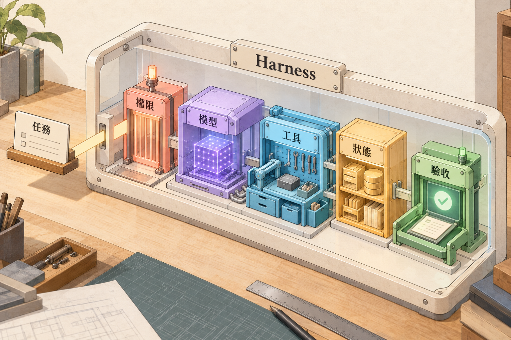

# Agent Engineering 2026

用通用原理、**自建 Agent harness** 與 **Codex runtime 對照**，準備 Agent 工程與系統設計面試。

適合已會程式、API 與 Git 的開發者。繁體中文教學，保留英文術語。每天約 2–3 小時，提供 14 天完整核心、7 天衝刺及跳章做題路線。

## 從這裡開始

- [14 天完整核心](paths/14-days.md)：每天一章，42 題必做。
- [7 天衝刺](paths/7-days.md)：每天兩章，28 題必做。
- [面試與跳章路線](paths/interview-and-jump.md)：依職能、題型或疑難直接開始。
- [84 題索引](maps/exercise-index.md)、[知識地圖](maps/knowledge-map.md)、[前置依賴圖](maps/dependencies.md)、[中英詞彙表](maps/glossary.md)。
- [第 15–28 天延伸安排](paths/further-study.md)。

## 目前交付與實作邊界

本版有 14 章正文、完整案例、設計取捨、84 題、分級提示、參考解答、面試追問、Codex 協作卡、3 張 Codex 生圖與各章機制圖。**Lab 只有規格，尚未建立或執行實作。**

後續推論以訂閱為主：既有 Codex 原生登入，或應用程式自己的 Sign in with ChatGPT plan usage OAuth＋Responses。自己的應用需獨立授權、符合資格與 preview 能力；不把原生登入、模型清單或官方文件當成該 app 已跑通的證據。[路線與限制](references/subscription-runtime.md)

配圖使用 Codex 內建 imagegen 製作。這和自建 Agent 的 Responses 工具能力是兩條不同路徑，不能據此假設訂閱 preview 支援 hosted image generation。

## 章節

| 章 | 主題 | 知識點 |
| --- | --- | --- |
| 01 | [Agent 與 Harness 全貌](chapters/foundations/01-agent-and-harness/README.md) | Agent, workflow, model, harness, runtime, environment, autonomy, acceptance |
| 02 | [LLM 與 Context Engineering](chapters/foundations/02-llm-and-context/README.md) | tokens, inference, instructions, structured outputs, context selection, compaction |
| 03 | [工具契約與 Agent-Friendly 介面](chapters/agent-core/03-tool-contracts/README.md) | function tools, schemas, validation, errors, authorization, idempotency, tool results |
| 04 | [Agent Loop、規劃與停止](chapters/agent-core/04-agent-loop-and-planning/README.md) | ReAct, plan-and-execute, routing, evaluator-optimizer, state machines, termination |
| 05 | [Retrieval 與 RAG](chapters/knowledge/05-retrieval-and-rag/README.md) | chunking, embeddings, lexical search, hybrid retrieval, reranking, grounding, freshness, ACL |
| 06 | [Memory、State 與恢復](chapters/knowledge/06-memory-and-state/README.md) | working memory, durable state, sessions, checkpoints, stores, retention, provenance |
| 07 | [Codex Runtime 與訂閱入口](chapters/codex-runtime/07-codex-runtime/README.md) | Codex CLI, exec, SDK, app-server, threads, turns, items, events, sandbox, approvals |
| 08 | [訂閱 OAuth、Responses 與自建 Harness](chapters/codex-runtime/08-subscription-oauth-and-harness/README.md) | SIWC, OAuth, PKCE, scopes, Responses API, SSE, custom harness, tool loop, token lifecycle |
| 09 | [MCP、Skills 與工具探索](chapters/protocols/09-mcp-skills-and-discovery/README.md) | MCP host client server, capabilities, resources, prompts, tools, AGENTS.md, Skills, discovery |
| 10 | [多 Agent、協調與 A2A](chapters/protocols/10-multi-agent-and-a2a/README.md) | delegation, handoff, agent-as-tool, ownership, shared state, A2A, Agent Card |
| 11 | [安全、信任邊界與人類控制](chapters/production/11-safety-and-trust/README.md) | prompt injection, least privilege, approval, data exfiltration, supply chain, audit, sandbox |
| 12 | [可靠性、冪等性與長任務恢復](chapters/production/12-reliability-and-recovery/README.md) | timeouts, bounded retry, idempotency, cancellation, checkpoints, compensation, durable execution |
| 13 | [Evals、Observability 與資源](chapters/production/13-evals-observability-and-budgets/README.md) | tasks, trials, graders, outcome, trace, regression, calibration, latency, tokens, quotas |
| 14 | [系統設計、案例整合與面試](chapters/synthesis/14-system-design-and-interviews/README.md) | requirements, architecture, tradeoffs, data flow, rollout, SLOs, interviews, evidence |

## 每章怎麼讀

依序讀正文與圖說、設計取捨，先自答 Q01／Q03／Q05；卡住才讀分級提示，修正後再看參考解答。Q02／Q04／Q06 是延伸比較、設計與未來 lab 規格。

每章都有最小前置摘要，可直接開始；建議前置是補讀導航，不要求先執行前章。個人答案可放 .study/，不會提交 Git。

## 為什麼這樣設計

- 通用概念先於產品名詞：能換 runtime，仍解釋責任與取捨。
- 把模型推論、工具執行、授權與完成驗收分開：容易診斷失敗與建立可測介面。
- 主題分類與獨立章節隔離：後續 lab 自帶環境、資料與驗收，不共用可變狀態。
- 題目、提示、解答分檔：支持先自答、逐步引導與模擬面試。
- 概念插畫配精確流程：先建立直覺，再核對狀態與邊界；圖片不當安全或執行證據。

## 時效、來源與證據

查證基線：2026-10-19。[來源與更新政策](references/sources.md)、[視覺編排與生圖紀錄](references/visual-policy.md)、[驗收紀錄](references/verification.md)。

核心知識地圖可追蹤與擴充；14 天目標是掌握核心設計及面試表達，延伸領域另有後續安排。合成教學案例清楚標示；設計、實作、測試與部署使用不同狀態。

## 授權

原創教材與本 repo 配圖採 [CC BY 4.0](LICENSE)。連結的第三方文件與論文仍依各自授權；本 repo 不重刊全文。
