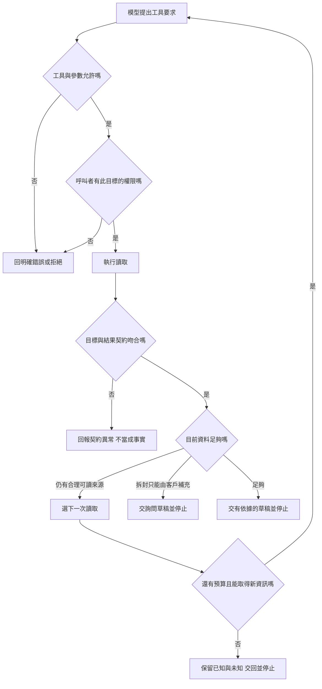

# 03 · 工具契約與 Agent-Friendly 介面：教學與案例

你請助理「讀 T-1042，幫我寫回覆草稿」。畫面轉了一下，只剩一行：

```text
success=true
```

你正要把結果交給客服，卻發現自己回答不了：讀到的是 T-1042 嗎？有沒有讀到包裝狀態？這個 success 是讀取成功，還是工單已被關掉？如果你現在說「已處理」，客服可能直接回覆一件根本還沒確認的事。

這是本章的合成場景。先沿著「確認讀了誰 → 保留缺漏 → 交出有限結論」讀到核心斷點；完整欄位表和分頁可以稍後回來查。

<a id="先抓住一個問題"></a>
<a id="把題目放到桌上"></a>

## 先別補答案，先讓工具回得清楚

你決定先不接受這個 success。不是因為你知道工具失敗，而是這份結果沒有足夠資訊讓你判斷。

眼前任務只准讀取和草稿。T-1042 的申請日是 2026-10-20，購買日是 10-08；現行 D14 要求相差不超過 14 天，還要未拆封。舊 D07 的 7 天規則已在 10/01 被取代。完整背景可回查[共同案例](../../../maps/course-story.md)。

現在先處理一個小問題：把「我要讀什麼」和「工具真的讀了什麼」對得起來。

<a id="完整走一次從要求到草稿"></a>

### 第一步：把要求縮成精確的工具候選

你把模糊的 execute(action=找工單) 換成 read_ticket(ticket_id=T-1042)。Tool 就是實際查資料的程式入口；名稱具體一點，模型便少猜一點。

這還不夠。有人填得出 T-1042，不代表他有權讀。工具服務必須根據真實呼叫者檢查可讀範圍，不能相信模型自填 is_admin=true。本輪沒有關單或退款授權，這兩種候選也必須在執行前被拒絕。

你正在補的，就是工具契約（contract）：要求怎樣填、由誰檢查、回來的東西能證明什麼。先不用一次寫完所有欄位，我們先看讀回的身分。

### 第二步：核對工具真的回了誰

新結果帶回 ticket_id=T-1042、revision=r3。這下你知道它指向哪個案件、哪一份資料。

**停 15 秒：**如果結果寫 status=ok，但 ticket_id=T-1043，你會先採用內容，還是先拒收？

應先拒收錯配結果並回報工具異常。內容再像，也不能當作 T-1042 的證據。status=ok 只代表這份契約定義的讀取完成，不會把別張工單變成正確目標。

revision=r3 也不是「永遠最新」的印章。它說明這次觀測屬於哪個版本；若讀的是快取，工具還得交代快取與取得時間。

### 第三步：把觀測轉成可用與待確認的欄位

日期讀到了，所以你能算出相差 12 天。再往下看，包裝欄位卻寫著 unknown。

這裡不用猜模型的意思。契約必須先約定：unknown 是「來源沒有提供可用判斷」；unopened 才是「來源明確記載未拆封」。兩者不能互換。

**停 20 秒：**如果資料沒填，工具卻自動補 opened=false，錯誤最早發生在哪裡？

是在工具轉換資料時。它把「不知道」改成「知道未拆封」，模型接著照假事實推論。只要求模型更謹慎，補不回已經被抹掉的缺漏。

修正時讓來源缺值保持 unknown，再檢查草稿是否仍要求確認包裝。若既有介面用 opened=null，也能成立，但必須說明 null 代表未知，而且途中不能補成 false。

現在已知日期條件符合；尚不知道拆封條件。工具回傳成功，與符合 D14 全部條件，仍是兩件事。

### 第四步：選本輪有授權的輸出並停止

你寫下：「您本次申請距購買日為 12 天，符合 D14 的天數條件；仍需確認商品是否未拆封，才能進一步判斷。請補充包裝狀態。」

這份草稿可以交付，因為它沒有替未知補答案。你沒有寄送、關單或退款；退貨判斷仍在等客戶補資料。本輪完成的是草稿，不是整張退貨流程。

如果模型這時提出 close_ticket，不是必經的下一步，而是額外的越權要求。執行層應拒絕，不因前面讀取成功就放行。

## 核心斷點：你已能指出 success 少了什麼

到這裡可以先做 [Q01](exercises/README.md#c03-q01) 或口答 [Q05](exercises/README.md#c03-q05)。不用先記完下面所有欄位。

如果今天在此停下，留下三行就能接回來：

- 我目前的判斷：讀到了 ______；還不知道 ______。
- 我想再弄懂：______。
- 下次接讀：下面的欄位契約／分頁段落，或題號 ______。

## 深挖入口：需要時再查，不要一次背完

接下來的表格補齊你剛用過的責任。它們是本教材的應用設計，不是特定產品要求的格式。上一章處理進模型的資料袋，本章把進貨口講清楚；下一章再決定什麼時候多讀一次、什麼時候停。

## 先把工具當成一張能照著辦的申請單

現在把剛才的 read_ticket 寫成可交接的契約。需要補齊用途、輸入、執行檢查、結果含義與錯誤下一步，別只留一個工具名稱。

本章先將 read_ticket 與 close_ticket、refund 分開。模型本輪只看到讀取工具，有助於減少誤選；但工具執行層也要拒絕沒有授權的寫入。隱藏按鈕能改善介面，不能取代後端檢查。

### 輸入：哪些由模型填，哪些不能相信它自報

| 欄位／資訊 | 來源 | 本例的約定 | 需要避免的猜測 |
| --- | --- | --- | --- |
| ticket_id | 模型提出 | 必填字串，如 T-1042 | 不接受「最近那張」讓工具任意挑選 |
| 呼叫者身分 | 受信任的執行環境 | 依已登入身分取得 | 不讓模型填 is_admin=true 決定權限 |
| 可用操作 | 受信任的任務授權 | 本輪只有讀取與草稿 | 不因 action 寫「退款」就算有權限 |
| request_id | 執行環境建立或驗證 | 用來對回一次要求與紀錄 | 它只便於追蹤，不代表業務已成功 |

ticket_id 的字樣正確，只是「表格填得像樣」。還必須檢查呼叫者可讀的案件範圍。下表將這些檢查分開，出錯才知道應修參數、權限還是資料。

### 執行：四層檢查不要混成一個 success

| 層次 | 問的問題 | 失敗範例 | 誰負責擋住 |
| --- | --- | --- | --- |
| 形狀與型別 | 必填欄位齊全嗎？型別正確嗎？ | ticket_id 漏填或是陣列 | 工具入口的參數驗證 |
| 值與目標 | ID 是否符合約定？目標是否存在？ | 工單不存在 | 工具服務；對外錯誤需遵守資訊揭露規則 |
| 授權 | 真正呼叫者可讀這張嗎？可寫嗎？ | 能讀 T-1042，但不能關單 | 執行層根據可信授權檢查 |
| 結果語意 | 回來的是要求的目標與足夠欄位嗎？ | 要 T-1042，卻回 T-1043 | 工具端保證、harness 再核對 |

實務上可能先做授權再查存在性，避免向無權限者洩露案件是否存在。上表是責任分類，不是規定所有系統必須照此順序執行。即使各層通過，「能讀」也沒有變成「可核准退貨」。業務結論仍要對照 D14。

### 輸出：看得出來源，也看得出不知道什麼

以下是虛構結果資料，不是已跑出的紀錄：

```json
{
  "request_id": "read-1042-01",
  "status": "ok",
  "ticket": {
    "ticket_id": "T-1042",
    "revision": "r3",
    "purchased_on": "2026-10-08",
    "requested_on": "2026-10-20",
    "packaging_state": "unknown"
  },
  "source": "synthetic-ticket-store"
}
```

status=ok 在這份契約中只表示讀取完成。revision 讓人知道這份觀測屬於哪個版本；它不是「永遠最新」的保證。source 讓後續能回查來源，也不是來源一定正確的證書。工具若會回快取，還應說清楚快取與取得時間，不把舊觀測寫成當前事實。

## unknown、空集合、false 到底差在哪裡

| 結果 | 能說什麼 | 不能說什麼 |
| --- | --- | --- |
| packaging_state=unknown | 來源沒有提供可用的包裝判斷 | 「未拆封」或「已拆封」 |
| packaging_state=unopened | 這份來源明確記載未拆封 | 所有其他退貨條件也都符合 |
| packaging_state=opened | 這份來源明確記載已拆封 | 可以忽略規則直接退款 |
| items=[]，查詢完成且沒有下一頁 | 在這次授權、條件與查詢範圍內沒有相符項目 | 整個商店從來沒有這種案件 |
| has_more=false | 依本次分頁契約，沒有下一頁 | 系統內沒有尚未同步或無權查看的資料 |
| 連線失敗，沒有 items | 這次沒有取得結果 | 相符項目數為零 |

如果一定要用布林 opened，必須另訂 unknown 的表示法。例如 null 明確代表未知，false 才代表已知未拆封。只留下 false／true，卻把沒填的資料自動補 false，會讓「不知道」偽裝成「條件符合」。列舉字串較長，但初學者比較不容易看反。

## 把責任路徑畫出來



這張圖有分支，不要求每次成功讀取後都嘗試寫入。如何避免反覆讀相同 r3，由下一章的 loop 負責。

## 名詞先換成人話

剛才已碰過的幾個詞，可以在這裡回查：Tool 是查資料或執行操作的入口；Contract 是輸入、結果與失敗的約定；Validation 是依不同規則檢查能否繼續。它們分別回答「做什麼」「怎麼對接」「能不能做」，不是三種同義詞。

Side effect 指外部狀態真的改變，例如關單；Pagination 則是資料分批交付。後者只在結果放不下或需分批查時登場，不是每次讀工單都必須翻頁。

## 深挖一：分頁是「這包還沒結束」，不是格式裝飾

現在換一個需要搜尋多張工單的任務。畫面一次只放得下部分結果，於是工具分批回傳，這叫分頁（pagination）。搜尋回 10 筆且 has_more=true、next_cursor=page-2，只能說已取得這一批 10 筆。若任務是「找出 T-1042」且已取得它，不一定需要掃完所有頁；若任務是「統計符合條件的全部工單」，就必須處理後續頁或明確交付部分結果。

| 觀測 | 下一步 | 完整性說法 |
| --- | --- | --- |
| 第 1 頁 10 筆，has_more=true | 原查詢條件不變，使用 page-2 續取 | 目前 10 筆，總數未確認 |
| 第 2 頁 4 筆，has_more=false | 核對跨頁 ID、查詢條件與快照後結束 | 共讀到 14 筆紀錄；僅在 14 個 ID 都不同且同一固定快照時，才能說該快照內有 14 個唯一項目 |
| 第 2 頁失敗 | 保留第 1 頁，有限重試或交回部分結果 | 已讀 10 筆，完整查詢未完成 |
| 第 2 頁重複第 1 頁且 cursor 不變 | 停止無進展循環，回報工具異常 | 不能因又收到 10 筆就累計成 20 |

10+4 只能先推出讀取了 14 筆紀錄，不能單靠筆數推出 14 個唯一結果。例如兩頁各自沒有重複，且第 2 頁恰有 1 筆 ID 與第 1 頁相同，去重後只剩 13 個。若翻頁期間資料增刪，即使已讀 ID 都不同，也不能把這個集合當成某個時間點的完整清單。上表的 14 筆只是另一個搜尋合成變體，不是 T-1042 的「14 天」。cursor 當作工具給的接續標記，不能臆測改成 page-99。若資料在翻頁間變動，還需由工具契約說明是否提供同一份查詢快照；否則不能保證是一個時間點的精確總數。

## 深挖二：錯誤名稱要能改變下一步

| 錯誤類型 | 已知什麼 | 合理下一步 | 停止條件 |
| --- | --- | --- | --- |
| invalid_input | 尚未按有效輸入執行 | 有可靠 ID 就修參數；沒有就詢問 | 無法取得必要欄位 |
| permission_denied | 目前身分不允許這個操作 | 停止該操作，說明需正當授權 | 不改 ID 或冒用身分繞過限制 |
| not_found | 在允許揭露的範圍內沒找到目標 | 請核對 ID；不自行選相似工單 | 無可靠替代 ID |
| temporary_unavailable | 讀取暫時沒完成 | 有限次退避後重試 | 達本輪次數／時間上限 |
| result_unknown | 寫入可能已做，未收到可靠結果 | 按操作紀錄與目標狀態查證 | 無法查證就交人工處理，不宣稱失敗 |

最後一列只是未來另獲授權寫入的契約變體，**本案例沒有寫入授權**。本章只要求分辨「不知道結果」與「確定沒做」，第 12 章再深入恢復。不要給模型一個 retryable=true 就任由它重送所有操作；是否重試還要看操作是否可能已生效。

## 反例與修正：格式漂亮仍會騙過自己

反例：工具回 {"success":true,"opened":false}，但 opened=false 其實是資料庫缺值被程式補出的預設。模型因此說「已確認未拆封，可以退貨」。問題的第一處在工具轉換，它已經把未知變成假事實；單純修改 prompt 效果有限。

修正：工具保留 unknown，輸出帶目標與版本。模型照來源說「天數符合，拆封未知」。驗收同時檢查原資料缺值、工具回傳未知、最終草稿不擅自核准，才覆蓋這條失敗路徑。

另一個反例是「既然 read_ticket 沒副作用，就無需權限檢查」。它仍可能洩露別人的地址或工單內容。修正是在真正讀取前核對可讀範圍，錯誤也不帶出未授權原文。

## 兩個初學者常問的問題

**一定要把所有欄位回給模型才完整嗎？** 不必。完整是對「這個任務需要的證據」而言。判斷本例需要日期與包裝狀態，不需要付款卡號。回必要欄位能減少資訊噪音與不必要揭露；若省略某條件，應標示未提供或提供續取方式，不能假裝條件已檢查。

**Schema 已經限制工具名稱與參數，為什麼後端還要驗證？** Schema 能降低格式錯誤，但它看不到真正的呼叫者權限，也不能保證外部資料仍是 r3。模型、其他客戶端或舊版本程式都可能發出不當要求。後端必須使用可信身分及當前資料做實際判斷，模型可見的描述只是操作說明。

## 接著做什麼

回到主線：我們已經能判斷讀回的是誰、缺什麼、能說到哪裡。還沒解決的是要不要再讀、下一輪換哪個來源。

先答 [Q01／Q03／Q05](exercises/README.md)，再用[設計取捨](design-notes.md)檢查介面拆分和完整性。核心產物是一份工具契約：精確輸入、可信授權來源、帶版本且保留未知的結果，以及能指向不同下一步的錯誤。

工具取得的資料已清楚，但接著要讀政策、提問還是停止？[下一章](../04-agent-loop-and-planning/README.md)把這些分支接成工作循環。本章不增加官方產品能力宣稱，Responses 的封裝與限制留給第 08 章。

## 來源與閱讀焦點

來源初查：2026-10-19；本次複核項目與日期見來源表。先讀來源中與本章名詞、責任及限制直接相關的段落；原始論文不要求第一輪讀完全部實驗。

- [S13 · Writing effective tools](https://www.anthropic.com/engineering/writing-tools-for-agents) — 第一方工程經驗；工具設計與可評估性
- [S06 · Preview limitations](https://developers.openai.com/siwc/token-sharing-open-source/preview-limitations) — 官方 preview；參數、工具與歷史限制，實作前必重查
- [S17 · OWASP Agentic Applications 2026](https://genai.owasp.org/resource/owasp-top-10-for-agentic-applications-for-2026/) — 社群風險框架；輔助 threat modeling，不是產品安全認證

進一步看[來源版本與更新政策](../../../references/sources.md)。
