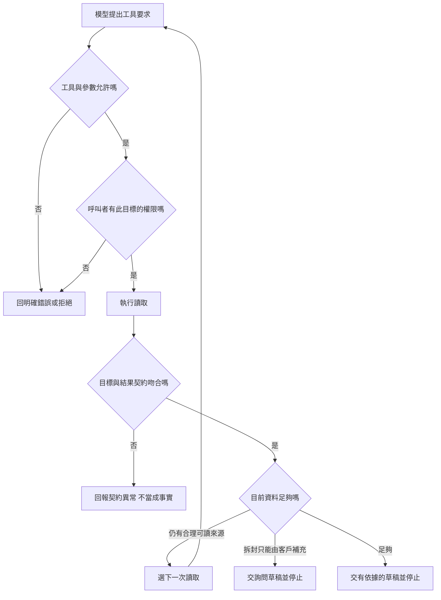

# 03 · 工具契約與 Agent-Friendly 介面：教學與案例

## 先抓住一個問題

**工具要怎樣說明輸入與結果，助理才不會讀錯、改錯或以為資料已完整？**

上一章在整理「交給模型的資料袋」。本章處理資料袋的進貨口：模型要求讀一張工單時，程式到底接收什麼、允許什麼、回來的東西能證明什麼？下一章才安排讀完之後的工作循環。

核心讀到「完整走一次」即可作答 Q01、Q03、Q05；分頁、錯誤表和設計取捨可作第二輪深挖。本章欄位都是教學設計，不是某家產品要求的 API 格式。

## 把題目放到桌上

本章沿用[共同合成案例](../../../maps/course-story.md)，不是法律建議或真實執行紀錄。

- 工單 T-1042，版本 r3；2026-10-08 購買、10-20 申請，相差 12 天。
- D14 自 10/01 生效，要求日期差不超過 14 天，**且商品未拆封**。舊 D07 的 7 天規則已被取代。
- r3 沒有記載是否拆封。使用者只准判斷及寫草稿，沒有寄送、關單、退款授權。
- 舊工具叫 execute，action 可以填「找工單」「關閉」「退款」，結果只有 success=true。

假設你收到 success=true，能知道讀到哪張工單嗎？能知道有沒有退款嗎？不能。這就是本章要消除的猜測。

## 名詞先換成人話

| 名詞 | 先用人話說 | 放進本例 |
| --- | --- | --- |
| Tool／工具 | 真正查資料或執行操作的程式入口 | read_ticket 讀工單 |
| Contract／契約 | 約好輸入、結果、權限、失敗與完整性 | ID 必填；結果帶同一 ID、版本和未知值 |
| Validation／驗證 | 按不同規則檢查可否繼續 | ID 格式正確後，仍要檢查是否可讀 |
| Side effect／副作用 | 外部狀態真的改變 | 關單、寄信、退款 |
| Pagination／分頁 | 大結果分批交付 | 第一批 10 筆，另有下一頁 |

## 先把工具當成一張能照著辦的申請單

工具名稱不是全部。完整說明至少要回答五件事：何時選這個工具、填哪些欄位、執行前由誰檢查、正常結果能證明什麼、失敗後該做什麼。只有「取得工單」四字，模型仍要猜能不能搜尋、能不能改狀態、空結果代表什麼。

本章先將 read_ticket 與 close_ticket、refund 分開。模型本輪只看到讀取工具，有助於減少誤選；但工具執行層也要拒絕沒有授權的寫入。隱藏按鈕能改善介面，不能取代後端檢查。

### 輸入：哪些由模型填，哪些不能相信它自報

| 欄位／資訊 | 來源 | 本例的約定 | 需要避免的猜測 |
| --- | --- | --- | --- |
| ticket_id | 模型提出 | 必填字串，如 T-1042 | 不接受「最近那張」讓工具任意挑選 |
| 呼叫者身分 | 受信任的執行環境 | 依已登入身分取得 | 不讓模型填 is_admin=true 決定權限 |
| 可用操作 | 受信任的任務授權 | 本輪只有讀取與草稿 | 不因 action 寫「退款」就算有權限 |
| request_id | 執行環境建立或驗證 | 用來對回一次要求與紀錄 | 它只便於追蹤，不代表業務已成功 |

ticket_id 的字樣正確，只是「表格填得像樣」。還必須檢查呼叫者可讀的案件範圍。下表將這些檢查分開，出錯才知道應修參數、權限還是資料。

### 執行：四層檢查不要混成一個 success

| 層次 | 問的問題 | 失敗範例 | 誰負責擋住 |
| --- | --- | --- | --- |
| 形狀與型別 | 必填欄位齊全嗎？型別正確嗎？ | ticket_id 漏填或是陣列 | 工具入口的參數驗證 |
| 值與目標 | ID 是否符合約定？目標是否存在？ | 工單不存在 | 工具服務；對外錯誤需遵守資訊揭露規則 |
| 授權 | 真正呼叫者可讀這張嗎？可寫嗎？ | 能讀 T-1042，但不能關單 | 執行層根據可信授權檢查 |
| 結果語意 | 回來的是要求的目標與足夠欄位嗎？ | 要 T-1042，卻回 T-1043 | 工具端保證、harness 再核對 |

實務上可能先做授權再查存在性，避免向無權限者洩露案件是否存在。上表是責任分類，不是規定所有系統必須照此順序執行。即使各層通過，「能讀」也沒有變成「可核准退貨」。業務結論仍要對照 D14。

### 輸出：看得出來源，也看得出不知道什麼

以下是虛構結果資料，不是已跑出的紀錄：

```json
{
  "request_id": "read-1042-01",
  "status": "ok",
  "ticket": {
    "ticket_id": "T-1042",
    "revision": "r3",
    "purchased_on": "2026-10-08",
    "requested_on": "2026-10-20",
    "packaging_state": "unknown"
  },
  "source": "synthetic-ticket-store"
}
```

status=ok 在這份契約中只表示讀取完成。revision 讓人知道這份觀測屬於哪個版本；它不是「永遠最新」的保證。source 讓後續能回查來源，也不是來源一定正確的證書。工具若會回快取，還應說清楚快取與取得時間，不把舊觀測寫成當前事實。

## unknown、空集合、false 到底差在哪裡

| 結果 | 能說什麼 | 不能說什麼 |
| --- | --- | --- |
| packaging_state=unknown | 來源沒有提供可用的包裝判斷 | 「未拆封」或「已拆封」 |
| packaging_state=unopened | 這份來源明確記載未拆封 | 所有其他退貨條件也都符合 |
| packaging_state=opened | 這份來源明確記載已拆封 | 可以忽略規則直接退款 |
| items=[]，查詢完成且沒有下一頁 | 在這次授權、條件與查詢範圍內沒有相符項目 | 整個商店從來沒有這種案件 |
| has_more=false | 依本次分頁契約，沒有下一頁 | 系統內沒有尚未同步或無權查看的資料 |
| 連線失敗，沒有 items | 這次沒有取得結果 | 相符項目數為零 |

如果一定要用布林 opened，必須另訂 unknown 的表示法。例如 null 明確代表未知，false 才代表已知未拆封。只留下 false／true，卻把沒填的資料自動補 false，會讓「不知道」偽裝成「條件符合」。列舉字串較長，但初學者比較不容易看反。

## 完整走一次：從要求到草稿

### 第一步：把要求縮成精確的工具候選

模型提出 read_ticket，ticket_id=T-1042。harness 先核對本輪可用工具與參數；工具服務再根據真實呼叫者檢查讀取權。此處沒有 close_ticket 的必要，也沒有權限。

### 第二步：核對工具真的回了誰

回傳 ID=T-1042、revision=r3。若回 T-1043，即使 status=ok 也不能當作 T-1042 的證據。應拒收錯配結果並回報工具契約異常，不用模型「大概猜」內容相近。

### 第三步：把觀測轉成可用與待確認的欄位

日期有值，可以依本案例算法算出 12 天。packaging_state=unknown，不能轉成 unopened。再搭配已讀取的 D14：天數條件符合，拆封條件仍缺資料。這裡是模型／應用的業務判斷；read_ticket 不需要越界替你核准退款。

### 第四步：選本輪有授權的輸出並停止

可交付的草稿是：「您本次申請距購買日為 12 天，符合 D14 的天數條件；仍需確認商品是否未拆封，才能進一步判斷。請補充包裝狀態。」

| 項目 | 本輪結束時留下什麼 |
| --- | --- |
| 已確認 | T-1042 r3、兩日期、差 12 天、使用 D14 |
| 未確認 | 是否未拆封 |
| 已交付 | 有條件的客服回覆草稿 |
| 沒有做 | 寄送、關單、退款 |
| 停止原因 | 已讀來源沒有拆封資訊，需客戶補充 |

如果模型此時提出 close_ticket，不是「流程的下一站」，而是額外的越權候選；執行層拒絕它。本輪交付完成與整張退貨完成是兩個不同結論。



這張圖有分支，不要求每次成功讀取後都嘗試寫入。如何避免反覆讀相同 r3，由下一章的 loop 負責。

## 深挖一：分頁是「這包還沒結束」，不是格式裝飾

搜尋回 10 筆且 has_more=true、next_cursor=page-2，只能說已取得這一批 10 筆。若任務是「找出 T-1042」且已取得它，不一定需要掃完所有頁；若任務是「統計符合條件的全部工單」，就必須處理後續頁或明確交付部分結果。

| 觀測 | 下一步 | 完整性說法 |
| --- | --- | --- |
| 第 1 頁 10 筆，has_more=true | 原查詢條件不變，使用 page-2 續取 | 目前 10 筆，總數未確認 |
| 第 2 頁 4 筆，has_more=false | 核對跨頁 ID、查詢條件與快照後結束 | 共讀到 14 筆紀錄；僅在 14 個 ID 都不同且同一固定快照時，才能說該快照內有 14 個唯一項目 |
| 第 2 頁失敗 | 保留第 1 頁，有限重試或交回部分結果 | 已讀 10 筆，完整查詢未完成 |
| 第 2 頁重複第 1 頁且 cursor 不變 | 停止無進展循環，回報工具異常 | 不能因又收到 10 筆就累計成 20 |

10+4 只能先推出讀取了 14 筆紀錄，不能單靠筆數推出 14 個唯一結果。例如兩頁各自沒有重複，且第 2 頁恰有 1 筆 ID 與第 1 頁相同，去重後只剩 13 個。若翻頁期間資料增刪，即使已讀 ID 都不同，也不能把這個集合當成某個時間點的完整清單。上表的 14 筆只是另一個搜尋合成變體，不是 T-1042 的「14 天」。cursor 當作工具給的接續標記，不能臆測改成 page-99。若資料在翻頁間變動，還需由工具契約說明是否提供同一份查詢快照；否則不能保證是一個時間點的精確總數。

## 深挖二：錯誤名稱要能改變下一步

| 錯誤類型 | 已知什麼 | 合理下一步 | 停止條件 |
| --- | --- | --- | --- |
| invalid_input | 尚未按有效輸入執行 | 有可靠 ID 就修參數；沒有就詢問 | 無法取得必要欄位 |
| permission_denied | 目前身分不允許這個操作 | 停止該操作，說明需正當授權 | 不改 ID 或冒用身分繞過限制 |
| not_found | 在允許揭露的範圍內沒找到目標 | 請核對 ID；不自行選相似工單 | 無可靠替代 ID |
| temporary_unavailable | 讀取暫時沒完成 | 有限次退避後重試 | 達本輪次數／時間上限 |
| result_unknown | 寫入可能已做，未收到可靠結果 | 按操作紀錄與目標狀態查證 | 無法查證就交人工處理，不宣稱失敗 |

最後一列只是未來另獲授權寫入的契約變體，**本案例沒有寫入授權**。本章只要求分辨「不知道結果」與「確定沒做」，第 12 章再深入恢復。不要給模型一個 retryable=true 就任由它重送所有操作；是否重試還要看操作是否可能已生效。

## 反例與修正：格式漂亮仍會騙過自己

反例：工具回 {"success":true,"opened":false}，但 opened=false 其實是資料庫缺值被程式補出的預設。模型因此說「已確認未拆封，可以退貨」。問題的第一處在工具轉換，它已經把未知變成假事實；單純修改 prompt 效果有限。

修正：工具保留 unknown，輸出帶目標與版本。模型照來源說「天數符合，拆封未知」。驗收同時檢查原資料缺值、工具回傳未知、最終草稿不擅自核准，才覆蓋這條失敗路徑。

另一個反例是「既然 read_ticket 沒副作用，就無需權限檢查」。它仍可能洩露別人的地址或工單內容。修正是在真正讀取前核對可讀範圍，錯誤也不帶出未授權原文。

## 兩個初學者常問的問題

**一定要把所有欄位回給模型才完整嗎？** 不必。完整是對「這個任務需要的證據」而言。判斷本例需要日期與包裝狀態，不需要付款卡號。回必要欄位能減少資訊噪音與不必要揭露；若省略某條件，應標示未提供或提供續取方式，不能假裝條件已檢查。

**Schema 已經限制工具名稱與參數，為什麼後端還要驗證？** Schema 能降低格式錯誤，但它看不到真正的呼叫者權限，也不能保證外部資料仍是 r3。模型、其他客戶端或舊版本程式都可能發出不當要求。後端必須使用可信身分及當前資料做實際判斷，模型可見的描述只是操作說明。

## 接著做什麼

先答 [Q01／Q03／Q05](exercises/README.md)，再用[設計取捨](design-notes.md)檢查介面拆分和完整性。核心產物是一份工具契約：精確輸入、可信授權來源、帶版本且保留未知的結果，以及能指向不同下一步的錯誤。

工具取得的資料已清楚，但接著要讀政策、提問還是停止？[下一章](../04-agent-loop-and-planning/README.md)把這些分支接成工作循環。本章不增加官方產品能力宣稱，Responses 的封裝與限制留給第 08 章。

## 來源與閱讀焦點

來源初查：2026-10-19；本次複核項目與日期見來源表。先讀來源中與本章名詞、責任及限制直接相關的段落；原始論文不要求第一輪讀完全部實驗。

- [S13 · Writing effective tools](https://www.anthropic.com/engineering/writing-tools-for-agents) — 第一方工程經驗；工具設計與可評估性
- [S06 · Preview limitations](https://developers.openai.com/siwc/token-sharing-open-source/preview-limitations) — 官方 preview；參數、工具與歷史限制，實作前必重查
- [S17 · OWASP Agentic Applications 2026](https://genai.owasp.org/resource/owasp-top-10-for-agentic-applications-for-2026/) — 社群風險框架；輔助 threat modeling，不是產品安全認證

進一步看[來源版本與更新政策](../../../references/sources.md)。
