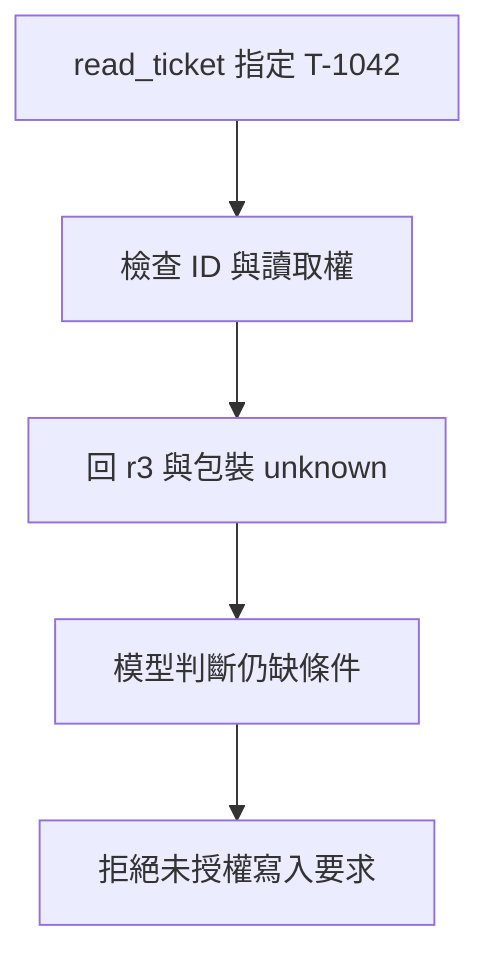

# 03 · 工具契約與 Agent-Friendly 介面：教學與案例

## 先抓住一個問題

**工具要怎樣說明輸入與結果，助理才不會讀錯、改錯或以為資料已完整？**

上一章決定資料袋內容。這章讓模型透過明確工具取得資料，避免用一個模糊的 execute 指令包辦所有事。

## 把題目放到桌上

T-1042 仍只准讀取與交草稿。現有工具叫 execute，action 可以填『找工單』『關閉』『退款』；結果只有 success=true，看不出實際讀了誰或是否還有下一頁。

這是虛構教材案例，不是法律建議、真實客服紀錄或執行證據。完整設定見[共同案例](../../../maps/course-story.md)。

讀這章時先想：手上已知什麼、還缺什麼、誰能做哪個動作？不要急著把每個英文名詞都背起來。

本課基礎資料：T-1042 r3；10/08 到 10/20 相差 12 天。D14 要求日期差不超過 14 天且未拆封；r3 的包裝狀態未知。原任務只讀與寫草稿。本章或題目若另述變體，只有明示條件改變。

## 名詞先換成人話

| 名詞 | 先用人話說 | 放進本例 |
| --- | --- | --- |
| Tool／工具 | 真正去讀檔、查資料或做操作的程式入口。 | read_ticket 讀工單。 |
| Contract／契約 | 約好要給什麼、回什麼、失敗怎麼表示。 | ticket_id 必填，回傳同一 ID 與資料版本。 |
| Validation／驗證 | 程式依規則檢查要求。 | ID 存在、使用者可讀，才查資料。 |
| Side effect／副作用 | 除了回文字，外部狀態真的變了。 | 關單、寄信或退款。 |
| Pagination／分頁 | 資料分批取回。 | 回 10 筆之外，告訴你還有下一頁。 |

## 工具名稱就是助理的操作選單

execute(action) 把讀取和退款混在一起，難以知道會做什麼，也難以分別授權。先用 read_ticket、read_policy 這類明確名稱，讓模型知道什麼時候選它，讓程式知道該檢查哪些條件。

## 一份讀取結果應該讓人回答什麼

對 read_ticket(T-1042)，至少要知道：實際讀的是 T-1042、資料版本 r3、兩個日期，以及拆封欄位是未知。不能用空字串讓模型猜是「未拆封」還是「沒填」。這些是應用自己的教學欄位，不是某家 API 規定的格式。

## 格式檢查之後還有權限與業務檢查

模型填了合法 ID，不代表它可讀任何人的案件。工具必須依真正呼叫者檢查權限；寫入還要確認授權與目前版本。readOnly 之類說明能幫模型選工具，但只有執行程式真的拒絕寫入，才有控制效果。

## 錯誤要告訴下一步，而不是只回失敗

缺欄位可以修參數；無權限應停止或走正當授權；暫時讀取失敗可以有限重試；寫入逾時則可能結果未知，要先查狀態。回傳清楚的種類與追蹤 ID，能讓助理選下一步；不要把憑證或未授權原文帶進錯誤訊息。

本章先設計工具行為，至於訂閱 Responses 要如何封裝 function/custom tools，留到第 08 章按當時支援介面對照。

## 完整走一次

| 步驟 | 發生什麼 | 為什麼這樣處理 |
| --- | --- | --- |
| 要求 | read_ticket；ticket_id=T-1042 | ID 明確，不接受任意命令字串。 |
| 執行前 | 檢查可讀工單範圍 | 可讀不代表可關閉。 |
| 正常結果 | T-1042、r3、10/08、10/20、拆封未知 | 模型看得出目標和缺漏。 |
| 例外結果 | 查無工單／無權限／暫時失敗分開 | 每種情況的下一步不同。 |

**這章要留下的產物：**讀取結果能對回 T-1042 與 r3，清楚寫出拆封未知；任何關單候選要求都因本輪只有讀取授權而被拒絕。

工具回得越清楚，模型越少需要猜。精確 ID 與版本也讓之後的核准、重試和讀回能指向同一件事。

## 用流程核對責任

圖的重點是「回 r3 與包裝 unknown」接到「模型判斷仍缺條件」時需要哪些證據。請對照上表，說明少了這一步會造成什麼誤判。

## 接著做什麼

先做[Q01／Q03／Q05](exercises/README.md)，保留自己的第一版答案。遇到疑難先看[設計取捨](design-notes.md)，需要才開提示。

工具取得的資料已清楚，但讀完之後下一步怎麼選、何時停？下一章安排整個工作循環。

## 來源與閱讀焦點

來源初查：2026-10-19；本次複核項目與日期見來源表。先讀來源中與本章名詞、責任及限制直接相關的段落；原始論文不要求第一輪讀完全部實驗。

- [S13 · Writing effective tools](https://www.anthropic.com/engineering/writing-tools-for-agents) — 第一方工程經驗；工具設計與可評估性
- [S06 · Preview limitations](https://developers.openai.com/siwc/token-sharing-open-source/preview-limitations) — 官方 preview；參數、工具與歷史限制，實作前必重查
- [S17 · OWASP Agentic Applications 2026](https://genai.owasp.org/resource/owasp-top-10-for-agentic-applications-for-2026/) — 社群風險框架；輔助 threat modeling，不是產品安全認證

進一步看[來源版本與更新政策](../../../references/sources.md)。
