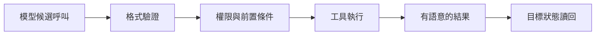

# 03 · 工具契約與 Agent-Friendly 介面

[章節入口](README.md) · [設計取捨](design-notes.md) · [練習](exercises/README.md)

## 本章完整案例

工單工具只有一個 action 字串，允許搜尋、讀取、關閉與退款。呼叫後一律回傳 success=true；結果太長時直接截掉尾端，模型無法知道是否還有資料。

案例與練習軌跡為合成教學資料，沒有執行真實業務操作。

## 為何工具是 Agent 的操作介面

模型只能根據名稱、說明、參數與結果選擇動作。讓工具一次處理一個清楚的工作單位，比把任意命令包在 action 字串更容易選擇、測試與授權。例如 search_tickets 與 close_ticket 的副作用不同，應能分別受限。

## 輸入與輸出都需要契約

輸入說明應包含必要欄位、型別、單位、可接受值與前置條件。模型生成符合 schema 的參數後，伺服器仍須驗證資源存在、使用者權限與業務狀態。輸出要包含穩定 ID、可用的資料、分頁或截斷訊號，以及操作到底處於哪個狀態。

## 執行成功、查無資料與未知結果

查無結果是有效觀測，不一定是錯誤。參數錯誤可提示如何修正；權限不足不應以換個參數繞過。逾時可能意味結果未知，需查詢 operation ID 或目標狀態。把所有情況壓成 success=false 會讓模型只能盲目重試。

## 名稱與資料量也是可靠性設計

命名應具體、少重疊，說明什麼時候不該使用。結果過大時使用分頁、摘要與可回讀的位置；只默默截斷會讓模型以不完整資料做完整結論。保留 request ID 便於追蹤，但 token、內部憑證與未授權資料不應出現在結果中。

## 政策應靠執行邊界

readOnly 或 destructive 等描述有助規劃，不能替代真正的權限與業務檢查。即使模型或工具說明被誤導，執行層仍應拒絕超出授權的操作。訂閱 Responses preview 目前對 function/custom tool 的封裝有要求；未來實作前依官方文件確認 namespaces 或 additional_tools。

## 用案例走一次

把工單功能拆成讀取與副作用介面；close_ticket 要精確工單 ID、預期狀態與操作 ID。回傳區分已套用、待確認與拒絕，讀取工具則回傳結果與 next cursor。當關閉要求逾時，先讀回工單與操作狀態，再決定後續。

## 精確機制圖

這張圖呈現本章需要討論的責任或狀態。實際功能、權限與可用性依所選 runtime、安裝版本及帳號驗證。

## 三個帶走的問題

- 能把工具輸入、執行與結果設計成可驗證契約：你會怎麼向另一位工程師說明？
- 能讓模型看見有用錯誤而不暴露機密：需要哪些證據才能判斷？
- 如果模型的建議錯誤，哪一層應阻止錯誤擴大？

## 來源與閱讀焦點

查證基線：2026-10-19。先讀來源中與本章名詞、責任及限制直接相關的段落；原始論文不要求第一輪讀完全部實驗。

- [S13 · Writing effective tools](https://www.anthropic.com/engineering/writing-tools-for-agents) — 第一方工程經驗；工具設計與可評估性
- [S06 · Preview limitations](https://developers.openai.com/siwc/token-sharing-open-source/preview-limitations) — 官方 preview；參數、工具與歷史限制，實作前必重查
- [S17 · OWASP Agentic Applications 2026](https://genai.owasp.org/resource/owasp-top-10-for-agentic-applications-for-2026/) — 社群風險框架；輔助 threat modeling，不是產品安全認證

進一步看[來源版本與更新政策](../../../references/sources.md)。
