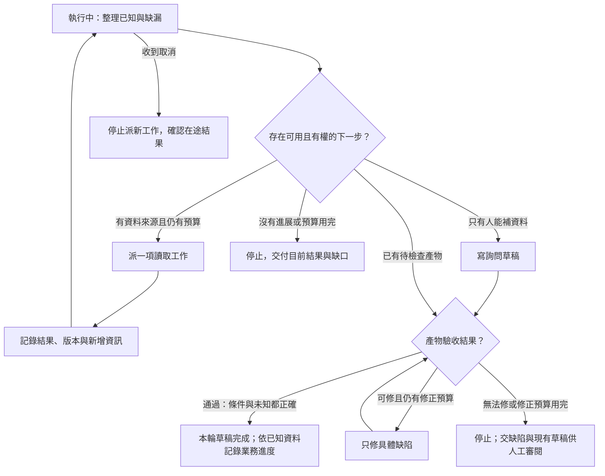

# 04 · Agent Loop、規劃與停止：教學與案例

螢幕第三次顯示同一行：

> T-1042 · r3 · 拆封狀態：未知

助理還在轉圈：「我再讀一次看看。」你原本只想拿到回覆草稿，現在卻得決定要讓它繼續，還是叫它換一條路。放著不管，可能只是多花幾次查詢；更糟的是，它最後把「一直查不到」寫成「應該沒拆封」。

這是本章的合成場景。先不急著替它加最大輪數，先看這一次重讀究竟能帶回什麼。

## 核心問題與讀法

沿著四個場景走：**重讀沒有變 → 換成可做的工作 → 檢查草稿 → 留下停點**。第一次先讀到「把結果交給下一輪」；後面的狀態圖、完整事件表和模式比較可以稍後查。

## 跳章也能看懂的資料

你接的是一張退貨工單。10 月 8 日購買、10 月 20 日申請，差 12 天。現行 D14 要求「不超過 14 天，而且未拆封」，但工單沒記是否拆封。

使用者只准你判斷並寫草稿，不是寄出、關單或退款。其他合法可讀紀錄也沒有這個欄位，只有客戶能補。完整日期、版本與舊規則見[共同案例](../../../maps/course-story.md)。

第 03 章幫我們把工具結果說清楚；現在要決定，這份結果值得接哪個動作。

## 場景一：再按一次讀取，會多知道什麼？

先停十秒，替下一次查詢補一句理由：

> 「我預期它會新增＿＿，因為＿＿。」

「也許會有答案」還不算理由。如果來源沒換、資料沒更新、欄位也相同，按第四次讀取並不會讓客戶突然填好資料。此刻已知的不是「未拆封」，而是「這個來源不能回答拆封問題」。

這就是判斷有沒有 **progress／進展**：下一個動作是否可能補上指定缺漏，或讓產物達到一項可檢查的要求。文字變長、模型語氣更確定，都不是這裡要的進展。

你可以先拒絕這次重讀，再找合法的新來源。若沒有，就換成詢問草稿。反過來說，如果同版工單還有一個你沒讀過的必要欄位，讀它仍可能有價值；不能只靠 r3 沒變就一律判停。

把輪數由 10 加到 20，沒有解決這個問題。它只是讓沒有新資訊的工作更晚結束。

## 場景二：停止重查，仍有一件事值得做

現在已確定：12 天符合天數條件，拆封仍未知，而且沒有別的合法來源。你不需要替客戶猜答案，可以先寫一份詢問草稿。

這一輪「看結果，再選下一步」的安排叫 **Agent loop／工作循環**。循環不表示一直呼叫工具；改為提問、交付或停止，也都是結果影響下一步的表現。這個簡單案例甚至可用固定 workflow 寫出，不必讓模型重新規劃每個動作。

在派工前，你的控制程式要問的是：「要補哪個缺口？這個動作為何可能補上？有權做嗎？還有額度嗎？」模型可以提議，不能替自己解除限制。

這裡也沒有必要先跳去等待核准。缺的是客戶事實，核准不會把未知變成未拆封。只有另行提出的具體寫入任務，才需要檢查它所缺的授權。

## 場景三：草稿出來了，先別按完成

助理交出第一版：

> 申請相隔 12 天，已符合退貨條件。

先停十秒：這份草稿缺的是新資料，還是一個用現有資料就能修正的句子？

D14 的未拆封條件已經在手上，所以這個過度承諾可以修。修正指令應具體到「補上拆封尚待確認，移除已符合的承諾」，而不是叫它籠統地再想想。

修改後可以是：

> 依本店 D14 規則，申請相隔 12 天，符合天數條件；仍需確認商品未拆封。請問商品目前是否已拆封？收到回覆後可再確認退貨資格。

接著重查兩項：有沒有保留未知？有沒有聲稱已核准或已寄送？通過才能標草稿完成。如果修完仍不對，而且修正額度已用完，就連同缺陷交人工審閱，不可把「停止」偷換成「通過」。

即使每次都有明確缺陷，修正也不能無限繼續。你可以先設「最多兩次草稿修正」這類教學上限；具體數字要按任務調整，不是產品預設。工具次數與執行期限也要由控制程式在派工前檢查。

## 先把兩個「完成」拆開

現在客服拿到一份可用草稿，這輪交付完成了。但客戶尚未回答拆封問題，退貨資格仍待確認。

記錄應能讀成兩句人話：「詢問草稿已交付」「業務等待拆封資料」。再留一個停止原因：目前需要客戶提供新資訊。沒有發信工具的結果，就不能寫「已詢問客戶」。

如果某題明示改成「已確認未拆封」，那題的業務判斷就不同，不要照抄等待資料。即使兩條件都符合，草稿完成仍不代表已寄送、關單或退款。

## 把結果交給下一輪

離開前留下一張短便條：T-1042 r3，採用 D14；12 天符合，拆封未知；詢問草稿放在哪裡；本輪為何停止；沒有外部寫入。

這份便條是 **state／狀態** 的一部分，讓下一輪知道接哪裡，不是要它盲目沿用舊結論。客戶回覆後，先重新核對工單版本與授權，再接續判斷。第 06 章會處理怎麼保存與更新它。

若只讀到這裡，已能先做 [Q01](exercises/README.md#c04-q01)。第 05 章會把「讀政策」拆成找來源與挑有效版本；下面則保留你設計控制器時會需要的細節。

## 深挖：把故事變成可查的設計

### 可見狀態機：每個箭頭都需要條件

**Transition／轉移** 就是事件發生後允許去哪裡。圖中的驗收分支對應剛才的第一版草稿：失敗可修就回修，無法修才帶缺陷停止，不能直接走到完成。

每次派工前都要重新檢查權限與預算。主案例通過後，業務仍等待拆封資料；資料完整變體則依實際已知條件記錄，不硬標等待。

取消是另一個出口：先停止新派工，已送出的工作則保留追蹤與結果。結果未知就記未知，不能從 cancelled 推論外部操作已撤回。更完整的恢復問題留到第 12 章。

展開：完整事件表與欄位對照

### 完整事件表

| 事件 | 觀測 | 判斷後的動作 |
| --- | --- | --- |
| 接任務 | T-1042，只讀與草稿 | 取得工單與政策 |
| 讀工單 | r3；差 12 天；拆封未知 | 保留缺漏，讀適用規則 |
| 讀政策 | D14；≤14 天且未拆封 | 日期符合，另一條件待確認 |
| 檢查來源範圍 | 無其他合法拆封來源 | 產生詢問草稿，不重查 |
| 驗第一版 | 漏未拆封條件 | 只修過度承諾 |
| 重驗通過 | 條件、未知、問題都有 | 交付並記等待資料 |

兩個獨立讀取可並行，表格不是強制順序。檢查來源範圍也不一定需要新工具；若已有可信目錄和契約，便可知道欄位不存在。

### 名詞先換成人話

| 名詞 | 本章的可見對應 |
| --- | --- |
| Agent loop | 讀取結果影響下一個動作，包含停止 |
| State | 已知、未知、產物與進度 |
| Transition | 例如草稿驗收通過才進完成 |
| Progress | 新增必要資訊或修好指定缺陷 |
| Stop reason | 為何停止派新工作，不是成功的同義詞 |

這些是教學欄位和設計用語，不是某家 API 的固定格式。完整時間版本為：2026-10-08 到 10-20；D14 自 10-01 取代舊 7 天規則 D07。

### 上限要放在哪裡？

可先以合成設定練習：6 次工具派工、2 次草稿修正、30 秒執行時間；同查詢連續兩次沒新增資訊時檢查停滯。這些不是通用最佳值。

先保留下一次工作的額度，再派工。用完時交付目前結果、缺陷與停止原因，不標成通過。人類等待另算：本章選擇在等客戶時結束本輪，回覆到達再開新輪，不讓執行時間計到幾天後。

派工前的理由只需可見摘要，例如「來源已讀，缺客戶拆封資訊，改交詢問草稿」。不要求模型揭露隱藏思考鏈。

## 深挖：四種安排工作的方式怎麼選

回頭看剛才的路徑，若任務與兩個來源都固定，簡單分支已足夠。下列模式是在遇到不同選擇時幫忙，不是必須全部加入的四個 Agent。

| 模式 | 何時派上用場 | 避免的誤用 |
| --- | --- | --- |
| Routing／分流 | 先把退貨問題送到政策流程 | 無法分類時別硬塞進一類 |
| Plan-and-execute | 來源大致已知，先安排讀取與草稿 | 發現未知後不能死守「最後核准」 |
| ReAct | 讀到 D07 才發現需要再找有效版本，依觀測改路 | 不是無目的多查幾次 |
| Evaluator-optimizer | 指出漏條件，再有限修正產物 | 不是一直說「再好一點」 |

模式可以組合。若為每個確定的小動作增加一次模型往返，可能只讓流程更慢、更難追查。驗收看是否正確選路與停止，不看模式名稱有幾個。這是工程模式的教學整理，來源的研究與經驗範圍見文末。

## 初學者常問

### 一次沒變就停，會不會太早？

先問下一次為何會變。已知稍後同步、暫時網路錯誤，都可能值得有限等待或重試；成功讀取卻永久缺欄位，則需要人或新來源。本題是後者。相同版本若帶回新欄位仍算進展，所以不要只比較 r3 字串。

### 模型自己說答案很好，能當評估結果嗎？

先把「好」換成可查標準：D14 兩條件都在、未知沒補成事實、沒聲稱寄送。自評只能當建議，是否通過要對照標準與來源。外部效果則查工具結果。第 13 章再擴成批量評估。

### 計畫越完整是不是越可靠？

計畫描述預期路徑，工具結果才告訴你現況。缺資料時應改成交詢問草稿；不為守住計畫而虛構條件。能依新資料改路，同時守住權限與上限，才是這章要練的能力。

## 接著做什麼

先做 [Q01／Q03／Q05](exercises/README.md)，需要挑戰方案時再讀[設計取捨](design-notes.md)。不必一次做完全部。

下次從這裡接：

- 我目前判斷下一個動作應是：＿＿。
- 我還沒分清的問題是：＿＿。
- 下次回到的段落或 QID：＿＿。

## 來源與閱讀焦點

來源初查：2026-10-19；本次複核項目與日期見來源表。先讀來源中與本章名詞、責任及限制直接相關的段落；原始論文不要求第一輪讀完全部實驗。

- [S14 · Building effective agents](https://www.anthropic.com/engineering/building-effective-agents) — 第一方架構經驗；workflow 與 Agent 模式
- [S19 · ReAct](https://arxiv.org/abs/2210.03629) — 原始研究；理解互動式推理與行動，不要求揭露隱藏思考鏈
- [S15 · Effective harnesses for long-running agents](https://www.anthropic.com/engineering/effective-harnesses-for-long-running-agents) — 第一方實驗；跨 session 增量工作與交接

進一步看[來源版本與更新政策](../../../references/sources.md)。
