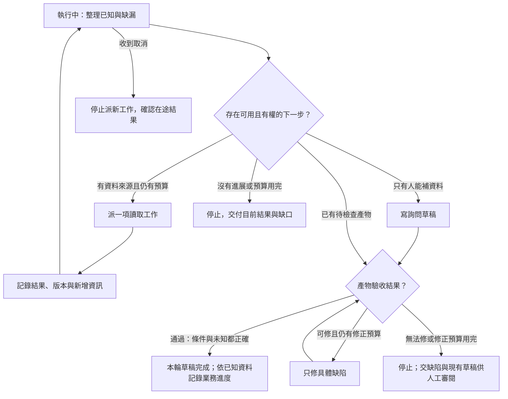

# 04 · Agent Loop、規劃與停止：教學與案例

## 核心問題與讀法

**讀完一份資料後，助理憑什麼選下一步，又憑什麼停？**

第 03 章讓工具結果說清楚「讀的是誰、哪個版本、有哪些未知」。這章把結果接到決策：拿到 r3 不是流程的終點，但也不是必須再叫一次模型或工具的理由。

核心讀到「把結果交給下一輪」即可，約 45 分鐘。後面的機制比較與疑問是深挖，約 20 分鐘。全章都是設計推導與合成資料，不是已執行的軌跡。

## 跳章也能看懂的資料

T-1042 r3：2026-10-08 購買、10-20 申請，相差 12 天。D07 是已被取代的 7 天規則；2026-10-01 生效的 D14 要求「不超過 14 天，且未拆封」。r3 的拆封欄位是未知。使用者只要條件判斷與回覆草稿，沒有寄送、關單、退款授權。

完整設定見[共同案例](../../../maps/course-story.md)。本章額外給一個觀察：合法可讀的工單來源沒有拆封資訊，只有客戶能補。不能把不知道改成未拆封，也不能把客戶尚未回覆當成工具錯誤。

## 名詞先換成人話

| 名詞 | 先用人話說 | 在本例負責什麼 |
| --- | --- | --- |
| Agent loop | 看目前資料、選動作、執行、更新，再判斷要不要繼續 | 讀到拆封未知後改為詢問 |
| State／狀態 | 此刻確定的事、缺的事、正在做的事 | 已讀 r3，尚缺拆封資訊 |
| Transition／轉移 | 某事件發生後，允許從哪個狀態走去哪裡 | 草稿檢查通過後結束本輪 |
| Progress／進展 | 決策所需的不確定性減少，或可驗證產物變好 | 取得 D14；修好漏寫的條件 |
| Stop reason／停止原因 | 說明這次為什麼不再派新工作 | 等客戶資料，而非假裝資格已確認 |

## 先把兩個「完成」拆開

「請幫我寫一封詢問拆封狀態的草稿」可以完成；「這個客戶是否符合退貨條件」仍無法確認。如果只存一個 completed，後續介面可能顯示「退貨完成」，客服也可能誤以為已核准。

因此至少分兩條記錄。以下欄位是本章自行設計的教學格式，不是 API 的固定欄位：

| 層次 | 本例記錄 | 它能證明什麼 |
| --- | --- | --- |
| 本輪交付 | 草稿已交付 | 客服已有可閱讀的草稿 |
| 工單業務進度 | 等待拆封資訊 | 尚不能確定退貨資格 |
| 停止原因 | need_customer_information | 下一步需要外部新資料 |
| 已產生外部效果 | 無 | 沒有寄送、關單、退款 |

等待資料可以是一輪工作的合理結束。它不是系統故障，也不是整件工單成功。第 07、08 章會把這個區分對應到 runtime 與推論事件。

## 可見狀態機：每個箭頭都需要條件

狀態機不是要你替每句文字取一個名字，而是要防止不合法的跳轉。例如「資訊不足」不能直接變成「退貨核准」。先用少數狀態即可。

權限判斷在每次派工前做。圖中的「仍有預算」也由控制器檢查，不能只在提示裡叫模型自律。產物通過驗收才可標草稿完成；漏條件時進修正分支，再驗收，而非直接結束。若無法修正或額度用完，只能帶著缺陷交回人工審閱，不能標成驗收通過。沒有待修缺陷時，不必修正；沒有缺資料時，也不必問客戶。

主案例的業務進度是等待拆封資料；若題目明示資料完整，例如已確認未拆封，應依該變體記錄條件判斷，不硬標等待資料。草稿完成仍不代表已寄送、關單或退款。

「等待核准」是另一種狀態，但基礎任務沒有寫入需求，所以不應無故新增核准流程。若使用者另行提出具體寫入，才由新任務檢查所需授權。等待資料不能用核准來補，核准也不能把未知事實變成真。

## 完整走一次：每輪到底多知道什麼

以下事件表是合成示範。開始時只有工單 ID 與任務範圍，資料由工具結果補入。

| 事件 | 可見輸入或結果 | 中間判斷 | 下一步 |
| --- | --- | --- | --- |
| 0 接收任務 | T-1042；只讀及草稿 | 需要工單事實與適用政策 | 讀工單 |
| 1 工單回傳 | r3；兩日期；拆封未知 | 天數可算，另一條件缺資料 | 讀適用政策 |
| 2 政策回傳 | D14；≤14 天且未拆封 | 12≤14；不能確認未拆封 | 檢查是否有其他合法資料來源 |
| 3 確認資料範圍 | 目前可讀記錄無拆封資訊 | 缺的是客戶事實，非更多推理 | 產生詢問草稿 |
| 4 檢查草稿 | 草稿只寫「12 天內，符合退貨」 | 漏了未拆封條件，是可修缺陷 | 僅修正該承諾與問題 |
| 5 重查草稿 | 包含條件、未知及詢問，未寫已核准 | 本輪產物達標 | 交付並停止 |

第 3 步是對可讀來源的範圍做確認，不表示一定要多呼叫一次工具。已有可信來源目錄或工具契約時，可以直接知道欄位不存在。若有尚未查過的合法客戶補件來源，則可先查該來源；本題明示沒有。

修正後草稿可寫：

> 依本店 D14 規則，申請相隔 12 天，符合天數條件；仍需確認商品未拆封。請問商品目前是否已拆封？收到回覆後可再確認退貨資格。

草稿給客服閱讀即可。本輪沒有發信工具呼叫，不得記成「已詢問客戶」。系統的完成記錄應是「詢問草稿已交付」，業務仍是等待資料。

## 反例：相同結果不會因為讀更多次而變完整

另一條合成事件發生在收到 r3 之後：

| 事件 | 回傳 | 新增可用事實 | 決策影響 |
| --- | --- | --- | --- |
| 第一次讀工單 | r3，拆封未知 | 得到日期與缺漏 | 值得讀 |
| 第二次讀工單 | r3，拆封未知 | 無 | 沒有新理由再讀 |
| 第三次讀工單 | r3，拆封未知 | 無 | 停滯訊號已成立 |
| 模型提議 | 再讀十次，也許會出現答案 | 只是期待 | 控制器不派這十次 |

**錯誤修法：**把最大輪數從 10 改成 20，或在提示裡加「請更努力」。資料沒有改變時，這些做法只延後停點。

**較好的修法：**記錄「相同來源、相同版本、相同缺漏」，檢查是否有明確可用的新來源；若沒有，交詢問草稿並停止。若工具說資料將在指定時間更新，才有等待後重讀的理由，且仍需截止時間與次數上限。本題沒有這個條件。

同版本不是永遠代表沒進展：先前漏讀的另一個欄位、同文件的另一段可能補上必要證據。進展判準要比較「這個動作帶回了什麼」，不能只看版本字串，也不能只看模型文字變長。

## 如何把「值得再做一輪」寫成規則

在派下一項工作前，回答四個可公開檢查的問題：

1. 缺的具體是什麼？例如拆封狀態，不是「信心不夠」。
2. 候選動作為何可能補上它？能指出來源或要修的缺陷。
3. 有權做，而且還有資源嗎？任何一項不成立就不派工。
4. 結果回來後，什麼證據會使我們繼續或停止？

這是可見決策摘要，不需要模型提供隱藏思考鏈。事件記錄可寫「缺拆封欄位；來源已讀；改交詢問草稿」，不要要求逐字揭露內部推理。

## 預算是保險，進展判準才讓流程及早停

教學可先約定：最多 6 次工具派工、2 次草稿修正、30 秒執行時間；同一查詢連續兩次無新增資訊就檢查停滯。這些是假設值，不是任何產品預設或推薦通用值。

| 上限 | 避免什麼 | 用完時交付什麼 |
| --- | --- | --- |
| 工具次數 | 反覆讀取或意外成本 | 已讀來源、未完成部分與停止原因 |
| 修正次數 | 評估器一直叫作者重寫 | 最後草稿、仍未符合的具體項目 |
| 執行期限 | 一直等服務或無限排程 | 目前狀態、在途工作是否已知 |
| 停滯門檻 | 到達硬上限前就浪費資源 | 重複觀測及可行的替代來源 |

先扣除或保留下一次派工的預算，再派工；不要派完才發現已超額。時間上限也要說清楚是否包含人類等待：本章選擇等待客戶時結束本輪，日後收到回覆再開新輪，不讓執行計時器一直跑幾天。第 13 章再區分執行延遲與端到端等待。

取消時先禁止新派工。已送出的外部工作不一定能撤回，不能從 cancelled 推論外部狀態已還原。本章只有讀取和草稿；需要寫入的恢復問題留到第 12 章。

## 把結果交給下一輪

交接至少包含：T-1042 r3、D14、已確認 12 天、拆封未知、詢問草稿位置、停止原因、無外部寫入。不要只留「處理完了」。

後來收到客戶資訊，應重新核對目前工單版本與任務授權，再接續判斷。上一輪的結束不是未來可以自動退款的授權。如何保存及更新這份狀態由第 06 章處理。

## 深挖：四種安排工作的方式怎麼選

這些是工程模式的教學整理，不是必須逐一安裝的產品功能。

| 方式 | 適合的決策 | T-1042 中的例子 | 常見失敗與驗收 |
| --- | --- | --- | --- |
| Routing／分流 | 先判定是哪一類任務，再選處理流程 | 退貨問題送政策流程 | 模糊分類送錯；保留無法分類出口 |
| Plan-and-execute | 步驟大致已知，但允許依結果調整 | 查工單、查政策、交草稿 | 死守計畫導致缺資料仍核准；測缺欄位時能改路 |
| ReAct | 後續動作高度依賴中間觀測 | 看到舊版政策，改查有效版本 | 任意探索；每輪要有觀測與下一步依據 |
| Evaluator-optimizer | 產物可按明確準則檢查與修正 | 發現草稿漏未拆封條件，再修一次 | 「再好一點」無窮迭代；給可定位缺陷並限次 |

它們可以組合，也可以只用一種。已知只有兩份固定文件時，直接安排讀取往往比要求模型先寫長計畫省事。判定 12≤14 用確定的運算即可，不需要額外評估 Agent。若兩個讀取彼此獨立，可以並行；表中的先後順序只是示範，不要求每次序列執行。

## 初學者常問

### 一次沒變就停，會不會太早？

要看「為何預期下一次會變」。暫時性讀取錯誤、已知延遲同步與永久缺欄位是不同情況。前兩者可能值得有限等待或重試；最後一種需要新來源或人類資料。本章 r3 是成功讀取且明確缺漏，反覆查不是恢復措施。第 12 章會細分可重試與結果未知。

### 模型自己說答案很好，能當評估結果嗎？

可以把自評當建議，但不能只用它的肯定語氣放行。先列可查標準：有 D14、寫出兩條件、不把未知當真、未宣稱寄送。對草稿逐項檢查，才知道修正是否有效。涉及事實時回查來源；涉及外部效果時看工具結果。第 13 章再擴大到整批評估。

### 計畫越完整是不是越可靠？

計畫只描述預期路徑，不能預先知道工具實際結果。若計畫寫「最後核准退貨」，遇到拆封未知仍應改成條件式草稿。可靠的是新資料能改變下一步，同時權限與硬上限不被模型改掉。

## 接著做什麼

先做[Q01／Q03／Q05](exercises/README.md)，保留第一版，再用[設計取捨](design-notes.md)挑戰自己的停止規則。第 05 章把「讀政策」拆開，說明如何找出有效條款；不是用更多無目的搜尋取代本章的停止判斷。

## 來源與閱讀焦點

來源初查：2026-10-19；本次複核項目與日期見來源表。先讀來源中與本章名詞、責任及限制直接相關的段落；原始論文不要求第一輪讀完全部實驗。

- [S14 · Building effective agents](https://www.anthropic.com/engineering/building-effective-agents) — 第一方架構經驗；workflow 與 Agent 模式
- [S19 · ReAct](https://arxiv.org/abs/2210.03629) — 原始研究；理解互動式推理與行動，不要求揭露隱藏思考鏈
- [S15 · Effective harnesses for long-running agents](https://www.anthropic.com/engineering/effective-harnesses-for-long-running-agents) — 第一方實驗；跨 session 增量工作與交接

進一步看[來源版本與更新政策](../../../references/sources.md)。
