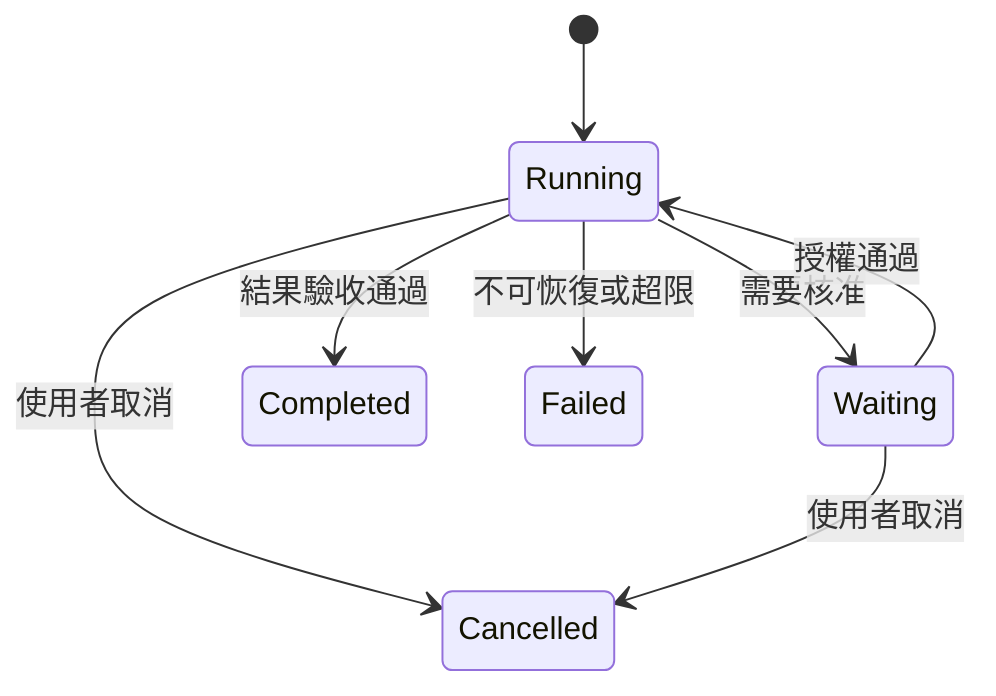

# 04 · Agent Loop、規劃與停止

[章節入口](README.md) · [設計取捨](design-notes.md) · [練習](exercises/README.md)

## 本章完整案例

研究助理找不到新版規格，連續五次換句話搜尋同一網站。每次模型都說「下一步會更精準」，但沒有新增來源或更接近驗收。

案例與練習軌跡為合成教學資料，沒有執行真實業務操作。

## 一個有狀態的控制循環

最小 loop 包含觀測、組合 context、推論、驗證候選行動、執行、更新狀態與終止判斷。狀態可區分 running、waiting_for_approval、completed、failed、cancelled。狀態名稱可不同，但等待不應算成功，取消也不代表正在執行的外部操作已回退。

## 規劃是可修訂的假設

Plan-and-execute 先拆解，再逐步執行；ReAct 強調依觀測調整後續行動。兩者可混合使用，例如保留高層目標，讓每一步按新證據改選工具。教材追蹤可見行動、理由摘要與結果，不要求模型交出隱藏思考鏈。

## 不同模式解決不同問題

Routing 將可辨識的任務送往特定處理器。Evaluator-optimizer 以評估結果改善候選產物，前提是評估能提供有用訊號。若評估只說「看起來不錯」，迭代容易變成自我肯定；若工作可確定性完成，增加模型迴圈反而增加變異。

## 停止規則與進展訊號

至少定義達成成功條件、無新證據、資源上限、不可恢復錯誤、等待授權與使用者取消。輪數上限只是一條保險，不等於真正進展。研究任務可追蹤已排除來源與新證據；維護任務可追蹤已驗證需求與測試結果。

## 控制器應守住什麼

模型不能自行解除輪數、權限或資源限制。工具失敗後，控制器先分類再決定重試、換方法或回報待確認。最終文字只在已符合驗收或清楚揭示未完成部分時輸出，避免 loop 停了就被當成工作完成。

## 用案例走一次

為搜尋建立來源與查詢紀錄；連續兩次沒有新證據時，要求檢查是否缺版本線索或應改查 release notes。若仍無可信來源，停止並交付未解問題。這個停止是誠實的部分結果，不是搜尋任務成功的保證。

## 精確機制圖

這張圖呈現本章需要討論的責任或狀態。實際功能、權限與可用性依所選 runtime、安裝版本及帳號驗證。

## 三個帶走的問題

- 能描述完整控制循環與中止條件：你會怎麼向另一位工程師說明？
- 能以觀測而非自我肯定判斷進展：需要哪些證據才能判斷？
- 如果模型的建議錯誤，哪一層應阻止錯誤擴大？

## 來源與閱讀焦點

查證基線：2026-10-19。先讀來源中與本章名詞、責任及限制直接相關的段落；原始論文不要求第一輪讀完全部實驗。

- [S14 · Building effective agents](https://www.anthropic.com/engineering/building-effective-agents) — 第一方架構經驗；workflow 與 Agent 模式
- [S19 · ReAct](https://arxiv.org/abs/2210.03629) — 原始研究；理解互動式推理與行動，不要求揭露隱藏思考鏈
- [S15 · Effective harnesses for long-running agents](https://www.anthropic.com/engineering/effective-harnesses-for-long-running-agents) — 第一方實驗；跨 session 增量工作與交接

進一步看[來源版本與更新政策](../../../references/sources.md)。
