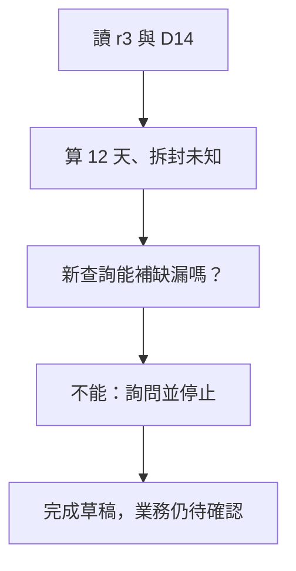

# 04 · Agent Loop、規劃與停止：教學與案例

## 先抓住一個問題

**助理怎樣根據剛讀到的結果決定下一步，又不會一直重查？**

上一章把工具的要求與結果講清楚。這章把它們接成循環，並為「缺資料」設一個合理的停點。

## 把題目放到桌上

T-1042 相隔 12 天，D14 還要求未拆封。讀工單三次都回 r3、拆封未知；只有客戶能補這個資訊。任務仍只准判斷和寫草稿。

這是虛構教材案例，不是法律建議、真實客服紀錄或執行證據。完整設定見[共同案例](../../../maps/course-story.md)。

讀這章時先想：手上已知什麼、還缺什麼、誰能做哪個動作？不要急著把每個英文名詞都背起來。

本課基礎資料：T-1042 r3；10/08 到 10/20 相差 12 天。D14 要求日期差不超過 14 天且未拆封；r3 的包裝狀態未知。原任務只讀與寫草稿。本章或題目若另述變體，只有明示條件改變。

## 名詞先換成人話

| 名詞 | 先用人話說 | 放進本例 |
| --- | --- | --- |
| Agent loop／工作循環 | 看資料、選動作、執行、再看結果，直到有理由停。 | 讀完發現缺拆封，改為詢問。 |
| Plan-and-execute | 先列步驟，再執行，遇新資料可改計畫。 | 先查工單，再查店規。 |
| ReAct | 讓後續動作跟著中間觀測調整的方式。 | 查不到拆封資料，就停止搜尋並提問。 |
| Routing／分流 | 按任務類型送到適當處理流程。 | 退貨問題送政策流程。 |
| Evaluator-optimizer | 依具體檢查結果修改產物。 | 引用缺 D14 段落，就補引用而非重寫一切。 |

## 不是「多想幾次」，而是每輪帶回新結果

Loop 的每一圈都要有可說明的變化：讀到新來源、確認一個條件、排除一種方案，或決定需要人類回覆。只是把同一查詢再做一次、得到相同 r3，沒有新增資訊。

## 計畫可以改，限制不能自己解除

起初可以計畫「讀工單 → 讀店規 → 判斷 → 寫草稿」。看到拆封未知後，下一步改成詢問客戶。這是合理重規劃；把禁止關單改成允許關單則不是。模型提議變更步驟，控制程式仍守住授權與資源上限。

## 要把「這輪結束」和「整件事完成」分開

客服收到詢問草稿，這一輪交付可以完成；但退貨資格仍等待資料。用兩個清楚的紀錄，比一個 completed 填滿所有層次可靠。後面第 07、08 章會看到產品事件也只能證明它自己的那一層完成。

## 何時該停

成功條件滿足、需要人類資料、沒有新進展、不可恢復錯誤、資源上限與使用者取消，都能使循環停止。可以先設一個教學規則：相同版本連續兩次沒有新資訊，就改查其他合理來源或交回提問。這是案例的設計選擇，不是通用最佳數字。

Evaluator 也必須給有用回饋，例如「草稿缺拆封待確認」。只說「再想想」並不能告訴下一輪要修什麼。我們記錄可見動作與結果，不要求模型交出隱藏思考鏈。

## 完整走一次

| 步驟 | 發生什麼 | 為什麼這樣處理 |
| --- | --- | --- |
| 讀 T-1042 | r3，拆封未知 | 已確認缺漏，不代表未拆封。 |
| 讀 D14 | 14 天且未拆封 | 兩項條件不能只驗第一項。 |
| 判斷下一步 | 再次讀 r3 不會新增資訊 | 改為請客服詢問客戶。 |
| 停止本輪 | 草稿已交付；資格待資料 | 不繼續無效查詢，也不關單。 |

**這章要留下的產物：**本輪交付：詢問拆封狀態的草稿。業務進度：等待資料。停止原因：目前可讀來源無法回答拆封問題。

停止有一個可以解釋的原因；不需要硬把答案變成可退或不可退。後續取得回覆時，保存的任務狀態也知道應從哪裡接續。

## 用流程核對責任

圖的重點是「新查詢能補缺漏嗎？」接到「不能：詢問並停止」時需要哪些證據。請對照上表，說明少了這一步會造成什麼誤判。

## 接著做什麼

先做[Q01／Q03／Q05](exercises/README.md)，保留自己的第一版答案。遇到疑難先看[設計取捨](design-notes.md)，需要才開提示。

循環知道缺資料會停，但怎麼從一堆文件找對條款？下一章處理檢索與引用。

## 來源與閱讀焦點

來源初查：2026-10-19；本次複核項目與日期見來源表。先讀來源中與本章名詞、責任及限制直接相關的段落；原始論文不要求第一輪讀完全部實驗。

- [S14 · Building effective agents](https://www.anthropic.com/engineering/building-effective-agents) — 第一方架構經驗；workflow 與 Agent 模式
- [S19 · ReAct](https://arxiv.org/abs/2210.03629) — 原始研究；理解互動式推理與行動，不要求揭露隱藏思考鏈
- [S15 · Effective harnesses for long-running agents](https://www.anthropic.com/engineering/effective-harnesses-for-long-running-agents) — 第一方實驗；跨 session 增量工作與交接

進一步看[來源版本與更新政策](../../../references/sources.md)。
