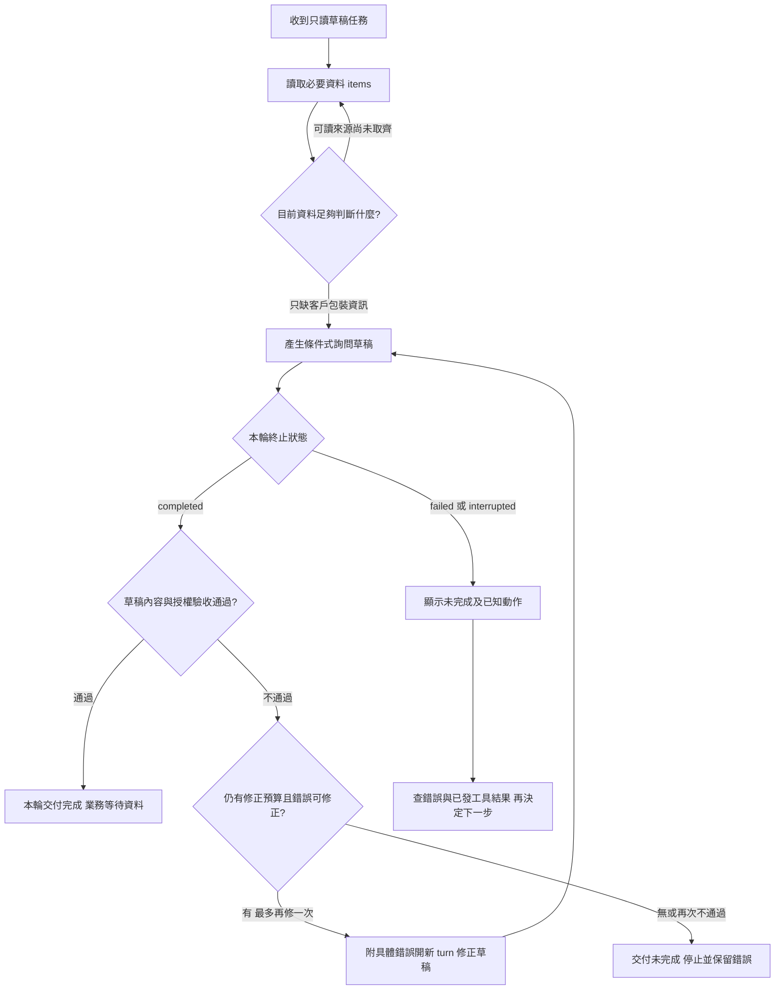

# 07 · Codex Runtime 與訂閱入口：教學與案例

## 先抓住一個問題

**用 Codex 做同一件事時，哪些工作已由它負責，哪些仍要你檢查？**

上一章把當輪資料與保存進度分開。本章把這些責任放進 Codex：你可以沿用現成 harness，不必自己從零寫模型與工具循環；但客服規則是否完整、工具是否越權、交付是否可信，仍需要設計與驗收。

核心讀法：先讀到「反例與修正」，做 Q01、Q03、Q05。事件介面差異、權限與來源表可在第二輪深挖。本章所有事件與資料均為合成教學，沒有執行 Codex、連接客服系統或測試帳號資格。

## 把題目放到桌上

你要交一份 T-1042 的回覆草稿；第一版只自己在終端機使用，之後可能做成帶進度及核准畫面的客服工作台。先確定工作，再選入口。

| 輸入 | 本輪可確定的內容 |
| --- | --- |
| 工單 | T-1042 r3，購買 2026-10-08、申請 2026-10-20，日期差 12 天 |
| 店規 | D14 自 10/01 生效，日期差不超過 14 天，而且未拆封；D07 已被取代 |
| 缺少的事實 | r3 沒寫是否拆封，不能補成未拆封 |
| 授權 | 只讀與交草稿；不可寄送、關單或退款 |
| 預期交付 | 日期條件符合，拆封待確認；提出詢問草稿並停止 |

完整設定見[共同案例](../../../maps/course-story.md)。跳章不必先建立上一章的環境。

## 名詞先換成人話

| 名詞 | 人話 | 放進本例 |
| --- | --- | --- |
| CLI | 在終端機與 Codex 對話的入口 | 你邊讀草稿邊補充限制 |
| exec | 把一項任務交給非互動執行，再收結果 | 固定輸入產生草稿報告 |
| SDK | 讓你的程式呼叫 Codex 的套件 | 程式建立、接續一段工作 |
| app-server | 自訂客戶端與 Codex 溝通的介面 | 工作台接事件、歷史、核准互動 |
| Thread／Turn／Item | 一段互動／一次請求及隨後工作／其中的輸入輸出單位 | 工單對話／產生草稿這輪／讀資料或草稿訊息 |
| cwd | 命令起始所在目錄 | 從教學資料夾解析相對路徑 |
| Sandbox／approval | 可強制的執行限制／受限動作如何獲准 | 限制檔案寫入；必要時呈現核准要求 |

Thread 是對話容器，不是資料庫 transaction，也不是一個獨立 sandbox。Item 可以是訊息、命令、檔案修改或工具呼叫；它不是只指最後答案。

## 1. 用工作需求選入口

| 具體需求 | 起步選擇 | 你新增的責任 |
| --- | --- | --- |
| 我在終端機看草稿，隨時追問 | CLI | 看懂動作、授權和結果 |
| 固定資料，每次交一份報告給既有腳本 | exec | 捕捉結束狀態、保留輸出、處理失敗 |
| 應用程式要建立及接續 Codex 工作 | Codex SDK | 程式生命週期、例外處理、資料驗收 |
| 自製工作台有歷史、逐步事件、核准畫面 | app-server | 通訊、事件對應、核准回覆、斷線呈現 |
| 要在自己的應用程式安排 Agent 與工具流程 | 另評估 Agents SDK 等編排工具 | 自己定義編排及工具責任；推論授權另確認 |

這是需求導向的起步建議，不是排他分類。SDK 也可能支援事件；app-server 也能自動化，但單一報告通常不需要先承擔完整客戶端通訊。

Codex SDK 與 Agents SDK 不是同一套介面改名。前者讓程式使用 Codex，保留 Codex 提供的 harness；後者屬於應用內 Agent 編排選擇。也不能把「SDK」一概解釋成某個固定底層：目前官方文件分列 TypeScript 與 Python，Python 透過本機 app-server，版本與能力需看對應文件。

## 2. 現成 harness 接走什麼工作

先把「不用自己寫循環」和「不用負責成果」分開。

| 層次 | Codex 提供的部分 | 本案例仍由你／產品負責 |
| --- | --- | --- |
| 模型與工具循環 | 依輸入推進工作、處理工具項目、產生回覆 | 提供適用店規、工單版本及停止要求 |
| 執行限制 | 依有效設定執行 sandbox 與核准流程 | 確認真正生效範圍、工具與外部服務的權限 |
| 對話與事件 | thread、turn、item 與串流進度 | 把事件放對輪次，不拿局部成功冒充整輪成功 |
| 內容 | 模型產生判斷及草稿 | 驗證 12 天、D14、拆封未知與引用 |
| 業務結果 | 可回報它觀察到的工具結果 | 驗證外部實際狀態，不把結束文字當關單收據 |

例如模型能提出讀取文件，harness 能執行讀取；但只載入 D14 前半段，仍會漏掉「未拆封」。換入口或模型不能補回根本沒給的證據。

## 3. Thread、turn、item 怎樣對回工單

教學對應：thread `th-demo-7` 處理 T-1042；turn `tr-draft-1` 要草稿；其中 `it-read-1` 讀工單、`it-policy-1` 讀 D14、`it-message-1` 交草稿。這些 ID 是假資料，不是實際 receipt。

下一輪使用者補資料時，可以沿用 thread，再開 turn `tr-followup-2`。但同一 thread 不會使 r3 永遠有效；仍要核對新資料及本輪授權。這接回第 06 章的恢復原則。

客戶端至少要回答：這段文字屬於哪個 thread、哪個 turn、哪個 item？某個工具已完成時，完成的是讀取，不代表模型已交答案；某輪已完成時，也不代表其他輪或外部工單已完成。

### 兩種事件拼法不要混接

| 介面 | 官方文件中的事件例子 | 如何讀終止 |
| --- | --- | --- |
| exec 的 JSONL | thread.started、turn.started、item.completed | 區分 turn.completed、turn.failed、error 等事件 |
| app-server | thread/started、turn/started、item/completed | turn/completed 再讀 turn.status：completed、failed 或 interrupted |

它們都能描述工作進度，但不是同一份 wire schema。不要把 exec 的點號事件和 app-server 的斜線事件混在同一份假追蹤，再寫一個通用字串判斷。實作時先辨認來源，再以該版本的結構解析；本章以下統一用 app-server。

## 4. 完整走一次：從請求到可驗收草稿

以下只列關鍵步驟，省略協定欄位，不是可直接送出的完整訊息。

| 步驟 | 輸入／事件 | 中間判斷 | 畫面或記錄 |
| --- | --- | --- | --- |
| 0 | 建立連線，initialize，之後 initialized | 此連線先完成初始化 | 尚未開始客服工作 |
| 1 | thread/start，取得 th-demo-7 | 對話建立不等於任務完成 | 顯示 T-1042 對話 |
| 2 | turn/start：只讀 r3、D14，交草稿 | 綁定 tr-draft-1 與限制 | 本輪執行中 |
| 3 | item/started → item/completed：讀 r3 | 兩日期差 12；拆封未知 | 只標資料已讀 |
| 4 | 讀 D14 的 item 完成 | 需要「日期且未拆封」，不能只看日期 | 記錄 D14 版本與來源 |
| 5 | item/agentMessage/delta：文字陸續到達 | 片段可能尚未完整或之後失敗 | 顯示產生中，不啟用寄送 |
| 6 | 草稿 item 完成，turn/completed，status=completed | 執行層完成；還要核對內容 | 進入草稿驗收 |
| 7 | 對照條款與工單 | 日期符合；拆封待問；無外部寫入 | 草稿可供審閱，業務等待資料 |

**可接受輸出：**「依 D14，10/08 至 10/20 相差 12 天，符合日期條件；工單未記載商品是否拆封，需先確認。草稿：請問商品目前是否尚未拆封？」本次未寄送、關單或退款。

**停止理由：**在已提供的 r3 中找不到包裝事實，反覆再讀同一版也不會得到答案；交出詢問草稿已滿足本輪任務。不要把等待客戶資料畫成仍在忙碌推論。

這裡沒有「先核准再讀取」的必經箭頭；是否需要核准取決於實際動作及有效設定。也沒有「狀態 completed 就自動寄送」的箭頭。

若 completed 的草稿把「拆封未知」寫成「未拆封」，或聲稱已退款，內容驗收必須不通過。本例設計最多追加一個修正 turn，把錯誤與原資料明確交回；修正後仍須重新驗收。修正額度已用完、條件無法補證或超出授權時，停止並標示「草稿交付未完成」，保留原因，不讓 completed 狀態掩蓋內容失敗。這個一次修正額度是教材的有界設計，並非 Codex 官方固定限制。

## 5. 失敗怎樣顯示，才不欺騙使用者

| 觀察 | 你能下的結論 | 不能推論 |
| --- | --- | --- |
| 文字出現「可以退…」，之後 turn.status=failed | 本輪失敗，文字是不完整片段 | 已核准退貨、已有完整草稿 |
| 某個讀取 item completed，之後整輪 failed | 該讀取完成，本輪未完成 | 所有步驟都成功 |
| 連線斷了，沒收到終止事件 | 客戶端目前不知道最後狀態 | 一定失敗，或一定可安全重做 |
| status=interrupted | 本輪遭中斷 | 先前工具作用已自動回復 |
| status=completed，草稿說「已退款」 | 執行結束，但內容越出證據與授權 | 業務完成 |

斷線時可設計重新讀取歷史與狀態的恢復流程，但是否發生外部變更，仍要對照工具或業務系統；重開畫面本身不是回退。這是第 12 章將深入的問題。

## 6. cwd、sandbox、approval 分別管哪一件事

假設工作位置叫 `/training/t1042`。這只表示相對路徑從哪裡算，不能推出 `/training/other` 或家目錄都不可讀。read-only 通常是在講寫入限制，也不能自行推論成只准讀兩份指定檔案。

本例的設計要求可以這樣寫：只提供 T-1042 r3 與 D14 假資料；不連客服寫入工具；草稿直接回傳給客戶端，不必寫檔；未來若需保存草稿，只另外開放指定輸出位置。然後用有效權限與實際拒絕結果驗證，不能只看目錄樹。

Sandbox 管執行邊界，approval 管受限要求怎樣取得決定，使用者的業務授權則管「這件事可不可以做」。系統能呼叫關單工具，不代表使用者已批准關單。反之，使用者想做某事，也不代表目前 runtime 有能力或權限完成。

app-server 的核准要求可能包含 threadId、turnId、itemId。工作台需把決定綁定正確要求；按鈕顯示「允許」不能不說對象與動作。核准回覆也不是執行結果：仍要等待對應 item 的最後狀態。

## 反例與修正

**反例：**工作台一收到「可以退…」就顯示綠色「退款成功」；之後 turn/completed 帶 failed，又因看見 completed 這個字而保持成功。開發者再以 cwd 在 t1042 資料夾內，宣稱未發生任何其他存取。

**修正：**先確定事件來自 app-server；片段只顯示產生中。終止事件讀取 turn.status，failed 時標記本輪失敗並保留錯誤。業務狀態維持待確認，檢查工具紀錄；需要證明無外部寫入時，核對能力配置及相關外部記錄，而不是用 cwd 或一句最終回答代替證據。

## 初學者常問

**我只是要一份草稿，真的要懂 app-server 嗎？** 先懂「片段、工具完成、本輪完成、業務完成」四層即可；不必先寫客戶端。選 exec 或 CLI 也有相同驗收問題，app-server 只是把責任看得更清楚。

**用了 SDK，為什麼還要看錯誤與事件？** 套件可以包裝通訊與型別，不會替你的商店決定拆封未知是否可退。它即使提供 finalResponse，也仍需確認本輪結果和內容；要診斷部分完成，再查看可取得的工具與事件證據。

**模型清單有 GPT-6 Luna，是否證明這章跑通？** 清單是候選資訊；帳號、執行環境、可用工具及任務驗收是其他條件。本章只有合成案例與規格，不能由列出模型或登入成功推導已實跑。

## 接著做什麼

先做[Q01／Q03／Q05](exercises/README.md)，再讀[設計取捨](design-notes.md)。留下三張小表：入口選擇、事件狀態、責任邊界；每張都能用 T-1042 說明。

本章沿用 Codex harness。下一章拆開自己的合格 OAuth app、Responses 推論及自建 harness，看看自己接回哪些控制責任。

## 來源與閱讀焦點

官方產品細節複核：**2026-10-21**。適用於當日文件描述的 Codex 入口及 app-server；未驗證本機 CLI 版本、帳號或真實推論。表中的工單判斷與 UI 呈現是教材設計選擇。

- [Codex app-server](https://learn.chatgpt.com/docs/app-server)：本章初始化、Thread／Turn／Item、斜線事件、終止狀態與核准生命週期。先讀 Core primitives、Lifecycle overview、Approvals。以所用版本的 schema 為準；不在本課建立遠端 listener。
- [Codex non-interactive mode](https://learn.chatgpt.com/docs/non-interactive-mode)：exec 的點號 JSONL 事件、非互動輸出及權限；不要把這份事件結構直接當成 app-server 結構。
- [Codex SDK](https://learn.chatgpt.com/docs/codex-sdk)：程式化建立／接續工作、SDK 與深度客戶端選擇；不同語言套件細節分開查。
- [Codex authentication](https://learn.chatgpt.com/docs/auth)：原生登入與方案入口；自己的 OAuth app 另見下一章。
- [Codex app-server with ChatGPT plan](https://developers.openai.com/siwc/token-sharing-open-source/codex-app-server)：訂閱授權 preview 路線的延伸，本章不實作或搬用登入憑證。

進一步看[來源版本與更新政策](../../../references/sources.md)。
