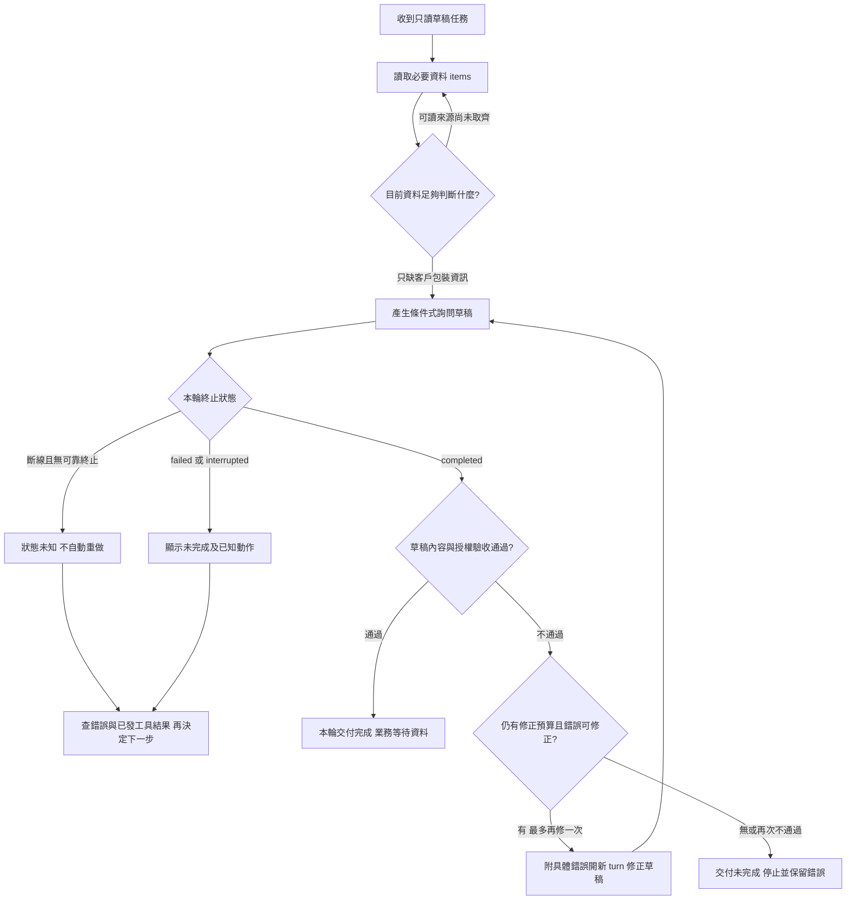

# 07 · Codex Runtime 與訂閱入口：教學與案例

## 先抓住一個問題

客服工作台亮起綠勾。你正要切去下一張工單，同事指著螢幕問：「這是草稿寫完，還是退貨已經核准？」

你往下看，文字寫著「日期符合條件」，卻沒說包裝有沒有拆過。如果這個勾被解讀成退款成功，客服就可能向客戶承諾一件根本沒有獲准、也沒執行的事。

這是本章的合成場景。先別急著選 CLI 或 SDK。眼前要做的選擇是：**這個勾究竟能證明什麼？**

閱讀路徑：先跟著四個場景查清綠勾 → 選入口 → 需要接產品時再看深挖。

## 把題目放到桌上

你打開的是 T-1042 r3：2026-10-08 購買，10-20 申請，兩日期相差 12 天。現行 D14 自 10/01 取代 D07；它要求不超過 14 天，而且商品未拆封。

r3 沒寫拆封狀態。你交辦的工作只有讀資料、判斷及草稿，沒有寄送、關單或退款授權。完整背景放在[共同案例](../../../maps/course-story.md)，這裡的資料已足夠繼續，不必先建立環境。

**停 15 秒：**先替綠勾補一個受詞。「＿＿已完成。」如果你填的是「退貨」，回頭找一項能證明它的觀察。

只看到勾或一句文字，還找不到這項證據。接下來我們把它拆成讀取、執行、交付三個不同問題。

## 完整走一次：從請求到可驗收草稿

### 場景一：先問它讀到了什麼

你展開時間線，看到「讀取工單完成」。這告訴你資料讀回來了，還沒告訴你是否讀到 D14、理解完整條款，或寫出了可用草稿。

這一小段輸入或輸出，在 Codex 介面裡叫 item。工具讀取是一個 item，草稿訊息也是一個 item；其中一個成功，不能替其他工作打勾。

你接著找到 D14 的讀取結果。12 天符合日期條件，但拆封仍未知。這一步的結論應留在資料層：「日期符合，另一條件待確認。」不要讓讀取完成直接跳成核准退貨。

### 場景二：再問這一輪有沒有正常結束

時間線往下，文字開始陸續出現。這是串流片段，像一份仍在打字的文件；你可以顯示它，卻不能因為第一句看起來正確，就標為已交付。

從你送出「請寫草稿」到隨後的工具與回答，合起來稱為一個 turn，也就是一輪工作。這輪可以含好幾個 item。

本章用 app-server 的事件來看它：收到 turn/completed 時，還要看 turn.status。狀態是 completed，才表示執行層正常結束；failed 或 interrupted 要另行呈現。若連線先斷、沒看到可靠終止狀態，現在知道的是「未知」。

先把這條規則留住即可。事件完整表與另一種 exec 拼法，放在後面的深挖區；現在不用背欄位。

### 場景三：正常結束，也要看草稿說了什麼

你找到完整草稿：「依 D14，10/08 至 10/20 相差 12 天，符合日期條件；目前未記載是否拆封，需先確認。草稿：請問商品目前是否尚未拆封？」

這份草稿符合本輪目標。可以交給客服審閱，工單的業務進度仍是等待資料。本次沒有寄送、關單或退款；草稿中也不應宣稱做過這些動作。

**停 20 秒：**另一份草稿把「是否拆封未知」改寫成「商品未拆封」。其他句子一樣，執行也正常結束。你會留下綠勾嗎？先指出需要修正的一句，再繼續。

不能留下代表交付通過的勾。這不是少一個好看的字，而是把缺證據的條件補成已知。若所有程序都成功，內容仍然可能驗收失敗。

本例給一次追加修正的額度：把具體錯句與 r3 交回新 turn，重新產生並驗收。再不通過、沒有額度，或問題無法在授權內解決，就標「草稿交付未完成」並停止。這是教材的有界設計，不是 Codex 官方固定限制。

### 場景四：把進度留給下一位客服

你把單一綠勾改成兩句話：「本輪：草稿可供審閱」「工單：等待拆封資料」。這樣即使下班換人，也知道下一步是取得客戶資訊，並非重讀同一份 r3 到它變出答案。

這段工單互動可以放在一個 thread，裡面包含剛才那個 turn。下輪若客戶補資料，可以在同一 thread 繼續，但仍須核對版本與授權；對話連續不代表事實永遠有效。這也接回上一章保存進度的問題。

**到這裡可以先停。** 你已能分開 item 完成、turn 結束、草稿通過與工單進度。下面才決定沿用 Codex 時，誰負責把它們接起來。

## 現成 harness 接走什麼工作

你不用親手安排每次模型推論與工具往返；Codex 的 harness 已提供一部分這種循環。這是沿用它的價值。但它拿到的若只有 D14 半段，或你把未知當成未拆封，它仍不能憑空補出可靠事實。

在這個工作台裡，責任先分成三件就夠了：Codex 推進模型與工具工作；客戶端把事件放回正確輪次、呈現錯誤；你與產品驗證店規、資料版本、授權及實際結果。只有第一件已由現成 harness 處理，不表示後兩件自動完成。

| 眼前的問題 | 仍需檢查的證據 |
| --- | --- |
| 草稿是否正確 | r3、完整 D14、日期差與拆封未知 |
| 畫面是否誠實 | 對應輪次的終止狀態，以及內容驗收 |
| 有沒有外部變更 | 可用能力、工具紀錄與相關外部狀態 |

最終文字「沒有關單」只是陳述。要證明無副作用，還得知道能用哪些工具、紀錄是否完整；需要時核對外部狀態。這一層不由綠勾代替。

## 用工作需求選入口

回到你的第一版需求：自己在終端機跑一份草稿。這時 CLI，也就是終端機互動入口，或交固定任務的 exec，就可能足夠。你不必為了解一個綠勾，先寫出整個工作台。

若既有程式要建立或接續 Codex 工作，再評估 Codex SDK。若要把歷史、逐步事件、核准互動放進自己的產品畫面，app-server 才帶來明確價值；你同時接下了通訊、輪次對應與斷線呈現的責任。

這些入口都不能替你決定「拆封未知是否可退」。選擇先從需求出發，完整比較留在下一個可展開區。

深挖：入口選擇與 SDK 責任差異

| 具體需求 | 起步選擇 | 你新增的責任 |
| --- | --- | --- |
| 我在終端機看草稿，隨時追問 | CLI | 看懂動作、授權和結果 |
| 固定資料，每次交一份報告給既有腳本 | exec | 捕捉結束狀態、保留輸出、處理失敗 |
| 應用程式要建立及接續 Codex 工作 | Codex SDK | 程式生命週期、例外處理、資料驗收 |
| 自製工作台有歷史、逐步事件、核准畫面 | app-server | 通訊、事件對應、核准回覆、斷線呈現 |
| 要在自己的應用程式安排 Agent 與工具流程 | 另評估 Agents SDK 等編排工具 | 自己定義編排及工具責任；推論授權另確認 |

這是需求導向的起步建議，不是排他分類。SDK 也可能支援事件；app-server 也能自動化，但單一報告通常不需要先承擔完整客戶端通訊。

Codex SDK 與 Agents SDK 不是同一套介面改名。前者讓程式使用 Codex，保留 Codex 提供的 harness；後者屬於應用內 Agent 編排選擇。也不能把「SDK」一概解釋成某個固定底層：目前官方文件分列 TypeScript 與 Python，Python 透過本機 app-server，版本與能力需看對應文件。

## 深挖：需要接工作台時再讀

## 名詞先換成人話

| 名詞 | 人話 | 放進本例 |
| --- | --- | --- |
| CLI | 在終端機與 Codex 對話的入口 | 你邊讀草稿邊補充限制 |
| exec | 把一項任務交給非互動執行，再收結果 | 固定輸入產生草稿報告 |
| SDK | 讓你的程式呼叫 Codex 的套件 | 程式建立、接續一段工作 |
| app-server | 自訂客戶端與 Codex 溝通的介面 | 工作台接事件、歷史、核准互動 |
| Thread／Turn／Item | 一段互動／一次請求及隨後工作／其中的輸入輸出單位 | 工單對話／產生草稿這輪／讀資料或草稿訊息 |
| cwd | 命令起始所在目錄 | 從教學資料夾解析相對路徑 |
| Sandbox／approval | 可強制的執行限制／受限動作如何獲准 | 限制檔案寫入；必要時呈現核准要求 |

Thread 是對話容器，不是資料庫 transaction，也不是一個獨立 sandbox。Item 可以是訊息、命令、檔案修改或工具呼叫；它不是只指最後答案。

## Thread、turn、item 怎樣對回工單

教學對應：thread `th-demo-7` 處理 T-1042；turn `tr-draft-1` 要草稿；其中 `it-read-1` 讀工單、`it-policy-1` 讀 D14、`it-message-1` 交草稿。這些 ID 是假資料，不是實際 receipt。

下一輪使用者補資料時，可以沿用 thread，再開 turn `tr-followup-2`。但同一 thread 不會使 r3 永遠有效；仍要核對新資料及本輪授權。這接回第 06 章的恢復原則。

客戶端至少要回答：這段文字屬於哪個 thread、哪個 turn、哪個 item？某個工具已完成時，完成的是讀取，不代表模型已交答案；某輪已完成時，也不代表其他輪或外部工單已完成。

### 兩種事件拼法不要混接

| 介面 | 官方文件中的事件例子 | 如何讀終止 |
| --- | --- | --- |
| exec 的 JSONL | thread.started、turn.started、item.completed | 區分 turn.completed、turn.failed、error 等事件 |
| app-server | thread/started、turn/started、item/completed | turn/completed 再讀 turn.status：completed、failed 或 interrupted |

它們都能描述工作進度，但不是同一份 wire schema。不要把 exec 的點號事件和 app-server 的斜線事件混在同一份假追蹤，再寫一個通用字串判斷。實作時先辨認來源，再以該版本的結構解析；本章以下統一用 app-server。

展開 app-server 事件步驟表

| 步驟 | 輸入／事件 | 中間判斷 | 畫面或記錄 |
| --- | --- | --- | --- |
| 0 | 建立連線，initialize，之後 initialized | 此連線先完成初始化 | 尚未開始客服工作 |
| 1 | thread/start，取得 th-demo-7 | 對話建立不等於任務完成 | 顯示 T-1042 對話 |
| 2 | turn/start：只讀 r3、D14，交草稿 | 綁定 tr-draft-1 與限制 | 本輪執行中 |
| 3 | item/started → item/completed：讀 r3 | 兩日期差 12；拆封未知 | 只標資料已讀 |
| 4 | 讀 D14 的 item 完成 | 需要「日期且未拆封」，不能只看日期 | 記錄 D14 版本與來源 |
| 5 | item/agentMessage/delta：文字陸續到達 | 片段可能尚未完整或之後失敗 | 顯示產生中，不啟用寄送 |
| 6 | 草稿 item 完成，turn/completed，status=completed | 執行層完成；還要核對內容 | 進入草稿驗收 |
| 7 | 對照條款與工單 | 日期符合；拆封待問；無外部寫入 | 草稿可供審閱，業務等待資料 |

### 把驗收分支補回流程

這裡沒有「先核准再讀取」的必經箭頭；是否需要核准取決於實際動作及有效設定。也沒有「狀態 completed 就自動寄送」的箭頭。

若 completed 的草稿把「拆封未知」寫成「未拆封」，或聲稱已退款，內容驗收必須不通過。本例設計最多追加一個修正 turn，把錯誤與原資料明確交回；修正後仍須重新驗收。修正額度已用完、條件無法補證或超出授權時，停止並標示「草稿交付未完成」，保留原因，不讓 completed 狀態掩蓋內容失敗。這個一次修正額度是教材的有界設計，並非 Codex 官方固定限制。

## 失敗怎樣顯示，才不欺騙使用者

| 觀察 | 你能下的結論 | 不能推論 |
| --- | --- | --- |
| 文字出現「可以退…」，之後 turn.status=failed | 本輪失敗，文字是不完整片段 | 已核准退貨、已有完整草稿 |
| 某個讀取 item completed，之後整輪 failed | 該讀取完成，本輪未完成 | 所有步驟都成功 |
| 連線斷了，沒收到終止事件 | 客戶端目前不知道最後狀態 | 一定失敗，或一定可安全重做 |
| status=interrupted | 本輪遭中斷 | 先前工具作用已自動回復 |
| status=completed，草稿說「已退款」 | 執行結束，但內容越出證據與授權 | 業務完成 |

斷線時可設計重新讀取歷史與狀態的恢復流程，但是否發生外部變更，仍要對照工具或業務系統；重開畫面本身不是回退。這是第 12 章將深入的問題。

## cwd、sandbox、approval 分別管哪一件事

假設工作位置叫 `/training/t1042`。這只表示相對路徑從哪裡算，不能推出 `/training/other` 或家目錄都不可讀。read-only 通常是在講寫入限制，也不能自行推論成只准讀兩份指定檔案。

本例的設計要求可以這樣寫：只提供 T-1042 r3 與 D14 假資料；不連客服寫入工具；草稿直接回傳給客戶端，不必寫檔；未來若需保存草稿，只另外開放指定輸出位置。然後用有效權限與實際拒絕結果驗證，不能只看目錄樹。

Sandbox 管執行邊界，approval 管受限要求怎樣取得決定，使用者的業務授權則管「這件事可不可以做」。系統能呼叫關單工具，不代表使用者已批准關單。反之，使用者想做某事，也不代表目前 runtime 有能力或權限完成。

app-server 的核准要求可能包含 threadId、turnId、itemId。工作台需把決定綁定正確要求；按鈕顯示「允許」不能不說對象與動作。核准回覆也不是執行結果：仍要等待對應 item 的最後狀態。

## 反例與修正

工作台收到「可以退…」片段就顯示綠色「退款成功」；後來終止狀態是 failed，仍因事件名稱裡有 completed 而保持成功。這同時混淆片段、執行結束與業務結果。

修正從最小的一步開始：先辨認事件來源，把片段標為產生中；終止時解析正確狀態。之後才驗收完整草稿。即使正常結束，若它聲稱已退款或把未知改成未拆封，仍不交付；最多再修一次，額度耗盡就停止。

另一種錯誤是因 cwd 在 t1042 資料夾，就宣稱沒有其他存取。修正需回到真正生效的檔案、工具與外部服務限制；路徑名稱不是拒絕結果。

## 初學者常問

**我只要一份草稿，為什麼要懂這麼多事件？** 你可以先不寫客戶端，只帶走四個區別：讀取完成、執行結束、內容通過、業務完成。事件名稱在需要整合或診斷時再查；責任不能一起略過。

**SDK 給了 finalResponse，還要驗收嗎？** 要。套件能包裝通訊，不會替商店決定未知拆封能否退貨。先看這輪是否可靠結束，再對照資料與條款。

**模型清單有 GPT-6 Luna，是否證明能跑通？** 清單提供候選資訊；帳號、環境、工具與任務驗收是其他條件。本章只有合成案例與規格，沒有真實推論證據。

## 接著做什麼

先做[Q01](exercises/README.md#c07-q01)，畫出剛才綠勾背後的責任；再用 Q03 診斷另一份事件序列。Q05 練習向同事解釋入口選擇。需要時回到[設計取捨](design-notes.md)，不要靠多背名詞補推理缺口。

下一章將拆開自己的 OAuth app、Responses 推論與自建 harness：如果不用這個現成循環，你要接回哪些工作？

### 下次從這裡接

- 我目前敢讓綠勾代表：＿＿。
- 我還分不清的觀察與結論是：＿＿。
- 下次只做一件：回到場景＿＿，或回答 C07-Q＿＿。

## 來源與閱讀焦點

官方產品細節複核：**2026-10-21**。適用於當日文件描述的 Codex 入口及 app-server；未驗證本機 CLI 版本、帳號或真實推論。表中的工單判斷與 UI 呈現是教材設計選擇。

- [Codex app-server](https://learn.chatgpt.com/docs/app-server)：本章初始化、Thread／Turn／Item、斜線事件、終止狀態與核准生命週期。先讀 Core primitives、Lifecycle overview、Approvals。以所用版本的 schema 為準；不在本課建立遠端 listener。
- [Codex non-interactive mode](https://learn.chatgpt.com/docs/non-interactive-mode)：exec 的點號 JSONL 事件、非互動輸出及權限；不要把這份事件結構直接當成 app-server 結構。
- [Codex SDK](https://learn.chatgpt.com/docs/codex-sdk)：程式化建立／接續工作、SDK 與深度客戶端選擇；不同語言套件細節分開查。
- [Codex authentication](https://learn.chatgpt.com/docs/auth)：原生登入與方案入口；自己的 OAuth app 另見下一章。
- [Codex app-server with ChatGPT plan](https://developers.openai.com/siwc/token-sharing-open-source/codex-app-server)：訂閱授權 preview 路線的延伸，本章不實作或搬用登入憑證。

進一步看[來源版本與更新政策](../../../references/sources.md)。
