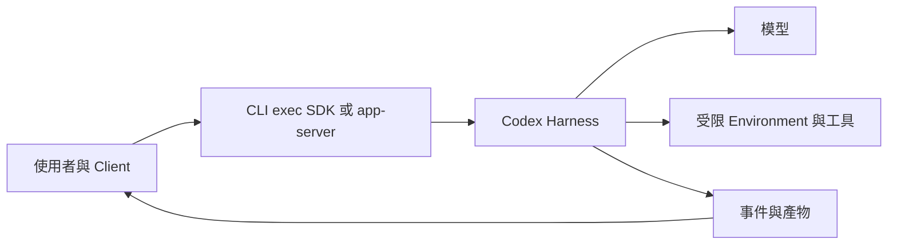

# 07 · Codex Runtime 與訂閱入口

[章節入口](README.md) · [設計取捨](design-notes.md) · [練習](exercises/README.md)

## 本章完整案例

你想讓程式維護 Agent 在本機讀 repo、產生修正建議，未來再加核准後修改。你同時看到 Codex CLI、Codex SDK、app-server 和 Agents SDK，不知道該由哪一層開始。

案例與練習軌跡為合成教學資料，沒有執行真實業務操作。

## 先選責任，再選入口

原生 CLI 提供互動介面；exec 適合以明確任務啟動非互動工作；Codex SDK 讓應用程式驅動 Codex；app-server 提供 threads、turns、核准與串流事件等深度整合。Agents SDK 是另一套可在應用程式內組合 Agent 的介面，並非 Codex SDK 的別名。用 Codex 不表示你的程式已擁有或改寫其內部 loop。

## 原生訂閱登入與自己的 OAuth app

原生 Codex 可使用 ChatGPT 登入。另一條路線是應用程式自己的 Sign in with ChatGPT 註冊與訂閱使用授權，再以授權 token 呼叫公開 Responses endpoint。兩條路線的 client、授權與 token 管理責任不同，不把它們合併成「只要有任意 OAuth token 就可用」。第 08 章專門處理自己的 harness 與 OAuth。

## Thread、turn、item 與事件

Thread 保存一段互動；turn 是一次請求及後續工作；item 是訊息、工具執行或其他輸入輸出單位。開始事件不代表完成。最終事件也要檢查狀態是 completed、failed 或 interrupted，之後仍需驗證任務產物。

## Workspace、sandbox 與 approval

工作目錄決定相對路徑與部分專案指令的發現。Sandbox 限制可讀寫或執行範圍；approval 是操作是否需要核准的政策。把任務放入子目錄不能取代作業系統與 runtime 的存取限制。起始設計先採讀取或最低必要權限，實際功能依安裝版本與政策確認。

## 可恢復不表示全部可用

Thread resume 可延續本機歷史，但外部資料與環境仍可能改變。模型清單也可能來自快取或 bundled catalog；有列出不等於該帳號此刻可完成推論。教材目前只核對到本機 CLI 0.160.1、ChatGPT 登入及 help 介面，沒有執行模型任務驗證。

## 用案例走一次

第一階段用原生 CLI／exec 的唯讀任務理解輸入、事件與產物；第二階段比較透過 SDK 或 app-server 管理 turn 的成本。無論入口，修正建議需指向實際檔案與可驗證原因；未獲修改授權時只交建議。

## 精確機制圖

這張圖呈現本章需要討論的責任或狀態。實際功能、權限與可用性依所選 runtime、安裝版本及帳號驗證。

## 三個帶走的問題

- 能說明原生 Codex 與自訂客戶端的責任分界：你會怎麼向另一位工程師說明？
- 能從事件與外部結果判斷任務狀態：需要哪些證據才能判斷？
- 如果模型的建議錯誤，哪一層應阻止錯誤擴大？

## 來源與閱讀焦點

查證基線：2026-10-19。先讀來源中與本章名詞、責任及限制直接相關的段落；原始論文不要求第一輪讀完全部實驗。

- [S02 · Codex authentication](https://learn.chatgpt.com/docs/auth) — 官方產品文件；ChatGPT 訂閱與 API key 登入
- [S23 · Codex non-interactive mode](https://learn.chatgpt.com/docs/non-interactive-mode) — 官方產品文件；exec、JSONL、結構化輸出與原生登入
- [S24 · Codex SDK](https://learn.chatgpt.com/docs/codex-sdk) — 官方產品文件；Codex SDK 與 Agents SDK 是不同介面
- [S07 · Codex app-server with ChatGPT plan](https://developers.openai.com/siwc/token-sharing-open-source/codex-app-server) — 官方 preview；app-server、Responses provider 與 token 更新

進一步看[來源版本與更新政策](../../../references/sources.md)。
