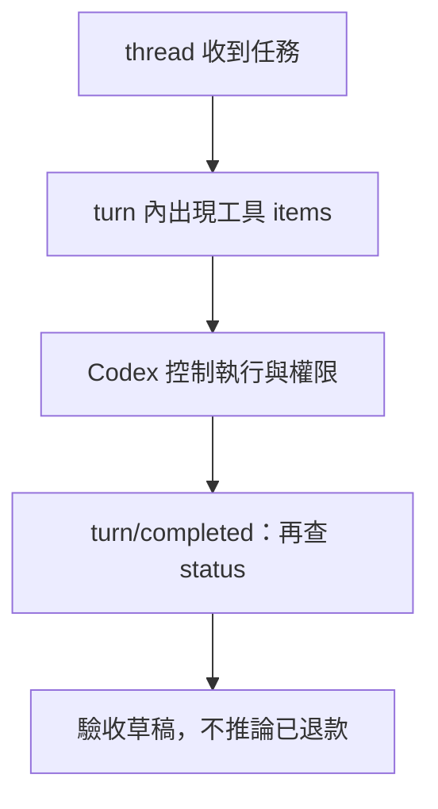

# 07 · Codex Runtime 與訂閱入口：教學與案例

## 先抓住一個問題

**用 Codex 做同一件事時，哪些工作已由它負責，哪些仍要你檢查？**

上一章分清當輪資料與保存進度。現在用 Codex 的實際介面名詞，對照這些責任。

## 把題目放到桌上

你要讓 Codex 讀教學工單 T-1042 與 D14，交條件式草稿。也想知道：直接用 CLI、從程式驅動，或做一個帶核准畫面的客戶端，各該從哪個入口開始。

這是虛構教材案例，不是法律建議、真實客服紀錄或執行證據。完整設定見[共同案例](../../../maps/course-story.md)。

讀這章時先想：手上已知什麼、還缺什麼、誰能做哪個動作？不要急著把每個英文名詞都背起來。

本課基礎資料：T-1042 r3；10/08 到 10/20 相差 12 天。D14 要求日期差不超過 14 天且未拆封；r3 的包裝狀態未知。原任務只讀與寫草稿。本章或題目若另述變體，只有明示條件改變。

## 名詞先換成人話

| 名詞 | 先用人話說 | 放進本例 |
| --- | --- | --- |
| CLI／命令列介面 | 人在終端機和 Codex 互動的入口。 | 請它讀資料並解釋判斷。 |
| exec | 以一項明確任務啟動非互動工作。 | 產出一份唯讀草稿報告。 |
| SDK | 讓你的程式使用一套現成介面的套件。 | 程式啟動或接續 Codex 任務。 |
| app-server | 供自訂客戶端驅動 Codex 的通訊介面。 | 接事件、歷史和核准互動。 |
| Thread／Turn／Item | 一段互動／一次請求與工作／其中一項輸入輸出。 | 同一工單對話中，一輪查詢有多個工具和訊息 item。 |

## 先問「我是要用助理，還是做操作台」

只想與 Codex 互動，先用 CLI；想讓腳本交一項任務，可用 exec 或適合的 SDK 整合；要做持續顯示事件、接核准與歷史的客戶端，再看 app-server。入口不同，使用的 Codex harness 仍會管理一部分模型與工具循環。

Codex SDK 是程式化使用 Codex 的入口；Agents SDK 則在你的應用程式裡組合 Agent 流程。它們不是同一個套件換名字，也不是所有 SDK 都讓你掌控同一層。

## Thread 和 turn 為什麼要分

你和助理處理同一工單的對話可放同一 thread。第一輪你要草稿，第二輪補客戶回覆，各是 turn；讀工單、工具結果、訊息等是其中 item。這能幫客戶端把事件放到正確輪次，避免把上次成功顯示在這次失敗上。

## 結束事件只證明對應那一層

看到 turn/completed 還要查 turn.status。即使 status=completed，也只表示這輪工作完成，不等於客戶已獲退款。T-1042 的草稿可已完成，但退貨資格仍等待拆封資料，工單也仍是 open。這就是第 04 章的兩層狀態。

## 資料夾、限制與核准各有工作

Workspace 是本次工作的目錄；sandbox 限制可讀寫範圍；approval 決定哪些要求需核准。換到一個子資料夾不代表其他檔案都不可讀。未來實作需查真正權限與目前版本，不能只看資料夾名稱。

原生 ChatGPT 登入與自己的 OAuth app 也是不同入口；第 08 章會分開。模型清單可能快取，有名字不代表這個帳號此刻能完成推論。

## 完整走一次

| 步驟 | 發生什麼 | 為什麼這樣處理 |
| --- | --- | --- |
| Thread | 同一段 T-1042 互動 | 把相關輪次放在一起。 |
| 第一個 turn | 要求只讀資料並交草稿 | 其中有讀取與訊息 item。 |
| 事件顯示本輪完成 | 狀態須是 completed 才能確認這輪完成 | 若 failed，部分文字仍不能當成功。 |
| 業務結果另外查 | 草稿已交；拆封未知；工單仍 open | 不以 turn 完成冒充退款完成。 |

**這章要留下的產物：**客戶端能指出是哪一輪、哪個工具與哪份產物；介面分開顯示本輪結果與工單業務狀態。

使用者看得到文字串流時，很容易誤以為整件事已成功。把事件對回任務與產物，才能避免漂亮的進度畫面掩蓋失敗。

## 用流程核對責任

圖的重點是「Codex 控制執行與權限」接到「turn/completed：再查 status」時需要哪些證據。請對照上表，說明少了這一步會造成什麼誤判。

## 接著做什麼

先做[Q01／Q03／Q05](exercises/README.md)，保留自己的第一版答案。遇到疑難先看[設計取捨](design-notes.md)，需要才開提示。

這章用的是現成 Codex harness。若想自己控制每一輪，再用訂閱授權取得模型推論，下一章拆開這條路。

## 來源與閱讀焦點

來源初查：2026-10-19；本次複核項目與日期見來源表。先讀來源中與本章名詞、責任及限制直接相關的段落；原始論文不要求第一輪讀完全部實驗。

- [S02 · Codex authentication](https://learn.chatgpt.com/docs/auth) — 官方產品文件；ChatGPT 訂閱與 API key 登入
- [S23 · Codex non-interactive mode](https://learn.chatgpt.com/docs/non-interactive-mode) — 官方產品文件；exec、JSONL、結構化輸出與原生登入
- [S24 · Codex SDK](https://learn.chatgpt.com/docs/codex-sdk) — 官方產品文件；Codex SDK 與 Agents SDK 是不同介面
- [S07 · Codex app-server with ChatGPT plan](https://developers.openai.com/siwc/token-sharing-open-source/codex-app-server) — 官方 preview；app-server、Responses provider 與 token 更新

進一步看[來源版本與更新政策](../../../references/sources.md)。
