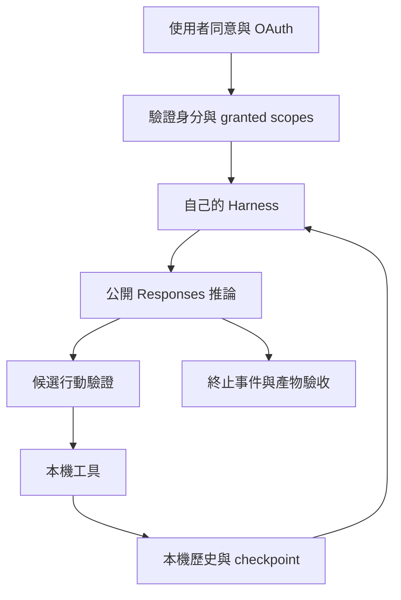

# 08 · 訂閱 OAuth、Responses 與自建 Harness

[章節入口](README.md) · [設計取捨](design-notes.md) · [練習](exercises/README.md)

## 本章完整案例

你要做開源、本機執行的研究助理，沿用使用者允許的 ChatGPT 方案額度。你希望自己控制工具與 loop，也能比較接入 Codex 現成 harness 的方案。

案例與練習軌跡為合成教學資料，沒有執行真實業務操作。

## 這條路線能學什麼

官方 Sign in with ChatGPT plan usage 讓符合資格的開源／本機託管應用，在取得使用者同意後發送合格的 Responses 請求。這是真實推論路線，仍屬 preview。帳號資格、模型、工作區政策與額度須個別確認，不能從原生 Codex 已登入推定自己的 app 也已獲授權。

## 自己的 OAuth 註冊與權限

首次流程為應用程式建立穩定 host ID，使用動態註冊入口，產生 state、nonce 與 PKCE，經瀏覽器完成同意及 loopback callback，再交換與驗證 token。保存的是發給該註冊的 client ID；host ID 是環境識別，不是秘密。檢查 granted scopes 中的 chatgpt.tokens.use.direct，ID token 有效並不代表可使用方案額度。

## Responses 是推論層

依此 preview 文件使用公開 POST https://api.openai.com/v1/responses，以授權 access token 作 Bearer。HTTP 請求要求 store=false、stream=true；input 是帶必要歷史的陣列，不能依靠 previous_response_id 保存對話。工具封裝、可用參數與能力必須依 preview 限制處理，不能把一般 API 範例整份照搬。

## 你打造的 harness 掌控循環

模型產生工具要求後，本機控制器先驗證格式、授權與業務條件，才執行工具並把結果與對應呼叫關係帶進下一輪。歷史、checkpoint、核准與停止都由你的應用程式管理。store=false 不會禁止你的 app 保存經授權的本機任務狀態。

## 使用 Codex 現成 harness 的比較

也可透過 app-server，把自己的授權 token 接到 Responses provider，由 Codex 管理既有工具循環。你的 app 仍負責 OAuth 更新、事件與結果驗收；文件的 env_key 配置在 token 更新後需重啟 app-server 並 resume。Hosted file search、Code Interpreter、原生 computer use 等能力不在這條 preview 支援範圍；本機 shell/MCP 工具與它們屬不同執行層。

## 用案例走一次

先完成授權與 scope 檢查，再讀可用模型；未來用一次最小唯讀任務驗證推論，必須讀到 response.completed。若串流中途出現 response.failed，保留錯誤與進度。自己的 loop 再加入本機讀檔與引用工具；不要把教材生圖功能當成此 Responses 路線支援的 hosted image generation。

## 精確機制圖

這張圖呈現本章需要討論的責任或狀態。實際功能、權限與可用性依所選 runtime、安裝版本及帳號驗證。

## 三個帶走的問題

- 能設計訂閱授權下的最小自建 harness：你會怎麼向另一位工程師說明？
- 能把 OAuth、推論、工具與恢復責任分層：需要哪些證據才能判斷？
- 如果模型的建議錯誤，哪一層應阻止錯誤擴大？

## 來源與閱讀焦點

查證基線：2026-10-19。先讀來源中與本章名詞、責任及限制直接相關的段落；原始論文不要求第一輪讀完全部實驗。

- [S03 · ChatGPT plan usage overview](https://developers.openai.com/siwc/token-sharing-open-source) — 官方 preview；開源／本機託管應用的訂閱授權
- [S04 · Registration and sign-in](https://developers.openai.com/siwc/token-sharing-open-source/sign-in) — 官方 preview；動態 client 註冊、PKCE、授權範圍
- [S05 · Models and inference](https://developers.openai.com/siwc/token-sharing-open-source/models-and-inference) — 官方 preview；公開 Responses endpoint 與完成事件
- [S06 · Preview limitations](https://developers.openai.com/siwc/token-sharing-open-source/preview-limitations) — 官方 preview；參數、工具與歷史限制，實作前必重查
- [S07 · Codex app-server with ChatGPT plan](https://developers.openai.com/siwc/token-sharing-open-source/codex-app-server) — 官方 preview；app-server、Responses provider 與 token 更新
- [S25 · Errors and recovery](https://developers.openai.com/siwc/token-sharing-open-source/errors-and-recovery) — 官方 preview；額度、資格、能力限制與 OAuth 恢復

進一步看[來源版本與更新政策](../../../references/sources.md)。
