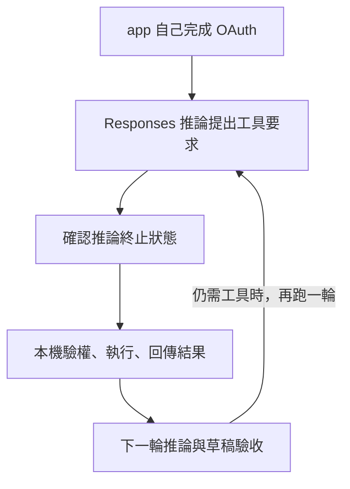

# 08 · 訂閱 OAuth、Responses 與自建 Harness：教學與案例

## 先抓住一個問題

**如果想自己安排每一步，訂閱 OAuth、Responses 和自己寫的 harness 要怎麼接？**

上一章由 Codex 提供現成循環。這章比較自己掌控循環的方式；兩條路都能拿同一份客服資料作設計。

## 把題目放到桌上

你要做本機客服助理，自己決定讀工單、讀店規、何時停。它想經使用者同意使用 ChatGPT 方案額度；這不是把既有 Codex 登入檔搬進程式。

這是虛構教材案例，不是法律建議、真實客服紀錄或執行證據。完整設定見[共同案例](../../../maps/course-story.md)。

讀這章時先想：手上已知什麼、還缺什麼、誰能做哪個動作？不要急著把每個英文名詞都背起來。

本課基礎資料：T-1042 r3；10/08 到 10/20 相差 12 天。D14 要求日期差不超過 14 天且未拆封；r3 的包裝狀態未知。原任務只讀與寫草稿。本章或題目若另述變體，只有明示條件改變。

## 名詞先換成人話

| 名詞 | 先用人話說 | 放進本例 |
| --- | --- | --- |
| OAuth／授權流程 | 讓使用者明確同意 app 取得某種使用權限。 | 允許此 app 使用方案推論。 |
| Scope／權限範圍 | 授權結果允許做哪些事。 | chatgpt.tokens.use.direct 與登入身分不同。 |
| Access token／存取憑證 | 呼叫時代表已授權身分的憑證。 | 作為 Bearer 傳給支援的 endpoint。 |
| Responses／模型推論介面 | 送入這輪資料，取得模型文字或工具要求。 | 模型要求讀 T-1042。 |
| Stream／串流 | 結果以多個事件陸續到達。 | 先看到文字片段，最後才知本次推論是否成功。 |

## 先把三份工作分清楚

OAuth 管的是「這個 app 獲准用誰的哪些權限」；Responses 管的是模型這次推論；harness 管的是任務怎樣往下走。拿到推論權，不會自動替你讀工單、保存進度或批准退款。這些仍是自己的工具與控制程式的責任。

## 登入，和獲准使用方案，是兩關

官方對符合資格的開源／本機託管 app 提供 Sign in with ChatGPT plan usage preview。自己的 app 要走註冊與同意流程，驗證授權結果，確認 granted scopes 包含 chatgpt.tokens.use.direct。能辨認使用者，不代表已獲准使用方案額度；原生 Codex 已登入也不是自己 app 的授權證據。

首次流程涉及穩定 host ID、發給此註冊的 client ID，以及 state、nonce、PKCE。白話說，前兩者區分 app 註冊與執行環境；後三者協助核對回呼與 token，並把授權碼交換綁到起始 client。它們解決不同檢查，不可只保留一項。

## 推論結束了，工具仍要你自己執行

模型可能回「請讀 T-1042」而不是最終回答。先讀完本次推論的終止事件，確認沒有 failed 或 incomplete，再由本機驗證工具要求、執行讀取，將呼叫與結果的關係帶進下一輪。這就是自己建立 loop；response.completed 只證明這次推論完成，不證明工單已處理。

## 這條 preview 的具體限制

使用公開 POST https://api.openai.com/v1/responses；HTTP 需 store=false、stream=true，input 帶必要歷史，不靠 previous_response_id 保存對話。Function/custom tools 的封裝依文件採 namespaces 或 additional_tools。Hosted file search、image generation、Code Interpreter、原生 computer use、hosted MCP/connectors 與 Responses tool_search 等目前不支援這條路線。

歷史可以由自己的 app 在本機保存。若接 Codex app-server，既有 harness 接手部分循環，你仍管 app 的 OAuth 更新與結果驗收；文件的 env_key 配置更新 token 後要重啟並 resume。額度或資格不符就保存進度，不自動改用另一種計費。

## 完整走一次

| 步驟 | 發生什麼 | 為什麼這樣處理 |
| --- | --- | --- |
| 先處理授權 | 驗證 app 的註冊、帳號、granted scope | 未授權不能開始推論。 |
| 第一次推論 | 模型要求讀 T-1042；本次推論正常結束 | 還沒有真的讀工單。 |
| 本機執行 | 檢查只讀權限後讀工單，再把結果帶回 | 呼叫與工具結果不能接錯。 |
| 下一次推論 | 取得 D14、指出拆封未知，產生詢問草稿 | 驗收草稿；業務資格仍等待資料。 |

**這章要留下的產物：**自己的 harness 留下授權狀態、每次推論終止狀態、工具要求與實際結果，最後交付有條件與引用的草稿。

拆成三層後，登入失敗、模型串流失敗和工具越權不會混成同一種錯。也能用相同客服題目比較自己的 loop 與 Codex 整合，而不偷換成功標準。

## 用流程核對責任

圖的重點是「確認推論終止狀態」接到「本機驗權、執行、回傳結果」時需要哪些證據。請對照上表，說明少了這一步會造成什麼誤判。

## 接著做什麼

先做[Q01／Q03／Q05](exercises/README.md)，保留自己的第一版答案。遇到疑難先看[設計取捨](design-notes.md)，需要才開提示。

自己接工具的責任清楚了。下一章解釋怎麼讓工具跨應用重用，以及 Skills 和專案指令各放什麼。

## 來源與閱讀焦點

來源初查：2026-10-19；本次複核項目與日期見來源表。先讀來源中與本章名詞、責任及限制直接相關的段落；原始論文不要求第一輪讀完全部實驗。

- [S03 · ChatGPT plan usage overview](https://developers.openai.com/siwc/token-sharing-open-source) — 官方 preview；開源／本機託管應用的訂閱授權
- [S04 · Registration and sign-in](https://developers.openai.com/siwc/token-sharing-open-source/sign-in) — 官方 preview；動態 client 註冊、PKCE、授權範圍
- [S05 · Models and inference](https://developers.openai.com/siwc/token-sharing-open-source/models-and-inference) — 官方 preview；公開 Responses endpoint 與完成事件
- [S06 · Preview limitations](https://developers.openai.com/siwc/token-sharing-open-source/preview-limitations) — 官方 preview；參數、工具與歷史限制，實作前必重查
- [S07 · Codex app-server with ChatGPT plan](https://developers.openai.com/siwc/token-sharing-open-source/codex-app-server) — 官方 preview；app-server、Responses provider 與 token 更新
- [S25 · Errors and recovery](https://developers.openai.com/siwc/token-sharing-open-source/errors-and-recovery) — 官方 preview；額度、資格、能力限制與 OAuth 恢復

進一步看[來源版本與更新政策](../../../references/sources.md)。
