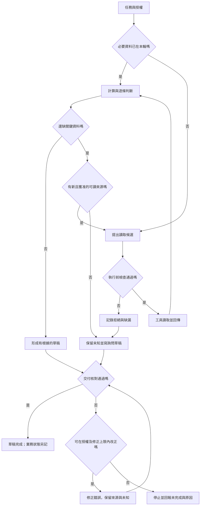

# 01 · Agent 與 Harness 全貌：教學與案例

下午，你打開客服傳來的訊息：「幫我看這張能不能退，先寫草稿，別寄出去。」旁邊是工單 T-1042，和一個看起來很能幹的模型。

你把要求貼進去。它回答：「我會先讀工單，再確認店規。」

現在先別按下一個按鈕。**它剛剛做了什麼？** 如果你把這句話當成「已經讀過」，接下來的判斷就會建立在不存在的證據上。

這是本課的合成案例。我們會一路用它練習工程判斷，不把下面的事件當成真實執行紀錄。

閱讀路徑：先跟著五個步驟讀到「本章驗收」；責任全表與完整流程圖留在後面的深挖區，今天可以先略過。

## 先抓住一個問題

這章先追一件事：從模型說「我會做」，到你真的能交差，中間還缺了誰的工作？

### 第一步：先寫下「交付契約」

你在筆記上寫：「這次交回覆草稿。」再補一句：「不寄送、不關單、不退款。」

這個動作很小，卻先排除了三件事：模型不能把有幫助的建議變成額外授權；資料即使完整，也不會自動獲得寄送權；最後要驗收的是草稿，而不是退款有沒有完成。

這份「做什麼、做到哪裡」的約定，這裡叫交付契約。先記住用途，不必背名詞。

## 把題目放到桌上

你展開 T-1042。買入日是 10 月 8 日，申請日是 10 月 20 日。你用日期相減，得到 12 天。

現行店規 D14 寫著：「日期差不超過 14 天，而且商品未拆封。」再看包裝欄位，空白。

**停 15 秒：**你現在會寫「符合條件」，還是「日期符合，另有條件待確認」？先在心裡選一句，再往下讀。

天數這一條成立，還不能把「而且」後面的條件吃掉。空白沒有證明已拆封，也沒有證明未拆封。因此你先留下兩行判斷：

> 日期條件：12 ≤14，符合。
> 包裝條件：未知，待確認。

這裡的未知不是失敗，也不是拒絕退貨。它提醒你：現在的證據還不能支持完整結論。你仍然可以把缺漏寫進草稿，請客服下一步確認。

跳章或中斷後需要核對：本章完整固定資料

- 工單 T-1042，版本 r3；買入 2026-10-08，申請 2026-10-20，純日期相減為 12 天。
- D14 自 2026-10-01 生效，條件為日期差 ≤14 天且未拆封。
- D07 是舊 7 天規則，10/01 起被 D14 取代，不拿它判斷本例。
- r3 包裝未知。只准判斷與草稿，不寄送、不關單、不退款。
- 完整合成設定見[共同案例](../../../maps/course-story.md)。其他章明示的變體，不會回頭改本章。

## 完整走一次：從任務到能交付的草稿

### 第二步：把取資料和理解資料分開

回到模型那句「我會先讀工單」。在真正的系統裡，這只是一個候選動作。必須有程式收到要求，確認它可以讀 T-1042，呼叫讀取工具，再把結果交回來。

負責接這些步驟的執行控制，本課稱為 **harness**。你可以先把它想成「讓模型的候選動作有機會安全落地、也能被拒絕的那段程式」。

模型負責提議；控制程式負責檢查與分派；工具真正接觸資料，回傳 r3。你要等到回傳，才有理由說「讀到了這份工單」。如果 r3 和店規一開始就附在輸入中，就直接使用，不必多讀一次來證明自己像個 Agent。

如果模型忽然建議「順便關單」，同一個控制端必須攔住。靠模型答應「我會遵守」不夠，因為那仍是模型產生的文字。拒絕要發生在真正執行之前。

### 第三步：逐條評估，先別跳到總結

資料讀回後，模型可以幫你整理：「日期符合，缺少拆封資訊。」日期由可靠計算核對，結論則對回 D14 的兩條條件。

你接著想：缺包裝，是否還有可讀的附件？本章沒有提供其他來源。這時繼續讀同一份 r3，只會再拿到同一個空白。

**停 20 秒：**假如你把流程寫成「遇到空白就產生固定詢問」，它需要模型自己選下一步嗎？

這個問題會決定你寫出多少控制程式，也會決定往後要除錯多少種路徑。先把它留下，下一段就做選擇。

## 先決定交付，再決定要不要 Agent

### 情況一：步驟與分支都能預先列完

你先畫一條最簡單的路：讀欄位 → 算天數 → 檢查包裝 → 缺資料就套詢問模板。這條路完全寫得出來，也不需要臨場選下一個來源。

這種事先定好控制路徑的安排叫 **workflow**。把 CSV 的「姓名」欄改成 name，也適合從這裡開始：欄名和衝突規則清楚後，固定程式就能做。

T-1042 也不會因為是中文客服問題，就突然必須用 Agent。遇到未知只是多一個固定分支，並不足以證明需要模型選路。

### 情況二：下一步取決於剛讀到的內容

現在想一個清楚標示的設計變體：未來的工單可能附照片、收據或客服紀錄，哪個來源有用，要看剛讀到的內容才知道。你可能讓模型判斷下一個值得讀的來源，再由控制端檢查能否執行。

這種觀察中間結果、再決定下一步的助理系統，本課稱為 **Agent**。不是所有決定都要交給它：日期仍可由程式算，授權仍由控制端檢查，停止仍需明確條件。

如果只是要從自由文字抽出「已拆封」，也可以只放一個模型步驟，外面仍維持固定 workflow。先讓模型解決一個具體困難，再評估是否需要更多選路能力。

## 回到桌上的草稿

### 第四步：檢查是否還有有用且獲准的動作

目前已知日期符合、包裝未知，也沒有其他可讀來源。你的下一步不是重查十次，而是把缺漏寫成一個問題。

若未來真的有另一份獲准可讀的附件，才繞回讀取，再評估。這是有條件的循環，不是讓模型一直忙到說出肯定答案。

### 第五步：交付產物並核對可宣稱範圍

你準備交出的內容可以是：

> 判斷備註：依 D14，申請與購買相差 12 天，日期條件符合。T-1042 r3 未記載是否拆封，目前無法判定符合全部條件。
>
> 回覆草稿：「您好，為確認是否符合本店退貨條件，請問商品是否已拆封？確認後我們再依 D14 進一步判斷。」

交之前，你核對來源、日期、未知和授權，也查這輪實際做過哪些動作。草稿若把未知寫成未拆封，就退回修正；如果修不對，要交代未完成的原因，不能照樣標通過。

確認草稿符合約定後，這一輪可以結束。**草稿完成；退貨資格仍待資料。** 這兩句應同時留給客服，避免他看到「成功」就以為整件業務已辦完。

## 反例：一句話偷偷跨過三個邊界

現在你再看一份不合格候選：「12 天內申請，符合退貨規定，我已寄信並關單。」

先改第一個跳躍：12 天只支持日期條件，不能補出「未拆封」。所以前半句要改成「日期符合，包裝待確認」。

再看後半句。本輪沒有寄送或關單授權；這些文字也不是操作證據。先阻止未授權動作，再核對實際紀錄，依觀察範圍更正交付，不能為了讓先前的話變真而偷偷補做。

這三種錯要在不同位置處理：判斷時保留未知，執行前檢查權限，交付前核對證據。單純把 prompt 改得比較保守，沒有取代這些控制。

## 本章驗收：交得出什麼才算懂

先離開本文，用自己的話寫兩句：模型提議後，誰真正做事？草稿完成時，哪件事還沒完成？

接著做[Q01](exercises/README.md#c01-q01)，把四個動作放回負責者；再做 Q03、Q05。今天只走 7 天路線，先做 Q01、Q05 即可。

你不必一次背完下面的名詞。核心是能把候選、執行與證據分開，並用已知和未知交出不越權的草稿。

## 深挖區：需要畫架構或回答追問時再打開

## 五個角色，不用互相繞著定義

| 名詞 | 本章具體責任 | 不能單憑它保證什麼 |
| --- | --- | --- |
| Model／模型 | 依本輪資料產生文字或候選動作 | 「我已寄出」不證明外部寄送。 |
| Agent／助理系統 | 觀察中間結果再選下一步 | 可選路不等於可加權限。 |
| Harness／執行控制 | 接模型、分派工具、驗權、保存進度、停止 | 有檢查函式不代表檢查寫對。 |
| Runtime／執行系統 | 提供控制實際運作的軟體與生命週期，例如 Codex | 選了產品不等於任務已驗收。 |
| Environment／執行環境 | 提供可接觸的檔案、程序、網路與資料 | 分資料夾不等於限制程序只能讀那裡。 |

這是本課的工作用語；不同文章可能把 harness 與 runtime 畫成重疊範圍。討論時直接指出哪段程式呼叫工具、拒絕越權、保存結果，比只爭名稱清楚。

工具是可被呼叫的具體功能，可以在 runtime 內，也可以由外部提供。模型、執行控制與工具不必在同一個程式中，但候選、允許、結果三份責任不能消失。

## 用分支流程核對責任

這是設計圖，不是實測軌跡。修正上限需在未來 Lab 定義；它防止驗收不通過時永遠重寫。工具失敗也不能把空結果當完整資料，第 03、12 章會處理更完整的錯誤與恢復。

看圖重點：模型只是執行系統的一部分；權限與驗收有獨立責任。圖的左右順序不是固定執行順序，權限也不只在任務進入時檢查。

**看圖練習：移除綠色驗收站後，還能根據哪些證據宣稱任務完成？為什麼模型的最終回答不能單獨替代它？**

插圖由 Codex 內建 imagegen 生成並檢視；[生成提示詞](assets/prompt.md)。示意圖的類比不替代本章流程與權限規格。

## 初學者常問

### 「模型知道工具有哪些，為什麼不能自己呼叫？」

它可以提出要求，但仍有實際程式把要求轉成讀檔或網路操作。那段程式能接觸系統，也必須檢查目標與權限。產品把步驟包成按鈕後，責任仍存在，只是由產品的執行系統承擔部分工作。

### 「資料不完整卻結束，這樣不是失敗嗎？」

回到交付契約：此輪要有根據的草稿，指出缺漏就是合理結果。如果交付是辦完退款，現有授權與資料都不足，應說未完成。停止不能把契約偷偷改小，也不能靠編資料把它做大。

### 「Harness 能不能直接保證答案正確？」

不能。權限檢查擋住關單，不會自動發現用錯 D07；工具讀取成功，也不保證條款理解正確。要把這些錯分別放進驗收案例，第 13 章會把評估做完整。

## 延伸：自主程度要看紀錄，不能只看名稱

面試時若說「這是全自動 Agent」，接著要能指向一個具體決定：誰挑來源、誰選工具參數、誰批准寫入、誰決定停止。

讀到缺漏後，模型改提下一個來源，可以支持「這次有依中間結果選路」；它不能證明所有輸入都會選對。關單候選被拒，能證明該次被攔住；它不能證明所有工具都有同樣控制。

本課談的自主，是在指定範圍內選下一步。固定流程包住一段模型選路，也值得練；不需要把全部決定都交出去。

## 接著做什麼

下一章會把 r3、D14、禁止動作與缺漏放進「這輪資料袋」。只有存檔卻沒交給模型看的資料，不能期待模型自然知道。

**下次從這裡接：**

> 我目前的判斷：日期＿＿；包裝＿＿；本輪交付＿＿。
> 我還想釐清：＿＿。
> 下一個入口：[Q01](exercises/README.md#c01-q01)／[Q03](exercises/README.md#c01-q03)／[第 02 章](../02-llm-and-context/README.md)，我選＿＿。

## 來源與閱讀焦點

來源初查：2026-10-19；本次複核項目與日期見來源表。先讀來源中與本章名詞、責任及限制直接相關的段落；原始論文不要求第一輪讀完全部實驗。

- [S01 · Agent runtimes](https://developers.openai.com/api/docs/guides/agents) — 官方產品文件；不同 runtime 的責任與資源生命週期
- [S14 · Building effective agents](https://www.anthropic.com/engineering/building-effective-agents) — 第一方架構經驗；workflow 與 Agent 模式
- [S16 · Demystifying evals for AI agents](https://www.anthropic.com/engineering/demystifying-evals-for-ai-agents) — 第一方工程經驗；task、trial、grader、outcome、trace

進一步看[來源版本與更新政策](../../../references/sources.md)。
