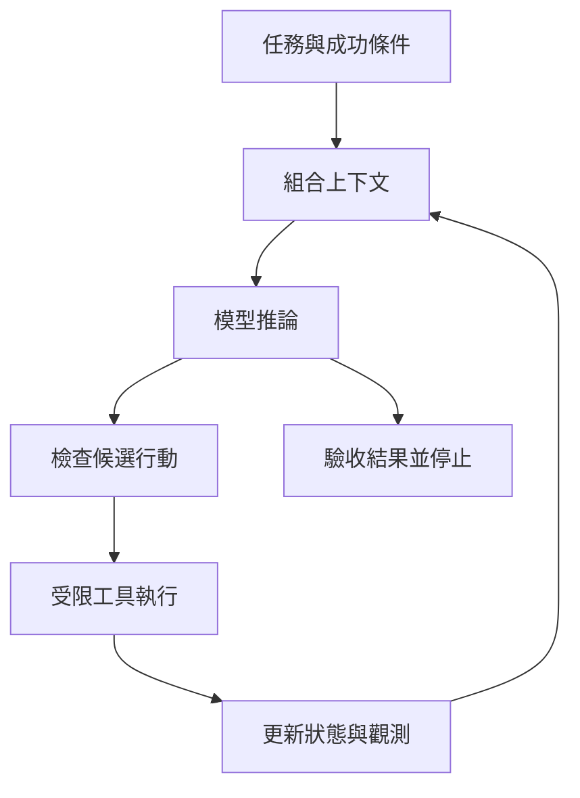

# 01 · Agent 與 Harness 全貌

[章節入口](README.md) · [設計取捨](design-notes.md) · [練習](exercises/README.md)

## 本章完整案例

你要做文件研究助理：讀三份規格，回答「哪些功能已可用」，附來源。另一項需求是固定把 CSV 欄位轉名。兩者都會處理文字，但只有前者需要在證據不足時選擇下一個查找動作。

案例與練習軌跡為合成教學資料，沒有執行真實業務操作。

## 概念插圖

看圖重點：模型只是執行系統的一部分；權限與驗收有獨立責任。圖的左右順序不是固定執行順序，權限也不只在任務進入時檢查。

**看圖練習：移除綠色驗收站後，還能根據哪些證據宣稱任務完成？為什麼模型的最終回答不能單獨替代它？**

插圖由 Codex 內建 imagegen 生成並檢視；[生成提示詞](assets/prompt.md)。示意圖的類比不替代下方流程與權限規格。

## 從任務開始，而不是從框架開始

先寫清楚輸入、允許行動、產物與成功條件。研究助理的「完成」可以是每項結論都附可定位證據，遇到衝突時保留不確定性。固定 CSV 轉換則可由確定性程式直接完成。模型能力是方案條件之一，需求與可驗收性決定需要多少自主性。

## Agent、workflow、harness、runtime

本教材把 Agent 視為能依中間觀測選擇後續行動的系統。Workflow 的主要路徑由工程師預先安排，兩者可在同一產品中混用。Harness 是模型外圍的控制與執行系統：整理上下文、接工具、套用權限、保存進度並處理停止。Runtime 著重這些機制實際如何運作；environment 則是命令、檔案與程序所在的環境。業界名詞邊界會重疊，因此面試時先聲明你的用法。

## 模型提出行動，應用程式承擔行動

模型輸出「已更新工單」只是文字；工具執行的結果與目標工單讀回才是外部狀態證據。同樣地，模型說它有權限不能建立權限。這個分工讓工程師能換模型而保留執行政策，也能單獨測試工具與驗收器。

## 最小 harness 的責任

一次循環先組合任務與觀測，呼叫模型，再分辨最終答案或工具要求。工具要求通過格式、權限與業務條件檢查後才執行；結果更新狀態，再決定繼續、等待人類、失敗或停止。每一步都需要可觀察狀態，不必替模型虛構內部思考過程。

## 設計先問的三件事

不知道結果是否正確時，要先設計驗收；不知道是否允許操作時，要先界定權限；不知道還需哪些證據時，才考慮讓模型動態規劃。把整個工作塞入一個大 prompt 會使這些責任糾纏，難以定位問題。

## 用案例走一次

研究助理可先讀三份已指定規格，再由模型指出證據缺口；harness 決定是否允許額外搜尋。最後由驗收步驟檢查結論與引用是否對應。CSV 題若規則完整，直接轉換並比對欄位即可；無須為了使用 Agent 而增加自主循環。

## 精確機制圖

這張圖呈現本章需要討論的責任或狀態。實際功能、權限與可用性依所選 runtime、安裝版本及帳號驗證。

## 三個帶走的問題

- 能把模型、執行系統與執行環境分開：你會怎麼向另一位工程師說明？
- 能依需求選擇自主程度並定義可查驗結果：需要哪些證據才能判斷？
- 如果模型的建議錯誤，哪一層應阻止錯誤擴大？

## 來源與閱讀焦點

查證基線：2026-10-19。先讀來源中與本章名詞、責任及限制直接相關的段落；原始論文不要求第一輪讀完全部實驗。

- [S01 · Agent runtimes](https://developers.openai.com/api/docs/guides/agents) — 官方產品文件；不同 runtime 的責任與資源生命週期
- [S14 · Building effective agents](https://www.anthropic.com/engineering/building-effective-agents) — 第一方架構經驗；workflow 與 Agent 模式
- [S16 · Demystifying evals for AI agents](https://www.anthropic.com/engineering/demystifying-evals-for-ai-agents) — 第一方工程經驗；task、trial、grader、outcome、trace

進一步看[來源版本與更新政策](../../../references/sources.md)。
