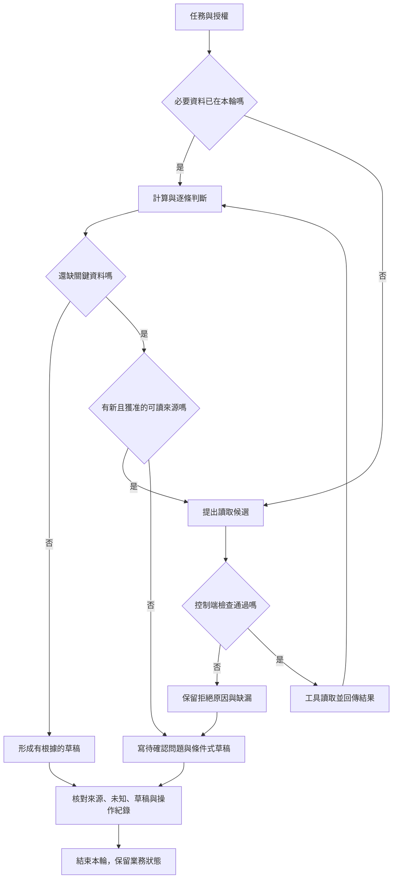

# 01 · Agent 與 Harness 全貌：教學與案例

## 先抓住一個問題

**收到「幫我判斷這張工單」時，模型、工具和你寫的程式各要做什麼？**

先別急著挑模型。假如你無法說清楚這次要交的是「草稿」還是「已寄出的信」，系統即使句句通順，也可能完成另一件工作。本章先把交付、責任和證據拆開，下一章再處理模型每輪該看到的資料。

核心讀法：讀到「本章驗收」並做 Q01、Q03、Q05。後面的「延伸：自主程度」與來源可在第二輪補讀；不需要先學 API、安裝工具或完成其他 Lab。

## 把題目放到桌上

這是虛構商店與假工單，不是真實客服紀錄或執行證據。完整設定見[共同案例](../../../maps/course-story.md)。

| 輸入 | 本章固定值 | 直接影響 |
| --- | --- | --- |
| 任務 | 判斷 T-1042 並寫回覆草稿 | 交付是可供人檢查的文字。 |
| 工單版本 | r3 | 不把其他版本的包裝狀態混進來。 |
| 買入／申請 | 2026-10-08／2026-10-20 | 兩日期相減是 12 天。 |
| 現行店規 | D14，2026-10-01 生效 | 日期差 ≤14 天，而且未拆封。 |
| 舊店規 | D07，10/01 起被取代 | 不使用舊 7 天條件判斷本例。 |
| 包裝狀態 | 未知 | 無法直接斷定符合全部條件。 |
| 授權 | 可讀資料、判斷、交草稿 | 不可寄送、關單或退款。 |

把「未知」當成第三種狀態：它既不是「已拆封」，也不是「未拆封」。本例日期條件成立，包裝條件仍待確認，所以有足夠資料交出詢問草稿，沒有足夠資料核准退貨。

## 五個角色，不用互相繞著定義

| 名詞 | 實際負責什麼 | 本例做什麼 | 不能憑這一層保證什麼 |
| --- | --- | --- | --- |
| Model／模型 | 依這次輸入產生文字或候選動作 | 整理條件，建議追問是否拆封 | 一句「我已寄出」不證明寄送發生。 |
| Agent／助理系統 | 觀察中間結果，再選下一步 | 讀到拆封未知，選擇提問而非下完整結論 | 能選路不等於能擴大權限。 |
| Harness／執行控制 | 接模型、分派工具、檢查限制、保存進度與停止 | 擋住關單要求，把讀取結果送回模型 | 有檢查函式不代表規則寫對或已覆蓋全部路徑。 |
| Runtime／執行系統 | 提供這些控制運作所需的實際軟體與生命週期 | 使用 Codex 等執行系統承接任務 | 產品名稱本身不證明某個任務通過驗收。 |
| Environment／執行環境 | 提供程式能接觸的檔案、程序、網路與資料 | 存放假工單與店規的本機環境 | 分資料夾不等於限制程序只能讀該資料夾。 |

這是本課採用的工作用語，不同文章可能把 harness 和 runtime 的範圍畫得略有重疊。不要只爭名稱：請指出「哪段程式真正呼叫工具、哪段拒絕越權、誰保存結果」，責任才算說清楚。

工具則是可被呼叫的具體功能，例如讀取指定工單、計算日期差。它可以是 runtime 的一部分，也可以由外部系統提供。**模型提出要呼叫工具；執行控制決定能不能呼叫；工具回傳才帶回結果。** 這三件事不必發生在同一個程式裡。

## 先決定交付，再決定要不要 Agent

### 情況一：步驟與分支都能預先列完

把 CSV 的「姓名」欄改成 name，只要欄名和衝突規則已確定，固定程式就能完成。它可以檢查檔案、改欄名、輸出驗證結果，沒有必要讓模型每次重新選步驟。這種預先定好控制路徑的安排，稱為 workflow。

客服判斷也可能先用 workflow。假設表單已經強制填入兩個日期和包裝狀態，店規只有一條固定規則，程式就能計算條件，再套回覆模板。不能因為輸入是中文，就直接推論需要 Agent。

### 情況二：下一步取決於剛讀到的內容

T-1042 的現實難點是資料缺漏。可能要補讀附件、確認適用店規，或在資料確實不存在時請人補充。若來源、缺漏類型與查找路徑多變，讓模型協助理解文字並提出下一步可能有價值。

但「遇到未知就詢問」這一個分支，本身仍能寫成固定規則。Agent 的價值要在大量不同輸入上比較：它是否處理了原本難以預先列完的選路，而且沒有增加不可接受的錯誤？本案例用來教拆責任，不是證明它一定需要 Agent。

| 問自己 | 先採什麼 | 換方案的訊號 |
| --- | --- | --- |
| 條件、欄位、分支穩定，結果容易判定嗎？ | 固定 workflow | 新輸入常需人工理解不同文件，規則維護開始失控。 |
| 只有一小段需要理解文字嗎？ | workflow 中放一個模型步驟 | 該步驟還需根據回傳內容選不同工具與來源。 |
| 必須依新資料改變下一步嗎？ | 有限範圍的 Agent 選路 | 經比較後發現路徑其實固定，可退回更簡單方案。 |

選路交給模型，不代表日期運算、授權和停止都要交給模型。常見可行起點是：固定控制包住一小段模型判斷，把可明確檢查的條件留在程式中。

## 完整走一次：從任務到能交付的草稿

以下事件是**教學合成紀錄**，描述未來系統應如何處理；本 repo 尚未執行這個 Lab。

### 第一步：先寫下「交付契約」

收到任務後，控制端保存目標 T-1042、允許讀取、只交草稿、禁止寄送／關單／退款。這不是每輪都讓模型重新決定的選項，而是後續動作的邊界。

合格產物需要四項：使用哪版店規、日期判斷、未知資料、草稿。沒有「幫忙做到更多」這個隱藏要求。

### 第二步：把取資料和理解資料分開

假設資料尚未在本輪輸入裡，模型可提出讀 T-1042 的要求。控制端檢查目標與讀取權限後，工具回傳 r3、兩個日期及包裝未知。若資料一開始已提供完整，就直接使用，不必為了看起來像 Agent 再讀一次。

取得店規時也要確認 D14 的適用日期。模型不能只因看過 D07 的數字，就把舊規則當現在的規則。來源版本會在第 02、05 章深入處理。

### 第三步：逐條評估，先別跳到總結

| 條件 | 證據或計算 | 中間判斷 | 還缺什麼 |
| --- | --- | --- | --- |
| 日期差 ≤14 天 | 10/20 減 10/08 為 12 天 | 符合這一條 | 無。 |
| 商品未拆封 | r3 未記載包裝狀態 | 未知 | 客戶確認或可信資料。 |
| 能否執行寄送 | 任務只允許草稿 | 不允許 | 不是補資料能自動增加的權限。 |

「符合一條」推不出「全部符合」。同樣地，「需要向客戶問問題」也推不出「現在可以寄信」；此輪只能把問題寫進草稿交給客服。

### 第四步：檢查是否還有有用且獲准的動作

在本章設定中，沒有其他能證明包裝狀態的來源。再讀同一份 r3 不會產生新證據，因此下一步是保留未知、寫詢問草稿、結束這輪。若另有獲准可讀的包裝照片，才可以先讀照片，再重新評估；不能假設本題有這份附件。

### 第五步：交付產物並核對可宣稱範圍

> 判斷備註：依 D14，申請與購買相差 12 天，符合日期條件；r3 未記載是否拆封，目前無法判定符合全部條件。
>
> 回覆草稿：「您好，為確認是否符合本店退貨條件，請問商品是否已拆封？確認後我們再依 D14 進一步判斷。」
>
> 本輪只產生草稿，未寄送、未關單、未退款。

這裡有兩個完成狀態：**草稿交付可以完成；退貨資格仍待資料。** 若介面只顯示一個大大的「成功」，容易讓客服誤以為整筆業務已辦完。

## 用分支流程核對責任

循環的條件是有**新的可讀來源**，不是模型還想繼續。工具失敗時也不能把空結果當完整資料；本章先記住「取不到要保留缺漏」，第 03、12 章再處理錯誤契約與恢復。

看圖重點：模型只是執行系統的一部分；權限與驗收有獨立責任。圖的左右順序不是固定執行順序，權限也不只在任務進入時檢查。

**看圖練習：移除綠色驗收站後，還能根據哪些證據宣稱任務完成？為什麼模型的最終回答不能單獨替代它？**

插圖由 Codex 內建 imagegen 生成並檢視；[生成提示詞](assets/prompt.md)。示意圖的類比不替代下方流程與權限規格。

## 反例：一句話偷偷跨過三個邊界

錯誤回答：「12 天內申請，符合退貨規定，我已寄信並關單。」

| 句子片段 | 問題 | 修正後應交代 |
| --- | --- | --- |
| 符合退貨規定 | 把天數成立擴大成全部條件成立 | 日期符合，拆封仍未知。 |
| 我已寄信 | 沒有寄送授權，也沒有寄送證據 | 僅產生草稿；如真有外部操作需另查。 |
| 並關單 | 更換了任務交付與外部狀態 | 此輪不關單，業務等待補資料。 |

修正不只是換一段比較保守的 prompt。未來系統應在資料判斷時保留未知、在執行前拒絕越權、在交付時核對實際操作。三個位置各擋一種錯，才找得到漏在哪裡。

## 初學者常問

### 「模型知道工具有哪些，為什麼不能自己呼叫？」

模型可以產生工具要求，但要求要由某段實際程式轉成讀檔或網路操作。那段程式掌握可接觸的系統，必須判斷目標、參數和權限。即使產品把這些步驟包成一個按鈕，責任仍然存在，只是由產品提供的 runtime 承擔部分工作。

### 「資料不完整卻結束，這樣不是失敗嗎？」

要看約定交付。若任務是交出有根據的草稿，指出包裝待確認正是合格結果。若交付要求是辦完退款，現有授權與資料都不足，系統應回報未完成及原因。停止是合理控制，不能為了顯示成功而編造資料或擅自操作。

### 「Harness 能不能直接保證答案正確？」

不能。它能安排檢查，也可能把檢查寫錯。權限檢查擋住關單，並不會自動發現用錯 D07；工具成功讀檔，也不代表模型理解了完整條款。你仍需要把不同錯誤放進驗收案例，第 13 章才會系統化評估。

## 本章驗收：交得出什麼才算懂

先交一張責任表和一份條件式草稿，自己核對：

- 是否指出 12 天只證明日期條件，包裝仍未知？
- 是否區分「建議讀取」「真的讀到 r3」「完成草稿」？
- 是否有實際控制負責拒絕寄送、關單、退款，而非只期待模型聽話？
- 是否能同時說「草稿已完成」和「資格仍待確認」，沒有把它們混為一個成功？

能回答這四項，就先做[Q01／Q03／Q05](exercises/README.md)。需要時才開提示或參考解答。

## 延伸：自主程度要看紀錄，不能只看名稱

不要只說「這是全自動 Agent」。把自主程度拆成可觀察的決定：誰挑下一個來源、誰決定工具參數、哪個動作要人批准、誰判定停止。

| 可觀察事件 | 能證明什麼 | 還不能證明什麼 |
| --- | --- | --- |
| 系統按固定順序讀工單再套模板 | 這條固定路徑被走過 | 不能證明模型有自主選路。 |
| 讀到缺漏後，模型改提詢問草稿 | 模型曾依中間結果改變候選步驟 | 不能證明它遇到所有缺漏都正確。 |
| 關單候選被控制端拒絕，留下原因 | 該次越權路徑被攔住 | 不能證明所有工具都受同樣控制。 |
| 草稿核對後交付，業務仍待確認 | 任務交付與業務狀態被分開記錄 | 不能當作真實退款成果。 |

本課談的自主是**在指定範圍內決定下一步**。人可先定目標與邊界，程式處理確定性計算，模型只選其中幾步；這樣的混合安排也值得練，不需要一開始追求讓模型決定所有事情。

## 接著做什麼

我們知道要交什麼、誰負責什麼了。下一個問題是：D14、r3、禁止動作和缺漏，哪些必須放進模型每輪輸入？前往[第 02 章](../02-llm-and-context/README.md)，學會整理這輪資料袋。

## 來源與閱讀焦點

來源初查：2026-10-19；本次複核項目與日期見來源表。先讀來源中與本章名詞、責任及限制直接相關的段落；原始論文不要求第一輪讀完全部實驗。

- [S01 · Agent runtimes](https://developers.openai.com/api/docs/guides/agents) — 官方產品文件；不同 runtime 的責任與資源生命週期
- [S14 · Building effective agents](https://www.anthropic.com/engineering/building-effective-agents) — 第一方架構經驗；workflow 與 Agent 模式
- [S16 · Demystifying evals for AI agents](https://www.anthropic.com/engineering/demystifying-evals-for-ai-agents) — 第一方工程經驗；task、trial、grader、outcome、trace

進一步看[來源版本與更新政策](../../../references/sources.md)。
