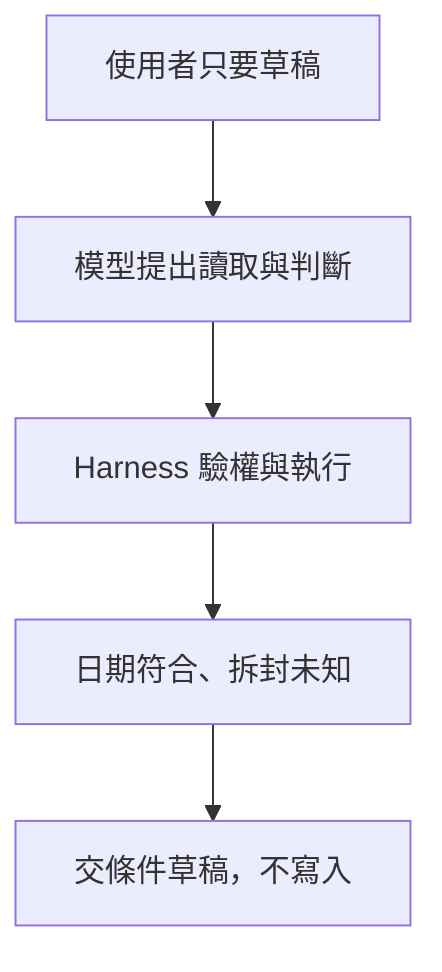

# 01 · Agent 與 Harness 全貌：教學與案例

## 先抓住一個問題

**收到「幫我判斷這張工單」時，模型、工具和你寫的程式各要做什麼？**

這是起點。我們先把「要交什麼」講清楚，後面才知道為什麼需要上下文、工具、記憶與權限。

## 把題目放到桌上

客服要你判斷 T-1042 能否退貨，只寫回覆草稿。買入日是 10/08，申請日是 10/20；店規 D14 要求相差不超過 14 天，而且商品未拆封。工單沒有寫是否拆封。禁止寄送、關單與退款。

這是虛構教材案例，不是法律建議、真實客服紀錄或執行證據。完整設定見[共同案例](../../../maps/course-story.md)。

讀這章時先想：手上已知什麼、還缺什麼、誰能做哪個動作？不要急著把每個英文名詞都背起來。

本課基礎資料：T-1042 r3；10/08 到 10/20 相差 12 天。D14 要求日期差不超過 14 天且未拆封；r3 的包裝狀態未知。原任務只讀與寫草稿。本章或題目若另述變體，只有明示條件改變。

## 名詞先換成人話

| 名詞 | 先用人話說 | 放進本例 |
| --- | --- | --- |
| Model／模型 | 讀取這次提供的資料，產生文字或下一步建議。 | 提出「先確認是否拆封」。 |
| Agent | 能看中間結果，再決定下一步的助理系統。 | 讀完工單後發現缺資料，改為提問。 |
| Harness | 包住模型的執行程式，安排工具、限制與進度。 | 擋住未授權的關單要求。 |
| Runtime／執行系統 | 讓這些機制實際運作的軟體。 | Codex 是一種可使用的執行系統。 |
| Environment／執行環境 | 程式與資料所在的地方。 | 放教學工單的本機資料夾。 |

## 先說清楚「幫我判斷」到底要交什麼

客服不是要一段聽起來很肯定的話，而是需要：適用店規、日期計算、仍缺的資料，以及可供人工確認的草稿。10/20 減 10/08 是 12 天，日期條件符合；未拆封條件沒有資料，所以還不能下完整結論。

這裡已經有三種不同工作：程式能算日期，工具能讀文件，模型能把條件和缺漏整理成易懂的回答。把責任拆開後，錯誤比較容易找到：算錯天數、拿錯店規，和擅自關單是三種不同問題。

## 什麼時候才需要 Agent

如果工作只是把 CSV 的「姓名」欄改成 name，規則已經完整，可以直接寫固定流程。客服問題則可能需要補讀文件、追問客戶或保留未知，下一步受剛取得的資料影響，才有讓模型參與選路的價值。固定流程稱為 workflow；它也可以在其中一小段使用 Agent。

## 模型的建議如何變成真實行動

模型說「請讀工單」時，還沒有真的讀到資料。Harness 要檢查讀取是否被允許，呼叫工具，再把結果交回模型。同樣地，模型說「我已退款」也不會憑空完成退款，必須有真正操作與讀回結果。

所以更強的模型仍需要執行系統。模型可建議下一步；你寫的程式要決定哪些動作能執行、何時停止，以及有沒有滿足這次交付要求。

看圖重點：模型只是執行系統的一部分；權限與驗收有獨立責任。圖的左右順序不是固定執行順序，權限也不只在任務進入時檢查。

**看圖練習：移除綠色驗收站後，還能根據哪些證據宣稱任務完成？為什麼模型的最終回答不能單獨替代它？**

插圖由 Codex 內建 imagegen 生成並檢視；[生成提示詞](assets/prompt.md)。示意圖的類比不替代下方流程與權限規格。

## 完整走一次

| 步驟 | 發生什麼 | 為什麼這樣處理 |
| --- | --- | --- |
| 1. 拿到任務 | 只准判斷與寫草稿 | 把禁止寄送、關單、退款保存成限制。 |
| 2. 讀資料與算日期 | T-1042；D14；相差 12 天 | 日期符合，但拆封資訊缺漏。 |
| 3. 形成下一步 | 問「商品是否已拆封？」 | 不能用猜測補成未拆封。 |
| 4. 交付本輪結果 | 交出條件式草稿，保留待確認項 | 沒有執行任何業務寫入。 |

**這章要留下的產物：**「依 D14，申請相隔 12 天，符合天數條件；工單尚未記載是否拆封，需先確認。以下提供詢問草稿。本次未寄送、關單或退款。」

這段回答把已知與未知分開，也說明實際做了什麼。客服可以接著確認缺漏；另一位工程師也能檢查日期、引用與操作紀錄，而不必相信模型的自我表態。

## 用流程核對責任

圖的重點是「Harness 驗權與執行」接到「日期符合、拆封未知」時需要哪些證據。請對照上表，說明少了這一步會造成什麼誤判。

## 接著做什麼

先做[Q01／Q03／Q05](exercises/README.md)，保留自己的第一版答案。遇到疑難先看[設計取捨](design-notes.md)，需要才開提示。

我們知道要交什麼了，但模型每次該看到哪些資料？下一章處理「這一輪該帶什麼進去」。

## 來源與閱讀焦點

來源初查：2026-10-19；本次複核項目與日期見來源表。先讀來源中與本章名詞、責任及限制直接相關的段落；原始論文不要求第一輪讀完全部實驗。

- [S01 · Agent runtimes](https://developers.openai.com/api/docs/guides/agents) — 官方產品文件；不同 runtime 的責任與資源生命週期
- [S14 · Building effective agents](https://www.anthropic.com/engineering/building-effective-agents) — 第一方架構經驗；workflow 與 Agent 模式
- [S16 · Demystifying evals for AI agents](https://www.anthropic.com/engineering/demystifying-evals-for-ai-agents) — 第一方工程經驗；task、trial、grader、outcome、trace

進一步看[來源版本與更新政策](../../../references/sources.md)。
