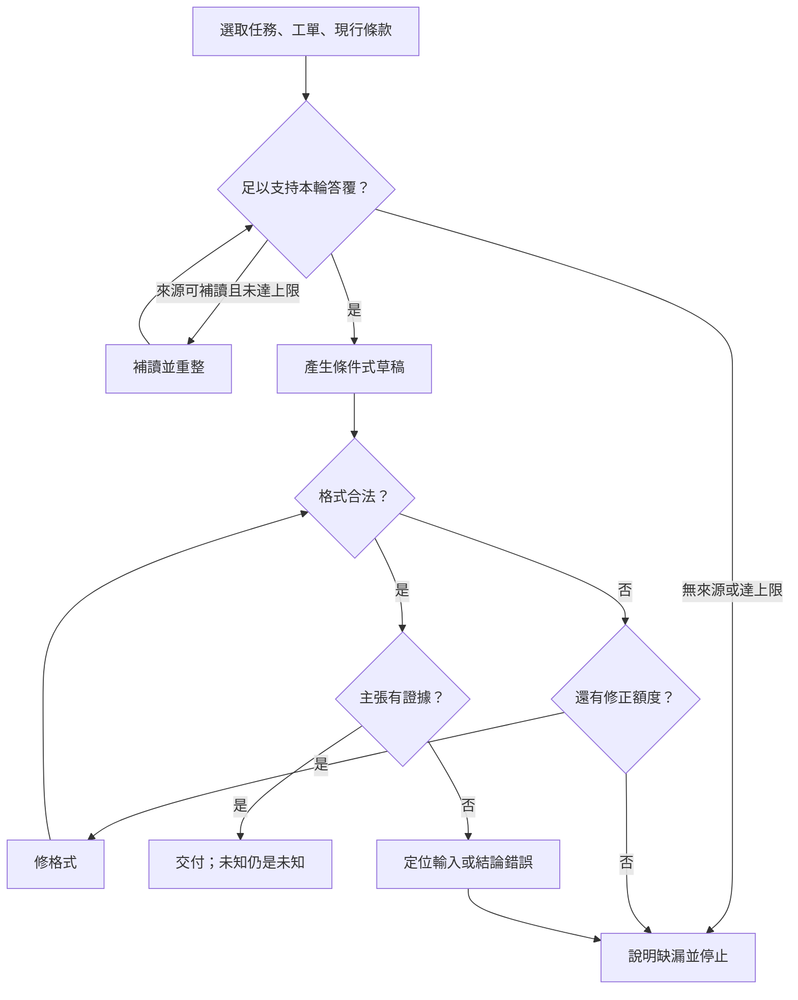

# 02 · LLM 與 Context Engineering：教學與案例

螢幕上，助理已經寫好：「申請在 14 天內，可以退貨。」你剛才給了它 30 頁歷史、兩版政策和整張工單，看起來什麼都沒漏。

你準備把這段話交給客服，卻注意到工單的「是否拆封」是空的。現行政策要求 **14 天內，而且未拆封**。資料給得很多，最關鍵的未知卻從回答裡消失了。

這是本章的合成場景。你現在要選：再塞更多資料，還是先檢查這次到底給了什麼、助理把什麼當成已知？

閱讀路徑：先跟著四步修好這一輪；有空再看深挖的壓縮表。中途停下，最後一節有接讀欄位。

<a id="核心問題與閱讀層次"></a>
<a id="跳章也能讀的案例"></a>

## 第一步：先看它這次真正看見什麼

你先打開工單 T-1042 r3。購買日期是 2026-10-08，申請日期是 10-20，相差 12 天。拆封欄沒有資料。客服只請你判斷並寫草稿，沒有請你寄出、關單或退款。

再看歷史紀錄。裡面有別張工單的「未拆封」，也有昨天留下的筆記。它們可能很像眼前的案件，但不是這張 r3 的證據。

這時才需要第一個名詞：**context，上下文**。它指這一次推論真正收到的輸入。我們把它想成「本輪資料袋」：任務、工單、政策和讀取結果都可能放進去。

資料存在硬碟，不代表已進資料袋；資料放進去，也不代表適用這張單。先檢查實際輸入，能把「根本沒看見」與「看見卻用錯」分開。

昨天的筆記是保存在外部的 **memory，記憶**。只有被讀出、選取並放進本輪輸入，才變成這輪 context。能讀檔與已讀檔也是兩件事。

你暫時不需要處理所有歷史。先圈出眼前的三件事：要交草稿、日期相差 12 天、拆封尚未確認。

<a id="資料袋怎麼組先分類再挑選"></a>
<a id="第一步把任務與外部資料分開"></a>
<a id="第二步讓來源帶著版本和位置"></a>

## 第二步：把現行規則放到它該在的位置

資料夾裡還有 D07，寫「7 天」。另一份 D14 寫「14 天，而且未拆封」。如果只把兩段貼給助理，沒有日期與適用關係，你其實還留了一個選擇讓它猜。

你查到：D07 自 2026-10-01 起被 D14 取代。本例應依 D14 判斷。把這段關係和完整兩個條件一起放入，才完成了政策資料的準備。

**停 15 秒：**你只剩一小段空間。會留下 D14 的未拆封條件，還是昨天重複搜尋的紀錄？先說理由，再繼續。

未拆封條件會改變結論，重複搜尋通常不會。這不是單純「把文字壓短」，而是先找出哪些資訊支撐這次決定。

任務裡的「只寫草稿」是給助理的要求；政策是被判讀的資料。這一類要求常稱為 **prompt，指令**。就算外部政策頁夾著「請立即寄出」，它也不會因此變成使用者授權。

標明「任務」與「來源」能幫助辨別，但不是安全鎖。包上 XML 標籤也不能保證文件指令失效；真正能不能執行寄送，仍由 harness 與工具檢查。第 11 章會接著談這個邊界。

D07 暫留歷史索引即可。若任務改成比較新舊政策，它就會變重要；資料選取是為了當前問題，不是永遠刪掉舊資料。

<a id="第三步直接表示未知"></a>
<a id="第四步只帶對這輪有用的歷史"></a>
<a id="完整-worked-example從原始資料到可交付草稿"></a>
<a id="1-組出五段輸入"></a>

## 第三步：整理輸入，讓未知留下來

現在你把本輪輸入整理如下。這是教材的資料分組，不是任何 API 的必要格式；D14 §1／§2 也是假文件的位置標籤。

```text
任務：判斷 T-1042 並寫草稿；禁止寄送、關單、退款。
工單：T-1042 r3；2026-10-08 購買，10-20 申請。
未知：拆封狀態 unknown，r3 沒有補充證據。
規則：D14 自 10/01 生效；§1 日期差 ≤14 天，§2 必須未拆封。
回查：D07 已被取代；其他紀錄留索引，必要時補讀。
```

注意第三行沒有寫「未拆封」。**沒有填，不是沒有拆封。** 如果為了欄位整齊把空值改成 false，下一步可能把它讀成「沒有拆封」，你就在人為整理資料時造出了一個事實。

<a id="2-把中間判斷寫成可查的帳"></a>

用這份輸入，先只做日期判斷：10/20 減 10/08 是 12，符合 D14 的天數條件。然後看另一條：未拆封仍沒有證據。因此不能從日期合格跳到全部合格。

這裡可以留一個很短、可回查的判斷帳：「日期符合，依兩日期與 D14 §1；拆封待確認，依 r3 與 D14 §2。」它讓人核對依據，不要求揭露模型隱藏推理。

<a id="3-寫出符合證據強度的輸出"></a>

重新寫出的草稿是：

> 您的申請相隔 12 天，符合 D14 的日期範圍。請先補充商品是否拆封，以便確認後續處理。

你也向客服註明：「工單 r3 拆封狀態未知；本次僅提供草稿，未寄送、關單或退款。」

現在已完成這輪的草稿，退貨本身仍等待資料。若來源顯示另有適用例外尚未讀，先補讀；本例明示的 D14 只有天數與未拆封兩條件。來源不足時應保留缺漏，不靠多問模型幾次把答案問成肯定。

<a id="4-驗收這一袋資料"></a>
<a id="格式對與內容對分開抓兩種錯"></a>

## 第四步：格式過關後，再問它憑什麼這樣說

假設這次把答案交成三個欄位：工單、結論、草稿。三欄都是字串，程式讀得懂。它仍可能在結論寫「日期符合，所以全部符合」。

約定欄位與型別的規則稱為 **schema**。它檢查資料形狀，不會替你查 r3 是否有拆封證據。

**停 20 秒：**如果三欄都合法，你會先要求重新輸出 JSON，還是先找那句「全部符合」的證據？

應先查證據。重排欄位不會補出拆封資訊。修正時保留合法格式，將結論改成「日期符合，拆封待確認」，再核對工單 ID、版本、日期、現行條件與只讀限制。

若答案用錯政策，先查資料袋有沒有標出效力關係；資料袋正確但輸出仍錯，再查模型與提示策略。這樣才知道修哪一層，避免每次出錯都直接換模型。

到這裡可以先做 [Q01、Q03、Q05](exercises/README.md)。你已走過本章核心：看實際輸入、選適用來源、保留未知、分開驗格式與事實。

## 深挖：容量、流程與壓縮

以下可稍後回來讀。核心不是記更多術語，而是知道資料變長、需要交接時，哪些條件不能丟。

### 容量夠大，為什麼還要整理

**Token** 是模型處理文字等內容的計量單位，不等於中文字數。**Context window** 是一次推論處理資料的容量範圍；**output budget** 是為這次輸出預留的容量。

30 頁歷史就算放得下，也不會自動解決版本衝突。整理是否值得，仍要在相同問題下比較錯版、漏條件、補讀與整體時間；不能從輸入較短直接推定延遲、訂閱配額或費用按比例下降。

不同介面對輸出與內部推理的容量計算可能不同，本章不套通用公式。第 08 章再核對所選訂閱介面的實際限制。

### 補讀、修正與停止怎麼分開



「足以答覆」不是每個業務未知都已消失。本例可以有根據地交出待補充草稿。圖中的補讀與格式修正都有上限；未知不能靠無限重試變成事實。

<a id="延伸長對話壓縮時到底可以丟掉什麼"></a>

### 把長對話交接出去，哪裡最容易失真

你準備明天接著做，想把歷史縮成一句「12 天，符合，可處理」。這句雖短，卻同時丟掉了另一條件、拆封未知與只能寫草稿的限制。

把長歷史換成較短的交接，叫 **compaction，歷史壓縮**。先看這張對照，再決定縮到哪裡。

| 原始資訊 | 壞摘要丟掉什麼 | 較好交接保留什麼 |
| --- | --- | --- |
| T-1042 r3 | 目標與版本 | ID 與 r3 |
| 兩日期與 12 天 | 重算依據 | 兩日期及算法 |
| D14 §1／§2 | 第二條件與來源 | 兩條件、生效日、位置 |
| 拆封 unknown | 未知被默認合格 | 待確認及來源 |
| 只准草稿 | 可做動作的界線 | 禁寄送／關單／退款 |
| 重複搜尋與寒暄 | 通常不影響此輪決定 | 留最後有效來源，未解矛盾仍留 |

較好的摘要仍會失去搜尋措辭與中途猜測，並非無損。若新任務變成審計查詢過程，就回原始紀錄；不要拿摘要回答它已刪除的問題。

壓縮後拿交接回比原始工單、D14 與任務。少一個條件就修摘要，來源沒有資料就留未知。第 06 章再接著處理：恢復時工單版本已更新怎麼辦。

<a id="名詞先換成人話"></a>

### 忘記名詞時，再回來查

| 名詞 | 用本章一件事記住 |
| --- | --- |
| Prompt | 「只判斷並寫草稿」的要求；本章以此強調指令部分 |
| Context | 模型這輪真正收到的整包輸入 |
| Memory | 外部筆記；載入後才成為這輪輸入 |
| Token／context window／output budget | 計量單位／容量範圍／輸出預留 |
| Compaction | 縮歷史，但保留下一輪的決策條件 |
| Schema | 欄位與型別的約定，不能證明內容是真的 |

<a id="初學者常問"></a>
<a id="context-很大為什麼不全部塞進去"></a>
<a id="記憶寫在磁碟模型不是自然就知道嗎"></a>
<a id="把答案改成-json就不會亂講嗎"></a>

### 回來讀時常卡的三件事

「全部帶入不是比較保險嗎？」只有在那些資料與任務相關、版本清楚且能被驗證時才有意義。政策比較需要 D07；本次判斷不需要用它競爭現行效力。

「筆記存在不就知道了？」只有實際載入的內容是本輪輸入。以工具讀取結果與輸入組裝確認，不用檔案存在推定。

「JSON 合法不就好了？」格式成功只解決程式能讀；內容仍須回 r3 和 D14 找證據。

## 接著做什麼

你現在可以用[設計取捨](design-notes.md)檢查選擇，也可以先寫一道[題目](exercises/README.md)。下一章會問：「要補讀工單時，工具應回哪些欄位，才不會把未知或分頁誤當完整結果？」

下次從這裡接：

- 當前判斷：我已確認＿＿，仍未知＿＿。
- 未解疑問：我還分不清＿＿與＿＿。
- 下一步：讀＿＿段，或做 C02-Q＿＿。

## 來源與閱讀焦點

來源初查：2026-10-19；本次複核項目與日期見來源表。先讀來源中與本章名詞、責任及限制直接相關的段落；原始論文不要求第一輪讀完全部實驗。

- [S12 · Effective context engineering](https://www.anthropic.com/engineering/effective-context-engineering-for-ai-agents) — 第一方工程經驗；不是跨模型保證
- [S05 · Models and inference](https://developers.openai.com/siwc/token-sharing-open-source/models-and-inference) — 官方 preview；公開 Responses endpoint 與完成事件
- [S06 · Preview limitations](https://developers.openai.com/siwc/token-sharing-open-source/preview-limitations) — 官方 preview；參數、工具與歷史限制，實作前必重查

進一步看[來源版本與更新政策](../../../references/sources.md)。
