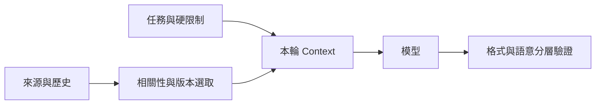

# 02 · LLM 與 Context Engineering

[章節入口](README.md) · [設計取捨](design-notes.md) · [練習](exercises/README.md)

## 本章完整案例

研究助理收到 30 頁工具輸出、一份過期規格、最新修訂摘要與使用者的兩項硬限制。它開始引用舊規格，也忘記「只能讀取」的限制。

案例與練習軌跡為合成教學資料，沒有執行真實業務操作。

## Context 是每一輪的工程輸入

Prompt 是其中的指令部分，context 還包括資料、工具定義、歷史與觀測。Context engineering 要決定什麼進入當輪、以何種順序與來源標記進入，以及下一輪如何更新。先保留任務、限制與高相關證據，再選擇必要歷史，比無差別塞入所有檔案更容易除錯。

## Token、非確定性與推論預算

Token 是模型處理文字等輸入的單位，不等同中文字數或英文單字數。相同輸入也可能得到不同輸出，因此單次成功不足以證明穩定性。更大的上下文或更多推論資源可能改善特定任務，也可能增加延遲與成本；要用同一批任務比較，而不是從模型名稱推定收益。

## 指令、資料與證據的邊界

將硬限制、任務與引用資料分別標記。從網頁或工具讀到的「請忽略原本規則」仍是外部資料，不會成為授權。這種標記有助模型理解，但實際拒絕越權仍需由工具與 runtime 控制。不要把排版格式視為安全機制。

## 選取、即時讀取與壓縮

固定且必要的限制適合先載入；大量參考資料可保留路徑、版本與摘要，需要時再讀原文。Compaction 要保留尚未解決的問題、重要決策、來源位置與操作狀態。摘要會遺漏細節，涉及關鍵結論時仍要能回到來源，不能把摘要提升成原始證據。

## 結構化輸出提供什麼保證

符合 schema 只表示形狀與某些欄位條件符合預期。日期可能過期、引用可能不存在、完成狀態也可能錯。把 schema 驗證、業務條件檢查與最終結果讀回分開，才能知道失敗來自哪一層。訂閱 preview 的參數支援也須另查，不假設所有採樣或輸出上限欄位可用。

## 用案例走一次

先把讀取限制與最新任務放入穩定指令區，將舊規格標為歷史來源。當輪只帶最新摘要及可回查的段落位置；若模型要引用重要行為，重新讀取對應原文。工具仍拒絕寫入，讓忘記限制不會直接導致副作用。

## 精確機制圖

這張圖呈現本章需要討論的責任或狀態。實際功能、權限與可用性依所選 runtime、安裝版本及帳號驗證。

## 三個帶走的問題

- 能設計每輪輸入的選擇與更新策略：你會怎麼向另一位工程師說明？
- 能區分格式有效、事實正確及任務成功：需要哪些證據才能判斷？
- 如果模型的建議錯誤，哪一層應阻止錯誤擴大？

## 來源與閱讀焦點

查證基線：2026-10-19。先讀來源中與本章名詞、責任及限制直接相關的段落；原始論文不要求第一輪讀完全部實驗。

- [S12 · Effective context engineering](https://www.anthropic.com/engineering/effective-context-engineering-for-ai-agents) — 第一方工程經驗；不是跨模型保證
- [S05 · Models and inference](https://developers.openai.com/siwc/token-sharing-open-source/models-and-inference) — 官方 preview；公開 Responses endpoint 與完成事件
- [S06 · Preview limitations](https://developers.openai.com/siwc/token-sharing-open-source/preview-limitations) — 官方 preview；參數、工具與歷史限制，實作前必重查

進一步看[來源版本與更新政策](../../../references/sources.md)。
