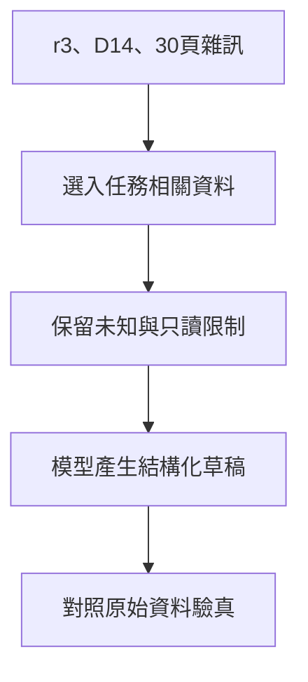

# 02 · LLM 與 Context Engineering：教學與案例

## 先抓住一個問題

**怎麼讓模型看見必要資料，卻不被舊文件與長對話帶偏？**

上一章拆開了模型和執行系統的責任。現在要決定：每次呼叫模型前，實際交給它哪一包資料。

## 把題目放到桌上

同樣處理 T-1042：相隔 12 天，拆封狀態未知。資料夾另有舊版 D07（7 天）和現行 D14（14 天且未拆封），以及 30 頁不相關紀錄；客服仍只准交草稿。

這是虛構教材案例，不是法律建議、真實客服紀錄或執行證據。完整設定見[共同案例](../../../maps/course-story.md)。

讀這章時先想：手上已知什麼、還缺什麼、誰能做哪個動作？不要急著把每個英文名詞都背起來。

本課基礎資料：T-1042 r3；10/08 到 10/20 相差 12 天。D14 要求日期差不超過 14 天且未拆封；r3 的包裝狀態未知。原任務只讀與寫草稿。本章或題目若另述變體，只有明示條件改變。

## 名詞先換成人話

| 名詞 | 先用人話說 | 放進本例 |
| --- | --- | --- |
| Prompt／指令 | 你要求模型做什麼。 | 判斷 T-1042，列缺漏，不准寫入。 |
| Context／本輪上下文 | 這一次模型真正看得到的全部輸入。 | 指令、T-1042、D14 段落及工具結果。 |
| Memory／保存的記憶 | 留在外面的資訊，需要時再讀入。 | 上次記錄的待確認拆封事項。 |
| Compaction／歷史壓縮 | 把長對話整理成較短的交接內容。 | 保留版本與未知，不保留每次搜尋廢話。 |
| Schema／資料形狀規則 | 檢查欄位和型別是否符合約定。 | 有 conclusion 字串，不代表結論正確。 |

## 先把它想成「這次交給助理的資料袋」

資料放在硬碟，不代表模型這次有看見。每次推論前，harness 要組一包輸入：任務、限制、必要來源、先前工具結果。這包就是 context。Prompt 是裡面的指令部分，不是整個資料世界。

## 放得多，為什麼仍會答錯

D07 的 7 天規則如果和 D14 混在一起，又沒有生效日期，模型就要猜哪個適用。問題不是容量夠不夠，而是你沒有交代來源關係。先選對版本並標來源，再考慮要帶多少內容。

Token 是模型讀寫資料的計量單位，不等於中文字數。多帶 30 頁紀錄通常增加要處理的資訊；是否改善答案，要用相同問題比較，而不是覺得越多越安心。相同輸入也可能產生不同輸出，單次答對不足以證明穩定。

## 壓縮時最容易丟掉什麼

「這張符合退貨規定」不是好交接，因為它抹掉未拆封仍未知這件事。較好的摘要是：T-1042、相隔 12 天、採 D14、拆封待確認、只准草稿。關鍵條款保留原文位置，需要時能重新讀。

## 格式對，和內容對，是兩關

模型交出的資料就算符合欄位規則，仍可能引用 D07、說商品未拆封，或把草稿標成已寄送。格式檢查先確認讀得懂；內容檢查再確認日期、來源與已知條件。這樣出錯時才知道要修哪一層。

## 完整走一次

| 步驟 | 發生什麼 | 為什麼這樣處理 |
| --- | --- | --- |
| 先固定指令 | 只判斷 T-1042、交草稿、不寫入 | 限制不能被舊對話沖淡。 |
| 選取資料 | 工單兩個日期、拆封未知、D14 完整條款 | D07 標成歷史，不與現行規則混用。 |
| 縮減雜訊 | 30 頁紀錄先留索引，需要才讀 | 不假設摘要已涵蓋所有例外。 |
| 檢查輸出 | 比對 12 天、D14、拆封待確認 | 不能只看 JSON 是否有效。 |

**這章要留下的產物：**本輪資料袋：任務與禁止動作；T-1042 的兩個日期與拆封未知；D14 的條款、版本及位置；尚待詢問的問題。

模型不用從 30 頁紀錄中猜任務，也不會把舊店規當現行依據。資料袋仍不是安全鎖；即使模型忽略限制，工具執行層仍須擋住寫入。

## 用流程核對責任

圖的重點是「保留未知與只讀限制」接到「模型產生結構化草稿」時需要哪些證據。請對照上表，說明少了這一步會造成什麼誤判。

## 接著做什麼

先做[Q01／Q03／Q05](exercises/README.md)，保留自己的第一版答案。遇到疑難先看[設計取捨](design-notes.md)，需要才開提示。

資料袋準備好了，但模型說「去讀工單」時，要怎樣讓程式讀到正確工單？下一章設計工具介面。

## 來源與閱讀焦點

來源初查：2026-10-19；本次複核項目與日期見來源表。先讀來源中與本章名詞、責任及限制直接相關的段落；原始論文不要求第一輪讀完全部實驗。

- [S12 · Effective context engineering](https://www.anthropic.com/engineering/effective-context-engineering-for-ai-agents) — 第一方工程經驗；不是跨模型保證
- [S05 · Models and inference](https://developers.openai.com/siwc/token-sharing-open-source/models-and-inference) — 官方 preview；公開 Responses endpoint 與完成事件
- [S06 · Preview limitations](https://developers.openai.com/siwc/token-sharing-open-source/preview-limitations) — 官方 preview；參數、工具與歷史限制，實作前必重查

進一步看[來源版本與更新政策](../../../references/sources.md)。
