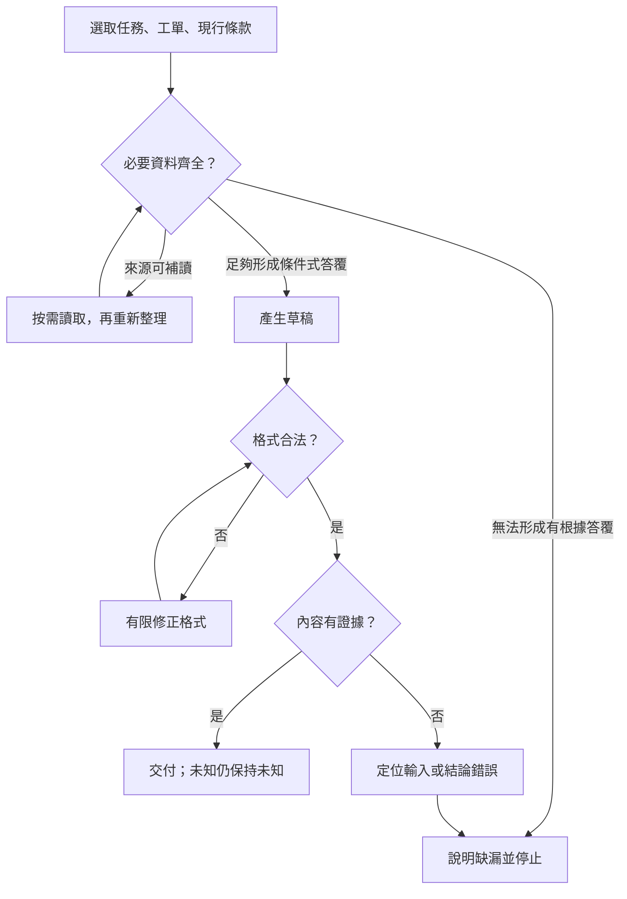

# 02 · LLM 與 Context Engineering：教學與案例

## 核心問題與閱讀層次

**怎麼讓模型看見必要資料，卻不被舊文件與長對話帶偏？**

上一章說明模型負責建議，harness 負責安排與限制。本章把鏡頭拉近一次推論：送出之前，究竟準備哪些資料？本章將這份輸入稱為「本輪資料袋」。這是教學比喻，不是產品功能名稱。

核心路線讀到「驗收這一袋資料」即可做 Q01、Q03、Q05。延伸部分處理壓縮與資料選取的取捨；第一次不必讀完所有來源。

## 跳章也能讀的案例

以下皆為合成資料，完整設定見[共同案例](../../../maps/course-story.md)。假設你面前有：

| 資料 | 內容 | 本輪作用 |
| --- | --- | --- |
| 使用者任務 | 判斷 T-1042，寫回覆草稿 | 決定交付；沒有寄送、關單、退款授權 |
| 工單 T-1042 r3 | 2026-10-08 購買、10-20 申請、拆封欄未知 | 日期相減為 12 天；未知不能補成未拆封 |
| D07 | 舊 7 天規則；10/01 起由 D14 取代 | 歷史資料，不能當本次現行規則 |
| D14 | 2026-10-01 生效；日期差 ≤14 天，而且未拆封 | 兩個條件都要核對 |
| 30 頁其他紀錄 | 別張工單、舊搜尋結果、重複寒暄 | 先不帶全文，保留按需回查的索引 |

本章引用「D14 §1／§2」作為合成文件的位置標籤：§1 是天數，§2 是未拆封條件；不是 repo 裡另有兩份真實檔案。

## 名詞先換成人話

| 名詞 | 意思 | 本例 |
| --- | --- | --- |
| Prompt／指令 | 要模型做的事及遵守的限制 | 列依據與缺漏，交草稿 |
| Context／上下文 | 這次推論真正能看到的輸入 | 指令、工單、條款、已載入的工具結果 |
| Token | 模型處理文字等輸入／輸出的計量單位 | 不能把 100 個中文字直接當 100 tokens |
| Context window | 一次推論能處理資料的容量範圍 | 容量有限，實際限制依模型與介面確認 |
| Output budget | 留給本次輸出的容量 | 要留空間寫判斷與草稿，不能只計輸入 |
| Memory | 保存在外部、可於以後取用的資訊 | 昨日筆記存在磁碟，不等於本輪已看過 |
| Compaction | 用較短的交接內容替代部分歷史 | 刪搜尋廢話，但留下未知與版本 |
| Schema | 資料欄位與型別的約定 | conclusion 必須是字串；不保證字串內容為真 |

不同服務對 context、輸出和內部推理的容量計算可能不同。本章只教預算思路，不用一條通用算式冒充所有產品限制；第 08 章再核對所選訂閱介面。

## 資料袋怎麼組：先分類，再挑選

先不要問「還能塞多少字」，而要問每段資料會改變哪個決定。本例必須決定適用版本、兩項條件、缺漏和允許交付。因此 D14 的完整必要條款與工單欄位都比別張工單重要。

### 第一步：把任務與外部資料分開

任務是「請判斷並寫草稿」；D14 是被判讀的來源。即使文件裡出現「請立即寄出」，它也不會因此取得使用者授權。標清來源與用途，有助模型辨別；真正能否執行，仍由 harness 與工具檢查。

分隔標記不是安全鎖。把外部資料包在 XML 標籤裡，不會自動消除其中的惡意指令。這裡先建立資料來源的概念，第 11 章再談執行邊界。

### 第二步：讓來源帶著版本和位置

只貼「14 天內可退」會漏掉未拆封條件。只貼 D07 與 D14 兩段文字、不交代適用日期，則把選版本的負擔丟給模型猜。資料袋應同時包含現行條款、適用日期與回查位置。

D07 可以不進主資料袋；若任務改為比較新舊政策，就要把它作為「歷史對照」載入。資料選取取決於這次問題，不能永久刪除所有舊資料。

### 第三步：直接表示未知

工單的「沒有填」和「未拆封」是兩種狀態。資料袋寫 packaging_status=unknown，並保留來源 r3，讓後續答案能指出缺漏。不要為了欄位漂亮，先把空值換成 false；false 可能被解讀成「沒有拆封」。

### 第四步：只帶對這輪有用的歷史

昨日查過十次文件，不代表要把十次查詢都帶入。留下最後確認的來源與待辦即可；但若有矛盾未解，不能把其中一方藏掉，再把摘要寫成已確定。

## 完整 worked example：從原始資料到可交付草稿

以下是設計範例，不是實際模型輸入紀錄，也不是任何 API 的必要格式。

### 1. 組出五段輸入

```text
[任務／限制]
只判斷 T-1042 並寫草稿；禁止寄送、關單、退款。
[工單／來源]
T-1042 r3：購買 2026-10-08；申請 2026-10-20。
[目前未知]
拆封狀態 unknown，來源為 T-1042 r3；沒有補充證據。
[現行規則／來源]
D14，2026-10-01 生效；§1 日期差 ≤14 天；§2 必須未拆封。
[歷史與回查]
D07 已被取代；其他紀錄留索引，若有政策例外疑問才按需補讀。
```

這五段是資訊分組，不是只能有五則訊息，也不是數學上的 token 限額。D14 的兩個條件放一起，避免取到天數、漏掉限制。

### 2. 把中間判斷寫成可查的帳

| 判斷 | 用哪筆資料 | 結果 | 可以推到哪裡 |
| --- | --- | --- | --- |
| 哪版規則適用 | D14 生效日期與 D07 取代資訊 | 用 D14 | 不再用 D07 的 7 天作結論 |
| 日期是否符合 | 10/20 減 10/08；D14 §1 | 12 ≤14，符合 | 只證明日期條件 |
| 是否未拆封 | T-1042 r3 拆封欄 | 未知 | 不能判定整體可退 |
| 本輪可交什麼 | 任務／限制 | 條件式判斷與草稿 | 不執行寄送、關單、退款 |

這張帳是提供讀者核對依據的簡短決策紀錄，不要求模型揭露隱藏推理。未來可由程式核對日期，由人或評分器核對來源與結論。

### 3. 寫出符合證據強度的輸出

> 依 D14，購買到申請相隔 12 天，符合日期條件。工單 r3 尚未記載是否拆封，因此還不能確認全部退貨條件。草稿：「您好，您的申請在日期範圍內，請先補充商品是否拆封，以便依 D14 確認後續處理。」本次未寄送、關單或退款。

已知是日期與條款；未知是拆封；停止是因為目前可讀資料不足。草稿完成，不代表退貨核准。若來源顯示另有尚未讀取的適用例外，應先補讀再下結論；本例已給出的 D14 則只有上述兩條件。

### 4. 驗收這一袋資料

不要只問「回答看起來通不通順」。逐項核對：是否用了 T-1042 r3；是否得出 12 天；是否採 D14；是否同時保留兩個條件；是否把 unknown 保持為未知；是否只交草稿。

若錯用 D07，先查資料袋是否標出適用關係。若資料袋明確正確，輸出仍用錯，再查模型或提示策略。不要每次都直接換更大模型，掩蓋輸入設計問題。

## 格式對與內容對：分開抓兩種錯

以下是「形狀合法、意思錯誤」的合成輸出：

```json
{
  "ticket_id": "T-1042",
  "conclusion": "相差12天，依D07可退，且商品未拆封",
  "draft": "您的退貨已獲核准。"
}
```

假設 schema 只要求三個字串，這份資料可以通過格式檢查。但它至少有三個內容錯誤：D07 已過期；即使照 7 天也不能說 12 天符合；r3 沒有未拆封證據。最後一句又把待確認說成核准。

修正時，先保持欄位可讀，再把結論改為「依 D14，日期符合；拆封未知，待補充」。增加 enum 或必填引用能減少某些錯誤，卻不會自動證明引用真的支持結論。驗真必須回到來源。



圖中「資料齊全」不是要求所有業務未知都消失，而是足以支持本輪交付。有限修正也要有上限；缺證據不能靠反覆要求模型「再想想」補出來。

## 延伸：長對話壓縮時，到底可以丟掉什麼

壓縮不是把內容變短就好，而是維持下一輪需要的判斷條件。下表比較兩種摘要；原始歷史還包括十次重複搜尋與三段寒暄。

| 原始資訊 | 壞摘要「12天，符合，可處理」丟了什麼 | 較好交接保留什麼 |
| --- | --- | --- |
| T-1042 r3 | 無目標版本，可能套到別單 | ID 與 r3 |
| 兩個日期與差 12 天 | 只留結果，無法重算 | 兩日期與算法 |
| D14 §1／§2 | 抹掉未拆封條件與來源 | 兩條件、生效日、回查位置 |
| 拆封 unknown | 把未知變成默認符合 | 明寫未知與待詢問 |
| 只准草稿 | 「可處理」暗示可寫入 | 禁寄送／關單／退款 |
| 十次重複搜尋 | 不是所有步驟都值得保留 | 留最終有效來源；必要時留矛盾 |

較好交接也會失去細節，例如搜索措辭和中途猜測。這是有意取捨，不是宣稱無損。如果之後問題改成「你曾查過什麼」，就要回原始紀錄；摘要不適合回答所有未來問題。

壓縮後先做一次「回讀驗真」：拿交接與原始資料對照上述五項必要資訊。若漏條件，修摘要；若來源根本沒資料，保留未知。不要讓下一輪再摘要一次，把「待確認」漸漸縮成「已確認」。

## 初學者常問

### Context 很大，為什麼不全部塞進去？

因為容量只解決放不放得下，不會解決哪個版本有效，也不保證模型能在重複與矛盾中選對。小而完整的 D14 應先帶入；大量歷史則可按需讀。若任務真的需要逐件比對 30 頁歷史，全部或分批讀才合理，不能一概刪掉。

### 記憶寫在磁碟，模型不是自然就知道嗎？

模型這一輪只會處理實際提供的輸入。Harness 必須讀出、選取、載入筆記，筆記才成為本輪 context。能讀檔也不等於已讀檔；要以實際工具結果或組好的輸入確認。第 06 章再談保存與恢復。

### 把答案改成 JSON，就不會亂講嗎？

JSON 解決程式如何讀欄位，沒有解決欄位是真是假。本例的合法 JSON 仍可能寫 D07 和未拆封。先查格式，再查證據；兩關失敗的修法不同。

## 接著做什麼

先自答 [Q01／Q03／Q05](exercises/README.md)，再讀[設計取捨](design-notes.md)。本章把資料準備清楚；下一章追問：「模型要求補讀工單時，工具要回哪些欄位，才不會把未知或分頁誤判成完整結果？」

## 來源與閱讀焦點

來源初查：2026-10-19；本次複核項目與日期見來源表。先讀來源中與本章名詞、責任及限制直接相關的段落；原始論文不要求第一輪讀完全部實驗。

- [S12 · Effective context engineering](https://www.anthropic.com/engineering/effective-context-engineering-for-ai-agents) — 第一方工程經驗；不是跨模型保證
- [S05 · Models and inference](https://developers.openai.com/siwc/token-sharing-open-source/models-and-inference) — 官方 preview；公開 Responses endpoint 與完成事件
- [S06 · Preview limitations](https://developers.openai.com/siwc/token-sharing-open-source/preview-limitations) — 官方 preview；參數、工具與歷史限制，實作前必重查

進一步看[來源版本與更新政策](../../../references/sources.md)。
