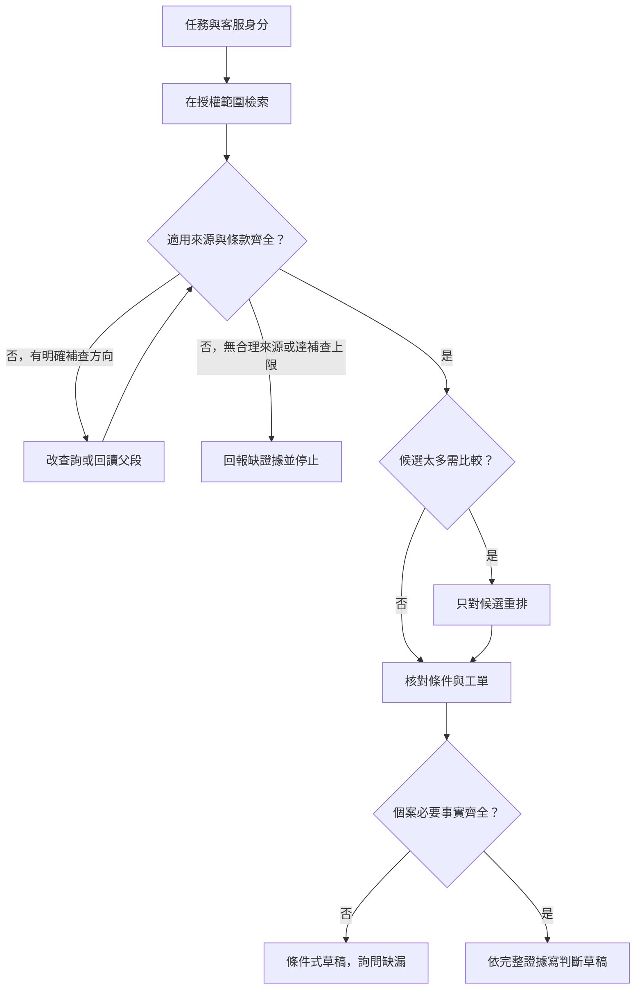

# 05 · Retrieval 與 RAG：教學與案例

## 核心讀法：先問「這句話靠哪一段證據」

**文件明明找到了，為什麼助理還是會用錯規則？**

上一章處理「看到結果後，下一步做什麼」。這章把其中的「查店規」打開：怎麼找、怎麼選、要讀到哪裡才夠，以及能說到什麼程度。

核心讀到「完整走一次」並做 Q01、Q03、Q05，約需 2–3 小時。搜尋選型與更新流程是深挖段落，可第二輪再讀。本章不要求先會向量資料庫。

## 把題目放到桌上

以下是合成教材資料，不是真實客服紀錄或執行結果。完整設定見[共同案例](../../../maps/course-story.md)。

- T-1042 r3：2026-10-08 購買，2026-10-20 申請，兩日期相減為 12 天。
- 包裝狀態未知；「沒寫已拆封」不等於「確定未拆封」。
- 任務只准判斷並寫草稿，沒有寄送、關單或退款授權。
- D07 舊版規定 7 天，自 2026-10-01 起由 D14 取代。
- D14 現行規定：日期差不超過 14 天，**而且未拆封**。

使用者問：「這張工單能退嗎？請幫我擬回覆。」答案不能只找出「退貨」兩字；還要辨別適用版本、完整條件，以及工單是否具備所需事實。

## 名詞先換成人話

| 名詞 | 先用人話說 | 本例中的責任 |
| --- | --- | --- |
| Retrieval／檢索 | 從資料中找出可能有用的候選。 | 找到 D14 的相關條款。 |
| RAG | 取得外部資料，再把資料交給模型作答。 | 依現行店規解釋工單，而非只憑模型記憶。 |
| Chunk／片段 | 為了搜尋與載入而切出的文件段落。 | D14 §2-A 天數與 §2-B 包裝限制。 |
| Embedding／向量表示 | 把文字轉成可比較相近程度的數值。 | 讓「快兩週」與「14 天」有機會相遇。 |
| Reranking／重新排序 | 更仔細比較已找到的候選。 | 在候選中選較能回答問題的段落。 |
| Recall／召回 | 應找到的資料，有多少確實進了候選。 | D14-B 不在候選，就是必要證據漏檢。 |
| ACL／存取規則 | 決定這位使用者或執行身分可讀哪些資料。 | 客服不能讀管理員附件 X99。 |

這些責任可以由簡單程式或不同模型分工完成；不需要把每個名詞都變成一個服務。

## 先用一個小文件集合看清楚問題

為便於手算，假設只有以下文件。片段 ID 是本章教學標記，§2-A、§2-B 屬於同一退貨條款的相鄰部分。

| 來源 | 內容／位置 | 版本與範圍 | 客服可讀？ |
| --- | --- | --- | --- |
| D07 | §2：「購買後 7 天內可申請退貨」 | 已於 10/01 被取代 | 是，歷史文件 |
| D14-A | §2-A：「購買日與申請日相差不超過 14 天」 | 10/01 起生效 | 是 |
| D14-B | §2-B：「上述申請限商品未拆封」 | 同 D14、同生效日 | 是 |
| D14-C | §3：「客服先取得包裝狀態，再回覆適用條件」 | 同 D14 | 是 |
| X99 | 管理員退款調整附件 | 其他部門限定 | 否 |

D14-A 不是一條獨立的無條件承諾。「上述」指向同一節的日期條件，因此切段後還要保留相鄰關係。這就是為什麼「有引用」仍可能答錯。

## 第一步：把問題拆成需要查證的事實

先寫問題清單，再找文件，可避免見到一段像答案的文字就收工。

| 待回答問題 | 應從哪裡取得 | 目前狀態 |
| --- | --- | --- |
| 相隔幾天？ | T-1042 r3 的兩個日期 | 可算出 12 天 |
| 適用哪版店規？ | 店規生效與取代資訊 | 需確認 D14 |
| 條件是否只有天數？ | D14 完整 §2 | 需取得 A 與 B |
| 商品是否未拆封？ | 工單或客戶補充 | 未知，不能從店規推知 |

文件檢索能找「規則是什麼」，不能替客戶證明「商品現在是什麼狀態」。繼續搜尋政策不會把未知包裝變成未拆封。

## 第二步：先限定可讀範圍，再讓結果進模型

檢索入口接收客服身分與任務範圍，從授權資料中找候選。若底層引擎先產生較廣的候選，仍須在取回原文、重排與送入模型之前通過授權檢查；不能把 X99 內容先交給模型，再要求它保密。

可觀察的驗收不是「答案沒提到 X99」，而是客服請求取得的原文、模型輸入與可讀引用都不含 X99。內部檢索索引如何隔離，須依實作另驗證；本章只定義契約。

權限不是相關性分數。X99 即使最像使用者問題，也不能以「比較有幫助」為理由越過可讀範圍。

## 第三步：搜尋先帶回候選，別把分數當判決

假設一次關鍵字搜尋在可讀範圍內得到：D07 分數 0.93、D14-A 0.86、D14-B 0.52。這些是合成分數，只能表示這次排序，不是正確機率。

若只取前一段，就會讀到過期 D07；若只取前兩段，雖然找到了現行天數，仍漏未拆封條件。先用生效與取代資訊選出適用 D14，再按條款關係補讀 B，比盲目相信 top-1 更可靠。

取代關係是題目給定規則，不是「所有文件都選日期最新」。真實場景可能依購買日、合約版本或地區選版；必須先定義適用方式，不能讓排序器自行發明。

## 第四步：片段要小到找得準，也要完整到不誤解

只以固定字數切分，容易在「但」「除外」「上述」中間斷開。對這份短政策，可以先按章節切，保留父段 §2，再把 A、B 作為可定位的子段。

一個可供核對的片段至少留下：

| 欄位 | 本例值 | 少了會怎樣 |
| --- | --- | --- |
| 文件與版本 | D14，2026-10-01 生效 | 舊 D07 可能混入 |
| 位置 | §2-B | 客服找不到原文 |
| 所屬條款 | D14 §2，鄰段 A | 不知道「上述」限制誰 |
| 可讀範圍 | 客服 | 錯把其他身分內容載入 |
| 原文 | 「上述申請限商品未拆封」 | 只存摘要可能丟掉「限」 |

發現片段含代詞、例外或不完整句時，回讀父段或相鄰段。這是有理由的補讀，不是每次把整本手冊塞進 context。

## 第五步：需要才重排，缺席就補找

重排回答的是「這些已找到的段落，哪個最能回答問題」。若候選已有 A、B，可以用重排減少無關段落；若 B 根本不在候選，重排再好也無從選 B。

診斷時先留一份生成前的證據清單：

- 沒拿到 D14-B：檢查切分、查詢、取回範圍與補讀。
- 拿到 B 卻沒放進模型：檢查選段與 context 組裝。
- 模型看到了 B 卻說一定可退：檢查生成是否越過證據、驗收是否漏看限制。

不要三種情況都用「換更強模型」解決。把失敗放回正確環節，才知道修正是否有效。

## 第六步：把每個結論對回證據

| 答案中的一句話 | 所需支持 | 本例能不能說 |
| --- | --- | --- |
| 申請相隔 12 天 | T-1042 r3 日期 | 能 |
| 符合 D14 的天數條件 | 上述日期＋D14 §2-A | 能 |
| 還要確認未拆封 | D14 §2-B＋r3 包裝未知 | 能 |
| 已核准退貨 | 所有條件證據與核准流程 | 不能；本例也無核准操作 |

引用應指向實際支持該句的原文位置。只在「一定可退」後面掛 D14-A，引用雖然存在，仍不支持這個完整結論。

## 完整走一次：從輸入到停點

| 步驟 | 中間判斷／輸出 | 此時還不能做什麼 |
| --- | --- | --- |
| 1. 讀任務 | 只讀與草稿；目標 T-1042 r3 | 不寄送、不關單 |
| 2. 看可讀來源 | X99 不在客服可讀集合 | 不把附件原文交給模型 |
| 3. 搜尋與選版 | D07 雖排第一，仍依取代規則採 D14 | 不把分數當現行證明 |
| 4. 補齊條款 | 已有 D14-A，再取同節 B | 不只憑 14 天承諾 |
| 5. 對照工單 | 12 ≤ 14；未拆封未知 | 不推定未知為符合 |
| 6. 交付並停止 | 有引用的詢問草稿；等待客戶補資料 | 不重查同一政策假裝進展 |

**可交付草稿：**「依 D14 §2-A，本案購買與申請相隔 12 天，符合天數條件；依 §2-B，仍須確認商品未拆封。工單 T-1042 r3 尚未記載此資訊，請先補充包裝狀態。」

這輪草稿可完成，退貨資格尚待確認。來源清單保存 T-1042 r3、D14 §2-A／§2-B；沒有執行寄送、關單或退款。

補查要有原因與上限；重排是可選步驟。圖上任一路都沒有自動取得寄送或退款權限。

## 反例與修正：引用正確，不代表推論正確

**反例：**系統取到 D14-A，回答「12 天在 14 天內，所以一定能退 [D14 §2-A]」。

錯誤分兩層：檢索沒有補齊 B；生成把必要的天數條件當成充分條件。即使先不知 B，只有 A 也不應宣稱已確認全部條件。

**修正：**回讀 D14 §2，拿到 B；保留 r3 的包裝未知，改寫為上述條件式草稿。再測「12 天但已拆封」變體，確認系統不會只看天數。變體只作檢查，不改寫主案例 r3。

## 初學者常問

**文件只有三份，直接全部讀不行嗎？** 可以，若它們短、皆授權、版本關係清楚，直接提供完整 D14 可能更簡單。仍需挑對版本與逐句支持答案。RAG 的重點是依外部證據作答，不是必須先上向量庫。

**多取二十段，是不是就不會漏？** 不保證。無權資料不能因多取而開放；過多舊文件也會增加選錯機會。先用條款結構補齊「正在缺的 B」，再以標記測例檢查必要段落是否都在，通常比盲目加量有診斷價值。

**有了 RAG 就不用擔心幻覺嗎？** 仍要擔心。拿錯版本、切掉例外、引用不支持結論，都是可觀察的錯誤。檢索改善證據取得，沒有把推論與權限檢查一併保證。

## 深挖：關鍵字、語意與混合檢索怎麼選

| 問題型態 | 合理起點 | 要特別檢查 |
| --- | --- | --- |
| 查 D14、商品碼 SKU-1042 | 精確欄位或關鍵字 | 字號不能被相似字替代 |
| 「買了快兩週能退嗎」 | 先測關鍵字，再比較語意 | 改述是否真的找到 A、B |
| 同時含商品碼與口語描述 | 精確條件搭配語意或混合 | 精確約束有無被模糊相似度沖掉 |

混合檢索不是把兩種分數直接相加，因為分數尺度可能不同。可比較各自排名再合併，或採明確定義的正規化方式；這是設計選擇，須以相同資料與題目驗證。

先標出每題必要的來源集合，再比較候選是否包含它、生成是否遵守它，以及耗時。只展示一次成功問答，不能判定新方案整體更好。

## 深挖：政策更新後，索引也得跟著失效

假設日後另有 D15，不能只把新檔加進資料夾就宣布更新完成。先定義適用時間與取代關係，再更新可搜尋內容、片段 metadata 與快取；驗收時用同一問題看是否仍取舊段。

ACL 改變或來源刪除也一樣：舊索引、已存候選與引用開啟入口都可能殘留。檢查重點是未授權身分拿不到舊原文，而不只是搜尋結果標題消失。

本課目前沒有建立索引或快取；以上是未來實作的驗收要求。訂閱路線的具體工具可用性另見[執行路線](../../../references/subscription-runtime.md)，不從 RAG 概念推論 hosted tool 一定可用。

## 接著做什麼

先自答 [Q01／Q03／Q05](exercises/README.md)，再用[設計取捨](design-notes.md)檢查選型。知道對的來源後，下一章問：明天恢復工作時，哪些證據可以沿用、哪些必須重新確認？

## 來源與閱讀焦點

來源初查 2026-10-19；本次為 2026-10-21 教學深化，未新增產品能力宣稱。上面的文件集合、分數、流程與檢查方式均為合成案例或設計選擇。

- [S22 · Retrieval-Augmented Generation](https://arxiv.org/abs/2005.11401)：原始研究，閱讀檢索與生成的分工；不是本章 ACL、切段或更新契約的規格。
- [S12 · Effective context engineering](https://www.anthropic.com/engineering/effective-context-engineering-for-ai-agents)：第一方工程經驗，可對照必要資料選擇與 context 管理，非跨模型保證。
- [S06 · Preview limitations](https://developers.openai.com/siwc/token-sharing-open-source/preview-limitations)：訂閱 preview 限制，實作前依[來源表](../../../references/sources.md)重新查證。
