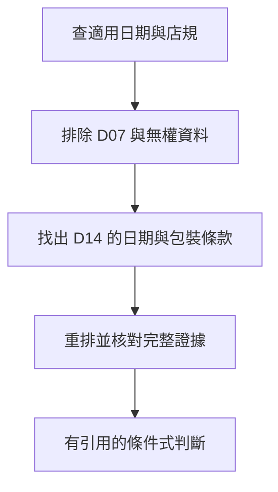

# 05 · Retrieval 與 RAG：教學與案例

## 先抓住一個問題

**文件明明找到了，為什麼助理還是會用錯規則？**

上一章讓助理根據觀測選下一步。現在把「讀店規」拆開，看看來源是如何被找出、挑選，再變成答案。

## 把題目放到桌上

T-1042 相隔 12 天，拆封未知。搜尋把舊版 D07（7 天）排第一，現行 D14（14 天且未拆封）排第二；另有一份客服無權閱讀的其他部門附件。

這是虛構教材案例，不是法律建議、真實客服紀錄或執行證據。完整設定見[共同案例](../../../maps/course-story.md)。

讀這章時先想：手上已知什麼、還缺什麼、誰能做哪個動作？不要急著把每個英文名詞都背起來。

本課基礎資料：T-1042 r3；10/08 到 10/20 相差 12 天。D14 要求日期差不超過 14 天且未拆封；r3 的包裝狀態未知。原任務只讀與寫草稿。本章或題目若另述變體，只有明示條件改變。

## 名詞先換成人話

| 名詞 | 先用人話說 | 放進本例 |
| --- | --- | --- |
| Retrieval／檢索 | 找可能回答問題的資料。 | 找到 D07、D14。 |
| RAG | 先取外部資料，再讓模型依資料回答的做法。 | 讀 D14 後解釋退貨條件。 |
| Chunk／片段 | 為了搜尋而切出的文件小段。 | D14 的天數段與拆封段。 |
| Embedding／向量表示 | 把資料變成可比較相近程度的數值表示。 | 讓『能退嗎』找到退貨政策。 |
| Reranking／重新排序 | 對已找出的候選再判斷相關性。 | 在候選中提高適用版的位置。 |

## 把「找得到」和「用得對」分開

搜尋找到 D07，證明系統有找到談退貨的資料，不代表這份適用。回答正確至少要走三關：取回需要的來源、選對版本與條款、讓答案忠實反映條款。哪一關壞掉，修法不同。

## 怎麼切文件才不會丟掉條件

如果片段 A 只有「14 天內可申請」，片段 B 才寫「限未拆封」，只讀 A 就會過度承諾。切分時保留文件 ID、版本、章節位置和相鄰條件；需要時回讀完整條款。沒有適合所有文件的固定片段大小，應拿會漏例外的問題來比較。

## 關鍵字、語意搜尋與排序各幫什麼

查商品代碼通常需要精確文字；「買了快兩週能退嗎」則可能需要找語意接近的段落。混合檢索把兩者結合，但分數不是同一把尺，不能隨便相加。重新排序也只能選已有候選：D14 根本沒進候選集時，排序器無法變出它。

## 先處理可讀範圍，再交資料給模型

無權附件不應先送進 context，再請模型保密。來源適用日期、資料刪除與索引更新也需處理。搜尋分數高，沒有替你驗證權限或有效版本。

本機搜尋可以先很簡單；RAG 不要求先買向量庫。依目前訂閱 preview，hosted file search 不在支援範圍，未來可由自己的本機工具提供檢索。

## 完整走一次

| 步驟 | 發生什麼 | 為什麼這樣處理 |
| --- | --- | --- |
| 候選結果 | D07 排第一、D14 排第二 | 排名高不等於現行。 |
| 套用範圍 | 只保留客服可讀資料 | 未授權附件不送入模型。 |
| 確認適用版本 | D14 自 10/01 適用，T-1042 購於 10/08 | 依題給店規版本選 D14。 |
| 補讀完整條款 | 天數段＋未拆封段 | 12 天符合，但拆封仍待確認。 |

**這章要留下的產物：**答案同時引用 D14 的天數與拆封條件；清楚說日期符合、拆封未確認。保留文件位置，讓客服能打開核對。

引用真的存在還不夠，它必須是適用來源，而且支持你說的那句話。這也讓檢索與生成能分開檢查：先看有沒有拿到 D14，再看答案有沒有漏條件。

## 用流程核對責任

圖的重點是「找出 D14 的日期與包裝條款」接到「重排並核對完整證據」時需要哪些證據。請對照上表，說明少了這一步會造成什麼誤判。

## 接著做什麼

先做[Q01／Q03／Q05](exercises/README.md)，保留自己的第一版答案。遇到疑難先看[設計取捨](design-notes.md)，需要才開提示。

找到對的資料後，若明天換一輪或程式重啟，如何保留進度又避免沿用過期資料？下一章談記憶。

## 來源與閱讀焦點

來源初查：2026-10-19；本次複核項目與日期見來源表。先讀來源中與本章名詞、責任及限制直接相關的段落；原始論文不要求第一輪讀完全部實驗。

- [S22 · Retrieval-Augmented Generation](https://arxiv.org/abs/2005.11401) — 原始研究；RAG 基本分工，非所有檢索系統的完整規格
- [S12 · Effective context engineering](https://www.anthropic.com/engineering/effective-context-engineering-for-ai-agents) — 第一方工程經驗；不是跨模型保證
- [S06 · Preview limitations](https://developers.openai.com/siwc/token-sharing-open-source/preview-limitations) — 官方 preview；參數、工具與歷史限制，實作前必重查

進一步看[來源版本與更新政策](../../../references/sources.md)。
