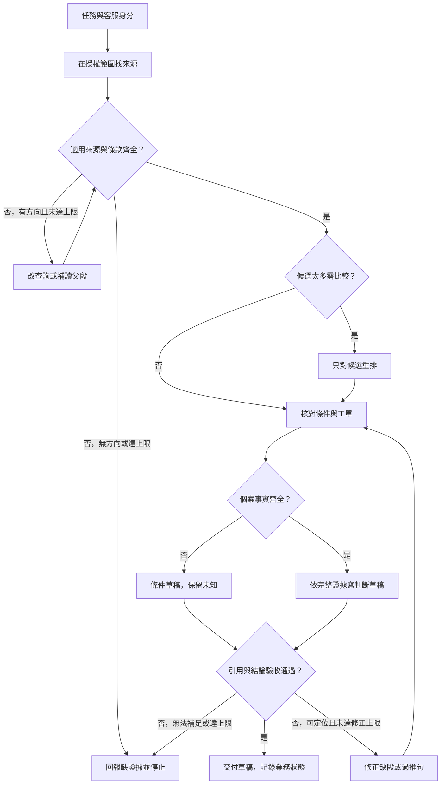

# 05 · Retrieval 與 RAG：教學與案例

你差點把草稿交出去：「申請相隔 12 天，在 14 天內，一定可以退。」

游標停在最後一個句號。你往政策下方多看一行，才看到：「上述申請限商品未拆封。」工單的包裝欄卻是空的。草稿若照交，客服就可能把一項尚未確認的條件說成已經符合。

這是本章的合成場景。先沿四個場景讀到草稿收尾；文件欄位與搜尋選型留在後面的深挖，不用現在一起記。

## 場景一：先收回「一定」兩個字

螢幕左邊是 T-1042 r3：2026-10-08 購買，10-20 申請，兩日期相減是 12 天。包裝狀態沒有記載。右邊是剛讀到的政策。你目前受託判斷與寫草稿，沒有寄送、關單或退款授權。

先別急著換模型。你的日期沒有算錯，真正出錯的是：把「日期條件符合」寫成「所有資格都符合」。

**停 15 秒：**「工單沒寫已拆封」能不能改寫成「商品未拆封」？先在心裡選，再往下讀。

不能。空欄可能是還沒問、漏填，或資料尚未同步；它沒有告訴你包裝的實際狀態。你可以確認 12 天，卻還不能確認未拆封。

這裡有兩種缺漏，補法也不同。政策少讀一行，可以回去讀；包裝未知，則要查可靠個案來源或請客戶補充。把政策再搜十次，也不能替客戶回答是否拆封。

上一章談工作循環何時停。這章先處理停之前的關鍵：你找回來的證據，到底足不足以支持這句話？完整共用設定可查[共同案例](../../../maps/course-story.md)，現在先留在這張工單。

## 場景二：第一名不是現行規則

你回到搜尋結果，看到最上面寫「購買後 7 天內可申請退貨」，下一筆才是剛才的 14 天政策。

這個「找可能有用資料」的動作叫 **Retrieval／檢索**。它先帶回候選，沒有替你判定哪份適用。像搜尋引擎把舊文章排第一，並不代表舊文章仍有效。

本例的版本資訊很清楚：舊 D07 是 7 天規則，2026-10-01 起已由 D14 取代；工單購於 10-08，按題給規則應採 D14。你因此保留 D14，排除 D07 作為本次判斷依據。

為什麼不直接寫「永遠挑最新的」？因為真實合約可能跟著購買日、地區或簽約版本走。你需要一條明示的適用規則，而不是讓排名或檔名日期替你猜。

假設這次排序分數是 D07 0.93、D14 的天數段 0.86、拆封段 0.52。這是合成數字，不是正確機率。它只讓你看見：越像查詢文字的段落，不一定越有權決定答案。

到這裡你已經知道採哪份政策，還沒確認是否讀完整。下一步不是立刻生成，而是回到同一節看上下文。

## 場景三：找到一段，不等於讀完一條規則

D14 §2 的第一部分講「相差不超過 14 天」，下面接著「上述申請限商品未拆封」。為了搜尋方便，系統把它們分成 A、B 兩小段。

這種小段叫 **Chunk／片段**。切小可以找得更精準；但切得不巧，也會把限制留在下一段。你眼前的 A 不是一條無條件承諾，B 的「上述」仍指向同一件申請。

現在有理由補讀：既然 A 來自 §2，就回到完整 §2，帶回 B。這不是每次都把整本手冊交給模型，而是針對可能缺少的條件讀完整。

**停 20 秒：**如果 B 根本沒進搜尋候選，把已有候選重新排一遍，能不能補出 B？只回答「能／不能」和一句理由。

不能。**Reranking／重排**是比較已找到的候選。它像把桌上的文件重新排順，不能把抽屜裡沒拿出的那頁變到桌上。此時應補查、回讀父段或修切段方式。

若 A、B 早已一起找到，只是候選很多、無關段落擠在前面，重排才可能有幫助。對這份很短的 D14，直接讀完整 §2 就夠，不必為了架構看起來完整而硬加一次重排。

你現在也能把出錯位置分開：B 沒找到，查證據取得；B 找到卻沒放入模型，查選段與 context 組裝；B 已在輸入卻仍被忽略，查生成與答案驗收。三種錯誤不該只用同一句「模型幻覺」帶過。

## 場景四：把引用接到句子，再決定怎麼交付

現在桌上已有正確版本與完整條款。這個先取外部資料、再依資料回答的做法，就是 **RAG**。它讓答案有可回查的依據，仍要由你檢查推論有沒有跨過證據。

你先保留能確認的一句：「依 D14 §2-A，本案相隔 12 天，符合天數條件。」再補上一句：「§2-B 另要求未拆封，工單 r3 尚未確認，請先補充包裝狀態。」

這段草稿沒有浪費已知資料，也沒有假裝未知已解決。引用 A 支持日期限制，引用 B 支持包裝限制；工單日期與空欄則來自 T-1042 r3。

反過來看原草稿：「一定可退 [D14 §2-A]」。引用真的存在，但 A 沒有支持「一定」。修正不是在句尾多掛幾個來源，而是把句子的承諾改回證據能支持的範圍。

你還看見另一筆搜尋標題：X99，管理員退款附件。它似乎相關，但客服沒有讀取權。這份原文應在交給模型前就被擋住；不能先載入，再請模型保密。

這叫 **ACL／存取規則**：相關性決定可能有沒有用，授權決定能不能讀。驗收時要看客服拿到的原文、模型輸入與引用入口，不只是看最後答案有沒有提到 X99。

作為反例檢查，你可另測「同樣 12 天，但明示已拆封」。這個獨立變體不符合 D14 的包裝條件；若系統仍只看天數說可退，表示限制還沒真正進入判斷。它不改寫主案例 r3 的未知。

## 把這次工作收好

你交的是有條件、有定位的詢問草稿。這一輪可以完成；退貨資格仍等資料。沒有寄送、關單或退款，也沒有理由不停重查同一份政策。

留下的來源是 T-1042 r3 與 D14 §2-A／§2-B。若接手者問「為什麼沒有直接核准」，他能沿這三個位置重建判斷，而不是猜你的意思。

以下圖可以當檢查路線。補查要有方向與上限，驗收不通過時只修能定位的缺口；沒有合理補查方向，就明確停下。

圖裡的交付仍受本輪授權限制。即使事實齊全，也不會自動獲得退款或寄送權。

## 讀到這裡，你可能還會問

**只有三份短政策，直接全部讀不行嗎？** 可以，只要都是授權資料、版本關係清楚。完整讀現行 D14 可能最省事。RAG 不要求你先買向量庫，也不要求每次都有獨立重排步驟。

**多取二十段不是比較保險？** 有時會補到漏段，也可能加進舊版和無關資料。已命中 A 且知道同節未完時，補同節 B 有清楚理由；盲目加量則不容易知道改善從哪裡來。權限更不能隨取回數一起放寬。

**有引用還要逐句看，RAG 到底省了什麼？** 它把可更新的來源帶進本輪，讓核對有地方可去；它沒有保證找齊、選對和用對同時發生。能定位錯在哪一層，正是它可被驗收的價值。

核心到這裡即可暫停。先試 [Q01、Q03、Q05](exercises/README.md)；想設計自己的文件契約，再讀下面深挖。

## 深挖：文件與名詞查閱

這裡是剛才故事的完整資料清單。各位置均為本章合成標記，方便人工核對。

| 來源 | 原文／位置 | 適用與可讀範圍 |
| --- | --- | --- |
| D07 | §2：購買後 7 天內可申請退貨 | 10/01 被取代，客服可讀歷史 |
| D14-A | §2-A：日期差不超過 14 天 | 10/01 起生效，客服可讀 |
| D14-B | §2-B：上述申請限商品未拆封 | 同 D14，客服可讀 |
| D14-C | §3：先取得包裝狀態，再回覆適用條件 | 同 D14，客服可讀 |
| X99 | 管理員退款調整附件 | 客服不可讀 |

Retrieval 是取候選；reranking 是比較已有候選；context 組裝決定實際交給模型的內容；生成才是寫答案。**Recall／召回**關心應找到的資料有多少進候選，例如 B 漏檢；**Embedding／向量表示**則把文字轉成可比較相似程度的數值，是支援語意搜尋的一種方式，不是正確性的證明。

### 片段契約：找得準，也回得去

對本例短條款可不切；若要切，至少留下以下資訊。這是設計選擇，不是某個產品的固定格式。

| 資訊 | 例值 | 要保住什麼 |
| --- | --- | --- |
| 文件與適用版本 | D14，2026-10-01 生效 | 不混入 D07 |
| 原文位置 | §2-B | 讓客服回看 |
| 父段與相鄰段 | §2、§2-A | 保住「上述」關係 |
| 可讀規則 | 客服 | 不因相關性越權 |
| 原文 | 上述申請限商品未拆封 | 不在摘要時丟掉「限」 |

授權應在可讀資料送入重排與生成之前檢查，引用開啟入口也應按目前呼叫者驗證。底層索引如何隔離需依實作另驗證，不能只靠本表宣稱安全。

## 深挖：關鍵字、語意與混合檢索怎麼選

查 D14 §2-B 或 SKU-1042，先用精確欄位或關鍵字。字號相近不是同一商品，不能因意思相似改成 SKU-1043。

「買了快兩週能退嗎」則有改述問題。先測簡單基線是否持續漏掉 A、B；確認資料存在、授權正確後，再比較語意搜尋。新機制應回應已觀察的缺口，而不是先把架構塞滿。

同時含商品碼與口語描述時，可以保留精確約束，再用語意比較描述。混合檢索的兩種分數不一定同尺，不能隨便相加；可比較排名合併或明確的正規化方案，仍要用同批資料驗證。

公平比較時固定來源快照、查詢、身分與取回預算，先標必要段落，再分別看候選覆蓋、答案支持與耗時。精確題和改述題分開報告，一次成功示範不能代表整體更好。

## 深挖：政策更新後，索引也得跟著失效

假設日後 D15 取代 D14，只把新檔放進資料夾並不夠。先寫清適用關係，再更新片段、索引與快取，用原本會命中 D14 的問題重查，看看新任務是否還拿舊內容。

合法歷史查詢可能仍需 D14，因此也不能一律刪舊版。你要檢查的是「這次任務應採哪版」，而非「舊字串是否完全消失」。

ACL 改變或來源刪除時，已存候選、快取與引用入口也可能殘留。驗收要證明不再授權的身分拿不到原文，不只是標題從搜尋頁消失。

本課尚未建立索引與快取；以上是未來實作要求。訂閱工具能力另見[執行路線](../../../references/subscription-runtime.md)，不從 RAG 概念推論 hosted tool 必然可用。

## 接著做什麼

先保留自己的初答，再用[設計取捨](design-notes.md)檢查為何選那種做法。下一章會把今天這份來源與判斷留下來，並問：明天接手時，哪些可能已過期？

**下次從這裡接：**我目前採用的政策是＿＿；我能確認＿＿、仍不知道＿＿；下一步要回讀＿＿段，或先做 C05-Q＿＿。

## 來源與閱讀焦點

來源初查 2026-10-19；2026-10-21 為教學與敘事編修，未新增產品能力宣稱。文件、分數、流程與驗收均為合成案例或設計選擇。

- [S22 · Retrieval-Augmented Generation](https://arxiv.org/abs/2005.11401)：原始研究，閱讀檢索與生成分工；不是本章 ACL、切段或更新契約的規格。
- [S12 · Effective context engineering](https://www.anthropic.com/engineering/effective-context-engineering-for-ai-agents)：第一方工程經驗，可對照資料選擇與 context 管理，非跨模型保證。
- [S06 · Preview limitations](https://developers.openai.com/siwc/token-sharing-open-source/preview-limitations)：訂閱 preview 限制，實作前依[來源表](../../../references/sources.md)重新查證。
