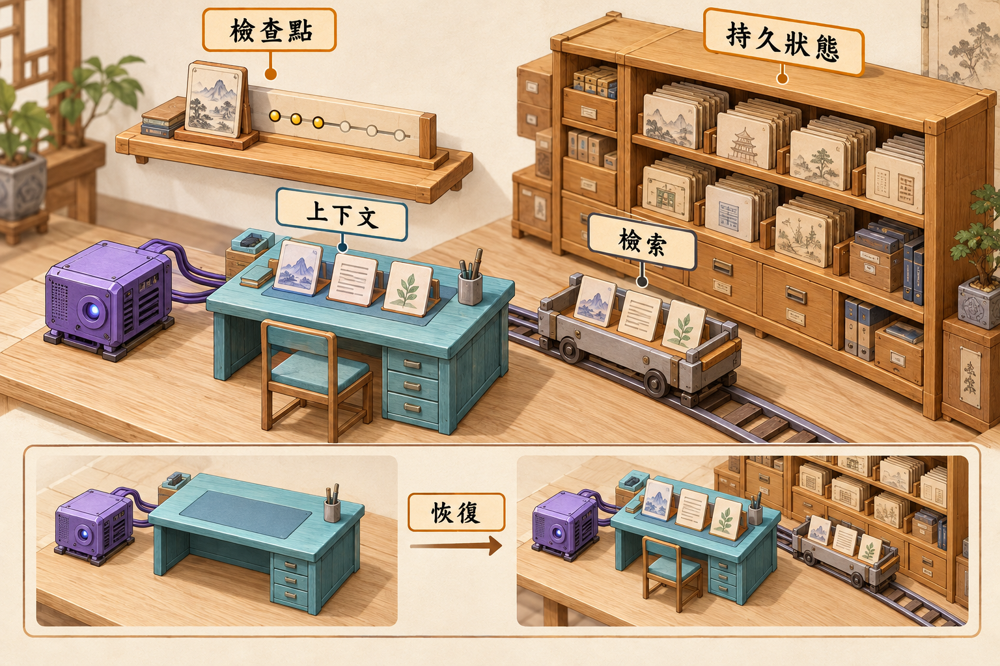
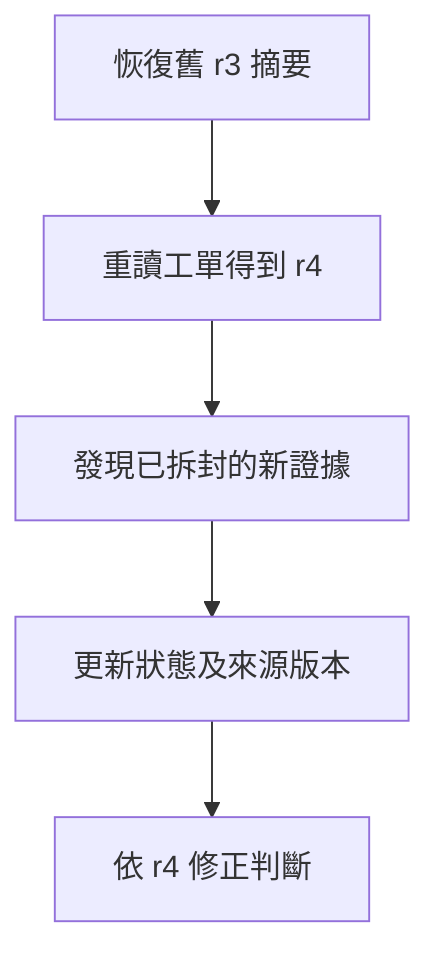

# 06 · Memory、State 與恢復：教學與案例

## 先抓住一個問題

**重啟後要接著做事，到底該記住什麼、又要重新確認什麼？**

上一章取得了對的文件。這章保存任務進度，但不把舊筆記當成永遠正確的現況。

## 把題目放到桌上

昨天讀到 T-1042 的 r3：相差 12 天、拆封未知、採 D14、只准草稿。今天程式重啟，可能有新客戶回覆。不能只憑昨天的摘要直接核准。

這是虛構教材案例，不是法律建議、真實客服紀錄或執行證據。完整設定見[共同案例](../../../maps/course-story.md)。

讀這章時先想：手上已知什麼、還缺什麼、誰能做哪個動作？不要急著把每個英文名詞都背起來。

本課基礎資料：T-1042 r3；10/08 到 10/20 相差 12 天。D14 要求日期差不超過 14 天且未拆封；r3 的包裝狀態未知。原任務只讀與寫草稿。本章或題目若另述變體，只有明示條件改變。

## 名詞先換成人話

| 名詞 | 先用人話說 | 放進本例 |
| --- | --- | --- |
| Working context／當輪資料 | 模型眼前正在用的資訊。 | 這輪載入 T-1042 和 D14。 |
| State／任務狀態 | 這件工作進行到哪裡、下一步缺什麼。 | 草稿已交，等待拆封回答。 |
| Checkpoint／進度快照 | 供中斷後接續的保存記錄。 | 上次用 r3、未寄送、下一步查新回覆。 |
| Store／長期儲存 | 跨輪或跨任務保存資訊的地方。 | 客服偏好簡短回答，與個案事實分開。 |
| Provenance／來源 | 這項資訊從哪裡來、何時確認。 | 拆封未知來自昨天 r3，不是永久事實。 |

## 工作桌、進度條與資料櫃不是同一件事

配圖中的桌面像當輪 context；櫃子像保存的資料；進度快照記錄任務做到哪。把資料存起來之後，還要挑選並載入，模型這一輪才看得見。檔案若其實只放在 RAM，程序結束後也不會神奇保留。

## 交接要能回答「下一個人現在做什麼」

一份可用交接至少寫清楚：目標、限制、採哪個版本、哪些條件已確認、哪些未知，以及下一步。T-1042 只寫「處理過了」會讓接手者重查或誤以為已寄送；寫「草稿已交、拆封待問、無寫入」才有接續意義。

## 重啟先核對可能改變的事實

假設工單已變成 r4，客戶補了「商品已拆封」，昨天 r3 的未知就必須更新。Checkpoint 記的是當時進度，不是今天工單的權威來源。已經可能執行的外部操作，也要讀回再決定是否重做，第 12 章會展開。

## 長期記憶要能更正與刪除

客服偏好短回答可以跨任務使用，某張工單的條件通常只屬那件事。每筆可重用資訊保留來源、對象、時間與失效方式，避免把模型猜測變成永久偏好，或把不同客戶資料混用。

LangGraph 用 checkpointer 保存單一 thread 狀態、store 保存較長期資訊，是具體實作對照；不是所有框架都用同一套介面。筆記與摘要也不等於訓練或更新模型權重。

看圖重點：資料保存與載入是兩件事；恢復需要重新選取資訊與確認外部狀態。櫃子不是模型權重，也不代表記憶永遠正確。

**看圖練習：程序重啟後，工作桌、櫃子與 checkpoint 哪些仍存在？若資料櫃也放在 RAM，答案有何改變？**

插圖由 Codex 內建 imagegen 生成並檢視；[生成提示詞](assets/prompt.md)。示意圖的類比不替代下方流程與權限規格。

## 完整走一次

| 步驟 | 發生什麼 | 為什麼這樣處理 |
| --- | --- | --- |
| 重啟前存進度 | T-1042、r3、D14、12 天、拆封待問、無寫入 | 接手者知道做過什麼。 |
| 重啟後先讀現況 | 查看工單是否有新版本 | 不先相信昨天摘要。 |
| 若變體 r4 記載已拆封 | 更新條件與回答 | 在本例 D14 下，未拆封條件不符合。 |
| 重新形成草稿 | 附 r4 與 D14 來源 | 記憶用來接續，不凌駕新證據。 |

**這章要留下的產物：**進度記錄保留昨日事實及來源；恢復時比對目前工單。若資料已更新，以新版本重新判斷，並保留變更理由。

這讓「記得上次做過什麼」和「今天資料到底是什麼」各有來源。重啟能省下無用重查，同時避免把舊結論直接套在新情況。

## 用流程核對責任

圖的重點是「發現已拆封的新證據」接到「更新狀態及來源版本」時需要哪些證據。請對照上表，說明少了這一步會造成什麼誤判。

## 接著做什麼

先做[Q01／Q03／Q05](exercises/README.md)，保留自己的第一版答案。遇到疑難先看[設計取捨](design-notes.md)，需要才開提示。

知道該保存什麼後，下一章看看 Codex 的 thread、turn、工具事件分別承載哪些工作。

## 來源與閱讀焦點

來源初查：2026-10-19；本次複核項目與日期見來源表。先讀來源中與本章名詞、責任及限制直接相關的段落；原始論文不要求第一輪讀完全部實驗。

- [S12 · Effective context engineering](https://www.anthropic.com/engineering/effective-context-engineering-for-ai-agents) — 第一方工程經驗；不是跨模型保證
- [S18 · LangGraph persistence](https://docs.langchain.com/oss/python/langgraph/persistence) — 框架文件；checkpointer 與 store 的具體對照
- [S15 · Effective harnesses for long-running agents](https://www.anthropic.com/engineering/effective-harnesses-for-long-running-agents) — 第一方實驗；跨 session 增量工作與交接

進一步看[來源版本與更新政策](../../../references/sources.md)。
