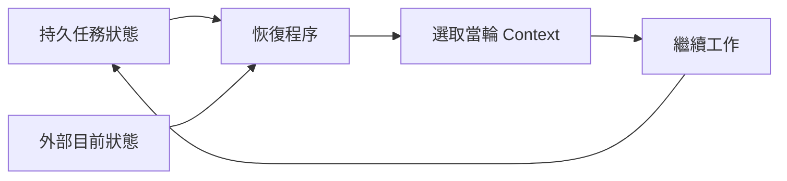

# 06 · Memory、State 與恢復

[章節入口](README.md) · [設計取捨](design-notes.md) · [練習](exercises/README.md)

## 本章完整案例

程式維護 Agent 重啟後，記得使用者偏好短回答，卻不知道上一輪修改已寫入檔案、測試尚未完成。它重新修改同一區塊並宣稱已驗收。

案例與練習軌跡為合成教學資料，沒有執行真實業務操作。

## 概念插圖

看圖重點：資料保存與載入是兩件事；恢復需要重新選取資訊與確認外部狀態。櫃子不是模型權重，也不代表記憶永遠正確。

**看圖練習：程序重啟後，工作桌、櫃子與 checkpoint 哪些仍存在？若資料櫃也放在 RAM，答案有何改變？**

插圖由 Codex 內建 imagegen 生成並檢視；[生成提示詞](assets/prompt.md)。示意圖的類比不替代下方流程與權限規格。

## 不同資訊需要不同生命週期

工作 context 用來支撐當輪推論；任務狀態記錄目標、已做、待做與外部操作；使用者偏好可能跨任務使用；來源事實則需版本與來源。不要把所有歷史都塞成一份「記憶」，否則很難更正、刪除或決定何時載入。

## Session、checkpoint 與長期 store

Session 通常代表一段互動，但名稱與保存方式由 runtime 決定。Checkpoint 是可恢復的工作狀態快照；長期 store 保存跨 session 的資訊。LangGraph 以 checkpointer 與 store 區分這些責任，是一種具體實作對照，不能推定所有框架介面相同。

## 恢復需要狀態與外部觀測

重啟時先讀任務狀態，再檢查檔案、資料庫或工具操作的實際結果。Checkpoint 說「即將提交」不表示沒有提交；外部操作可能在保存 checkpoint 前已成功。使用 operation ID 或版本條件判斷是否需要繼續，避免重複副作用。

## 記憶的來源、範圍與失效

每筆可重用資訊應有來源、適用對象、時間與更正方式。任務推測不能自動變成使用者偏好；外部文件中的惡意內容也不應提升成長期指令。最小化保存、設有效期限與刪除流程，能降低過期與跨使用者汙染。

## Compaction 與訓練是不同機制

筆記與摘要改變未來提供給模型的輸入，不代表更新模型權重。壓縮可維持連續性，但若丟失驗收狀態，恢復後仍會誤判完成。記錄「觀察到什麼」與「推測什麼」讓下一輪能辨別證據強度。

## 用案例走一次

恢復後先確認檔案差異與當前 revision，將任務標為「修改存在、測試未驗證」。重新跑必要檢查後才更新完成狀態。使用者偏好可另外載入，不應蓋掉本任務的要求；無法讀回的操作保留待確認。

## 精確機制圖

這張圖呈現本章需要討論的責任或狀態。實際功能、權限與可用性依所選 runtime、安裝版本及帳號驗證。

## 三個帶走的問題

- 能選擇資訊的生命週期與保存範圍：你會怎麼向另一位工程師說明？
- 能用持久狀態恢復任務並重新確認外部結果：需要哪些證據才能判斷？
- 如果模型的建議錯誤，哪一層應阻止錯誤擴大？

## 來源與閱讀焦點

查證基線：2026-10-19。先讀來源中與本章名詞、責任及限制直接相關的段落；原始論文不要求第一輪讀完全部實驗。

- [S12 · Effective context engineering](https://www.anthropic.com/engineering/effective-context-engineering-for-ai-agents) — 第一方工程經驗；不是跨模型保證
- [S18 · LangGraph persistence](https://docs.langchain.com/oss/python/langgraph/persistence) — 框架文件；checkpointer 與 store 的具體對照
- [S15 · Effective harnesses for long-running agents](https://www.anthropic.com/engineering/effective-harnesses-for-long-running-agents) — 第一方實驗；跨 session 增量工作與交接

進一步看[來源版本與更新政策](../../../references/sources.md)。
