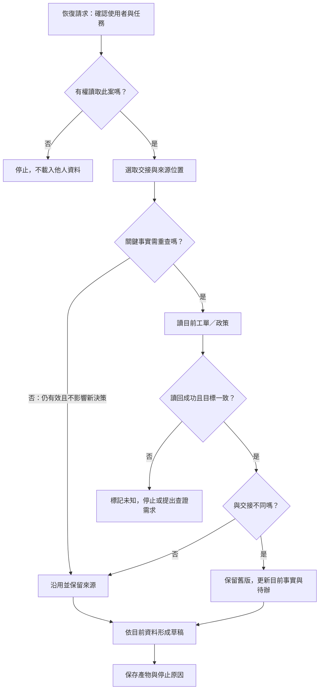

# 06 · Memory、State 與恢復：教學與案例

## 先抓住一個問題

**昨天做過的工作，今天要怎麼接下去，又不被昨天的結論騙倒？**

第 05 章解決「讀到哪份政策」。本章增加時間：程式可能重啟，客戶可能補資料，另一輪也可能接手。記憶的目的，是省去不必要的重做，同時留下能重新檢查的根據。

核心閱讀到「恢復流程」即可開始 Q01、Q03、Q05；保存策略與資料生命週期可作深挖。這章沒有要求先建資料庫。

## 把題目放到桌上

這是[共同案例](../../../maps/course-story.md)的合成變體，並非真實客服紀錄：

- 工單 T-1042，昨天版本 r3；2026-10-08 購買、10-20 申請，相差 12 天。
- D14 自 10-01 生效，要求「相差不超過 14 天」且「未拆封」。D07 舊 7 天規則已被取代。
- r3 沒有記載拆封狀態。昨天完成的是詢問包裝狀態的草稿，業務仍等待資料。
- 原授權只允許讀取與草稿，不允許寄送、關單或退款。
- 今天重啟後，讀到同一工單 r4，客戶明確補充「商品已拆封」。

本章的問題不是「如何讓模型永遠記得」，而是「哪份記錄應該保留、哪個事實應該更新、更新後要怎樣改答案」。

## 名詞先換成人話

| 名詞 | 責任 | 本例 |
| --- | --- | --- |
| Working context／當輪資料 | 這次推論實際收到的資料 | 這輪選入的交接、r4、D14 |
| State／任務狀態 | 描述這件事進度的欄位 | 草稿 v1 已交；目前等待重新判斷 |
| Checkpoint／進度快照 | 保存某個時點的狀態，供接續或查證 | 昨日 r3、拆封未知、下一步查回覆 |
| Store／跨輪資料儲存 | 放可被多次工作取用的資訊 | 已確認的「使用繁中短答」偏好 |
| Provenance／來源紀錄 | 說明資訊來自哪裡、何時觀察 | r4 的客戶回覆位置與版本 |

這些名稱描述的是工作責任，不是一定要買五套服務。同一資料庫可以放不同資料，但仍需分清哪些屬單一任務、哪些可跨任務使用。

## 保存不等於載入，載入不等於可信

可以把 context 想成桌面，持久資料想成資料櫃。昨天把筆記放入櫃子，只代表有地方找；今天仍要選出與 T-1042 有關且有權使用的內容，才會成為模型眼前的輸入。

一份記憶至少經過四個不同決定：

| 決定 | 要回答的問題 | 常見失敗 |
| --- | --- | --- |
| 要不要保存 | 之後還需要這項資訊嗎？ | 每句聊天都永久保存 |
| 保存什麼 | 是觀察、推論、待辦，還是偏好？ | 把「可能未拆封」存成事實 |
| 要不要載入 | 這次使用者、任務、權限是否適用？ | 讀到另一位客戶的個案 |
| 載入後怎麼用 | 它是否仍有效，需不需要重查？ | 舊 r3 摘要蓋過新 r4 |

本例適合載入六行交接，不必一開始塞進昨天全部對話。若摘要省略了關鍵條款，再回原文，不要求模型用猜的補齊。

## Checkpoint 和 Store 差在哪裡

Checkpoint 像交班單，重點是「這件工作停在哪裡」。Store 像可查的資料櫃，重點是「未來哪些工作還可使用這筆資料」。兩者不靠存放多久來區分：一年前的 checkpoint 仍是某次任務快照，一分鐘前保存的偏好也可能屬跨任務資料。

| 資料 | 優先放哪裡 | 為什麼 |
| --- | --- | --- |
| T-1042 r3 的草稿位置與待問事項 | 此任務 checkpoint | 接續同一任務要用 |
| 客服本人確認的繁中短答偏好 | 該使用者範圍的 store | 可用於之後其他工單 |
| D14 原始條款 | 政策來源庫；交接只留版本與位置 | 政策維護者才是權威來源 |
| 「T-1042 可直接退」的模型猜測 | 不提升為事實；需留則標推論 | 未拆封條件沒有證據 |

LangGraph 是一個實作對照：其官方文件把 checkpointer 用於 thread 的狀態快照，把 store 用於 graph state 之外的應用資料。這不是所有框架共同的介面，也不表示使用記憶體版儲存就能跨程序重啟保留。

## 完整走一次：從 r3 交班到 r4 修正

### 第一步：先做一份能接手的 r3 記錄

下面是欄位示意，不是可執行設定，也不證明任何資料已寫入：

| 欄位 | r3 時點保存值 | 用途 |
| --- | --- | --- |
| task / owner | T-1042／教學客服 A | 防止接到別案或別人資料 |
| goal / allowed | 判斷與草稿／僅讀取 | 不把歷史進度當新授權 |
| observed_sources | 工單 r3；D14 條款位置 | 可回查當時依據 |
| facts | 日期差 12 天；包裝 unknown | 未知也要明寫 |
| artifacts / effects | 草稿 v1 位置；未寄送、關單、退款 | 區分產物與外部副作用 |
| next / status | 查新回覆；草稿完成、業務待資料 | 告訴接手者先做哪一步 |

「未寄送」在這個合成案例有明示前提；實際系統若只有缺少寄送記錄，應寫「未確認」，不能推成沒寄過。

### 第二步：恢復時只先取必要資料

先驗證目前使用者能否讀 T-1042，再載入該案最新可用交接。讀取政策位置與工單版本，是為了確認關鍵事實，不是無差別重跑所有歷史工具。

對任務無影響且仍有效的資訊可以沿用，例如「這輪使用繁中短答」。會改變結論的包裝狀態，則要查目前工單。任務授權也應從現行可信任任務邊界確認，不能讓摘要替自己擴權。

### 第三步：比較新版，不直接覆蓋歷史

| 項目 | 昨日交接 r3 | 今日讀回 r4 | 決定 |
| --- | --- | --- | --- |
| 工單 ID | T-1042 | T-1042 | 同一案，可比較 |
| 日期差 | 12 天 | 12 天 | 日期條件仍符合 |
| 包裝 | unknown | 已拆封 | 更新目前事實，保留 r3 歷史 |
| 政策 | D14 | 仍確認適用 D14 | 不改用 D07 |
| 權限 | 只讀與草稿 | 本輪仍只讀與草稿 | 不能因此寄送或退款 |

版本較新不是唯一的可信理由。這裡還有同一目標、可信工單來源與明確的新回覆；若得到的是別案 r9，或來源不明的摘要，就不應覆蓋 T-1042。

### 第四步：重新計算結論與待辦

D14 有兩個必要條件。12 ≤ 14 為真；「未拆封」現在為假。因此本例不符合 D14 的未拆封條件，不能沿用「等待拆封回覆」的舊待辦。

更新後可以記錄：目前來源 r4、包裝已拆封、日期符合、未拆封條件不符；草稿 v1 已過期，產出草稿 v2。保留變更原因「r4 新增拆封回覆」，避免下一輪只看到兩份互相矛盾的草稿。

### 第五步：輸出並停止

可接受的草稿片段：

> 依本店 D14，申請相隔 12 天，符合天數條件；但您在 T-1042 r4 回覆商品已拆封，因此未符合未拆封條件。以上為本次判斷草稿，尚未寄送、關單或退款。

本輪在「更正草稿完成」停止，不把工單標成已退款。若 r4 缺少來源或讀取失敗，就保留「現況未確認」，說明阻礙，不把昨日未知偷偷改成未拆封。

## 恢復流程不是每次都走同一條直線

此圖沒有宣稱每次恢復都必須完整重查全部資料，也沒有讓「恢復」自動觸發外部寫入。第 12 章會專門處理已送出的外部操作與回覆遺失。

看圖時指出：哪裡只負責保存，哪裡負責選取？如果櫃子實際在 RAM，程序重啟就可能全部消失。圖中櫃子不是模型權重，使用它不等於訓練模型。

插圖由 Codex 內建 imagegen 生成並檢視；[生成提示詞](assets/prompt.md)。圖是類比，不是儲存與權限的驗收證據。

## 反例：摘要看起來順，交接卻不能用

**弱交接：**「客戶符合 14 天退貨，已處理，下次直接繼續。」

它把日期符合寫成整體符合、刪掉拆封未知，也沒說「已處理」指草稿或寄送。接手者讀得很快，卻無法做對決定。

**修正：**「T-1042 r3，D14；日期差 12 天，包裝未知。草稿 v1 已交，業務待資料；無寄送／關單／退款。下輪先讀新回覆，再決定是否更新草稿。」

修正的價值不是字比較多，而是接手者能指出每個結論的依據，知道第一步，且不會誤認有新授權。

## 深挖：記憶也需要到期、更正與刪除

| 事件 | 應做什麼 | 怎麼驗收 |
| --- | --- | --- |
| r4 更正包裝 | 更新目前狀態，讓 r3 留在歷史 | 下一輪不能仍以 r3 決定 |
| 偏好可能過期 | 到期先停用或重新確認 | 未確認前不再套用舊偏好 |
| 使用者要求刪除 | 依既定範圍處理原記錄、摘要、索引等衍生副本 | 再檢索不回傳已刪資訊；備份依保存政策處理 |
| 使用者 B 啟動任務 | 先依身份限制可查範圍，再檢索 | B 查相同關鍵字也取不到 A 私有資料 |

保存多久是產品與資料責任的選擇，不是「記越多越聰明」。設定到期時間也不等於已刪除；資料可能仍留在摘要或索引，需定義清除與停用的邊界。

## 初學者常問

**有完整聊天記錄，為什麼還要 checkpoint？** 聊天記錄可能含多次改口、工具失敗和舊草稿。Checkpoint 把目前進度整理成可接續的欄位；但它可能整理錯，因此還要保留來源位置。若任務很短，明確的單頁交接就可能夠用，不必先引入框架。

**重查現況不就等於完全沒省到？** 不同。恢復後可保留目標、限制、已完成分析與草稿位置，只重新確認會改變下一步的部分。r4 更新拆封，就重做受影響判斷；不用重寫「12 天如何相減」的教學，也不用重搜無關文件。

**把舊摘要刪掉就不會誤用嗎？** 可能會失去更正原因與查證依據。通常可把舊摘要標為歷史、目前指向 r4；若有刪除要求，依明確資料政策處理。歷史可查與預設載入是兩個不同決定。

## 接著做什麼

先做[Q01／Q03／Q05](exercises/README.md)，再用[設計取捨](design-notes.md)檢查自己是否只會說「加記憶」。下一章把本章任務、回合與產物，對照到 Codex 的 thread、turn 和工具事件；保存的對話仍不等於退款已完成。

## 來源與閱讀焦點

- [S18 · LangGraph persistence](https://docs.langchain.com/oss/python/langgraph/persistence) — 第一方框架文件，2026-10-21 複核 checkpointer／store 的責任與 RAM 不保證跨程序保存。這是實作對照，不是跨框架標準。
- [S12 · Effective context engineering](https://www.anthropic.com/engineering/effective-context-engineering-for-ai-agents) — 第一方工程經驗；當輪資料選取的延伸閱讀，沿用 2026-10-19 初查。
- [S15 · Effective harnesses for long-running agents](https://www.anthropic.com/engineering/effective-harnesses-for-long-running-agents) — 第一方工程經驗；交接與增量工作，沿用 2026-10-19 初查。

本章欄位、保留策略與恢復分支是教學設計選擇，不是框架預設保證。更多見[來源版本與更新政策](../../../references/sources.md)。
