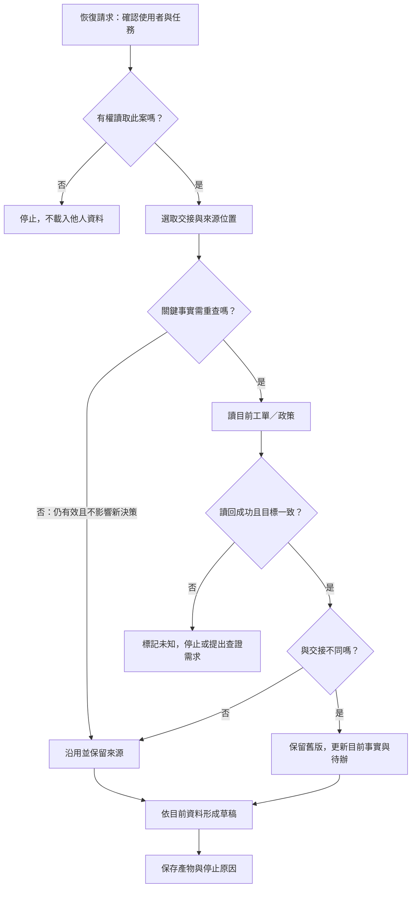

# 06 · Memory、State 與恢復：教學與案例

隔天早上，你重新打開助理。左邊的交接摘要寫著：「草稿已交，等待客戶說明包裝狀態。」右邊工單卻多了一則回覆：「商品已拆封。」

如果直接按「沿用昨天結果」，助理可能再問一次已經回答的問題，甚至拿舊結論承諾退貨。你現在得先決定：**昨天的記錄，哪些還能用？**

這是本課的合成客服案例。先沿著「找回交接 → 選入本輪 → 核對新回覆 → 更新進度」讀一遍；後面的欄位表和框架對照可以稍後再看。

## 先抓住一個問題

助理重啟後，不必從頭做所有工作；但「上次記得什麼」也不能直接當成「現在發生什麼」。這章要把兩者接起來。

第 05 章找到正確政策，這一章則要讓下一輪接手者知道：上次依據哪份資料，做到了哪裡，接著還缺什麼。

## 把題目放到桌上

先記住三件事。昨天的工單是 T-1042 r3，包裝狀態未知；助理只交了詢問草稿。今天同一張工單變成 r4，客戶補充已拆封。

這家虛構商店的 D14 規則要求「申請相差不超過 14 天，而且未拆封」。本案 10/08 購買、10/20 申請，相差 12 天；D07 舊 7 天規則已在 10/01 被 D14 取代。

本輪仍只准讀取與草稿，沒有寄送、關單或退款授權。完整設定見[共同案例](../../../maps/course-story.md)，不必先完成其他章的 lab。

## 完整走一次：從 r3 交班到 r4 修正

### 第一步：先做一份能接手的 r3 記錄

先退回昨天。當助理結束工作時，只寫「已處理」會留下大洞：完成的是草稿，還是退款？下一輪又該先查什麼？

因此要保存一份交班單，寫出當時的來源、已知、未知與下一步。這種供中斷後接續的進度快照，稱為 **checkpoint**。

本例的交班單可以先寫成一句可讀的話：

> T-1042 r3，依 D14；日期差 12 天，包裝未知。詢問草稿 v1 已交，業務待資料。下輪先讀新回覆；本案例沒有寄送、關單或退款。

它沒有記下全部對話，卻留下了接手方向。完整欄位稍後再看。

### 第二步：恢復時只先取必要資料

回到今天。交班單即使存在檔案裡，也不會自己進入模型這一輪的輸入。

你要先確認目前使用者能讀這張工單，再選出這份交接及政策位置。真正送進這次推論的資料，才是 **context／當輪資料**。保存和載入是兩個動作。

**停 15 秒：**交接已存在硬碟，但新一輪只收到「請繼續」。這時可以說模型已知道昨天的包裝狀態嗎？

還不行。你只能說資料有被保存；還要看這輪是否選取並載入它。反過來，即使載入成功，也只代表模型看得見，不代表記錄仍有效。

桌面是本輪實際資料，櫃子是可再取用的資料。圖中的櫃子不是模型權重；若實際儲存只在 RAM，程序重啟也可能全部消失。[生成提示詞](assets/prompt.md)保留於章內；此圖是類比，並非隔離或保存的驗收證據。

### 第三步：比較新版，不直接覆蓋歷史

現在你讀到 r4：「商品已拆封。」先確認它來自可信工單來源，而且仍是 T-1042。只有版本數字較大還不夠，別案 r9 不該更新本案。

確認是同一案後，就能把 r3 的「包裝未知」更新成目前的「已拆封」。昨天的交接不用假裝從未存在；它說明了當時為何要詢問。

這裡多了一項很實用的資訊：**來源紀錄（provenance）**。它回答「這句話從哪裡來、何時確認」，讓接手者知道應該回看哪則客戶回覆。

到這裡，你已有兩種不同記錄：r3 是歷史進度，r4 是目前事實。下一步才是判斷新事實會改變什麼。

### 第四步：重新計算結論與待辦

日期差仍是 12 天，因此天數條件不變。包裝從未知變成已拆封，則不符合 D14 的未拆封條件。

不只答案要改，待辦也要改。「等待拆封回答」已經過時，下一步是更正草稿。任務目前做到哪裡、接著要做什麼，合起來就是這件工作的 **state／狀態**。

**停 20 秒：**如果把舊草稿刪掉，只留下「不符合」，下一個接手者會少知道什麼？

他會不知道結論為何改變。比較可靠的做法，是讓目前記錄指向 r4，標示草稿 v1 已被 v2 取代，並保留「客戶新增已拆封回覆」這個原因。歷史是否保留多久，另依資料政策決定。

### 第五步：輸出並停止

更正後的草稿要分別說清楚：天數符合；依 r4，未拆封條件不符。這輪完成的是更正草稿，沒有因此取得寄送或退款權限。

如果今天讀工單失敗，就還不能確定現況。此時標示「目前版本未確認」，說明阻礙並停止相關推論。昨天的未知不會因為今天連不上，就自動變成未拆封。

你可以在這裡先停。現在已能解釋三道關卡：資料有保存嗎？本輪有載入嗎？載入後仍可信且適用嗎？接著做 [Q01](exercises/README.md#c06-q01)，或往下查完整契約。

## 反例：摘要看起來順，交接卻不能用

「客戶符合 14 天退貨，已處理，下次直接繼續。」這份摘要很短，但把日期符合說成整體符合，也沒交代「處理」指草稿還是外部操作。

把它改成「12 天、包裝未知、草稿 v1 已交、下輪查新回覆」，接手者才知道應該做什麼。這不是為了寫長，而是留下會影響下一步的差別。

實際系統還要注意：沒找到寄送記錄，不一定等於從未寄送。本合成案例明示沒有寄送；若證據不足，就寫「寄送未確認」。外部結果未知的恢復，第 12 章會展開。

## 深挖：把剛才的交接變成可檢查欄位

### 六欄交接

下面只是欄位示意，並非可執行設定或已保存的證據。

| 欄位 | r3 時點保存值 | 幫接手者回答 |
| --- | --- | --- |
| task / owner | T-1042／教學客服 A | 哪件事、誰的資料？ |
| goal / allowed | 判斷與草稿／只讀 | 可以做什麼？ |
| observed_sources | 工單 r3；D14 條款位置 | 根據哪份資料？ |
| facts | 日期差 12 天；包裝 unknown | 已知與未知是什麼？ |
| artifacts / effects | 草稿 v1 位置；無寄送、關單、退款 | 完成哪份產物，有何副作用？ |
| next / status | 查新回覆；草稿完成、業務待資料 | 第一個接續動作是什麼？ |

對照 r4 時，更新包裝、來源版本、判斷與待辦；日期條件和本輪只讀授權並未改變。不要把所有欄位一律清空，也不要只改最後一句答案。

## Checkpoint 和 Store 差在哪裡

交班單關心同一任務停在哪裡；另外有些資訊可能用於以後其他任務，例如客服 A 明確確認的「使用繁中短答」。可跨輪再取用這類資訊的儲存，常稱為 **store**。

差別不在存多久。一年前的 checkpoint 仍是某件事的快照；剛確認的偏好也可能要跨任務使用。短任務用單頁交接就可能夠用，不必先導入框架。

| 資料 | 優先歸屬 | 不該誤用成什麼 |
| --- | --- | --- |
| T-1042 草稿位置與待辦 | 本案 checkpoint | 所有工單的進度 |
| A 確認的短答偏好 | A 範圍的 store | 所有使用者的偏好 |
| D14 原始條款 | 政策來源庫，交接留位置 | 永遠不需再確認的規則 |
| 模型猜「可以退」 | 若留則標推論 | 已確認事實 |

LangGraph 的官方文件用 checkpointer 保存 thread 狀態快照，用 store 保存 graph state 之外的應用資料。這是具體框架對照，不是所有框架的共同介面；記憶體版儲存也不保證跨程序保留。

## 保存不等於載入，載入不等於可信

現在回頭看，記憶需要四個選擇，而不只是一個「存起來」按鈕。

| 選擇 | 本案要問 |
| --- | --- |
| 要不要保存 | 下輪需要這項資訊嗎？ |
| 保存什麼 | 它是觀察、推論、待辦還是偏好？ |
| 要不要載入 | 此使用者與此任務有權且有需要嗎？ |
| 載入後怎麼用 | 來源與有效性仍足以支持這次決定嗎？ |

同一資料庫可以承擔多種責任，不表示一定需要四套系統。保存方式與載入策略仍要分開設計。

## 恢復流程不是每次都走同一條直線

不需要每次重讀全部歷史。仍有效且不影響新決策的資訊可以沿用；影響下一步的關鍵事實才需要重查。若來源失敗，流程停在未知，不讓模型自行補成成功。

## 深挖：記憶也需要到期、更正與刪除

r4 是「更正目前事實」的例子。其他資訊也有離開系統的時機：偏好可能到期，使用者可能要求刪除，另一位使用者也不該取到你的私有資料。

| 事件 | 做法 | 驗收觀測 |
| --- | --- | --- |
| r4 更正包裝 | 目前指向 r4；r3 留歷史 | 下輪不再以 r3 決定 |
| 偏好到期 | 停用或重新確認 | 未確認前不套舊偏好 |
| 要求刪除 | 處理原記錄與摘要／索引等衍生副本 | 再檢索不回傳已刪資訊；備份依政策處理 |
| B 開任務 | 先限制可查身份範圍 | 相同關鍵字也取不到 A 私有資料 |

設定到期時間不等於已刪除。刪掉一列也不一定清掉摘要；必須定義處理範圍，並從下一次載入與檢索結果確認。

## 名詞先換成人話

需要回查時看這裡：context 是當輪實際輸入；state 是任務目前進度；checkpoint 是某時點快照；store 保存可再次取用的資料；provenance 說明來源與觀察時點。這些責任可由同一套儲存承擔，但不能混成同一個結論。

## 初學者常問

**有完整聊天記錄，為什麼還要 checkpoint？** 聊天可能保留多次改口、失敗和過期草稿。交接把「現在在哪」整理出來；原始紀錄則供回查。摘要可能整理錯，所以還要留來源位置。

**重查現況還能省下什麼？** 保留任務、限制、已完成分析與草稿位置，只重查會改變下一步的部分。包裝更新，不必連無關文件一起重搜。

**把舊摘要刪掉就不會誤用嗎？** 可能也丟掉更正原因。通常可分開「歷史可查」和「預設載入」；遇到刪除要求則依資料政策處理，不能為了查證無限保留。

## 接著做什麼

先做 [Q01／Q03／Q05](exercises/README.md)，需要時才看提示。若你仍只寫「加 memory」，回到第三步，說出哪份來源改了哪個欄位。

下次從這裡接：

- 我目前的判斷：保存、載入、現況確認分別是＿＿。
- 我還不確定：＿＿。
- 下一次先看：第＿＿步／[Q＿＿](exercises/README.md)。

下一章把任務、回合與產物對照到 Codex 的 thread、turn、item。對話可以保存，業務卻不一定已完成。

## 來源與閱讀焦點

- [S18 · LangGraph persistence](https://docs.langchain.com/oss/python/langgraph/persistence) — 第一方框架文件，2026-10-21 複核 checkpointer／store 的責任與 RAM 不保證跨程序保存。這是實作對照，不是跨框架標準。
- [S12 · Effective context engineering](https://www.anthropic.com/engineering/effective-context-engineering-for-ai-agents) — 第一方工程經驗；當輪資料選取的延伸閱讀，沿用 2026-10-19 初查。
- [S15 · Effective harnesses for long-running agents](https://www.anthropic.com/engineering/effective-harnesses-for-long-running-agents) — 第一方工程經驗；交接與增量工作，沿用 2026-10-19 初查。

本章欄位、保留策略與恢復分支為教學設計；本輪只改敘事節奏，未新增執行證據。更多見[來源政策](../../../references/sources.md)。
