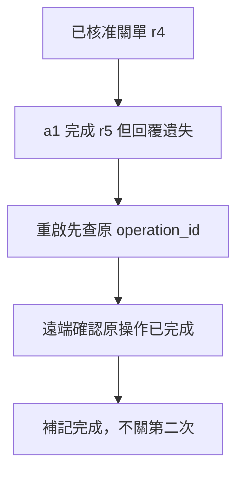

# 12 · 可靠性、冪等性與長任務恢復：教學與案例

## 先抓住一個問題

**工具沒有回覆，怎麼知道該重試還是先查狀態？**

第 11 章確認操作有權執行；本章處理有權執行後仍可能斷線、當機或只完成一半。

## 把題目放到桌上

這是另行核准的延伸案例：使用者同意關閉 T-1042 r4。關單 operation_id 為 close-T1042-01。伺服器已關單並產生 r5，但回覆遺失，本地仍只記錄到送出要求。

這是虛構教材案例，不是法律建議、真實客服紀錄或執行證據。完整設定見[共同案例](../../../maps/course-story.md)。

讀這章時先想：手上已知什麼、還缺什麼、誰能做哪個動作？不要急著把每個英文名詞都背起來。

## 名詞先換成人話

| 名詞 | 先用人話說 | 放進本例 |
| --- | --- | --- |
| Idempotency／冪等 | 同一個邏輯操作重送，不再造成一次新的效果 | 重送 close-T1042-01 仍是同一次關單 |
| Retry／重試 | 對可能恢復的失敗再試一次 | 短暫斷線後查詢原操作 |
| Checkpoint／檢查點 | 持久保存恢復所需的進度 | 記錄操作 ID、目標、核准與最後已知狀態 |
| Compensation／補償 | 以另一個操作修正已發生的效果 | 重新開單是新操作，仍需自己的授權 |
| Unknown outcome／結果未知 | 目前證據不足以判定成功或失敗 | 沒收到回覆，不能直接認定沒有關單 |

### 先問發生了什麼，再決定重做什麼
讀取失敗通常可以再讀；寫入失去回覆時，伺服器可能已完成。此時立即重送，會把通訊問題變成重複操作問題。先查原操作或目標狀態，才能縮小不確定性。

### 一個業務操作可以有多次嘗試
operation_id 表示同一次關單；attempt_id 表示某次傳送，例如 a1、a2。重試換 attempt_id，不能換掉原 operation_id，否則伺服器可能把它當新操作。伺服器必須實際保存去重結果；客戶端自行取名不會自動得到冪等保證。

### 恢復不是把整段對話再跑一遍
檢查點至少留下目標、預期版本、核准、operation_id 和最後已知狀態。恢復時重新讀取真實狀態：本例若讀到 r5 已關閉，且原操作記錄相符，就補記完成，不再關一次。若只能看到關閉狀態、無法確認由誰造成，應記錄證據限制。

### 重試、取消和補償都有邊界
重試需有可恢復理由、次數與時間上限；權限錯誤不能靠等待修好。取消本地等待，不保證遠端已停止。補償也不是倒帶：重新開單可能觸發通知，需要單獨授權。單一資料庫 transaction 不能保證跨資料庫、郵件與遠端 API 全部只發生一次。

## 完整走一次

| 步驟 | 發生什麼 | 為什麼這樣處理 |
| --- | --- | --- |
| 送出 a1 | 保存 close-T1042-01 與核准，再送關單 | 保留恢復線索 |
| 回覆遺失 | 本地記成結果未知 | 避免把未知當失敗 |
| 重新啟動 | 讀操作紀錄與工單 r5 | 以遠端狀態判斷 |
| 恢復完成 | 補記同一操作已完成 | 不產生第二次關單 |

**這章要留下的產物：**一張恢復判斷表：已完成、明確未完成、結果未知，各自列出下一步。

把通訊狀態與業務效果分開，才能避免每次重啟都重做副作用。

## 用流程核對責任

圖的重點是「重啟先查原 operation_id」接到「遠端確認原操作已完成」時需要哪些證據。請對照上表，說明少了這一步會造成什麼誤判。

## 接著做什麼

先做[Q01／Q03／Q05](exercises/README.md)，保留自己的第一版答案。遇到疑難先看[設計取捨](design-notes.md)，需要才開提示。

第 13 章問：如何用測試與事件紀錄，證明這套恢復設計有效？

## 來源與閱讀焦點

來源初查：2026-10-19；本次複核項目與日期見來源表。先讀來源中與本章名詞、責任及限制直接相關的段落；原始論文不要求第一輪讀完全部實驗。

- [S15 · Effective harnesses for long-running agents](https://www.anthropic.com/engineering/effective-harnesses-for-long-running-agents) — 第一方實驗；跨 session 增量工作與交接
- [S18 · LangGraph persistence](https://docs.langchain.com/oss/python/langgraph/persistence) — 框架文件；checkpointer 與 store 的具體對照
- [S25 · Errors and recovery](https://developers.openai.com/siwc/token-sharing-open-source/errors-and-recovery) — 官方 preview；額度、資格、能力限制與 OAuth 恢復

進一步看[來源版本與更新政策](../../../references/sources.md)。
