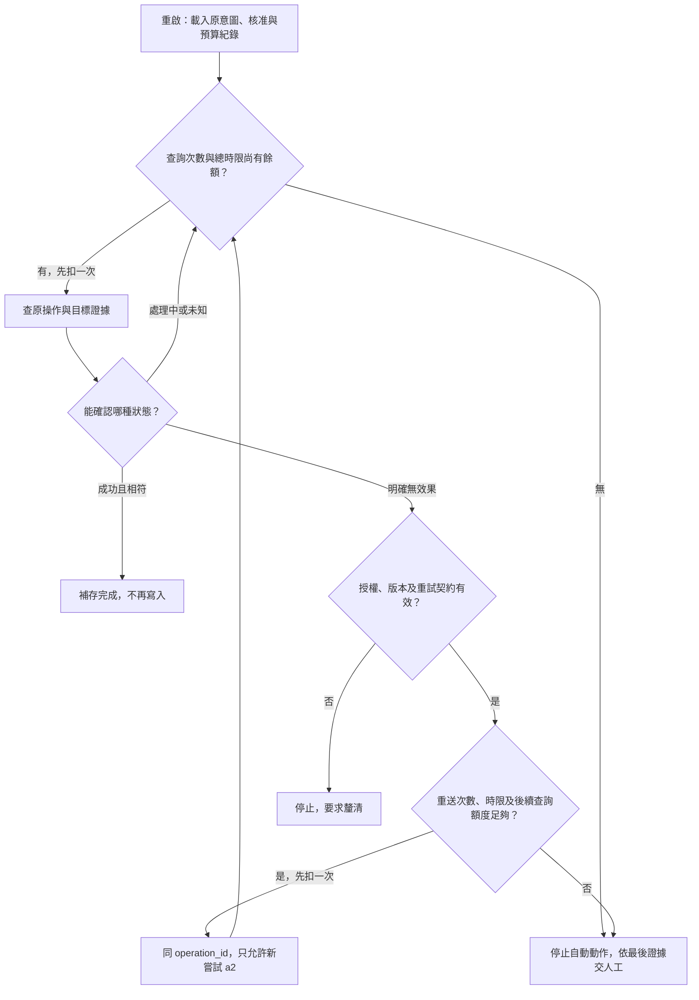

# 12 · 可靠性、冪等性與長任務恢復：教學與案例

## 先抓住一個問題

你剛按下「關閉工單」。轉圈停了，螢幕只剩：**「要求逾時，請稍後再試。」**

游標停在重試按鈕上。再按一次，或許就好了；但如果第一次其實已經成功，再按會不會多寄一封通知、多留一筆關單紀錄？

這一刻，你需要的不是更有信心地猜，而是找出下一個值得做的動作。

先讀下面四個場景，再做 Q01、Q03、Q05；欄位表、完整流程與故障點放在後面的「深挖」，可以第二輪再看。這是合成案例，沒有執行真實關單。

## 把題目放到桌上

這次操作已獲使用者另外核准：關閉 **T-1042 r4**，內容也已確定。關單不是退款。全課原始 r3 任務只有讀取和寫草稿；那份授權不能拿來關單。

r4 是後來補充「已拆封」的變體。原日期仍是 10/08 購買、10/20 申請，相差 12 天；D14 要求不超過 14 天且未拆封。本章不改退貨條件，只追蹤這次另行核准的關單。完整背景見[共同案例](../../../maps/course-story.md)。

## 場景 1：你只知道沒收到回覆

先別碰重試。你打開本地紀錄，看到的最後一行是「準備送出」。它沒有告訴你遠端收到沒有，更沒有證明關單尚未發生。

停 15 秒，先選一句你現在敢對使用者說的話：「關單失敗了」，或「關單結果還沒確認」。哪一句只用了眼前證據？

回覆可能在傳送途中遺失，也可能在遠端完成關單後遺失。兩種情況在你螢幕上都長得像逾時。因此此刻要記成 **結果未知（unknown outcome）**，保留查證空間。

未知不是「大概失敗」，也不是要求模型選一邊。它是一個會改變下一步的狀態：先查原來那件事，不新增另一件事。

## 場景 2：你要找的是原來那次關單

你翻到送出前留下的記錄。這次關單有固定名稱 **close-T1042-01**。它是 operation_id：用來指認使用者要完成的同一件事。

第一次傳送另叫 **a1**。這是 attempt_id，方便分辨哪一次傳送超時。若之後真的符合重送條件，下一次可以叫 a2，但仍屬於 close-T1042-01。

這個分別很實際：如果每次重啟都替關單取新名字，遠端可能會以為你要再做一件新的事。反過來，只換傳送編號，才有機會問「原來那件事完成了沒？」

不過，取名字本身沒有防重能力。遠端必須真的認得同一操作、保存結果並防止重複效果。這種「同一件事重送也不再多做一次」的契約，叫 **冪等（idempotency）**；完整前提留在深挖。

## 場景 3：你取得了新的證據

你查 close-T1042-01 的遠端操作紀錄。它顯示：a1 已完成，T-1042 從 r4 關成 r5。你再核對工單，結果相符。

現在才揭開這個案例的真相：**第一次關單成功了，只是回覆沒回來。**

此時該做的是補存已確認的結果，不是再送一次關單。你把確認來源、時間、結果 r5 留下，再告知使用者已核對完成。這份能跨重啟找回進度的記錄，就是 checkpoint，檢查點。

若之後工單已被別人更新到 r6，也不能只因現況不是 r5 就抹掉原操作。要結合操作歷史，確認 r5 曾發生、後來又改了什麼。

**本次輸入**是舊記錄與原核准；**新增證據**是原操作結果及相符工單；**輸出**是補記完成；**停止**是沒有再發一筆關單。恢復不等於重演整段對話。

## 場景 4：如果這次查不到呢？

把剛才那份成功紀錄暫時拿掉。假如服務端也在逾時，你不能因為急著結案，就把「不知道」改寫成「沒做」。

這時有三條路。能確認原操作完成，就補記；能確認沒有產生效果，才評估是否還有授權、版本及安全重送條件；剩下的仍是未知，要繼續查證或交接。

先停 20 秒：假設你只查到工單是 closed，卻查不到原操作。你能確認的是「目前已關閉」，還是「一定由 a1 關閉」？這兩句需要的證據不同。

同樣地，「找不到操作」也可能只是紀錄過期或查錯位置。除非工具契約明確保證它代表未受理、並可排除仍在途中的 a1，否則不能拿它當重送許可。

### 查詢和重送各有一個煞車

本章的合成預算是：**最多查 3 次，包含首次；a1 之外最多重送 1 次，只能是 a2；整次恢復總時限 30 秒。**

每次查詢前檢查查詢餘額與時限。每次重送前另檢查重送餘額、授權、版本與工具契約，且至少保留一次查詢額度供後續查證。這些不是必須用完的配額；第一次查明成功就停止。

操作 ID、嘗試 ID、已用次數及截止時間都要持久保存，不能靠重啟歸零。必要預算耗盡，就停止新增動作，按最後證據報告未完成或未知，附資料交人工。停止等待不代表取消遠端。

你若在這裡中斷，下次從深挖區的「三、未知狀態怎麼一步步收斂」接讀。記住目前結論：a1 在主案例已關成 r5，恢復只補記；查不到的變體則不能套用這個答案。

## 反例：看起來積極，卻把事情做兩遍

有人提議：「既然超時，取一個新的操作 ID，再讀最新版本關一次。」

這看起來繞過錯誤，卻同時換了操作身分與核准前提。第二次操作即使仍讓工單顯示 closed，也可能多出通知和歷程。把欄位寫成同一個值，不代表所有附帶效果都只發生一次。

修正的第一步是保留原意圖與原核准，查可追溯的效果。若證據不足，保留未知；不能靠第二次改動來調查第一次。

## 深挖：把剛才的決策寫成契約

接下來可選讀。前四個場景已給你主線；這裡保留完整欄位、分支和驗收，方便做 Q02、Q04、Q06 時回查。

## 名詞先換成人話

| 名詞 | 人話 | 本例 |
| --- | --- | --- |
| Logical operation／邏輯操作 | 使用者要完成的那一件事 | 關閉這張特定工單一次 |
| Attempt／嘗試 | 為那件事做的一次傳送 | a1 回覆遺失；必要時可能有 a2 |
| Idempotency／冪等 | 重送相同操作，不再新增同一種效果 | 相同 close-T1042-01 取回原結果 |
| Deduplication／去重 | 找出同一操作的重複要求並合併處理 | 遠端保存操作 ID 與已確認結果 |
| Checkpoint／檢查點 | 當機後仍找得到的恢復紀錄 | 目標、核准、版本、操作 ID 與最後證據 |
| Unknown outcome／結果未知 | 沒有足夠證據判定效果 | 超時後不知是否已關單 |
| Compensation／補償 | 用另一件事修正已發生的效果 | 另行核准重新開單，而非抹掉歷史 |

## 一、完整時間線：先分清誰知道什麼

先把「遠端發生了什麼」與「本地取得了什麼證據」拆成兩欄。a1 超時時，程式只能使用右欄。

| 時點 | 遠端真實狀態 | 本地已持久保存的證據 | 可採取的判斷 |
| --- | --- | --- | --- |
| t0 | T-1042 是開啟的 r4 | 指定操作核准、預期 r4 | 可以準備本次關單 |
| t1 | 還未收到 a1 | close-T1042-01、a1、要求內容與準備狀態 | 有恢復線索，尚不能說已執行 |
| t2 | 收到 a1；以 r4 為前置條件，完成關閉並產生 r5 | 仍只有 t1 | 遠端已成功，本地還不知道 |
| t3 | 操作紀錄可查到成功與結果 r5；回覆在途中遺失 | 等待超時，之後程序終止 | 記為結果未知，不能記成未關單 |
| t4 | 仍是 r5 | 重啟後讀到操作成功及相符工單 | 取得足夠證據，不再發送關單 |
| t5 | 沒有第二次效果 | 補存完成、來源與 r5 | 本次操作可對外報告已確認完成 |

t1 的「準備送出」不保證已傳送，也不保證沒傳送：程序可能在網路要求發出後、更新本地狀態前終止。這就是為什麼只看本地狀態無法判斷遠端效果。

## 二、兩種 ID 為什麼要分開

| 欄位 | a1 | 如果確有理由重送的 a2 | 用途 |
| --- | --- | --- | --- |
| operation_id | close-T1042-01 | close-T1042-01 | 對應同一件業務意圖，供遠端去重 |
| attempt_id | a1 | a2 | 區分傳送、延遲、超時與錯誤 |
| target | T-1042 | T-1042 | 不能趁重試換對象 |
| expected_version | r4 | 原要求仍為 r4 | 同一操作不能改成新版本的新內容 |
| request content | 指定關單內容 | 相同內容 | 改內容應視為新意圖，重新確認 |

**ID 只是標籤，保證來自工具端契約。** 遠端必須能在適當作用範圍內，保存操作 ID、比對原內容、避免併發重複執行並回傳既有結果。只有客戶端寫一個字串，不會自動得到這些能力。

重送已完成的原操作時，服務端應依其明定契約識別原結果；它不能只看到目前 r5 不等於 r4，就把原操作成功誤報成一次新的失敗。若工具沒有這個契約，客戶端只能先查證，不能自己宣稱「可安全重送」。

去重也有保存期限與範圍。若操作紀錄已過期，或不同服務沒有共用辨識範圍，舊 ID 可能不再防重；必須查證效果或交人工，而非無限期重送。

### 版本檢查和去重保護不同事情

- **版本檢查**防止你根據舊 r4 覆蓋別人剛做的更新。
- **去重**防止同一意圖因斷線被執行兩次。
- **核准檢查**防止操作對象或內容超出使用者同意範圍。

例如遠端尚未執行，但工單已被他人改成 r5，原 r4 要求應停在版本衝突。不能為了讓重試成功，自動把 expected_version 改成 r5；新版本可能改變了使用者核准的前提。

## 三、未知狀態怎麼一步步收斂

| 讀回證據 | 可下的結論 | 下一步 | 何時停止 |
| --- | --- | --- | --- |
| 原操作成功，目標及結果相符 | 原操作已完成 | 補存完成 | 不再新增寫入 |
| 權威紀錄明確拒絕，且確認未產生效果 | 原嘗試未完成 | 分類原因；符合授權及重試契約才再試 | 不可恢復原因即停止 |
| 原操作仍處理中 | 尚無最終結果 | 在時間上限內再查 | 達上限轉待確認 |
| 只查到工單已關閉，沒有原操作紀錄 | 目前已關閉，但不知由誰造成 | 保存現況，調查歷史 | 不再盲目新增關單 |
| 查詢超時／只有過期快取／紀錄找不到 | 仍未知 | 查權威來源或交人工 | 達調查上限保留未知 |

「找不到 operation_id」未必是「從未執行」：可能查錯作用範圍、資料尚未同步或紀錄過期。只有工具契約明確保證某個查詢結果代表未受理，而且能排除仍在途中的 a1，才可據此考慮重送。

本章示例的恢復預算分開計：最多查 3 次（包含第一次查詢）、原 a1 之外最多重送 1 次（只允許 a2），且本次恢復流程總時限 30 秒。每次查詢前檢查剩餘查詢次數與時限；每次重送前另檢查剩餘重送次數，並保留至少一次查詢額度供重送後查證。任一必要預算耗盡即停止自動動作，依最後證據交人工，不能換新 operation_id 或靠重啟歸零。操作、嘗試、計數與截止時間都需持久保存。這是合成設計選擇，不是所有產品適用的標準。

查詢循環必經 Q，重送循環還必經 R；a2 之後即使再次明確無效果，也不能發出 a3。到達時限不代表遠端被取消：停止新增動作後，仍按最後證據報告未完成或未知。箭頭不是要求每次恢復都重送一次。

## 四、三個中斷點要分開驗收

| 注入故障的位置 | 遠端可能的效果 | 恢復要做什麼 | 應觀察的結果 |
| --- | --- | --- | --- |
| 明確在任何傳送前終止 | 尚無效果 | 查證尚未受理、核對授權與版本，再首次傳送 | 遠端只有一次合法效果 |
| 遠端執行後、回覆到達前終止 | 已關閉 r5 | 以原 ID 查到完成、補存 | 沒有第二次關單效果 |
| 回覆到達後、本地完成紀錄落盤前終止 | 已關閉 r5，但重啟只見舊紀錄 | 同樣重新查證，而非相信已遺失的記憶體 | 恢復後證據與 r5 一致 |

第一列的「明確傳送前」是故障注入器提供的真相。生產環境若只剩一筆 preparing，程式未必能確定這件事，所以仍應走查證路徑。不要把測試知道的斷點當成恢復程式天然擁有的資訊。

## 五、重試、取消、補償各管什麼

**重試**適合可能恢復的失敗。讀取短暫超時可在上限內重查；寫入還要滿足去重、版本及核准契約。權限不足、版本衝突、無效內容通常需要修正前提，不能靠等待碰運氣。延遲重試可緩和壅塞，但不會創造授權或冪等性。

**取消**是要求停止後續工作。使用者按取消，本地可立刻停止再派新操作；對已發出的 a1，只能要求遠端取消並等確認。若遠端已完成關單，取消本地等待不會把 r5 變回 r4，報告應寫「後續已停，原關單已完成／仍待確認」。

**補償**是新的業務操作，例如重新開單。它可能寄出通知、重新排隊或觸發 SLA，因此需要自己的核准、操作 ID 與驗收。它修正可修正的效果，不能抹去「曾關閉」的歷史，也不保證撤回已送出的通知。

### 為什麼不能靠一個 transaction 解決全部

假設未來關單服務同時更新資料庫並請另一系統寄信。資料庫 transaction 只能管它涵蓋的資料；資料庫提交後寄信失敗，或信已寄出但確認遺失，都可能讓兩邊不同步。

可以設計「先可靠記錄待送通知，再由可追蹤的投遞程序處理」，但仍要定義通知 ID、重送與收件端限制。這是一種設計方向，不是本章已建立的系統，更不能只寫 exactly once 就略過跨系統證據。

## 初學者常問的兩件事

### 「查到 closed，不就可以說我成功了？」

可以說目前工單是 closed，卻未必能說「原操作由我完成」。別人可能早一步關單。要分開報告目標現況與操作歸因；稽核、通知去重及責任追查需要後者。查不到歸因，不必為了補足履歷再關一次。

### 「每一步都存檔，還會有未知嗎？」

會。遠端效果發生與本地存檔通常無法包在同一個原子動作裡，兩者間總有中斷窗口。檢查點的價值是留下查證所需線索，縮短恢復，不是消除分散式系統的不確定性。把每個 token 存下來也無法替代原操作紀錄。

## 本章交付與下一章

先做[題目](exercises/README.md)，只寫得出「加 retry」時，回到場景 4；分不清同一操作與新操作時，回到場景 2。按需讀[設計取捨](design-notes.md)。

第 13 章會把這些中斷變成評估案例。不是每案都要完成關單：未知時能停住並如實交接，也可能是正確行為。

下次從這裡接（可填入個人 .study/）：

- 我目前能確認：＿＿＿＿；證據是：＿＿＿＿。
- 我還不能判定：＿＿＿＿。
- 下一次從「場景＿＿」／「深挖＿＿」或 C12-Q＿＿開始。

## 來源與閱讀焦點

來源初查：2026-10-19；本次複核項目與日期見來源表。先讀來源中與本章名詞、責任及限制直接相關的段落；原始論文不要求第一輪讀完全部實驗。

- [S15 · Effective harnesses for long-running agents](https://www.anthropic.com/engineering/effective-harnesses-for-long-running-agents) — 第一方實驗；跨 session 增量工作與交接
- [S18 · LangGraph persistence](https://docs.langchain.com/oss/python/langgraph/persistence) — 框架文件；checkpointer 與 store 的具體對照
- [S25 · Errors and recovery](https://developers.openai.com/siwc/token-sharing-open-source/errors-and-recovery) — 官方 preview；額度、資格、能力限制與 OAuth 恢復

進一步看[來源版本與更新政策](../../../references/sources.md)。
