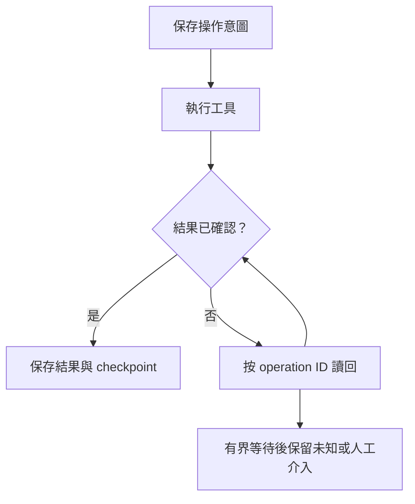

# 12 · 可靠性、冪等性與長任務恢復

[章節入口](README.md) · [設計取捨](design-notes.md) · [練習](exercises/README.md)

## 本章完整案例

工單關閉要求已送出，但 client 逾時。Agent 換一個 request ID 重送，接著又重試退款。操作紀錄與 checkpoint 不一致，無法知道應繼續還是補償。

案例與練習軌跡為合成教學資料，沒有執行真實業務操作。

## 錯誤先分類

可修正的參數錯誤、權限拒絕、暫時服務錯誤與結果未知需要不同動作。暫時錯誤可有限退避；權限與不支援能力不會因相同重試改善。結果未知先查狀態，尤其工具有付款、寄送或刪除等副作用時。

## Operation ID 與 attempt ID

同一邏輯操作跨重試應能被辨識，不能每次都變成新操作。Attempt ID 可以追蹤每次傳輸，operation ID 則關聯同一業務意圖。冪等性需由工具或外部系統落實，並明確適用範圍與保存期限；單在 prompt 寫「不要重複」無法建立保證。

## Checkpoint 與外部世界

應用狀態與外部副作用通常跨系統，不能輕易承諾全域 exactly-once。先寫意圖、執行後查證並保存結果，可降低恢復歧義；仍需處理執行成功但保存失敗的時間窗。恢復時以外部實際狀態、操作 ID 與版本條件判斷下一步。

## 取消、補償與人工介入

取消應停止新工作，但已送出的操作可能繼續完成。先查在途狀態，再判斷是否有可授權的補償；退款或取消寄送不一定能完整還原原始世界。不可逆或狀態不明時，保存證據並交人工處理，不隱藏成成功。

## 長任務的工程節奏

每個增量要留下目標、已確認結果、待辦、環境狀態與驗收證據。對高風險 DB 寫入，未來 lab 必須先讀目前狀態、備份、回退與精確 target，並採適當 transaction、lock／statement timeout 及讀回。教材本期只定義流程，不執行任何 DB 變更。

## 用案例走一次

對已逾時的關閉要求，先沿同一 operation ID 讀工單狀態。若確認已完成，補記結果再做下一步；若仍未知，停止退款等相依副作用。恢復與補償各有獨立狀態，不能用新 request ID 強迫重新開始。

## 精確機制圖

這張圖呈現本章需要討論的責任或狀態。實際功能、權限與可用性依所選 runtime、安裝版本及帳號驗證。

## 三個帶走的問題

- 能分類暫時失敗與結果未知：你會怎麼向另一位工程師說明？
- 能設計不重複副作用的恢復及補償流程：需要哪些證據才能判斷？
- 如果模型的建議錯誤，哪一層應阻止錯誤擴大？

## 來源與閱讀焦點

查證基線：2026-10-19。先讀來源中與本章名詞、責任及限制直接相關的段落；原始論文不要求第一輪讀完全部實驗。

- [S15 · Effective harnesses for long-running agents](https://www.anthropic.com/engineering/effective-harnesses-for-long-running-agents) — 第一方實驗；跨 session 增量工作與交接
- [S18 · LangGraph persistence](https://docs.langchain.com/oss/python/langgraph/persistence) — 框架文件；checkpointer 與 store 的具體對照
- [S25 · Errors and recovery](https://developers.openai.com/siwc/token-sharing-open-source/errors-and-recovery) — 官方 preview；額度、資格、能力限制與 OAuth 恢復

進一步看[來源版本與更新政策](../../../references/sources.md)。
