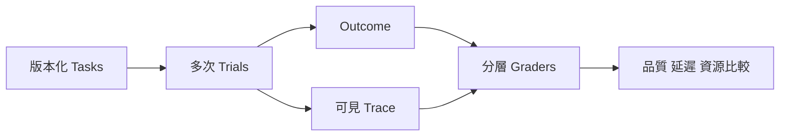

# 13 · Evals、Observability 與資源

[章節入口](README.md) · [設計取捨](design-notes.md) · [練習](exercises/README.md)

## 本章完整案例

新版 harness 在 demo 很流暢，但評估只看最終答案有沒有「完成」。被取消、工具越權與引用過期都被算成功；團隊再以輸出較短宣稱節省一半成本。

案例與練習軌跡為合成教學資料，沒有執行真實業務操作。

## Task、trial、grader 與 outcome

Task 是具輸入與成功條件的題目；trial 是一次嘗試；grader 對結果或軌跡的特定面向評分；outcome 是環境最後實際狀態。先寫成功條件與失敗例子，再做評估集，能避免需求只停留在「看起來合理」。

## 最終結果與執行過程

工單是否正確關閉、引用是否支持答案是結果；是否越權讀取、是否重試過度是過程。兩者都要檢查。評分先用能確定性判斷的條件，再搭配 rubric、模型或人工；模型評分需以人工樣本校準並測順序、長度與風格偏誤。

## 能力與回歸

能力題用來發現系統還做不到什麼；回歸題保護已承諾的行為。每次更換模型、prompt、工具或 loop 都可能改變品質。單次通過不能證明可靠，應重複試驗並報樣本數；pass@k 的「至少一次成功」與 pass^k 的「每次成功」回答不同問題，不互換解讀，也不假設各次獨立。

## 可觀察性與隱私

記錄 task、trial、turn、tool 與 operation 的關係、時間、狀態、錯誤和必要產物位置。Trace 不必包含隱藏思考鏈；可見工具要求、結果與狀態足以支撐多種診斷。敏感輸入與 token 要遮蔽，資料保留與傳送目的地需有規則。OpenTelemetry 可提供命名參考，個別 GenAI 欄位穩定度仍要按版本查。

## 資源比較與真實成本

分開記錄推論、工具、等待與整合時間，才知道 critical path。Token 不是貨幣，也不等同訂閱剩餘額度；本機 cached token 觀測不能自行解釋服務端 cache miss 原因。訂閱額度錯誤可能是 app 層限制，不能推定整個方案用完或重設時間。先減少無用工作、簡化與批次，再決定是否並行或換模型。

## 用案例走一次

把 demo 拆成正常、來源衝突、工具失敗、越權、取消與恢復六類 task。固定資料與限制做多次 trial，以最終狀態和 trace 分層評分。比較新版時同時報品質、延遲與實測資源；未量測的費用或額度節省標為未知。

## 精確機制圖

這張圖呈現本章需要討論的責任或狀態。實際功能、權限與可用性依所選 runtime、安裝版本及帳號驗證。

## 三個帶走的問題

- 能設計能辨識退步的 Agent 評估集：你會怎麼向另一位工程師說明？
- 能以可觀察證據比較品質、延遲與資源：需要哪些證據才能判斷？
- 如果模型的建議錯誤，哪一層應阻止錯誤擴大？

## 來源與閱讀焦點

查證基線：2026-10-19。先讀來源中與本章名詞、責任及限制直接相關的段落；原始論文不要求第一輪讀完全部實驗。

- [S16 · Demystifying evals for AI agents](https://www.anthropic.com/engineering/demystifying-evals-for-ai-agents) — 第一方工程經驗；task、trial、grader、outcome、trace
- [S21 · OpenTelemetry GenAI conventions](https://github.com/open-telemetry/semantic-conventions-genai) — 可觀測性規格；個別欄位穩定度與版本須分開查
- [S05 · Models and inference](https://developers.openai.com/siwc/token-sharing-open-source/models-and-inference) — 官方 preview；公開 Responses endpoint 與完成事件
- [S25 · Errors and recovery](https://developers.openai.com/siwc/token-sharing-open-source/errors-and-recovery) — 官方 preview；額度、資格、能力限制與 OAuth 恢復

進一步看[來源版本與更新政策](../../../references/sources.md)。
