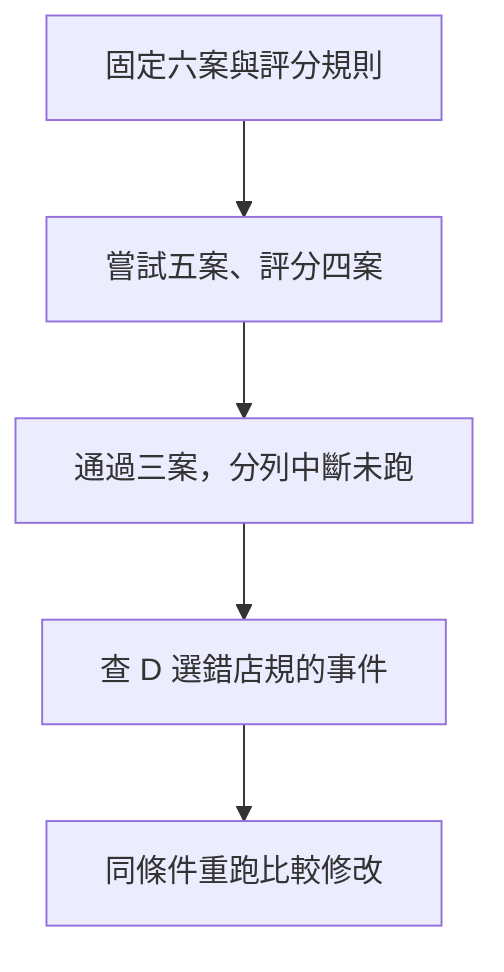

# 13 · Evals、Observability 與資源：教學與案例

## 先抓住一個問題

**怎麼知道 Agent 真的變好，而不只是回答變順？**

前章提出恢復機制，本章用可重複的案例與事件驗證它，也檢查品質、延遲和預算。

## 把題目放到桌上

以下全部是合成評估資料，沒有實際模型測試：預定六案，A 正常、B 條件缺漏、C 越權阻擋通過；D 過期店規失敗；E 配額中斷未評分；F 尚未執行。

這是虛構教材案例，不是法律建議、真實客服紀錄或執行證據。完整設定見[共同案例](../../../maps/course-story.md)。

讀這章時先想：手上已知什麼、還缺什麼、誰能做哪個動作？不要急著把每個英文名詞都背起來。

## 名詞先換成人話

| 名詞 | 先用人話說 | 放進本例 |
| --- | --- | --- |
| Eval／評估 | 用事先定義的案例與標準檢查行為 | D 必須選有效 D14 |
| Trial／一次試跑 | 某個案例的一次執行 | 同一案例可以重複三次 |
| Grader／評分器 | 根據標準判斷結果的程序或人 | 查是否把未知說成未拆封 |
| Trace／事件軌跡 | 依順序留下可觀察事件 | 讀取、候選工具、拒絕和終止原因 |
| Budget／預算 | 事先限制可消耗的資源 | 時間、輪數、訂閱配額或 API 金額 |

### 先定義對，再看是否比較快
本課程的正確包含有效店規、缺漏條件、權限與事實一致。只評文筆會漏掉漂亮卻錯誤的核准。評估案例必須包含正常、缺資訊、過期來源、越權與恢復情況，並保存輸入與評分規則版本。

### 成功率要先交代分母
六案中嘗試五案、完成評分四案、通過三案。因此已評分通過率是 3/4＝75%；在所有已嘗試案例中，已確認通過占 3/5＝60%。E 是配額中斷，F 是未跑，不能偷偷移入成功或業務失敗。報告保留這些狀態才知道缺少哪些證據。

### 重複跑要回答哪種穩定性
同一題三次結果為成功、失敗、成功：至少一次成功的指標會通過；要求三次全成功的指標不會通過。pass@k 與 pass^k 關注不同問題，報告需寫採樣方式與 k，不能只挑最好的一次證明穩定。

### 記錄能幫助定位，不代表什麼都要記
保留來源版本、工具結果、拒絕原因、耗時與最終狀態，避免記登入憑證或不必要個資，也不需要索取模型隱藏思考。模型評分器需以人工抽查校準，尤其是「引用看起來對但沒支持結論」的案例。

### 找最大的等待再優化
合成例子：模型 5 秒、工具 1 秒、等人確認 12 秒，共 18 秒。模型時間減半只降到 15.5 秒；不能宣稱整體快一倍。訂閱配額、token、秒數與 API 金額是不同資源，沒有帳單與用量證據就不換算省了多少錢。

## 完整走一次

| 步驟 | 發生什麼 | 為什麼這樣處理 |
| --- | --- | --- |
| 固定案例 | 保存 A–F 輸入與標準 | 能重跑比較 |
| 記錄狀態 | 分開通過、失敗、中斷、未跑 | 避免污染分母 |
| 查 D 事件 | 確認選錯 D07 的位置 | 定位檢索或選版問題 |
| 比較修改 | 同樣案例再跑並保留差異 | 不能只看更漂亮的一次 |

**這章要留下的產物：**一份包含六案狀態、兩種分母、失敗原因與下一步的合成評估報告。

同時呈現品質和證據缺口，避免把未測部分包裝成已通過。

## 用流程核對責任

圖的重點是「通過三案，分列中斷未跑」接到「查 D 選錯店規的事件」時需要哪些證據。請對照上表，說明少了這一步會造成什麼誤判。

## 接著做什麼

先做[Q01／Q03／Q05](exercises/README.md)，保留自己的第一版答案。遇到疑難先看[設計取捨](design-notes.md)，需要才開提示。

第 14 章把這些驗收方式放回整套系統設計，形成可用於面試的論述。

## 來源與閱讀焦點

來源初查：2026-10-19；本次複核項目與日期見來源表。先讀來源中與本章名詞、責任及限制直接相關的段落；原始論文不要求第一輪讀完全部實驗。

- [S16 · Demystifying evals for AI agents](https://www.anthropic.com/engineering/demystifying-evals-for-ai-agents) — 第一方工程經驗；task、trial、grader、outcome、trace
- [S21 · OpenTelemetry GenAI conventions](https://github.com/open-telemetry/semantic-conventions-genai) — 可觀測性規格；個別欄位穩定度與版本須分開查
- [S05 · Models and inference](https://developers.openai.com/siwc/token-sharing-open-source/models-and-inference) — 官方 preview；公開 Responses endpoint 與完成事件
- [S25 · Errors and recovery](https://developers.openai.com/siwc/token-sharing-open-source/errors-and-recovery) — 官方 preview；額度、資格、能力限制與 OAuth 恢復

進一步看[來源版本與更新政策](../../../references/sources.md)。
