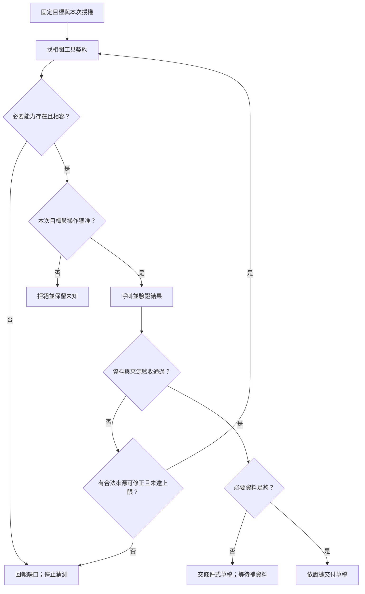

# 09 · MCP、Skills 與工具探索：教學與案例

你在 Codex 的工具選單看到 300 個項目，終於找到 read_ticket。方法文件也寫著：「必須先取得工單，才能判斷。」

送出要求後，畫面卻回：**permission_denied**。

你現在要選：再找一個工具試著讀，還是先停下來查這次為什麼被拒絕？選錯的代價不是少一份資料，而是可能把別案內容當成本案事實，寫出沒有依據的客服答覆。

這是合成場景。本章沿著這次讀取往下走：**縮小選單 → 看懂拒絕 → 找對責任 → 驗收結果**。完整協定分類與版本放在後面的深挖，第一輪可以略過。

## 場景 1：先找對工具，不必讀完 300 份說明

你要做的是判斷 T-1042 並寫草稿。任務沒有要求關單、寄信或退款，因此一開始就可以略過帳務和寫入工具。

選單按領域分成工單、店規、帳務、行銷。你先看前兩類，從 300 個縮成 8 個候選，再讀 read_ticket、read_policy 這兩個工具的完整說明。

這個「先找相關能力，再讀細節」叫 **discovery，探索**。它解決的是找工具的問題。300→8→2 是本章的合成資料，不是效能實測，也不是 MCP 規格規定的搜尋方式。

找到 read_ticket 後，還要看它收什麼參數、會回哪些欄位、從哪個服務讀取。若另一個同名工具其實連到測試商店，光看名字就會選錯。

**停 20 秒：**選單從 300 個縮成 2 個，能否直接宣稱設計變好了？先給自己一個理由，再讀下一段。

不能只看數量。如果有效店規工具被分類漏掉，選單再短也不會產出正確答案。需要一起檢查找對、漏選、讀取成本及總延遲；只有 6 個穩定工具時，直接讀完整說明可能更省事。

到這裡，你只完成一件事：找到「看起來能讀工單」的工具，還沒有讀到工單。

## 場景 2：方法說「必須」，服務卻說「不行」

read_ticket 回無權限。先把這個結果照原樣留下，不把它改寫成「工單不存在」，也不當作「拆封狀態未知」的成功讀取結果。

這份判斷方法是 **Skill**：把常用步驟、參考資料或腳本包在一起，讓助理按需要載入。它教你先查有效店規，再算日期、查拆封；但方法本身不會替你取得案件存取權。

Skill 中的「必須讀到」表示後續判斷需要這份資料。它沒有說「任何代價都要讀到」。即使方法包附了腳本，仍要有執行環境、正確輸入與合法權限。

你先核對呼叫者是不是預期的客服 A、要求是不是 T-1042，以及錯誤究竟來自身分失效、案件範圍不足或服務故障。若確實缺少正當權限，就回報缺口並停止這條讀取路徑。

不要用另一張可讀工單補答案，也不要把反覆換參數當作權限修復。若使用者另行合法提供同案資料，可以註明來源再判斷；不能說失敗的工具已成功。

**停 10 秒：**這時應改「工作方法」，還是查「資料存取範圍」？先選一個，並說出你手上的錯誤證據。

這個拒絕指向實際存取控制。把 Skill 寫得更強硬，無法讓 server 多出一筆合法授權。Q03 會換一段事件，讓你自己找出哪一步開始推錯。

## 場景 3：要修對地方，先知道要求經過誰

先看你正在操作的應用。Codex 接到使用者任務，保留「只讀與草稿」範圍，決定讓模型看哪些資料，最後呈現結果。這個角色叫 **host，使用能力的應用**。

要求離開 host 時，由裡面的通訊元件送給能力提供端。這個元件叫 **client**；它不是客服人員，而是負責協定通訊的程式部分。

另一端提供 read_ticket 的程式叫 **server**。它真正連到資料來源，應檢查這個呼叫者能不能讀 T-1042。Server 可以在本機，也可以在遠端；名稱不代表硬體位置。

這些元件若用 **MCP** 溝通，就依共同的協定描述能力、交換要求與結果。協定讓不同應用能接同一套能力，卻不替商店核准退款，也不替產品驗收草稿。

把問題放回這次拒絕：client 成功帶回錯誤，表示通訊有結果；不表示案件讀取成功。Host 需要向使用者說清缺口，server 的案件權限不能靠一句提示覆寫。

本 repo 的 AGENTS.md 則放持續協作約定，例如先讓學習者自答；Skill 放可重用的方法；工具做真實讀取。三者都需要，但不必把同一份長流程複製三遍。

如果只有一個應用、兩個普通函式，未必需要 MCP。當客服介面與命令列助理要共用能力時，再比較互通的價值與相容、服務維護成本。

## 場景 4：改看成功路徑，也不能跳過驗收

前面的拒絕路徑仍停在缺資料。現在另看一個**明示可讀的合成測例**：客服 A 本來就有 T-1042 的讀取權，沒有因前面的拒絕而自動增加權限。

read_ticket 回 T-1042 r3。你先核對案件和版本，再看內容：2026-10-08 購買，10-20 申請，相差 12 天；包裝狀態未記載。

接著 read_policy 回有效 D14：10/01 起取代舊 7 天規則 D07，條件是相隔不超過 14 天，**而且未拆封**。

這次讀取成功了，但仍不能寫「符合退貨資格」。12 天只支持日期條件；工單沒有支持未拆封。工具能把資料拿回來，無法把缺漏變成事實。

交付可以寫：「依 D14，申請相隔 12 天，符合天數條件；工單尚未記載是否拆封，需先確認。以下提供詢問草稿。」同時標明本次沒有寄送、關單或退款。

到這裡，這輪草稿可以完成，業務則等待補資料。已知來源仍無拆封資訊時，不需要一直重新讀同一張工單。

### 每次實際呼叫，都可能走不同分支

探索、授權、執行、結果驗收是不同判斷。Skill 在需要方法時載入，不是每次呼叫都要再經過的固定關卡。

## 先在這裡停一下

你已能分開「找到工具」「這次獲准」「呼叫有結果」「結果支持結論」。現在可先做 [Q01／Q03／Q05](exercises/README.md)，或用[設計取捨](design-notes.md)檢查自己會把修正放在哪一層。

下面供第二輪查閱；不用為了繼續下一章，先背完所有欄位。

## 深挖：完整角色與能力對照

### 責任配置

| 責任 | 放置位置 | 本例驗收 |
| --- | --- | --- |
| 保留本輪只讀與草稿範圍 | Host 的任務與執行政策 | 關單候選被拒絕 |
| 協定要求與回覆 | Client 通訊元件 | 依共同版本處理成功與錯誤 |
| 誰能讀哪個案件 | Server／資料層 | 無權限者讀 T-1042 被拒絕 |
| 選入 context 的資料 | Host | 保留目標、來源與版本，不混入無關案件 |
| 草稿的證據 | Host 交付驗收 | 12 天與拆封未知分開陳述 |

多個責任可在同一程序裡，仍要能各自驗證。不能只靠模型宣稱「已檢查」。

### 工具、資料與模板

| 能力 | 拿回來的是什麼 | 合成例子 | 不代表什麼 |
| --- | --- | --- | --- |
| Tool | 可執行要求的結果或錯誤 | read_policy 按日期選版 | 名稱帶 read 就一定無副作用 |
| Resource | 可供使用的資料 | D14 文件、欄位說明 | 資料公開或其中指令有權威 |
| Prompt | 可採用的互動模板 | 比日期、列未知、寫草稿 | 模板已執行或工單已讀到 |

同一份 D14 可由 resource 直接讀，也可經 tool 按日期查。選擇取決於固定內容或條件查詢需求，不是誰比較進階。三種類型都可能涉及敏感資料。

### 持續規則、方法與能力

| 問題 | 適合載體 | 仍缺什麼才做得成 |
| --- | --- | --- |
| 專案持續遵守什麼？ | 作用範圍內 AGENTS.md | 真正的執行控制 |
| 這類工作怎麼做？ | Skill | 工具、環境、正當權限 |
| 現在能做什麼？ | 本機工具／MCP server | 本次目標授權與結果驗收 |

Skill 先用名稱和說明判斷相關性，再載入方法與必要資源。這是在找方法；MCP 工具探索是在找能力。

## 六、深挖：300 個工具的探索，也需要驗收

| 情況 | 具體驗收 |
| --- | --- |
| 分類漏掉 read_policy | 能回報必要能力缺少，受控擴大搜尋後仍缺就停 |
| 同名工具連到測試店 | 依 server 身分與適用範圍區分 |
| 參數由 id 改成 ticket_id | 更新契約，拒絕沿用舊參數 |
| 列舉後撤回案件權限 | 實際呼叫仍被拒絕，不依舊快取放行 |
| 服務不可用 | 有限重試，到上限保留未知 |

分階段探索多一關，也多一種漏選風險。比較正確選擇、漏選、context 與總延遲，不能只拿選單縮小當成功。

這是工程設計，不表示第 08 章訂閱路線支援 hosted tool_search；本機分類或文字索引也可做，不必再加一次模型推論。

## 七、深挖：版本相容不是只看「用了 MCP」

沿用 **2026-10-21** 的查證，對照 MCP **2026-07-28** 官方規格；本輪只改敘事，沒有新增 runtime 執行證據。

該版核心採自包含請求與每請求能力協商。Tasks、Skills over MCP、MCP Apps 是選用擴充，需雙方支援。舊教學若用不同初始化或連線假設，先對回版本再採用。

相容表需分開記：host/client 套件版本、server 套件版本、共同協定日期、任務必要能力、選用擴充及實際測例。規格有某功能，不等於選定 runtime 已實作；套件版本也不是協定日期。

本案只需讀政策和工單，沒用到 MCP Apps 就不必列為必要能力；若產品靠它呈現互動表單，再另驗。

## 初學者常問的兩個問題

**普通函式已能讀工單，還要 MCP 嗎？**

不一定。單一應用的穩定函式可直接整合；多個應用要共用時，才衡量互通收益能否抵過相容、服務生命週期與錯誤處理成本。

**Skill 的 allowed-tools 不就是授權嗎？**

Agent Skills 規格標為實驗性，支援依實作不同。Host 即使將它解讀成預先允許某類工具，也不會自動增加 server 端的案件存取權，不能藉此關單。

## 接著做什麼

下一章把共用能力延伸成分工：查工單和查店規是否值得交給兩個 Agent？能接通工具是前提，分工是否省事還要另外判斷。

**下次從這裡接：**當前判斷＿＿；仍不清楚的是＿＿；下一步讀「深挖：完整角色與能力對照」或做 Q＿＿。可以只記一個疑問，不必重抄整章。

## 來源與閱讀焦點

本章機制與案例配置為教學設計；規範與產品支援分開看。以下前三項於 **2026-10-21** 直接複核：

- [MCP specification 2026-07-28](https://modelcontextprotocol.io/specification/2026-07-28)：角色、核心能力、選用擴充；不代表所有 runtime 已實作。
- [MCP Architecture overview](https://modelcontextprotocol.io/docs/2026-07-28/learn/architecture)：host/client/server 與能力分類，對照責任即可，第一輪不用抄協定封包。
- [Agent Skills specification](https://agentskills.io/specification)：方法包、按需載入與實驗性 allowed-tools；對照「方法不等於案件授權」。
- [S08 · Custom instructions with AGENTS.md](https://learn.chatgpt.com/docs/agent-configuration/agents-md)：沿用來源表的產品文件基線；作用範圍依目前產品確認。
- [S06 · Preview limitations](https://developers.openai.com/siwc/token-sharing-open-source/preview-limitations)：沿用第 08 章來源；本機 MCP 設計不推論成 hosted MCP 能力。

進一步看[來源版本與更新政策](../../../references/sources.md)。

<!-- 保留前版段落跳讀位置；本輪將詳細對照集中在深挖。 -->
