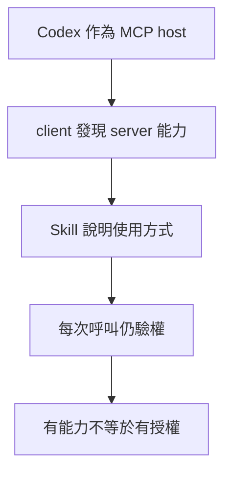

# 09 · MCP、Skills 與工具探索：教學與案例

## 先抓住一個問題

**專案規則、工作步驟和真正能執行的工具，應該各放哪裡？**

上一章已說清自己如何呼叫工具。這章處理工具怎麼跨應用共用，以及方法文件為什麼不等於權限。

## 把題目放到桌上

客服助理需要讀 T-1042 和 D14。團隊有 300 個工具，另寫一份『先算日期、再查拆封』的方法；有人以為把方法放進 Skill，就能自動讀取所有案件。

這是虛構教材案例，不是法律建議、真實客服紀錄或執行證據。完整設定見[共同案例](../../../maps/course-story.md)。

讀這章時先想：手上已知什麼、還缺什麼、誰能做哪個動作？不要急著把每個英文名詞都背起來。

本課基礎資料：T-1042 r3；10/08 到 10/20 相差 12 天。D14 要求日期差不超過 14 天且未拆封；r3 的包裝狀態未知。原任務只讀與寫草稿。本章或題目若另述變體，只有明示條件改變。

## 名詞先換成人話

| 名詞 | 先用人話說 | 放進本例 |
| --- | --- | --- |
| MCP | 應用與外部工具／資料溝通的協定。 | 讓不同客戶端讀同一套店規服務。 |
| Host／使用能力的應用 | 包含模型與使用者介面的應用。 | Codex。 |
| Client／通訊元件 | Host 裡連到某個 server 的部分。 | 把讀政策要求傳過去。 |
| Server／提供能力的服務 | 真正暴露工具或資料的服務。 | 只提供獲准文件的店規服務。 |
| Skill／工作方法包 | 可按需要載入的步驟與資源。 | 教助理檢查日期和拆封。 |

## 先把「會怎麼做」和「有什麼能做」分開

Skill 可以教助理先查版本、再算日期，但如果工具不存在，文件不能憑空把工具變出來。工具存在也不代表人人有權使用。方法、能力與權限是三件不同的事。

AGENTS.md 放專案內的持續指引，例如本 repo 預設只做教學、不代答；Skill 適合封裝可重用的方法；工具負責真的讀取或修改。工具契約仍沿用第 03 章的輸入、結果與錯誤檢查。

## MCP 解決溝通，不替你核准業務

以 Codex 作 host，它內部的 client 連到政策 server。Server 可提供 tools（動作）、resources（資料）和 prompts（模板）；它不會因為使用 MCP 就保證資料正確或權限完備。T-1042 仍需依呼叫者的可讀範圍判斷。

## 工具很多時先找選單，再讀細節

先給一份精簡目錄，找到和工單、政策相關的少數工具，再載入完整契約，能減少不相關資料。程式也可先批次查詢或整理結果，再把必要部分交給模型。這些是設計方法，不等同某家名為 tool_search 的託管功能已可用。

## 相容要查雙方實際版本

MCP 的 2026-07-28 規格將自包含請求、每請求能力協商列入核心，Tasks、Skills over MCP、MCP Apps 等是擴充。舊版教學的握手不一定能直接套用；規格存在不代表你選的 Codex 或 server 已支援。Skill 的實驗性欄位也不能當執行權限。

## 完整走一次

| 步驟 | 發生什麼 | 為什麼這樣處理 |
| --- | --- | --- |
| 專案約定 | 只能讀取教學資料，不代答 | 放作用範圍內的 AGENTS.md。 |
| 可重用方法 | 先查版本、再算天數、再查拆封 | 放 Skill，按任務需要載入。 |
| 真正能力 | read_ticket、read_policy | 由本機工具或 MCP server 提供並檢查權限。 |
| 相容與執行 | 列得出工具、版本相容、呼叫獲准 | 三件都要查，不能只看選單。 |

**這章要留下的產物：**一張清楚的配置表：規則在哪裡、方法在哪裡、工具在哪裡、由誰拒絕越權。300 個工具不必每次全部放入 context。

這能避免把所有問題都塞進 prompt 或 Skill：沒有工具就補能力，版本不合就解決相容，無權限就停止。下一步不再只剩『再要求模型努力一次』。

## 用流程核對責任

圖的重點是「Skill 說明使用方式」接到「每次呼叫仍驗權」時需要哪些證據。請對照上表，說明少了這一步會造成什麼誤判。

## 接著做什麼

先做[Q01／Q03／Q05](exercises/README.md)，保留自己的第一版答案。遇到疑難先看[設計取捨](design-notes.md)，需要才開提示。

工具能共用了，是否該把工作分給幾個 Agent？下一章先看分工是否真的減少工作。

## 來源與閱讀焦點

來源初查：2026-10-19；本次複核項目與日期見來源表。先讀來源中與本章名詞、責任及限制直接相關的段落；原始論文不要求第一輪讀完全部實驗。

- [S10 · MCP specification 2026-07-28](https://modelcontextprotocol.io/specification/2026-07-28) — 規範性來源；勿把規格能力當成所有 runtime 已實作
- [S09 · Agent Skills specification](https://agentskills.io/specification) — 公開規格；按需載入，實作支援仍須逐 runtime 查證
- [S08 · Custom instructions with AGENTS.md](https://learn.chatgpt.com/docs/agent-configuration/agents-md) — 官方產品文件；指令發現與作用範圍
- [S06 · Preview limitations](https://developers.openai.com/siwc/token-sharing-open-source/preview-limitations) — 官方 preview；參數、工具與歷史限制，實作前必重查

進一步看[來源版本與更新政策](../../../references/sources.md)。
