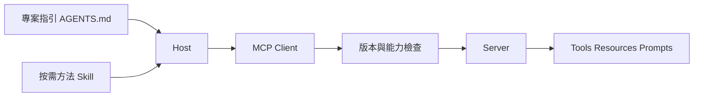

# 09 · MCP、Skills 與工具探索

[章節入口](README.md) · [設計取捨](design-notes.md) · [練習](exercises/README.md)

## 本章完整案例

你的研究助理有 300 個工具，每次都把全部 schema 放入 context；另一個團隊把操作步驟寫成 Skill，卻以為這會自動提供文件存取權。

案例與練習軌跡為合成教學資料，沒有執行真實業務操作。

## MCP 的角色

Host 是使用工具與資料的應用，client 是 host 內與 server 通訊的元件，server 暴露能力。Tools 提供動作，resources 提供可取用資料，prompts 提供可選的模板或工作流程入口。協定讓不同實作能互通，並不替應用程式決定產品政策或保證所有工具安全。

## 版本、核心與擴充

截至查證日，MCP latest 指向 2026-07-28：核心含無狀態、自包含請求與每請求能力協商；Tasks、Skills over MCP、MCP Apps 等列為擴充。較舊實作可能沿用不同握手與能力模型。必須查雙方支援版本與擴充，不能把某版生命週期當成永久規則，也不能因規格已公布就假設 Codex 已實作全部能力。

## AGENTS.md 與 Skills

AGENTS.md 提供作用域內的專案指引；Codex 依路徑發現與合併，從子目錄啟動時要確認實際載入範圍。Skill 把特定工作知識包成可按需載入的指令與資源，減少每輪帶入無關內容。它能教怎麼做，不能自行賦予權限，也不會自動建立不存在的工具。

## 動態探索與程式化協作

先讓模型找到少量相關工具，再載入詳細契約，可降低 schema 噪音。程式化協作可在本機完成批次與過濾，把必要結果帶回模型；要保留授權與錯誤。這是設計模式，和某個服務商名為 tool_search 或 programmatic_tool_calling 的託管功能不同。訂閱 preview 對後者有具體限制。

## 互通之後仍需驗證

能列出工具不等於能正確呼叫；呼叫成功也不代表業務結果正確。確認必要工具、權限、分頁、錯誤與版本相容性。工具描述或 annotations 可能不可信，實際執行仍走獨立權限邊界。

## 用案例走一次

先以功能類別與任務需求縮小工具集合，對選中的工具載入 schema；將穩定的研究步驟放入 Skill，將 repo 特定限制放入 AGENTS.md。本機 MCP server 只提供允許讀取的文件，不因 Skill 說要讀機密就放行。

## 精確機制圖

這張圖呈現本章需要討論的責任或狀態。實際功能、權限與可用性依所選 runtime、安裝版本及帳號驗證。

## 三個帶走的問題

- 能依責任選擇指令、Skill、本機工具與 MCP：你會怎麼向另一位工程師說明？
- 能區分協定能力、權限與 runtime 實際支援：需要哪些證據才能判斷？
- 如果模型的建議錯誤，哪一層應阻止錯誤擴大？

## 來源與閱讀焦點

查證基線：2026-10-19。先讀來源中與本章名詞、責任及限制直接相關的段落；原始論文不要求第一輪讀完全部實驗。

- [S10 · MCP specification 2026-07-28](https://modelcontextprotocol.io/specification/2026-07-28) — 規範性來源；勿把規格能力當成所有 runtime 已實作
- [S09 · Agent Skills specification](https://agentskills.io/specification) — 公開規格；按需載入，實作支援仍須逐 runtime 查證
- [S08 · Custom instructions with AGENTS.md](https://learn.chatgpt.com/docs/agent-configuration/agents-md) — 官方產品文件；指令發現與作用範圍
- [S06 · Preview limitations](https://developers.openai.com/siwc/token-sharing-open-source/preview-limitations) — 官方 preview；參數、工具與歷史限制，實作前必重查

進一步看[來源版本與更新政策](../../../references/sources.md)。
