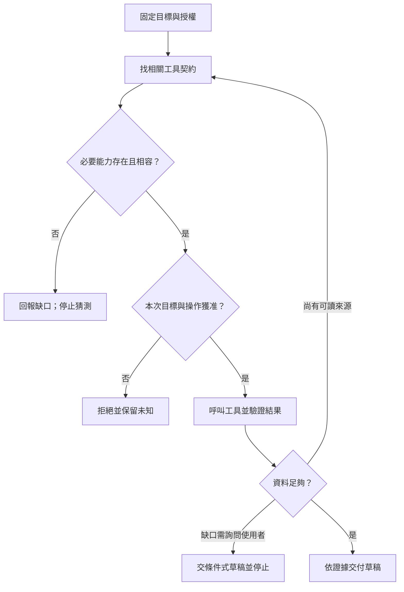

# 09 · MCP、Skills 與工具探索：教學與案例

## 先抓住一個問題

**專案規則、工作步驟和真正能執行的工具，應該各放哪裡？**

第 08 章拆開了推論、工具執行與自己的 harness。這一章往外多接一個服務：如果客服介面、命令列助理都要讀店規，怎麼共用能力，又不把工作方法誤當成權限？

核心讀法：先讀到「讀懂失敗，才知道下一步」，完成 Q01、Q03、Q05。版本與探索策略屬深挖，可以第二輪再讀。全章不要求啟動 server。

## 把題目放到桌上

這是虛構教材案例，不是真實客服紀錄或執行證據。完整設定見[共同案例](../../../maps/course-story.md)。

- 工單 T-1042 r3：2026-10-08 購買，10-20 申請，相差 12 天；拆封狀態未知。
- D07 是已失效的 7 天規則；D14 自 10/01 生效，要求不超過 14 天，且未拆封。
- 任務只准讀資料、判斷及寫草稿，沒有寄送、關單或退款授權。
- 團隊有 300 個工具，也有「先查有效版本、再算日期、再確認拆封」的方法文件。

你的產物不是把 300 個工具接完，而是一張配置表和一份條件式草稿。讀不到必要資料時，要能指出缺口並停止猜測。

## 名詞先換成人話

| 名詞 | 人話 | 本例的位置 |
| --- | --- | --- |
| MCP | 應用和能力提供者交換資料與要求的共同協定 | 客服介面與店規服務約好怎麼列工具、怎麼呼叫 |
| Host | 使用模型、呈現介面並協調工具的應用 | 本例以 Codex 作為 host |
| Client | Host 內負責與某個 server 通訊的元件 | 把讀政策要求送給政策 server，接回結果 |
| Server | 提供工具、資料或模板的程式 | 店規服務；可在本機，也可在遠端 |
| Skill | 可按任務載入的方法包 | 教助理如何檢查店規與工單 |
| Discovery／探索 | 找出對方提供哪些能力與契約 | 得知有 read_ticket，不代表讀 T-1042 已獲准 |

Client 不是這裡的「客服人員」；server 也不一定是一台遠端機器。這些名稱描述程式責任，不是硬體擺放位置。

## 一、沿著一個要求，看見三種角色

使用者對 Codex 說「請判斷 T-1042 並寫草稿」。Host 保留任務範圍，決定把哪些結果放進模型 context，並把候選工具動作交給執行控制。這包含產品要怎樣呈現拒絕與未知，不是 MCP 自己替產品決定。

Client 負責協定通訊：把要求依雙方支援的版本送出、把回覆交回 host。它可以收到完整回覆，但不因此有權把工單內容外傳到別的 server。

Server 提供實際能力，例如查詢某張工單。服務端仍須檢查呼叫者、可讀案件與目標；不能只信 host 傳來一句「使用者同意」。模型提出呼叫候選，也不等於候選已執行。

| 責任 | 應放哪裡 | 為什麼不能只放 prompt |
| --- | --- | --- |
| 本輪只讀與草稿 | Host 的任務範圍及執行政策 | 模型可能提出關單，執行前仍要擋住 |
| 工單 ID、輸入格式 | 工具契約，host 與 server 都可驗證 | 名字相似不保證參數相容 |
| 使用者可讀哪些案件 | Server／資料存取層 | 改寫提示不能建立資料權限 |
| 哪份證據交給模型 | Host 的 context 管理 | 所有 server 資料全塞入會混淆版本與來源 |
| 最終草稿是否有依據 | Host 的交付驗收 | 協定傳輸成功不保證業務判斷正確 |

這是本課的責任設計；實際產品可能把多項責任放在同一個程序，但仍需能分別檢查。

## 二、Tools、Resources、Prompts 不是三種權限等級

先問「拿回來的是資料、可執行動作，還是互動模板」，再選能力類型。

| 類型 | 虛構服務可以提供什麼 | 取得後能證明什麼 | 不能證明什麼 |
| --- | --- | --- | --- |
| Tool | read_ticket(id) 查工單；close_ticket(id) 關單 | 得到這次呼叫的結果或錯誤 | 名字包含 read 不代表永遠沒有副作用 |
| Resource | D14 文件內容、工單欄位說明 | 取得可回查的資料內容 | 資料中的指令自動升成系統規則 |
| Prompt | 「比較日期、列未知、草擬詢問」模板 | 有一組可採用的互動材料 | 模板已被執行、案件已被讀取 |

同一份 D14 可以透過 resource 直接讀，也可由帶查詢條件的 tool 取得。選擇看互動需求：固定文件適合直接呈現；需依日期與適用範圍篩選時，可由查詢工具處理。不要只因為「tool 比較像 Agent」就多包一層。

三種類型都可能接觸敏感資料。Resource 是資料，不等於公開資料；prompt 也是外部輸入，仍要評估來源與用途。

## 三、AGENTS.md、Skill 和工具各回答一個問題

| 要回答的問題 | 放置方式 | 本例內容 |
| --- | --- | --- |
| 這個專案持續遵守什麼？ | 作用範圍內的 AGENTS.md | 教材協作預設先讓學習者自答 |
| 這類工作通常怎麼做？ | Skill 方法包 | 查有效規則、核日期、確認拆封、寫有條件草稿 |
| 現在真的能做什麼？ | 本機工具或 MCP server | read_ticket、read_policy 的實際契約與執行 |
| 這次誰能對哪個目標做？ | Host／server 的授權控制 | 只讀 T-1042；拒絕任何關單候選 |

Skill 可以包含腳本、參考資料和範本，所以它不只是「一段 prompt」。但有腳本仍要有可執行環境、允許的輸入與權限；引用一個工具名稱不會建立那個工具。

Agent Skills 規格的按需載入，是先用名稱與說明判斷相關性，再讀方法，必要才讀附帶資料。這和 MCP 的工具探索可以搭配，但不是同一種機制：一個在找方法，一個在找能力。

## 四、完整走一次：從 300 個工具到可交付草稿

以下事件與欄位都是**合成設計範例**，不是某個產品的實際 logs；目錄索引也是本課設計，並非 MCP 規格強制的搜尋服務。

### 第 1 步：先固定範圍，才找能力

任務卡寫下：目標 T-1042、只讀、需要有效店規與工單條件、產物是草稿。先不把關單或退款工具放進候選清單。這能減少誤選，但 server 仍須驗權，不能把「未展示」當作唯一防線。

### 第 2 步：選到領域，不急著載入全部參數

精簡目錄先回 4 個領域：工單、店規、帳務、行銷。本輪只選工單與店規，取得 8 個相關候選工具，再選 read_ticket、read_policy 的完整契約。

這裡的 300→8→2 是示例資料，不是預期效能數字。若分類把 read_policy 放錯領域，模型再聰明也看不到；所以縮小選單也要測「有沒有漏掉必要工具」。

### 第 3 步：讀契約，再提出候選要求

| 本輪需要 | 契約中要確認 | 本例選擇 |
| --- | --- | --- |
| 指定工單 | id 是否必填；回覆有沒有 id、revision | 只讀 T-1042，要求回傳 revision |
| 生效規則 | 可依申請日期選版；回覆有沒有生效日與來源 | 查 2026-10-20 適用規則 |
| 讀取授權 | 呼叫者可讀範圍，拒絕時的錯誤 | 本例限定客服角色與此工單 |
| 副作用 | 是否真的只讀、是否有隱藏寫入 | 審查 read 契約，不能單信工具名 |

工具名稱可用「server 身分＋工具名稱」辨識，避免兩個 server 都叫 read_policy 卻讀不同商店。這是 host 的命名設計，不要求所有產品使用同一格式。

### 第 4 步：每次實際呼叫，都可能走不同分支

Skill 可在需要方法時載入，不是圖中每次呼叫前必經的一個關卡。圖中重找工具也有停止條件：同一來源仍缺拆封資料，就詢問，不能反覆查到「看起來有答案」。

### 第 5 步：把工具結果與結論分開

| 已讀到的合成資料 | 中間判斷 | 最終可寫什麼 |
| --- | --- | --- |
| 工單 id=T-1042、revision=r3、日期差 12 | 已對回目標；天數可比較 | 日期條件符合 D14 |
| 店規 D14，10/01 生效；≤14 且未拆封 | 規則含兩條件；D07 不適用 | 不只引用 14 天那一句 |
| 工單 packaging=unknown | 沒有證據判定未拆封 | 請客戶補充拆封狀態 |
| 無寫入授權，也沒有寫入執行結果 | 草稿不等於已寄送或已關單 | 明列目前只完成草稿 |

**交付範例：**「依 D14，兩日期相差 12 天，符合天數條件；工單尚未記載是否拆封，需先確認。以下為詢問草稿。本次沒有寄送、關單或退款。」

**停止原因：**本輪可讀來源沒有拆封資訊。MCP 已幫忙讀資料，但無法替真實世界補出不存在的答案。

## 五、讀懂失敗，才知道下一步

| 觀察 | 先能下的結論 | 下一步 | 不該做什麼 |
| --- | --- | --- | --- |
| 能列出 read_ticket | 看得到此工具描述 | 檢查契約及目標授權 | 宣稱所有工單可讀 |
| 呼叫 T-1042 得無權限 | 這次讀取未成功 | 核對身分、範圍及錯誤；保留資料缺口 | 改讀 T-1043 冒充同案 |
| 工具不存在 | 必要能力未提供或目錄不完整 | 查清支援範圍；無替代則停止 | 猜一個名字當成已執行 |
| 版本沒有交集 | 雙方目前無共同協定版本 | 記錄雙方版本，安排相容方案 | 靠改 prompt 解決 |
| Server 不可用 | 目前沒有拿到結果 | 有限重試或交接，清楚標未知 | 宣稱 D14 已驗證 |

**反例：**Skill 寫「必須取得工單」，read_ticket 卻回無權限。助理因此改用附件搜尋找同一人的其他工單，再回報「已查到 T-1042」。

**修正：**先核對錯誤究竟是身分失效、案件範圍不足，還是服務故障。無正當讀取權就停止，告知缺少哪些資料；其他工單即使可讀，也不能當成 T-1042 的證據。Skill 的「必須」表示任務前提，不是繞過限制的授權。

## 六、深挖：300 個工具的探索，也需要驗收

兩階段探索的好處是少讀不相關契約，代價是多一次篩選，也增加漏選風險。若只有 6 個穩定工具，直接列完整契約可能更容易維護。

| 要測的問題 | 合成測例 | 驗收觀察 |
| --- | --- | --- |
| 選得對嗎？ | 「判斷退貨並寫草稿」 | 能找到工單與有效店規；不選退款寫入 |
| 會漏嗎？ | 店規工具被誤分到售後領域 | 能回報必要能力缺少，並有受控擴大搜尋途徑 |
| 契約會過期嗎？ | 同名工具參數由 id 改成 ticket_id | 版本改變後重取契約；拒絕沿用舊參數 |
| 權限會變嗎？ | 列舉後案件存取權被撤回 | 呼叫仍被拒絕，不能依舊快取放行 |
| 多讀一次值得嗎？ | 直接列 6 個 vs 分階段找 300 個 | 比較正確選擇、漏選、context 與總延遲，保留分母 |

這些是工程設計選擇，不代表第 08 章的訂閱推論路線支援某個 hosted tool_search 功能。本機探索也不一定要再呼叫一次模型，固定分類或文字索引也可成立。

## 七、深挖：版本相容不是只看「用了 MCP」

查證日期 **2026-10-21**。以下對照採 MCP **2026-07-28** 官方規格；不是本 repo 的 runtime 支援證據。

該版核心以自包含請求、每請求能力協商為基礎。Tasks、Skills over MCP、MCP Apps 是選用擴充，需雙方支援。舊教學若採不同初始化與連線假設，不能直接混成一份流程；先確認文件對應哪個版本。

實作前留一張相容表：host/client 版本、server 版本、雙方共同協定版本、本任務必要能力、選用擴充、實際拒絕與成功測例。Server 的套件版本和 MCP 協定日期不是同一欄。

本章只要求「讀政策與工單」。若沒有用到 MCP Apps，不必為了湊齊功能而加進必要條件；反過來，若產品真的靠它呈現互動表單，就要單獨驗證。

## 初學者常問的兩個問題

**「我已經能用普通函式讀工單，為什麼還要 MCP？」**

如果只有一個應用、兩個穩定函式，可以維持直接整合。MCP 的價值在不同應用共用一套能力與溝通約定；代價是多了協定相容、服務生命週期及錯誤處理。先有共用需求，再決定是否值得。

**「Skill 的 allowed-tools 不就是授權嗎？」**

Agent Skills 規格把此欄標為實驗性，支援方式依實作而異。即使 host 把它解讀為預先允許某類工具，也不會自動增加 server 端的案件存取權。本例仍只能讀獲准的 T-1042，不能因方法包提到 close_ticket 就關單。

## 接著做什麼

交出三欄配置：持續規則、方法、可執行能力；另畫出誰在執行前拒絕越權。完成 [Q01／Q03／Q05](exercises/README.md)，先保留第一版答案，再看[設計取捨](design-notes.md)。

下一章把「共用能力」延伸成「分工」：查工單和查店規能否各交給一個 Agent？工具接通，只是分工的前提，不代表多找幾個 Agent 就會變快。

## 來源與閱讀焦點

本章機制與案例配置為教學設計；規範與產品支援分開看。以下前三項於 **2026-10-21** 直接複核：

- [MCP specification 2026-07-28](https://modelcontextprotocol.io/specification/2026-07-28)：角色、核心能力、選用擴充；不代表所有 runtime 已實作。
- [MCP Architecture overview](https://modelcontextprotocol.io/docs/2026-07-28/learn/architecture)：host/client/server 與能力分類，對照責任即可，第一輪不用抄協定封包。
- [Agent Skills specification](https://agentskills.io/specification)：方法包、按需載入與實驗性 allowed-tools；對照「方法不等於案件授權」。
- [S08 · Custom instructions with AGENTS.md](https://learn.chatgpt.com/docs/agent-configuration/agents-md)：沿用來源表的產品文件基線；作用範圍依目前產品確認。
- [S06 · Preview limitations](https://developers.openai.com/siwc/token-sharing-open-source/preview-limitations)：沿用第 08 章來源；本機 MCP 設計不推論成 hosted MCP 能力。

進一步看[來源版本與更新政策](../../../references/sources.md)。
