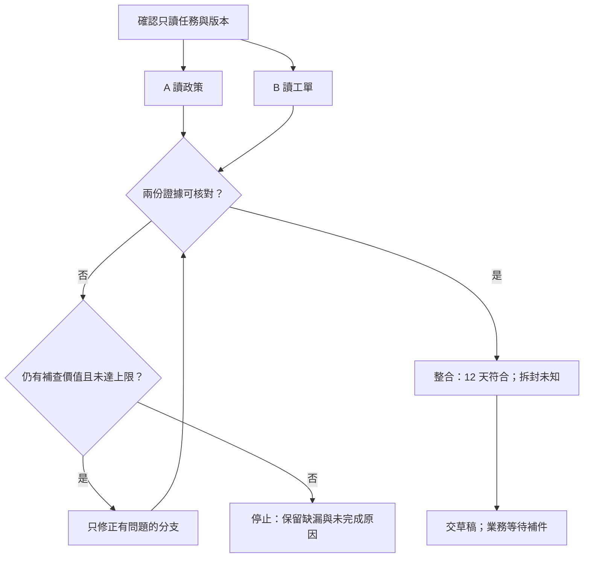

# 10 · 多 Agent、協調與 A2A：教學與案例

你開了兩位助理，原本想把等待縮短一半。A 很快回「完成，依 7 天規則處理」；B 也說完成，卻沒寫它讀的是哪一版工單。

主草稿已經有結論。現在你要選：直接交出去，還是先停下來查兩份結果能不能放在一起？如果採用了不同版本，兩位助理可能各自做完工作，整份答案卻仍然錯。

這是合成情境。本章就從這張桌面重新安排分工：先決定誰查什麼、誰能寫稿，最後才替這種協作方式命名。

## 核心問題與讀法

沿著「拆工作 → 說清交付 → 收回證據 → 驗收 → 停止」讀到草稿即可。欄位表、架構名稱與完整算例放在後面的深挖區，第一次可以略過。

## 桌上的任務與禁止動作

這次要分析的是 T-1042 r3：10 月 8 日購買，10 月 20 日申請，相隔 12 天。拆封欄沒有資料。

適用政策是 10 月 1 日生效的 D14：不超過 14 天，**而且未拆封**。舊 7 天規則 D07 已被取代。開場 A 回的版本因此不能直接採用。

你只被要求判斷條件並寫回覆草稿；沒有寄送、關單或退款授權。完整假資料見[共同案例](../../../maps/course-story.md)。接下來每多一位助理，這個範圍都不會自動變大。

## 第一步：先畫依賴，才決定要幾個 Agent

先把「判斷這張工單」拆開。A 可以讀店規，B 可以讀工單；兩邊不必等對方開始。

可是判斷資格需要兩邊的資料。你現在把「寫最後結論」也交給 C，C 只會等，或拿還沒確認的條件先猜。

**停 15 秒：**A、B 都還在讀，你能先讓第三位助理寫出確定的退貨結論嗎？指出它目前缺哪一份輸入，再繼續。

搜尋與整理可以同時進行，最後判斷仍要等待。這種「後一步需要前一步資料」叫 dependency／依賴。能不能並行，要看這個關係，不看手上能開幾個視窗。

圖裡沒有「一直重派到成功」。找不到來源或到達預定補查上限，就留下缺漏停止；若資料本來不存在，也不需要反覆叫另一位助理再找一次。

## 第二步：把模糊委派改成驗收契約

先別寫長規格。用兩小段話，把責任說清楚：

> A：查申請日適用的政策，交完整退貨條件及來源位置。不要替客戶核准，政策筆記獨立交回。

> B：只讀 T-1042，核對預期版本 r3，交兩個日期、拆封欄與來源。讀到不同版本就回報，不改工單，也不改主草稿。

你保留最後整合與交稿責任。這裡負責分派與整合的人或 Agent，叫 coordinator／總負責者；A、B 是 worker／受派工作者。名字是用來說明責任，不能替代這兩段清楚的交代。

A、B 各交一份筆記，只有你寫主稿。否則即使資料閱讀互不相依，兩人同時存主稿也可能互相覆蓋。這時知識工作能並行，寫入位置卻不能任意共用。

## 第三步：回報證據，別只回工作狀態

A 這次交回：「D14，10/01 生效；條件是 ≤14 天且未拆封；來源在有效日期與退貨條件段落。」B 回：「T-1042 r3；10/08、10/20；拆封未知；來源在工單日期欄與包裝欄。」

現在你終於有可以拿來檢查的東西。這就是 artifact／產物：它不是「我忙完了」，而是能支持下一步的內容。

**停 20 秒：**B 正常完成讀取，但包裝欄是空的。你會把 B 標為「沒有做完工作」，還是把退貨條件標為「尚未確認」？先分開這兩層。

B 可以已完成這次讀取，整件退貨卻仍缺資料。completed 只說明那份工作停了；它沒有把未知變成未拆封，更沒有替你批准退款。

## 第四步：整合不是把兩段話接起來

你先對目標與版本：工單是不是 T-1042 r3，政策是不是 D14？再對條件：A 是否同時交了天數與拆封要求，而不只給「14 天」三個字？

接著才算日期：12≤14，這項符合。包裝未知，所以另一項尚無法判斷。兩個人都說完成，也不會改變這個推論。

若 A 少了條款，只請 A 補那段來源；B 的有效筆記不必跟著重做。若目前可讀資料確實沒記載包裝狀態，就改成詢問，不用讓新 worker 一直重查相同空欄。

開場那份「7 天」結論要先留在診斷紀錄，不交給客戶。你補查 D14，核對工單版本，再重寫稿件。「稿上寫已拒絕」也不代表工具真的拒絕過；要另看實際操作證據，不能自行補做或反向操作。

## 停止與交付

最後留下 A 的政策筆記、B 的工單筆記，以及你整合的草稿：

> 依 D14，您的申請與購買相隔 12 天，符合天數條件。此規則亦要求商品未拆封，目前工單尚未記載，請協助確認包裝狀態。

稿件旁清楚標「待審閱，尚未寄送」。本輪草稿已完成，業務則等待補件。你可以停在這裡，不必為了讓三個角色都有事做，再生出一個沒有資料能回答的新任務。

到此已足夠做 [Q01、Q03、Q05](exercises/README.md)。若今天時間到，先填文末接讀紀錄；以下是回來查細節的地方。

## 深挖：完整欄位契約

要設計委派與驗收時，再展開兩張欄位表

下面是一份**教學用欄位設計**，不是任何協定強制的 schema：

| 委派欄位 | 給 A | 給 B |
| --- | --- | --- |
| task_id／子任務識別 | policy-check-01 | ticket-read-01 |
| 問題與目標 | 找申請日適用的完整退貨條件 | 只讀 T-1042 r3 的日期與包裝欄 |
| 已給輸入 | 申請日 2026-10-20；政策來源範圍 | 精確工單 ID；預期 revision r3 |
| 允許動作 | 讀指定政策；交政策筆記 | 讀指定工單；交工單筆記 |
| 禁止動作 | 不讀其他案件、不核准退貨 | 不改工單、不寄送、不關單 |
| 回報位置 | A 的獨立政策筆記 | B 的獨立工單筆記 |
| 驗收者 | 總負責者 | 總負責者 |
| 停止條件 | 找不到適用版或條款不完整就報缺漏 | ID／revision 不符就停止並回報 |

指定 r3 並非要求 worker 假裝舊資料永遠有效。若工具只能讀到 r4，B 應回「預期 r3，實際 r4」及查到的事實；總負責者再決定是否以新版本重做判斷。本章基礎案例仍是 r3、拆封未知。

| 結果欄位 | A 的合成結果 | B 的合成結果 |
| --- | --- | --- |
| task_id | policy-check-01 | ticket-read-01 |
| 目標與版本 | D14，2026-10-01 生效 | T-1042 r3 |
| 已確認事實 | ≤14 天且未拆封；D07 已取代 | 購買 10/08、申請 10/20、拆封未知 |
| 來源位置 | D14 的有效日期、退貨條件段落 | T-1042 r3 的日期欄及包裝欄 |
| 查過範圍 | 指定政策的完整相關條款 | 指定工單；未查其他案件 |
| 未知或失敗 | 本身不能判定客戶是否拆封 | 包裝欄沒有資訊 |
| 實際副作用 | 無；只讀 | 無；只讀 |

這些「來源位置」是本題假資料的標籤，未假裝存在真實客服系統。未來實作才換成能打開或查詢的實際來源。

## 第五步：版本不一致與覆寫怎麼處理

假設整合前 B 通知「工單已有新版本」。有兩種合理任務契約：

- **固定快照分析：**使用者指定只分析 r3，報告明列「以 r3 為準，未代表現況」。
- **回答目前狀態：**總負責者重新確認最新資料，再更新判斷，並說明版本變更。

不能一邊標 r3、一邊偷用 r4 的欄位；也不能叫 worker 把新版本改回舊版來符合題目。

寫入產物也有版本問題。最簡單做法是 A、B 各寫自己的筆記，只有總負責者寫主草稿。如果確實要共同編輯，就先分區塊 ownership，提交時檢查基底版本。舊版修改遇到新版時要比較差異、整合後讀回，不以「最後存檔的人贏」當驗收。

## 反例：兩個 completed 加在一起，錯誤反而更難找

更嚴重的變體：A 用 D07，B 讀錯 T-1043，兩人還同改主稿。這時先保留原稿與事件，分開查政策、工單與覆寫三件事，不是選較新存檔的版本相信。

要求 A 回適用政策及完整條款，B 回精確工單與 revision；兩份產物核對後，才由一人整合。真正的操作狀態另查工具紀錄。可用 [Q03](exercises/README.md#c10-q03)練習自己排出處理順序。

## 常見疑問：多一位審查者，不就一定更可靠？

如果兩人拿到同一份漏掉拆封條款的摘要，可能一起說「可以」。第二位要有不同檢查方式或獨立來源，才可能補盲點。請它逐項核對條件與證據，並把異議交回總負責者，比問「你同意嗎」更有用。

## 常見疑問：既然總負責者仍要檢查，分工省了什麼？

省的是可獨立完成的搜尋與閱讀。最後責任仍要有人接。如果檢查筆記比自己讀資料還久，這次就不值得拆；下一段的時間算例讓你看見這個差別。

## 深挖：agent-as-tool、handoff、A2A 怎麼選

| 選擇 | 適用情況 | 誰接著負責 | 代價與驗收 |
| --- | --- | --- | --- |
| Agent-as-tool | 需要專家的一份結果，主流程不換人 | 主 Agent 收回結果並整合 | 子結果須有格式、來源、失敗狀態 |
| Handoff | 專家需要接續多輪詢問與互動 | 接手者處理指定範圍，交接契約明定誰結案 | 帶足上下文與權限，避免雙方都等對方 |
| A2A | 不同 Agent 系統需要共同通訊方式 | 依應用委派契約；協定不替你承擔業務責任 | 相容性、身分與授權仍要驗證 |

這三者不是互斥的同一層選項。跨系統的專家可以透過 A2A 溝通，同時在主 Agent 看來像一次工具式委派。Agent Card 是能力宣告，不是能力已通過驗證的證書。來源表既有複核紀錄為 A2A released version 1.0.0；本節不新增特定 SDK 可用能力宣稱。

本例 A 查政策、B 查工單，最後仍由總負責者寫草稿，通常工具式委派已能表達責任；沒有因為三個 Agent 就必須導入跨系統協定。

## 深挖：時間變少，總資源未必變少

以下是合成算例，不是模型效能測試。A=25 秒、B=30 秒、整合=8 秒：

- 串行等待：25+30+8=63 秒。
- 理想並行等待：max(25,30)+8=38 秒，前提是兩支能同時開始、沒有額外排隊或返工。
- 分支運算工作量仍是 25+30=55 秒的工作，加上整合 8 秒；這不等於帳單，也不等於可直接換算的 token 用量。

若另有啟動 6 秒、排隊延誤 10 秒、A 返工 15 秒且落在關鍵路徑，觀察到的全程可能是 69 秒。不能把三個數字不分事件順序隨意相加；先在時間線標示它們在哪裡，這個 69 秒是假設上述額外工作都延後最終完成的情況。

另看一組合成資源：單 Agent 讀入 6,000 tokens；雙 worker 各讀 4,000、總負責者另讀 2,000，合計 10,000。即使全程更快，也可能消耗更多共用額度。這只是輸入量算例，未含輸出、快取或實際訂閱計費規則。

公平對照至少固定題目、資料版本、工具權限與**全隊總預算**；記錄從開始到可用產物的時間、所有 worker 資源、整合錯誤與未完成案。不要給每個 worker 各一份原本單 Agent 的預算後，再宣稱同成本提升。

需要回查名詞時：coordinator 負責整合、worker 負責子題；dependency 是前後資料依賴；artifact 是可核對的內容。協作方式的英文比較在上方深挖區，不必在開場先背完。

## 接著做什麼

多 Agent 會接觸更多來源；委派寫「只讀」也不代表工具真的無法越權。下一章接著處理文件裡的指令與執行權限。

**下次從這裡接：**

- 我目前會讓＿＿並行，因為＿＿；＿＿必須等資料。
- 我仍不確定＿＿，需要查＿＿。
- 下次從＿＿段／C10-Q＿＿接著做。

## 來源與閱讀焦點

來源初查：2026-10-19；本次複核項目與日期見來源表。先讀來源中與本章名詞、責任及限制直接相關的段落；原始論文不要求第一輪讀完全部實驗。

- [S14 · Building effective agents](https://www.anthropic.com/engineering/building-effective-agents) — 第一方架構經驗；workflow 與 Agent 模式
- [S11 · A2A specification](https://a2a-protocol.org/latest/specification/) — 查證時 Latest Released Version 為 1.0.0；保留與舊版的差異
- [S20 · Google ADK agents](https://adk.dev/agents/) — 框架文件；Agent 類型與協作方式的跨 runtime 對照
- [S15 · Effective harnesses for long-running agents](https://www.anthropic.com/engineering/effective-harnesses-for-long-running-agents) — 第一方實驗；跨 session 增量工作與交接

進一步看[來源版本與更新政策](../../../references/sources.md)。
