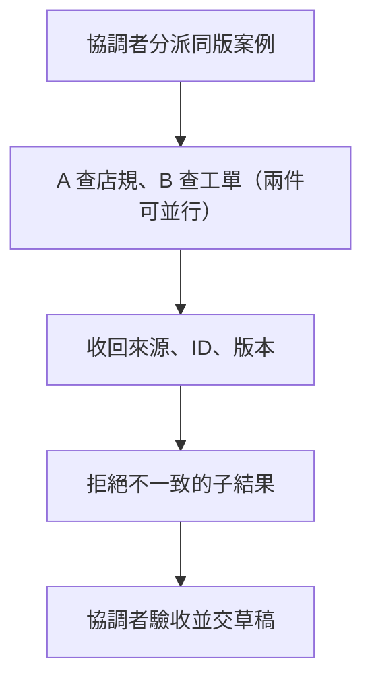

# 10 · 多 Agent、協調與 A2A：教學與案例

## 先抓住一個問題

**多找幾個 Agent，真的會更快、更可靠嗎？**

上一章共用工具與方法。這章只在工作能清楚拆分時討論分工；不預設一定要多 Agent。

## 把題目放到桌上

把 T-1042 分給 A 查 D14、B 查工單條件。A 回日期規則，B 回拆封未知。若兩人同寫主草稿，或只回 completed，總負責者仍無法確認答案。

這是虛構教材案例，不是法律建議、真實客服紀錄或執行證據。完整設定見[共同案例](../../../maps/course-story.md)。

讀這章時先想：手上已知什麼、還缺什麼、誰能做哪個動作？不要急著把每個英文名詞都背起來。

本課基礎資料：T-1042 r3；10/08 到 10/20 相差 12 天。D14 要求日期差不超過 14 天且未拆封；r3 的包裝狀態未知。原任務只讀與寫草稿。本章或題目若另述變體，只有明示條件改變。

## 名詞先換成人話

| 名詞 | 先用人話說 | 放進本例 |
| --- | --- | --- |
| Coordinator／總負責者 | 分派工作、整合與最後檢查的人或 Agent。 | 確認兩個來源指同一張工單與版本。 |
| Worker／受派工作者 | 負責一個有邊界的子題。 | A 查店規，B 查工單。 |
| Agent-as-tool | 主 Agent 把專家當一次可呼叫能力。 | 請專家回條款後，主 Agent 繼續處理。 |
| Handoff／交接 | 將部分互動或控制移交。 | 轉由另一個助理接續對話。 |
| A2A | 不同 Agent 系統交換訊息、任務與產物的協定。 | 跨系統交接，仍需驗收結果。 |

## 先找能獨立做的兩件事

查工單和查店規可以分開；依查到的條款才判斷是否需追問，則有前後依賴。增加 worker 不會消除依賴，還會增加交接、重複讀資料與整合時間。先畫工作關係，再決定是否並行。

## 委派至少要說清楚什麼

「幫我查一下」不夠。A 應知道查哪個店規版本、回哪些條款與位置；B 應知道只讀 T-1042、回 revision 和缺漏。回報同時包含已確認、未知與查過範圍，總負責者才有東西可檢查。

## Completed 不是驗收證據

Worker 說結束，只代表它停了。總負責者仍要確認案件 ID、來源版本、內容是否支持結論；如果 B 其實讀了 T-1043，就算文字完整也不能整合。讓 worker 交獨立筆記、由一人寫主草稿，可減少互相覆寫。

## 接工具式專家、交接和跨系統是不同選擇

Agent-as-tool 保留主 Agent 控制；handoff 交出一部分互動；A2A 處理不同系統怎麼互通。Agent Card 是能力宣告，不是能力已獲認證的證書。來源表所核對的 A2A released version 為 1.0.0，舊版範例仍需對照。

分工是否划算，最後看相同題目、總資源與成功標準的比較。不要把 worker 數量當能力進步的證據。

## 完整走一次

| 步驟 | 發生什麼 | 為什麼這樣處理 |
| --- | --- | --- |
| A 的委派 | 查 D14 的有效日期與完整退貨條件 | 交來源與位置，不自行核准。 |
| B 的委派 | 讀 T-1042 的 r3 與拆封欄 | 交未知，不把空值猜成未拆。 |
| 總負責者整合 | 核對同一任務與適用版本 | 結論仍是天數符合、拆封待問。 |
| 教學時間估算 | A 25 秒、B 30 秒、整合 8 秒 | 串行 63 秒；理想並行 38 秒，未含其他成本。 |

**這章要留下的產物：**兩份可回查的獨立產物，加一份由總負責者整合的草稿。上表時間只是合成算例，並非模型效能實測。

責任與來源比『三個都完成』更有用。分工可以降低等待，也可能因重複工作或整合錯誤而更差，因此需要對照而非信仰。

## 用流程核對責任

圖的重點是「收回來源、ID、版本」接到「拒絕不一致的子結果」時需要哪些證據。請對照上表，說明少了這一步會造成什麼誤判。

## 接著做什麼

先做[Q01／Q03／Q05](exercises/README.md)，保留自己的第一版答案。遇到疑難先看[設計取捨](design-notes.md)，需要才開提示。

Agent 越多，接觸的資料與工具也越多。下一章集中處理：哪些內容只是資料，哪些才有權授權操作？

## 來源與閱讀焦點

來源初查：2026-10-19；本次複核項目與日期見來源表。先讀來源中與本章名詞、責任及限制直接相關的段落；原始論文不要求第一輪讀完全部實驗。

- [S14 · Building effective agents](https://www.anthropic.com/engineering/building-effective-agents) — 第一方架構經驗；workflow 與 Agent 模式
- [S11 · A2A specification](https://a2a-protocol.org/latest/specification/) — 查證時 Latest Released Version 為 1.0.0；保留與舊版的差異
- [S20 · Google ADK agents](https://adk.dev/agents/) — 框架文件；Agent 類型與協作方式的跨 runtime 對照
- [S15 · Effective harnesses for long-running agents](https://www.anthropic.com/engineering/effective-harnesses-for-long-running-agents) — 第一方實驗；跨 session 增量工作與交接

進一步看[來源版本與更新政策](../../../references/sources.md)。
