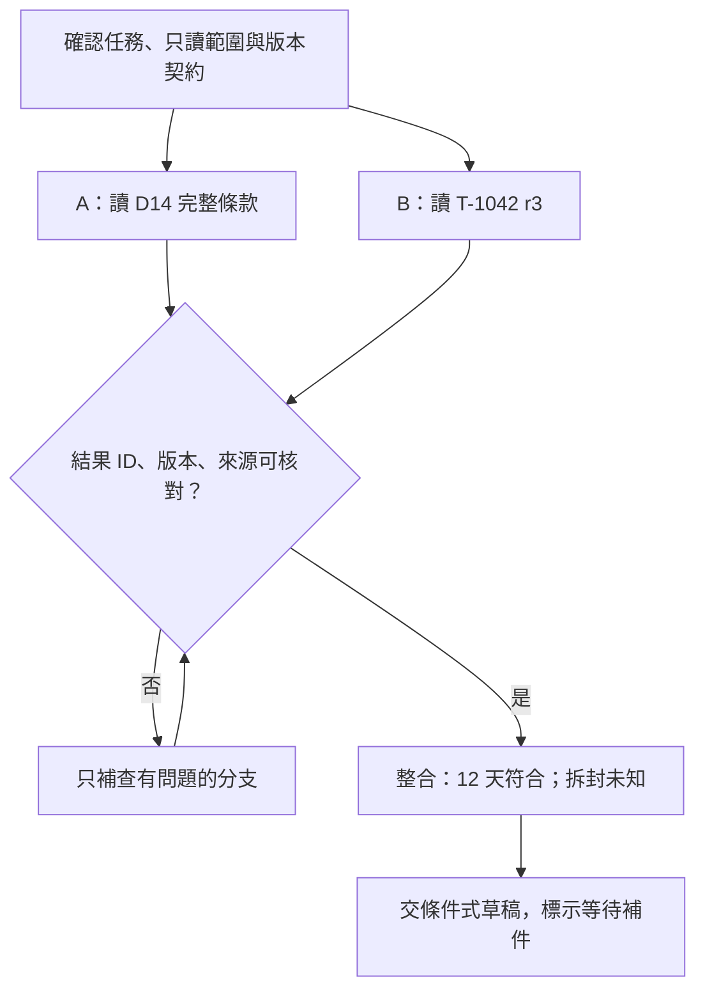

# 10 · 多 Agent、協調與 A2A：教學與案例

## 核心問題與讀法

**多找幾個 Agent，真的會更快、更可靠嗎？**

上一章解決「有哪些工具、方法怎麼共用」。本章問：有了這些能力，哪些工作值得拆給不同 Agent？先讀到「停止與交付」，再做 Q01、Q03、Q05，便能完成核心路線。後面的架構選擇與資源算例可再深挖。

這裡的 Agent 是可接收任務、讀取資料並產生結果的工作者；不預設它是另一個真人、另一家服務或另一個模型。多開一個 Agent，首先增加的是一份需要交代和驗收的工作。

## 桌上的任務與禁止動作

以下皆為合成教材案例，完整背景見[共同案例](../../../maps/course-story.md)。

- 工單 T-1042 r3：2026-10-08 購買，2026-10-20 申請，相差 12 天；拆封狀態未知。
- D14 自 2026-10-01 生效，取代舊 7 天規則 D07；要求日期差不超過 14 天，**且商品未拆封**。
- 使用者只要求判斷條件並寫草稿；沒有寄送、關單或退款授權。

我們讓 A 查政策、B 查工單，總負責者整合。成功是「交出可核對的條件式草稿」，不是多收到兩句 completed，也不是核准退貨。

## 名詞先換成人話

| 名詞 | 人話 | 本例的責任 |
| --- | --- | --- |
| Coordinator／總負責者 | 分工後仍要對最後結果負責的人或 Agent | 核對兩份產物，形成草稿 |
| Worker／受派工作者 | 只接一塊邊界清楚的工作 | A 查 D14；B 查 T-1042 |
| Dependency／依賴 | 後面的工作必須等前面交資料 | 判斷要等政策與工單 |
| Artifact／產物 | 能拿來檢查的實際內容 | 帶來源的條款筆記，不只是完成訊號 |
| Agent-as-tool | 請專家交結果，再回到主 Agent 繼續 | 主 Agent 收回 A 的條款筆記 |
| Handoff／交接 | 把一段互動的主導權交給另一助理 | 專門客服接續向使用者詢問 |
| A2A | 不同 Agent 系統交換任務與產物的協定 | 跨系統傳遞查證任務及結果 |

## 第一步：先畫依賴，才決定要幾個 Agent

A 查政策時，不需要 B 先讀完工單；B 讀工單也不必等 A。因此兩件事可以同時開始。可是「12 天是否符合這個政策」需要兩邊的結果，「寫草稿」又需要判斷結果。把草稿也提前分給 C，常會得到猜條件的文章，而非真正多省一段時間。

「可以並行」還要同時滿足三個條件：輸入已知、工作不必等待彼此、產物不會競爭同一個寫入位置。若 A、B 都要修改 draft.md，即使知識工作獨立，寫入仍會互相踩到。

## 第二步：把模糊委派改成驗收契約

差的委派是「你查政策，他查工單，趕快完成」。A 不知道查舊版還新版，B 不知道是否要順手關單，總負責者也不知道 completed 裡面藏了什麼。

下面是一份**教學用欄位設計**，不是任何協定強制的 schema：

| 委派欄位 | 給 A | 給 B |
| --- | --- | --- |
| task_id／子任務識別 | policy-check-01 | ticket-read-01 |
| 問題與目標 | 找申請日適用的完整退貨條件 | 只讀 T-1042 r3 的日期與包裝欄 |
| 已給輸入 | 申請日 2026-10-20；政策來源範圍 | 精確工單 ID；預期 revision r3 |
| 允許動作 | 讀指定政策；交政策筆記 | 讀指定工單；交工單筆記 |
| 禁止動作 | 不讀其他案件、不核准退貨 | 不改工單、不寄送、不關單 |
| 回報位置 | A 的獨立政策筆記 | B 的獨立工單筆記 |
| 驗收者 | 總負責者 | 總負責者 |
| 停止條件 | 找不到適用版或條款不完整就報缺漏 | ID／revision 不符就停止並回報 |

指定 r3 並非要求 worker 假裝舊資料永遠有效。若工具只能讀到 r4，B 應回「預期 r3，實際 r4」及查到的事實；總負責者再決定是否以新版本重做判斷。本章基礎案例仍是 r3、拆封未知。

## 第三步：回報證據，別只回工作狀態

A 可以回報「子任務已完成」，但還要交這些內容：

| 結果欄位 | A 的合成結果 | B 的合成結果 |
| --- | --- | --- |
| task_id | policy-check-01 | ticket-read-01 |
| 目標與版本 | D14，2026-10-01 生效 | T-1042 r3 |
| 已確認事實 | ≤14 天且未拆封；D07 已取代 | 購買 10/08、申請 10/20、拆封未知 |
| 來源位置 | D14 的有效日期、退貨條件段落 | T-1042 r3 的日期欄及包裝欄 |
| 查過範圍 | 指定政策的完整相關條款 | 指定工單；未查其他案件 |
| 未知或失敗 | 本身不能判定客戶是否拆封 | 包裝欄沒有資訊 |
| 實際副作用 | 無；只讀 | 無；只讀 |

這些「來源位置」是本題假資料的標籤，未假裝存在真實客服系統。未來實作才換成能打開或查詢的實際來源。

狀態回答「工作停在哪裡」，產物回答「到底查到了什麼」。兩者必須分開。Worker 可以正常結束並誠實交出「查無資料」；總負責者不能把它改寫成條件已符合。

## 第四步：整合不是把兩段話接起來

總負責者按以下順序驗收，不先挑文筆最順的一份：

1. **對目標：**B 的 ID 是否 T-1042？若回 T-1043，拒收該分支。
2. **對版本：**A 是否用 D14？B 是否 r3？版本變動須先釐清，不能默默混用。
3. **對完整性：**A 是否同時交天數與拆封條款？只交「14 天」不夠。
4. **對推論：**日期相減為 12；12≤14；拆封仍未知，因此無法完成全部資格判斷。
5. **對權限：**本輪只能交草稿。草稿不能寫「已寄出」或「已核准退款」。

每一步失敗時，只回到需要修正的分支。例如 A 漏拆封條款，請 A 補來源；不要要求 B 再讀五次相同 r3。若目前來源根本沒有拆封資訊，增加 Agent 數量也不會產生那項事實。

## 第五步：版本不一致與覆寫怎麼處理

假設整合前 B 通知「工單已有新版本」。有兩種合理任務契約：

- **固定快照分析：**使用者指定只分析 r3，報告明列「以 r3 為準，未代表現況」。
- **回答目前狀態：**總負責者重新確認最新資料，再更新判斷，並說明版本變更。

不能一邊標 r3、一邊偷用 r4 的欄位；也不能叫 worker 把新版本改回舊版來符合題目。

寫入產物也有版本問題。最簡單做法是 A、B 各寫自己的筆記，只有總負責者寫主草稿。如果確實要共同編輯，就先分區塊 ownership，提交時檢查基底版本。舊版修改遇到新版時要比較差異、整合後讀回，不以「最後存檔的人贏」當驗收。

## 停止與交付

本輪適合留下三份產物：政策筆記、工單筆記、整合草稿。草稿可以是：

> 依 D14，您的申請與購買相隔 12 天，符合天數條件。此規則亦要求商品未拆封，目前工單尚未記載，請協助確認包裝狀態。這是待審閱草稿，尚未寄送或執行其他業務操作。

總負責者把「草稿已完成」與「業務等待補件」各記一欄。沒有必要為了顯得自動化，讓 worker 持續重查或自行關單。

## 反例：兩個 completed 加在一起，錯誤反而更難找

合成事件：A 說 completed 卻只交舊版 D07；B 說 completed 卻讀 T-1043。兩人同時改主草稿，最後文字是「超過 7 天，已拒絕」。

錯誤不是單一模型算錯，而是三道缺口連在一起：委派沒綁版本與目標 → 回報沒有可查證來源 → 共寫主稿把錯誤覆蓋成流暢結論。

修正時先保留現有稿及事件作為診斷材料，暫停交付；要求 A 補 D14 完整條款，B 只補 T-1042 r3。總負責者核對後重寫條件式草稿。原本「已拒絕」也不能當真的業務狀態，需另看是否有實際操作證據。

## 常見疑問：多一位審查者，不就一定更可靠？

不一定。兩位 Agent 若讀相同缺漏 context、採相同錯誤假設，可能一起漏掉拆封條件。第二位只有在檢查方式不同、能看到獨立證據，且問題回到總負責者處理時才可能補盲點。可以讓審查者逐欄檢查「ID、版本、兩項條件、未知、權限」，比問「你同意嗎」更有用。

## 常見疑問：既然總負責者仍要檢查，分工省了什麼？

省的是可獨立完成的搜尋、閱讀與整理，不是省掉最終責任。若檢查兩份筆記比自己查資料還久，這次分工就不划算。應先找長而獨立的分支；不要為一個五秒鐘可回答的欄位，加上複雜交接。

## 深挖：agent-as-tool、handoff、A2A 怎麼選

| 選擇 | 適用情況 | 誰接著負責 | 代價與驗收 |
| --- | --- | --- | --- |
| Agent-as-tool | 需要專家的一份結果，主流程不換人 | 主 Agent 收回結果並整合 | 子結果須有格式、來源、失敗狀態 |
| Handoff | 專家需要接續多輪詢問與互動 | 接手者處理指定範圍，交接契約明定誰結案 | 帶足上下文與權限，避免雙方都等對方 |
| A2A | 不同 Agent 系統需要共同通訊方式 | 依應用委派契約；協定不替你承擔業務責任 | 相容性、身分與授權仍要驗證 |

這三者不是互斥的同一層選項。跨系統的專家可以透過 A2A 溝通，同時在主 Agent 看來像一次工具式委派。Agent Card 是能力宣告，不是能力已通過驗證的證書。來源表既有複核紀錄為 A2A released version 1.0.0；本節不新增特定 SDK 可用能力宣稱。

本例 A 查政策、B 查工單，最後仍由總負責者寫草稿，通常工具式委派已能表達責任；沒有因為三個 Agent 就必須導入跨系統協定。

## 深挖：時間變少，總資源未必變少

以下是合成算例，不是模型效能測試。A=25 秒、B=30 秒、整合=8 秒：

- 串行等待：25+30+8=63 秒。
- 理想並行等待：max(25,30)+8=38 秒，前提是兩支能同時開始、沒有額外排隊或返工。
- 分支運算工作量仍是 25+30=55 秒的工作，加上整合 8 秒；這不等於帳單，也不等於可直接換算的 token 用量。

若另有啟動 6 秒、排隊延誤 10 秒、A 返工 15 秒且落在關鍵路徑，觀察到的全程可能是 69 秒。不能把三個數字不分事件順序隨意相加；先在時間線標示它們在哪裡，這個 69 秒是假設上述額外工作都延後最終完成的情況。

另看一組合成資源：單 Agent 讀入 6,000 tokens；雙 worker 各讀 4,000、總負責者另讀 2,000，合計 10,000。即使全程更快，也可能消耗更多共用額度。這只是輸入量算例，未含輸出、快取或實際訂閱計費規則。

公平對照至少固定題目、資料版本、工具權限與**全隊總預算**；記錄從開始到可用產物的時間、所有 worker 資源、整合錯誤與未完成案。不要給每個 worker 各一份原本單 Agent 的預算後，再宣稱同成本提升。

## 接著做什麼

先做[Q01／Q03／Q05](exercises/README.md)，留下自己的第一版答案。選擇不只一種，重點是能說出依賴、產物、驗收者與失敗後下一步。

多 Agent 會接觸更多來源；委派中寫「只讀」也不代表工具真的無法越權。下一章接著問：文件中的指令能決定什麼，真正的執行限制放在哪裡？

## 來源與閱讀焦點

來源初查：2026-10-19；本次複核項目與日期見來源表。先讀來源中與本章名詞、責任及限制直接相關的段落；原始論文不要求第一輪讀完全部實驗。

- [S14 · Building effective agents](https://www.anthropic.com/engineering/building-effective-agents) — 第一方架構經驗；workflow 與 Agent 模式
- [S11 · A2A specification](https://a2a-protocol.org/latest/specification/) — 查證時 Latest Released Version 為 1.0.0；保留與舊版的差異
- [S20 · Google ADK agents](https://adk.dev/agents/) — 框架文件；Agent 類型與協作方式的跨 runtime 對照
- [S15 · Effective harnesses for long-running agents](https://www.anthropic.com/engineering/effective-harnesses-for-long-running-agents) — 第一方實驗；跨 session 增量工作與交接

進一步看[來源版本與更新政策](../../../references/sources.md)。
