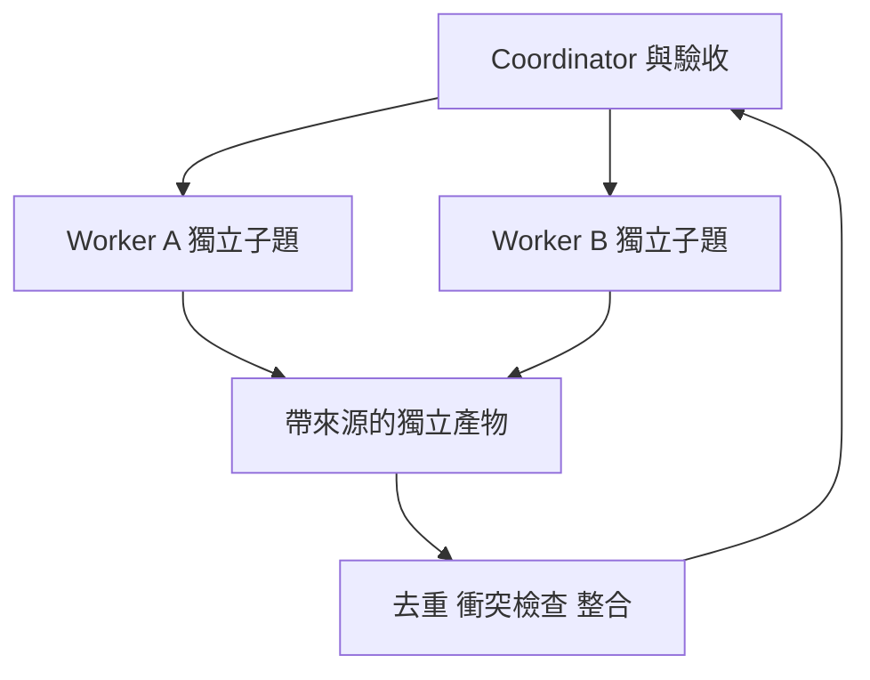

# 10 · 多 Agent、協調與 A2A

[章節入口](README.md) · [設計取捨](design-notes.md) · [練習](exercises/README.md)

## 本章完整案例

一個研究任務交給三個 worker。它們查到同一篇文章、編輯同一份筆記，最後 coordinator 只看到三個 completed，就向使用者宣稱已全面查證。

案例與練習軌跡為合成教學資料，沒有執行真實業務操作。

## 分工的前提

適合委派的工作有清楚輸入、獨立產物、可辨識的責任範圍與驗收。三個子題可獨立查證時，分工能隔離 context；若每一步都依賴另一個剛產生的結果，協調與等待可能吞掉收益。先看工作相依圖與實測 critical path，再談並行數量。

## Coordinator 與 worker 的契約

委派應指明誰負責哪個主題或檔案、可用工具、完成條件、結果格式與需回報的不確定性。Coordinator 整合證據並承擔最後驗收；worker 的 completed 只代表它結束工作。對共享檔案安排單一寫入者，或以獨立產物加整合步驟避免互相覆蓋。

## Agent-as-tool 與 handoff

把專家當工具時，主 Agent 保持控制並接收結果；handoff 則將某段互動或控制交給另一個 Agent。兩者影響誰持有對話、狀態與責任。交接至少包含目標、限制、已確認事項、待辦與證據位置，不能只寫「請繼續」。

## A2A 的位置

A2A 用於不同 Agent 系統之間的互通，涵蓋 Agent Card、訊息、task、artifact 與狀態等概念。查證時最新 released version 為 1.0.0，舊版教學不可不經核對直接套用。A2A 不要求接收方公開全部內部實作，也不替你證明能力宣稱或業務成果。

## 多 Agent 的隱藏代價

重複搜尋、重複上下文、版本衝突、配額競爭與整合延遲都會增加成本。可以用共享來源索引降低重複，但要保留各自任務狀態。量測成功率與總資源，不把更多 worker 當成自動更可靠。

## 用案例走一次

將三個 worker 改為分別負責版本、工具限制與恢復策略，各交帶來源的結果。共享主筆記只由 coordinator 寫入；整合時按來源去重並確認衝突。若 worker 沒有證據或引用不可用，結果標為未驗證而非沿用 completed。

## 精確機制圖

這張圖呈現本章需要討論的責任或狀態。實際功能、權限與可用性依所選 runtime、安裝版本及帳號驗證。

## 三個帶走的問題

- 能說明何時分工有收益與何時有害：你會怎麼向另一位工程師說明？
- 能設計委派、交接與結果驗收契約：需要哪些證據才能判斷？
- 如果模型的建議錯誤，哪一層應阻止錯誤擴大？

## 來源與閱讀焦點

查證基線：2026-10-19。先讀來源中與本章名詞、責任及限制直接相關的段落；原始論文不要求第一輪讀完全部實驗。

- [S14 · Building effective agents](https://www.anthropic.com/engineering/building-effective-agents) — 第一方架構經驗；workflow 與 Agent 模式
- [S11 · A2A specification](https://a2a-protocol.org/latest/specification/) — 查證時 Latest Released Version 為 1.0.0；保留與舊版的差異
- [S20 · Google ADK agents](https://adk.dev/agents/) — 框架文件；Agent 類型與協作方式的跨 runtime 對照
- [S15 · Effective harnesses for long-running agents](https://www.anthropic.com/engineering/effective-harnesses-for-long-running-agents) — 第一方實驗；跨 session 增量工作與交接

進一步看[來源版本與更新政策](../../../references/sources.md)。
