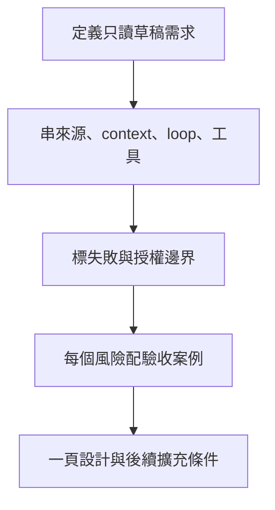

# 14 · 系統設計、案例整合與面試：教學與案例

## 先抓住一個問題

**面試時怎麼把整套 Agent 說成可執行、可驗收的設計？**

前 13 章逐一補齊責任、資料、執行、權限與驗證；本章練習把它們連成一個有邊界的系統。

## 把題目放到桌上

回到基礎任務：T-1042 r3，購買 10/08、申請 10/20，相差 12 天；有效 D14 要求 14 天內且未拆封，包裝未知。只要判斷與回覆草稿，沒有寄送、關單或退款授權。

這是虛構教材案例，不是法律建議、真實客服紀錄或執行證據。完整設定見[共同案例](../../../maps/course-story.md)。

讀這章時先想：手上已知什麼、還缺什麼、誰能做哪個動作？不要急著把每個英文名詞都背起來。

本課基礎資料：T-1042 r3；10/08 到 10/20 相差 12 天。D14 要求日期差不超過 14 天且未拆封；r3 的包裝狀態未知。原任務只讀與寫草稿。本章或題目若另述變體，只有明示條件改變。

## 名詞先換成人話

| 名詞 | 先用人話說 | 放進本例 |
| --- | --- | --- |
| System boundary／系統邊界 | 先講這個系統負責到哪一步 | 輸出草稿，不執行退款 |
| Invariant／不變條件 | 任何流程都不能破壞的規則 | 缺證不說已未拆封；未授權不寫入 |
| SLO／服務目標 | 想達到且可以量測的服務表現 | 提出完成時間目標，之後再測 |
| Rollout／逐步上線 | 先小範圍驗證再擴大 | 從假工單只讀試跑開始 |
| ADR／架構決策紀錄 | 保存選擇、理由與代價 | 先單一 Agent，何時才拆分工 |

### 開場先說使用者要的結果
「我要做客服 Agent」太寬。可改成：「讀一筆工單與當時有效店規，產出有根據的條件判斷及草稿；缺資料就問，不自行寄送或退款。」面試官因此能判斷後面的設計是否必要。

### 用一條完整路徑解釋架構
輸入先驗證工單 ID 與任務範圍；讀取工具取得 r3 和 D14；context 保留日期、未拆封未知及只讀限制；loop 算出 12 天、辨識缺漏後停止；輸出附來源的條件式草稿。state 保存來源版本與本輪結果，避免下一輪把未知當成已確認。工具執行層限制寫入，即使模型要求關單也不能通過。

### 在路徑上標出失敗與驗收
若拿到 D07，先修正版本；若工單變 r4，重新確認；若讀取失敗，不編造資料。用缺條件、過期來源、越權和恢復案例測試。之後若另核准關單，才增加精確目標核准、版本檢查、操作 ID、恢復與讀回。這是擴充範圍，不能偷偷混入基礎架構。

### 用取捨回答為什麼
先用單一 Agent 和少量工具，因為本例資料量小、流程短；不用多 Agent 也能完成。資料量與權限複雜度增加後，再引入檢索與分工。提出 SLO 時說是待測目標；履歷則分開寫已設計、已實作、已測試，不能把本課程的抽象規格當上線成果。

### 把原則轉移到新領域
換成程式庫維護：工單變 issue，店規變 repo 約定，草稿變修補提案，實際修改仍需測試。換成研究助理：工單變研究問題，來源需版本與引用，輸出結論仍保留不確定性。責任分工可移用；每個領域的授權、副作用與驗收要重新定義。

## 完整走一次

| 步驟 | 發生什麼 | 為什麼這樣處理 |
| --- | --- | --- |
| 定範圍 | 只讀判斷與草稿 | 限制設計膨脹 |
| 串流程 | r3＋D14 → 12 天＋條件未知 → 草稿 | 讓輸入和結果可追溯 |
| 標失敗 | 舊版本、缺資料、越權、斷線 | 設計可被反駁和測試 |
| 定驗收 | 每項風險對應案例與觀測 | 不用流暢文筆替代證據 |

**這章要留下的產物：**一頁系統設計：需求、資料路徑、責任、失敗處理、驗收與擴充條件。

面試不是背完全部術語，而是證明能把一個需求拆成有理由、能檢查的工程決策。

## 用流程核對責任

圖的重點是「標失敗與授權邊界」接到「每個風險配驗收案例」時需要哪些證據。請對照上表，說明少了這一步會造成什麼誤判。

## 接著做什麼

先做[Q01／Q03／Q05](exercises/README.md)，保留自己的第一版答案。遇到疑難先看[設計取捨](design-notes.md)，需要才開提示。

後續第 15–28 天可依進階路線選一個 lab 另行實作；先驗收單一路徑，再擴充模型與工具。

## 來源與閱讀焦點

來源初查：2026-10-19；本次複核項目與日期見來源表。先讀來源中與本章名詞、責任及限制直接相關的段落；原始論文不要求第一輪讀完全部實驗。

- [S01 · Agent runtimes](https://developers.openai.com/api/docs/guides/agents) — 官方產品文件；不同 runtime 的責任與資源生命週期
- [S14 · Building effective agents](https://www.anthropic.com/engineering/building-effective-agents) — 第一方架構經驗；workflow 與 Agent 模式
- [S16 · Demystifying evals for AI agents](https://www.anthropic.com/engineering/demystifying-evals-for-ai-agents) — 第一方工程經驗；task、trial、grader、outcome、trace
- [S17 · OWASP Agentic Applications 2026](https://genai.owasp.org/resource/owasp-top-10-for-agentic-applications-for-2026/) — 社群風險框架；輔助 threat modeling，不是產品安全認證

進一步看[來源版本與更新政策](../../../references/sources.md)。
