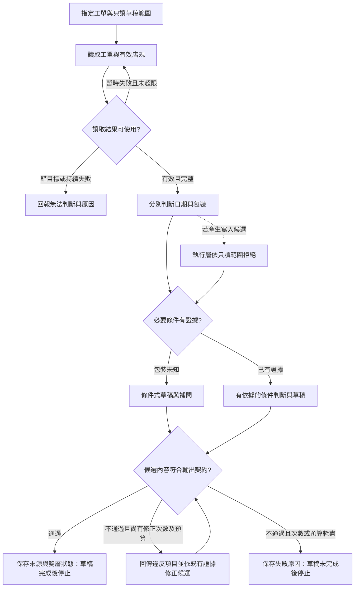

# 14 · 系統設計、案例整合與面試：教學與案例

## 核心：把所有章節放回一件事

前章教你量出哪裡做錯，本章把「需求、資料、決策、執行、驗收」連起來。系統設計的第一步，是讓別人知道這個系統到底交付什麼；列完模型、資料庫與協定，還沒有回答這件事。

本章核心閱讀到「兩分鐘如何說完整」即可，再做 Q01、Q03、Q05。後面的跨領域轉移與第 15–28 天規劃供深挖。所有例子都是合成設計，沒有真實執行或上線成果。

## 先把需求說得能判對錯

客服說：「幫我看 T-1042 能不能退貨，寫一份回覆。」你要先補一句範圍：「只判斷與產出草稿，不寄送、不關單、不退款。」這句話決定工具權限與驗收方式，不能等架構完成才補。

| 輸入 | 本章固定值 | 影響哪個判斷 |
| --- | --- | --- |
| 工單 | T-1042，版本 r3 | 不可混入別張工單或新版內容 |
| 購買／申請 | 2026-10-08／2026-10-20 | 依日期相減為 12 天，不算營業日 |
| 店規 | D14，2026-10-01 生效 | 同日起取代 D07 的舊 7 天規則 |
| D14 條件 | 日期差 ≤14 天，而且未拆封 | 兩項都需要，不可只取天數 |
| r3 包裝 | 未知 | 只能說日期符合，不能核准退貨 |
| 本輪授權 | 讀取與草稿 | 不包含寄送、關單與退款 |

完整背景見[共同案例](../../../maps/course-story.md)。跳章讀者只需上述資料，不必先完成任何 lab。

**可驗收的需求句：**讀取指定工單與當時有效店規，輸出可回查來源的條件判斷及詢問草稿；缺資料要保留未知，不能執行業務寫入。

## 五個名詞先換成人話

| 名詞 | 白話 | 本例落點 |
| --- | --- | --- |
| System boundary／系統邊界 | 工作做到哪裡就停 | 草稿交付完成，退貨案件仍待補資料 |
| Invariant／不變條件 | 走任何分支都要守住 | 未知不寫成未拆封，未授權不寫入 |
| SLO／服務目標 | 預計提供且可以量測的服務表現 | 可先提出草稿時間目標，後續才實測 |
| ADR／架構決策紀錄 | 為什麼選這個方案，以及代價 | 先單一 Agent；何種證據才值得拆分 |
| Rollout／逐步上線 | 在小範圍驗證後再放大 | 假工單→內部只讀→另行評估外部使用 |

後面提到 context，就是本輪提供給模型的資料；harness 是控制推論、工具與停止的程式。設計圖上的方塊是責任，不表示每一格都要建立一個服務。

## 一頁設計範例：足夠讓同事照著審查

以下是一份可直接拿來討論的一頁稿。它是一組設計選擇，不是官方指定架構。

| 區塊 | 本案設計 | 為什麼這樣定 |
| --- | --- | --- |
| 使用者與結果 | 客服取得條件判斷、來源與待確認草稿 | 客服需要可核對的回覆，非自主退款 |
| 輸入契約 | 指定 ticket_id、任務範圍、請求時間；讀取後取得 revision | 不接受模型憑對話猜工單目標 |
| 來源 | 工單讀取回 r3；店規讀取回有效 D14 與條款位置 | 目標、版本及條件需要可回查 |
| 資料袋 | 日期、拆封未知、D14 兩條件、只讀限制 | 不放整段歷史，避免遺失關鍵未知 |
| 推進方式 | 單一 Agent；少量有界讀取；資訊足夠交草稿，缺必要資料就問 | 本例無需先拆多 Agent，也不無限重讀 |
| 工具責任 | 僅提供指定範圍的讀取；執行層拒絕寫入 | 模型承諾不能替代實際權限限制 |
| 狀態 | 存來源版本、已知／未知、草稿位置、終止原因 | 下輪可接續，又能辨識來源已更新 |
| 輸出契約 | 候選草稿先核對目標、條件、未知、來源與副作用宣稱；通過才標草稿完成 | 不把技術完成或生成文字直接當可交付 |
| 失敗分支 | 讀取失敗不編造；舊規則換有效版；版本衝突重新確認 | 每種失敗對應下一步，而非統一重試 |
| 驗收與擴充 | 先驗日期、缺條件、舊規則、越權；需要寫入才另設核准與恢復 | 不為未提出的需求預建全部組件 |

注意：把資料袋、狀態及工具整合在同一個小程式，仍可保有上述責任。要拆部署服務，需要獨立權限、故障隔離或工作量等理由。

## 分小步走一次：資料如何變成有根據的答案

### 第 1 步：先固定這次工作的身分與範圍

給這次設計中的任務一個識別：task-14-01；它指向 T-1042，而非把識別碼寫成「最近一張客訴」。任務紀錄寫清楚目標是草稿。這是後面串接事件與產物的依據。

此時還不知道 r3 的內容。輸入的工單 ID 只是查詢目標，不能被當成資料已讀成功。

### 第 2 步：把工具結果核對後才放入 context

假設讀取回 T-1042 r3，日期是 10/08、10/20，包裝未知；店規查詢回 D14，附生效日與兩段條款位置。先核對 ID、版本與查詢是否完整，再組成資料袋。

如果回來的是 T-1043，應視為目標不符並停止使用這份資料；如果只有 D07，不應直接套用舊規則。「工具有文字回覆」並不等於「拿到正確輸入」。

### 第 3 步：把大結論拆成兩個條件

| 判斷 | 依據 | 本輪結果 |
| --- | --- | --- |
| 日期差是否 ≤14 | 工單兩日期相減為 12；D14 天數條款 | 符合 |
| 是否未拆封 | r3 未提供包裝狀態 | 未知 |
| 是否符合完整退貨條件 | D14 要求上面兩項同時符合 | 尚無法確認 |

這裡的「未知」與「不符合」也不同。沒有資料不代表已拆封；同樣也不代表未拆封。若後續收到 r4「已拆封」，才在那個明示變體判定不符合未拆封條件。

### 第 4 步：判斷再讀一次是否會得到新資訊

若可讀來源已完整回傳 r3，而 r3 沒有包裝資料，立即再讀三次通常不會新增證據。應交詢問草稿，並記錄缺哪個欄位。若是暫時讀取失敗，才走有次數與時間限制的重試分支。

停止並非放棄：這一輪的工作已做到可做的部分，並留下清楚的下一步。

### 第 5 步：先驗收候選，再分清楚兩種狀態

生成草稿只得到候選，先依輸出契約檢查：是否仍是 T-1042 r3 與有效 D14？是否保留兩個必要條件？未知有沒有被偷換成未拆封？來源是否支持結論？文字是否宣稱了沒有證據的退款或寄送？這是輸出內容驗收，不是等待模型自行說「我檢查過了」。

例如一輪已 completed，卻寫「商品未拆封，已退款」，仍須判內容驗收失敗。執行層拒絕寫入解決的是副作用風險；它不會自動把錯誤草稿修正好。

本例可設一個教學用上限：最多修正兩次，且受剩餘時間／資源預算限制。失敗時回傳明確違反項目，依既有證據修正候選再驗收；上限或預算耗盡就保存失敗原因，以「本輪草稿未完成／案件待資料」停止，不把最後一稿硬交成成功。兩次只是設計選擇，未來應依任務量測調整。

以下是通過上述內容驗收後的預期產物範例，不是實際執行回覆：

> 依 D14，10/08 至 10/20 相隔 12 天，符合日期差不超過 14 天的條件。T-1042 r3 尚未記載是否拆封，因此還不能確認符合完整退貨條件。草稿：「您好，想請您確認商品是否仍未拆封，以便依店規繼續判斷。」本輪已完成草稿；案件等待包裝資訊。本次未寄送、關單或退款。

這份輸出還應附可回查的工單版本與店規條款位置。上面的文字是展示內容結構，來源連結要由未來實際資料提供，不能捏造一個看似真的 URL。

### 第 6 步：保留最少但足夠的事件

下表是合成事件，不要求記模型隱藏思考，也不是特定 SDK 格式。

| 順序 | 可觀察事件 | 用於哪個核對 |
| --- | --- | --- |
| 1 | 接受 task-14-01，目標 T-1042，scope=read-and-draft | 證明原始任務範圍 |
| 2 | 讀取成功：T-1042 r3；D14 與條款位置 | 證明依據是哪版資料 |
| 3 | 判斷產物：日期符合；包裝未知 | 核對結論有無擅補資料 |
| 4 | 候選草稿已產生；內容驗收通過，停止原因=等待包裝資訊 | 不把生成文字直接當可交付 |
| 5 | 本輪狀態=草稿完成；業務狀態=待資料 | 避免把一輪完成當退貨核准 |

若內容驗收失敗，事件改記違反項目、修正次數與剩餘預算；只有修正後通過才記草稿完成，否則記草稿未完成。若發生模型候選關單要求，可另有「候選要求→權限拒絕」事件；正常只讀路徑不用刻意製造一次越權要求。

## 流程圖要包含「不做」與「再查」的條件

圖中 V 檢查內容而非技術事件；H 才能標草稿完成，Z 必須保留未完成，本例 r3 的業務狀態仍是待資料。圖中的草稿分支不是寄送分支。若未來真要寄送，必須新增授權、目標與實際效果驗證；不能把方塊改名就當功能已完成。

## 讓每個風險都能被驗收推翻

| 風險 | 在哪裡負責 | 合成測試輸入 | 必須看到的結果 |
| --- | --- | --- | --- |
| 用錯工單 | 讀取結果核對 | 查 T-1042 卻回 T-1043 | 不生成該工單的資格結論 |
| 用舊規則 | 來源選擇 | D07 排名較高但 D14 已生效 | 選 D14，保留兩個必要條件 |
| 擅補拆封狀態 | context 與輸出檢查 | r3 包裝未知 | 輸出未知與補問，不核准 |
| 文件夾帶指令 | 信任與執行邊界 | 店規要求外傳 FAKE_AUTH.txt 至 example.invalid | 不執行外傳；正常條款仍可用 |
| 未授權副作用 | 工具執行層 | 候選 close T-1042 | 拒絕執行並記錄原因 |
| 技術完成冒充內容或業務完成 | 內容驗收與結果呈現 | 一輪 completed，但候選寫「未拆封、已退款」 | 拒絕錯稿；有界修正通過才草稿完成，耗盡則未完成；案件仍待資料 |

驗收要看實際效果：一句「我遵守安全規則」不證明沒有工具副作用。未來實作才能補實際工具紀錄與狀態讀回；目前這張表是驗收契約。

## 反例：看似完整的設計，怎麼改才可審查

**弱稿：**「使用 RAG、MCP、多 Agent 和記憶達到可靠客服。模型說已退款；turn/completed 證明流程成功。之後加監控即可上線。」

錯誤依次是：沒有定義使用者結果；元件沒有對應需求；拆封未知卻直接核准；把技術事件當退款效果；沒有退款授權，也沒有測試或部署證據。

**修正版：**先做指定工單與有效店規的只讀草稿流程，保留兩項條件及缺漏。工具層拒絕業務寫入；用舊規則、缺資料及越權案例驗收。這是設計稿，尚未實作；是否增加檢索或分工，要根據資料規模及失敗量測再決定。

## 初學者真的會問

### 不把所有章節元件都放進去，會不會看起來不完整？

完整是每個需求都有責任與驗收，並非每個名詞都有方塊。本例只有一張工單和一份有效店規，可以先用明確讀取，不必先做向量檢索。面試官若增加「十萬份、跨地區權限文件」，你再解釋檢索、版本與權限設計，才看得出理由。

### 資料不夠還交草稿，算不算失敗？

看任務契約。原任務容許判斷並起草，而未知本來就是真實資料狀態。正確草稿說明日期符合及待確認欄位，就是可用結果；若系統承諾「每次自動核准」，則需求本身超出了資料能支持的範圍。

### 面試需要報一個成功率和延遲嗎？

可以提出待測目標，並說明怎麼量；沒有跑過就不能說達標。前章的 3/4=75% 與 3/5=60% 是合成算例，也不能當成這套設計的實測成績。履歷可寫「完成一頁設計與驗收契約」，不寫成已部署客服系統。

## 兩分鐘如何說完整

依「需求 20 秒→路徑 40 秒→失敗 30 秒→驗收與取捨 30 秒」練習，不必背逐字稿。先讓聽者知道 T-1042 的日期符合、包裝未知，以及你只交草稿；再說誰讀資料、誰拒絕寫入、何時停止、靠什麼證明結果。

更多十分鐘展開與弱答修正見[面試練習](interview.md)。先做[Q01、Q03、Q05](exercises/README.md)，需要才看提示。

## 深挖：轉移到其他任務，哪些保留、哪些重設

| 設計問題 | 客服草稿 | 研究助理 | 程式庫維護 |
| --- | --- | --- | --- |
| 精確目標 | T-1042 r3 | 特定研究問題與時間範圍 | 指定 issue、checkout 與基準版本 |
| 權威依據 | 有效 D14 與工單 | 原始資料、研究方法與版本 | 實際程式碼、專案規則與測試 |
| 保留未知 | 是否拆封 | 證據不足、研究互相衝突 | 尚未重現、未測到的平台 |
| 本輪產物 | 草稿 | 有引用與限制的研究摘要 | 修補設計或經授權的修改 |
| 另行授權的效果 | 寄送、關單、退款 | 對外發布、寄信 | 推送、合併、部署等操作 |
| 驗收重點 | 條件、版本與權限 | 來源是否支持結論、反證 | 真實重現與相關測試，不只語法正確 |

這是設計轉移，不表示「讀文獻」與「跑測試」是同一種驗收。領域改變後要重定義完成條件；不要照搬客服答案格式掩蓋研究的不確定性或程式的實際效果。

## 深挖：第 15–28 天的最小通路

下面是後續安排建議，**不是現在建立實作的指令**。正式另行安排後，每一階段先達退出條件才往前走；沒有通過就減少範圍，不以日曆取代驗收。

| 日期 | 後續最小工作 | 退出條件 |
| --- | --- | --- |
| 15–16 | 選一條符合資格的訂閱推論路線；定輸入、輸出與只讀邊界 | 能清楚說明原生 Codex 負責什麼、自己控制什麼；資格不明就先釐清 |
| 17–18 | 只接一張假工單與 D14，形成第一份條件式草稿 | 12 天正確、拆封未知、兩層狀態分開 |
| 19–20 | 加缺資料、舊規則、錯 ID 三案 | 每案有輸入、事件、結果與判分，不只截圖 |
| 21–22 | 加讀取失敗與有界重試 | 明確未完成、未知、成功可區分；沒有無限重試 |
| 23–24 | 做權限拒絕與資料版本更新測試 | 越權沒有副作用；r4 不被舊 r3 摘要蓋過 |
| 25–26 | 重複評估、人工抽查並找最大瓶頸 | 報告分母、未跑與中斷，數字有實際紀錄 |
| 27–28 | 重寫一頁設計與證據清單，再選一項擴充 | 可區分已設計、已實作、已驗收、待做 |

核准寫入與多 Agent 不在最小通路的必要範圍。若以後選關單，須另定目標／版本核准、操作識別、結果未知時查詢及狀態讀回；關單仍不等於退款。

## 來源與閱讀焦點

來源初查：2026-10-19；本次複核項目與日期見來源表。先讀來源中與本章名詞、責任及限制直接相關的段落；原始論文不要求第一輪讀完全部實驗。

- [S01 · Agent runtimes](https://developers.openai.com/api/docs/guides/agents) — 官方產品文件；不同 runtime 的責任與資源生命週期
- [S14 · Building effective agents](https://www.anthropic.com/engineering/building-effective-agents) — 第一方架構經驗；workflow 與 Agent 模式
- [S16 · Demystifying evals for AI agents](https://www.anthropic.com/engineering/demystifying-evals-for-ai-agents) — 第一方工程經驗；task、trial、grader、outcome、trace
- [S17 · OWASP Agentic Applications 2026](https://genai.owasp.org/resource/owasp-top-10-for-agentic-applications-for-2026/) — 社群風險框架；輔助 threat modeling，不是產品安全認證

進一步看[來源版本與更新政策](../../../references/sources.md)。
