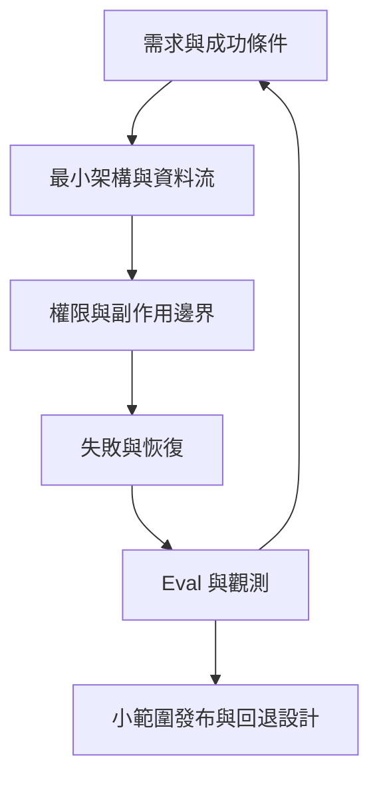

# 14 · 系統設計、案例整合與面試

[章節入口](README.md) · [設計取捨](design-notes.md) · [練習](exercises/README.md)

## 本章完整案例

三選一：A 文件研究助理需附最新來源；B 程式維護助理先提修改建議，再經授權寫入；C 工單助理讀取案件、提出處理建議，核准後關閉。每個案例都以本機／教學資料為前提。

案例與練習軌跡為合成教學資料，沒有執行真實業務操作。

## 先澄清需求與限制

先問使用者、輸入來源、允許行動、資料權限、成功條件與時間／資源預算。把模糊的「幫我處理」拆成可驗收結果，例如研究答案每項可引用、維護修改通過指定檢查、工單狀態讀回一致。需要上線的產品還要定義服務目標、監測、失敗處理與回退。

## 畫出最小架構

由任務入口、授權、context、harness、工具、狀態與驗收組成。模型連線可選自己的訂閱 OAuth＋Responses，或整合 Codex；兩者改變誰承擔 loop、history 與工具責任。選擇要對應產品與學習目標，不能只以最新名稱決定。

## 三種案例的關鍵差異

研究助理重點是檢索、版本、引用與未知事項；程式維護助理要理解實際 checkout、限制修改範圍並驗證產物；工單助理要綁定精確目標、核准、冪等操作與讀回。共用 harness 元件可以重用，驗收器與業務權限仍需依案例設計。

## 系統設計面試的推進順序

先陳述假設，再畫資料流，指出最容易出錯的邊界，提出簡單方案與替代條件。面試官問擴展時，再談 queue、並行、隔離與多租戶；不要在尚無量測時宣稱需要微服務、多 Agent 或向量庫。服務目標也要有分母，例如可完成任務中成功率與特定範圍的延遲。

## 讓證據比敘事更具體

區分設計過、實作過、測試過、部署過與實際量測過。這份首版教材是概念與設計練習，不能作為已完成生產 Agent 的履歷證據。面試時可以展示設計稿、題目、取捨與未來驗收規格；真正實作後再補執行紀錄與限制。

## 用案例走一次

選工單案例：先限制只讀，讓模型整理建議與證據；核准卡包含目標 ID、狀態與修改內容；受限工具確認前置條件後關閉，再讀回狀態。逾時先查 operation ID，取消則停止新工作並查在途結果。發布設計包含人工處理與退回只讀模式。

## 精確機制圖

這張圖呈現本章需要討論的責任或狀態。實際功能、權限與可用性依所選 runtime、安裝版本及帳號驗證。

## 三個帶走的問題

- 能從需求走到可驗收的 Agent 系統設計：你會怎麼向另一位工程師說明？
- 能用誠實證據與具體取捨回答面試追問：需要哪些證據才能判斷？
- 如果模型的建議錯誤，哪一層應阻止錯誤擴大？

## 來源與閱讀焦點

查證基線：2026-10-19。先讀來源中與本章名詞、責任及限制直接相關的段落；原始論文不要求第一輪讀完全部實驗。

- [S01 · Agent runtimes](https://developers.openai.com/api/docs/guides/agents) — 官方產品文件；不同 runtime 的責任與資源生命週期
- [S14 · Building effective agents](https://www.anthropic.com/engineering/building-effective-agents) — 第一方架構經驗；workflow 與 Agent 模式
- [S16 · Demystifying evals for AI agents](https://www.anthropic.com/engineering/demystifying-evals-for-ai-agents) — 第一方工程經驗；task、trial、grader、outcome、trace
- [S17 · OWASP Agentic Applications 2026](https://genai.owasp.org/resource/owasp-top-10-for-agentic-applications-for-2026/) — 社群風險框架；輔助 threat modeling，不是產品安全認證

進一步看[來源版本與更新政策](../../../references/sources.md)。
